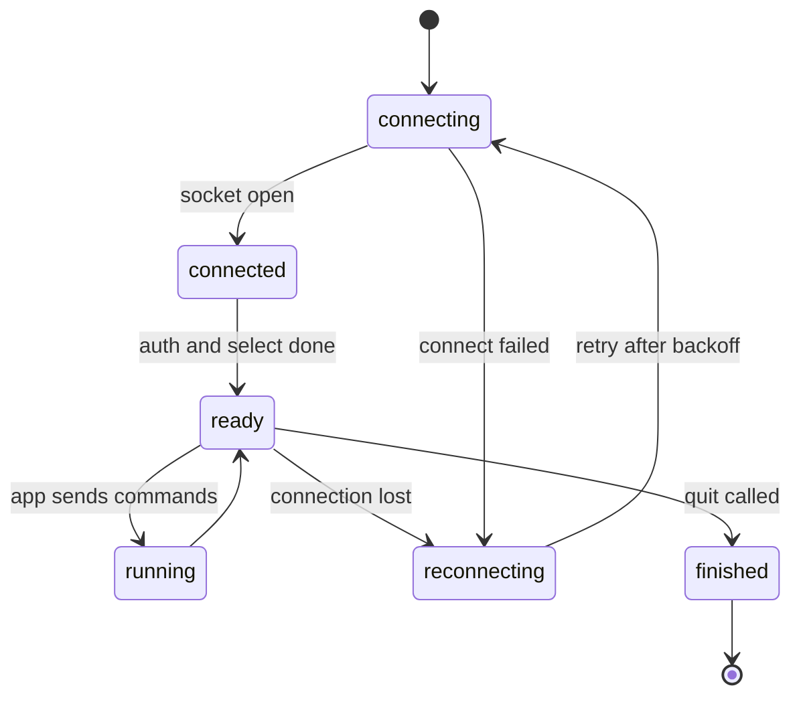

# Connecting to Redis From Node — Part 1

Most Node projects add Redis in about ten minutes. Install a client, call
`set`, call `get`, ship it. That code usually works on a laptop and then
behaves strangely in production: requests hang when Redis is slow, the whole
process crashes when Redis restarts, and one innocent-looking command freezes
every other user for two seconds.

This file is about the ten minutes you skipped. Part 1 covers what Redis
actually is, why its single thread decides everything else, and how to hold a
connection that survives a bad night. Part 2 covers round trips, the commands
that are dangerous in production, key naming, and what to watch.

> **➡️ Continued in [Part 2](./01-connecting-to-redis-part-2.md)**

> **📌 In one line:** Redis runs your commands one at a time in a single
> thread, so everything else in this folder follows from two rules — keep each
> command small, and keep round trips rare.

## Table of Contents

1. [What Redis Actually Is](#what-redis-actually-is)
2. [Why Single-Threaded Changes How You Use It](#why-single-threaded-changes-how-you-use-it)
3. [Choosing a Client](#choosing-a-client)
4. [One Client for the Whole Process](#one-client-for-the-whole-process)
5. [The Connection Lifecycle](#the-connection-lifecycle)
6. [Redis Is Down — Your App Must Not Be](#redis-is-down--your-app-must-not-be)
7. [Command Timeouts](#command-timeouts)
8. [Advanced: When You Do Need a Second Connection](#advanced-when-you-do-need-a-second-connection)
9. [Common Mistakes](#common-mistakes)
10. [Questions to Test Yourself](#questions-to-test-yourself)
11. [Related](#related)

---

## What Redis Actually Is

Think of a corner shop with exactly one person behind the counter. That person
is extremely fast. They know where every item is without looking. But they
serve one customer at a time, start to finish, and everybody else stands in
line. If one customer asks them to count every item in the storeroom, the queue
stops moving until the counting is done.

That is Redis.

More precisely: **Redis is a single-threaded, in-memory data structure server.**
Break that phrase into three parts.

- **In-memory** — all your data lives in RAM (random access memory), not on
  disk. That is why a read takes microseconds instead of milliseconds. It is
  also why memory is the limit on everything you do, which is the subject of
  [05-memory-and-operations-part-1.md](./05-memory-and-operations-part-1.md).
- **Data structure server** — not just string keys and string values. Redis
  holds hashes, lists, sets and sorted sets, and gives you operations on them.
  That is the subject of
  [02-choosing-data-structures-part-1.md](./02-choosing-data-structures-part-1.md).
- **Single-threaded** — one command runs at a time. This one deserves its own
  section, because it changes how you write every line of Redis code.

> **💡 Tip:** "single-threaded" describes *command execution*. In recent
> versions Redis uses extra threads for background work such as freeing large
> objects and handling network I/O. The part that matters to you — running your
> commands — is still strictly one at a time.

## Why Single-Threaded Changes How You Use It

Because commands run one at a time, **a slow command does not slow down one
client. It blocks every client.**

This is the single most useful fact in this folder. It explains why `KEYS` is
banned, why a long Lua script is dangerous, and why you should never fetch a
hash with a million fields.

You already understand this shape. Node's event loop has the same property: one
long synchronous function blocks every request in the process, not just the one
that called it. If that idea is not solid yet, read
[../../typescript-fundamentals/event-loop/event-loop.md](../../typescript-fundamentals/event-loop/event-loop.md)
first — Redis is the same lesson on a different machine.

```text
  Node process (one event loop)        Redis server (one command thread)
  ─────────────────────────────        ────────────────────────────────
  req A ─┐                             client A ─┐
  req B ─┼─► [ one JS stack ]          client B ─┼─► [ one command ]
  req C ─┘                             client C ─┘

  A slow loop in req B                 A slow KEYS from client B
  stalls A and C too.                  stalls A and C too.
```

The practical rule that falls out of this:

> **📌 Remember:** every Redis command you write should be O(1), or bounded to a
> small and known number of elements. If a command's cost grows with how much
> data a customer happens to have, it will eventually stop the server for
> everybody.

## Choosing a Client

Two clients cover almost every Node project. Both are good. Pick one and use it
everywhere in the codebase.

| | `ioredis` | `node-redis` |
|---|---|---|
| Maintained by | Community, very widely deployed | The official Redis client |
| API style | Promise-based, one method per command | Promise-based, one method per command |
| Cluster and Sentinel | Built in, mature | Supported |
| Lua helper | `defineCommand` gives you a typed method | A scripts option, or `EVALSHA` directly |
| Ecosystem pull | BullMQ, the job queue used in folder 03, requires it | Fine for cache and lock work |
| Newer protocol features | Supported in recent versions | Strong RESP3 support |

**Practical advice:** if you plan to use BullMQ for background jobs — and this
track does, in [../03-background-jobs/](../03-background-jobs/) — choose
`ioredis`, because it will already be in your dependency tree. Examples in this
folder use `ioredis`. Every idea translates directly to `node-redis`; only the
constructor options differ.

On AdonisJS, `@adonisjs/redis` wraps `ioredis` and reads its settings from
`config/redis.ts`, so you get the shared-client behaviour below for free. On
Express you create the client yourself in a module and import it where needed.

## One Client for the Whole Process

Here is a bug that looks like tidiness and is actually a leak.

```ts
// ❌ BROKEN - a new TCP connection, handshake and auth on every single request
export async function getCompany(companyId: number): Promise<Company | null> {
  const redis = new Redis(process.env.REDIS_URL!)   // connect
  const cached = await redis.get(`company:${companyId}`)
  await redis.quit()                                 // disconnect
  return cached ? (JSON.parse(cached) as Company) : null
}
```

Every call opens a socket, performs a TCP handshake, sends `AUTH`, sends one
command, then tears it all down. Under load you run out of file descriptors on
your side and hit `maxclients` on the Redis side. The handshake alone often
costs more than the command it was opened for.

```ts
// ✅ FIXED - one long-lived client, created at startup, imported everywhere
// src/services/redis.ts
import Redis from 'ioredis'

export const redis = new Redis(process.env.REDIS_URL!, {
  // Fail a command rather than queue it forever while disconnected.
  maxRetriesPerRequest: 2,
  connectTimeout: 5_000,
  // Name the process so CLIENT LIST tells you who is connected.
  connectionName: `api-${process.env.INSTANCE_ID ?? 'local'}`,
})
```

A Redis connection is meant to be long-lived. Redis is not PostgreSQL: there is
no heavy per-connection state to pool away, and the client already multiplexes
many outstanding commands over one socket. **One client per process is the
default.** Add a second only for a specific reason, covered at the end of this
file.

This is the same "build expensive things once at boot, never per request" rule
that applies to the application as a whole in
[../../backend-fundamentals/03-request-lifecycle/01-anatomy-of-a-backend-app.md](../../backend-fundamentals/03-request-lifecycle/01-anatomy-of-a-backend-app.md).

## The Connection Lifecycle

A Redis client is a small state machine. Knowing its states is what lets you
reason about "what happens when Redis restarts at 2 AM".



| Event | What it means | What you should do |
|---|---|---|
| `connect` | The TCP socket is open | Nothing yet — commands can still fail |
| `ready` | Authenticated, safe to send commands | Log once at info level |
| `error` | Any client or socket error | **Handle it.** See the next section |
| `close` | The connection ended | Log at warn level |
| `reconnecting` | A retry is scheduled | Log with the delay, but not at error level on every attempt |
| `end` | The client is finished, no more retries | Normally only during shutdown |

The gap between `connect` and `ready` catches people. A socket being open does
not mean Redis has accepted your password or selected your database. Health
checks should test `ready`, or better, send an actual `PING`.

## Redis Is Down — Your App Must Not Be

In Node, an `EventEmitter` that emits `'error'` with no listener attached
throws an uncaught exception. For a Redis client that means: **if you do not
attach an error handler, a Redis restart crashes your API process.**

```ts
// ❌ BROKEN - no error listener. One Redis blip and the whole process exits.
export const redis = new Redis(process.env.REDIS_URL!)
```

```ts
// ✅ FIXED - the app records the problem and keeps serving requests
redis.on('error', (err: Error) => {
  // Do NOT rethrow. Redis being unreachable is a degraded state, not a crash.
  logger.error({ err }, 'redis connection error')
})

redis.on('ready', () => logger.info('redis ready'))
redis.on('reconnecting', (delayMs: number) =>
  logger.warn({ delayMs }, 'redis reconnecting'),
)
```

That handler stops the crash. It does not yet stop the *hang* — a command sent
while Redis is unreachable may sit in the client's offline queue waiting for a
server that is not coming back. Three options control that behaviour:

```ts
export const redis = new Redis(process.env.REDIS_URL!, {
  connectTimeout: 5_000,       // give up on one connect attempt after 5s
  maxRetriesPerRequest: 2,     // then fail the command instead of holding it
  enableOfflineQueue: true,    // buffer briefly during a short reconnect
  retryStrategy: (attempt) => Math.min(attempt * 200, 3_000), // capped backoff
})
```

`enableOfflineQueue: false` is the aggressive setting: commands fail instantly
while the client is disconnected. That is **correct for a cache**, where a
failure should simply mean "go to the database". It is **wrong for a queue
producer**, where you would rather wait a moment than drop a job on the floor.
Another reason the two belong on different clients.

> **⚠️ Warning:** a failed cache read must never become a 500 response. Wrap
> cache reads so that a Redis failure degrades into a database read. The full
> set of failure modes — stampede, cold cache, Redis unreachable — is in
> [../01-caching-in-practice/04-stampede-and-failure-modes-part-1.md](../01-caching-in-practice/04-stampede-and-failure-modes-part-1.md).

## Command Timeouts

Connecting is not the only thing that can hang. A command sent over a perfectly
*healthy* connection can also take a very long time, because another client is
running something slow and Redis is busy serving it. One thread, remember.

Most clients apply no command timeout by default. That means a Redis call with
no timeout can hold an HTTP request open indefinitely — your connection pool
fills with requests waiting on a cache lookup, and the API stops responding
even though the database is fine.

Add a limit yourself:

```ts
// ✅ A cache read can never hold a request open for more than 100ms.
async function withTimeout<T>(work: Promise<T>, ms: number): Promise<T> {
  let timer: NodeJS.Timeout
  const limit = new Promise<never>((_, reject) => {
    timer = setTimeout(() => reject(new Error(`redis timeout after ${ms}ms`)), ms)
  })
  try {
    return await Promise.race([work, limit])
  } finally {
    clearTimeout(timer!) // always clear, or the timer keeps the loop alive
  }
}

export async function cachedCompany(id: number): Promise<Company | null> {
  try {
    const raw = await withTimeout(redis.get(`company:${id}`), 100)
    return raw ? (JSON.parse(raw) as Company) : null
  } catch {
    return null // treat a timeout exactly like a cache miss
  }
}
```

`ioredis` also accepts a `commandTimeout` option, which is simpler when one
limit suits everything. Use the wrapper when different call sites deserve
different limits — 50 ms for a cache lookup on the hot path, 2 seconds for
writing a job to a queue.

> **📌 Remember:** the point of a cache is to make requests faster. A cache call
> with no timeout can make requests *slower than having no cache at all*.

## Advanced: When You Do Need a Second Connection

One client per process is the rule. There are exactly three common exceptions,
and each one exists because the connection stops being usable for anything
else.

| Reason | What happens | What to do |
|---|---|---|
| **Blocking commands** — `BLPOP`, `BRPOPLPUSH`, `XREAD BLOCK` | The connection waits on the server and cannot carry other commands | A dedicated client for the consumer loop |
| **Pub/sub** — after `SUBSCRIBE` | The connection enters subscriber mode and accepts almost no other commands | One client to subscribe, the shared one to publish |
| **A job queue library** | BullMQ opens its own blocking connections and needs specific options | Give it its own client or its own connection settings |

```ts
// The shared client publishes. A separate one subscribes and stays in
// subscriber mode forever.
const subscriber = redis.duplicate()
await subscriber.subscribe('company:4182:invalidate')
subscriber.on('message', (channel, payload) => handleInvalidation(channel, payload))
```

`duplicate()` copies the connection options, so you do not repeat the URL and
timeouts. Note that Redis pub/sub does not store messages: a subscriber that is
offline when a message is published never receives it. The concept-level
treatment is in
[../../system-design/foundational/redis.md](../../system-design/foundational/redis.md)
— this folder does not repeat it.

Finally, shut down cleanly. `quit()` finishes in-flight commands and closes;
`disconnect()` drops the socket immediately.

```ts
process.on('SIGTERM', async () => {
  await server.close()      // stop accepting requests first
  await redis.quit()        // then let in-flight Redis commands finish
})
```

---

## Common Mistakes

| Mistake | Why it is wrong | Do this instead |
|---|---|---|
| `new Redis()` inside a request handler | Connection churn, socket exhaustion, a handshake per call | One shared client created at startup |
| No `error` listener on the client | An unhandled `'error'` event crashes the Node process | Always attach a handler that logs and returns |
| No command timeout | A busy Redis holds your HTTP request open indefinitely | `commandTimeout`, or a `Promise.race` wrapper |
| A cache miss throwing a 500 | Redis being down should degrade the app, not break it | Catch, log, fall through to the database |
| Treating `connect` as "ready" | Auth and `SELECT` have not run yet | Wait for `ready`, or `PING` before you trust it |
| Using the shared client to `SUBSCRIBE` | The connection enters subscriber mode and stops serving commands | `duplicate()` a dedicated subscriber |
| `enableOfflineQueue: true` on a cache client | Commands pile up waiting for a server that may not return | `false` for cache, `true` for queue producers |
| Never calling `quit()` on shutdown | In-flight commands are cut off mid-operation | `quit()` after the HTTP server stops accepting |

## Questions to Test Yourself

1. Redis is single-threaded. Explain, without using the word "slow", why that
   makes `HGETALL` on a hash with 500,000 fields a production incident rather
   than just a slow request.
2. Your API crashes every time Redis restarts, with an unhandled error. What is
   missing — and why does adding it *not* also fix requests that hang?
3. Why is a connection pool essential for PostgreSQL but usually unnecessary
   for Redis?
4. A Redis call with no timeout can take down an API whose database is
   perfectly healthy. Walk through how.
5. When is `enableOfflineQueue: false` the right choice, and when is it a way
   to lose data?
6. You call `SUBSCRIBE` on your shared client and suddenly every cache read
   fails. What happened?
7. Your health check calls `redis.status === 'connect'` and reports healthy,
   but cache reads are failing with `NOAUTH`. Why?

## Related

- [Part 2](./01-connecting-to-redis-part-2.md) — round trips, dangerous commands, key naming, and observability
- [README.md](./README.md) — the rest of this folder
- [02-choosing-data-structures-part-1.md](./02-choosing-data-structures-part-1.md) — what to store, and in which structure
- [05-memory-and-operations-part-1.md](./05-memory-and-operations-part-1.md) — why memory is the real limit
- [../01-caching-in-practice/04-stampede-and-failure-modes-part-2.md](../01-caching-in-practice/04-stampede-and-failure-modes-part-2.md) — what your app does when Redis is unreachable
- [../03-background-jobs/](../03-background-jobs/) — the queue that wants its own instance and its own client
- [../../system-design/foundational/redis.md](../../system-design/foundational/redis.md) — the concept-level reference: data structures, TTL, persistence, pub/sub, cluster mode
- [../../typescript-fundamentals/event-loop/event-loop.md](../../typescript-fundamentals/event-loop/event-loop.md) — the same one-thread-blocks-everyone lesson, in Node
- [../../backend-fundamentals/03-request-lifecycle/01-anatomy-of-a-backend-app.md](../../backend-fundamentals/03-request-lifecycle/01-anatomy-of-a-backend-app.md) — why expensive clients are built once at startup
