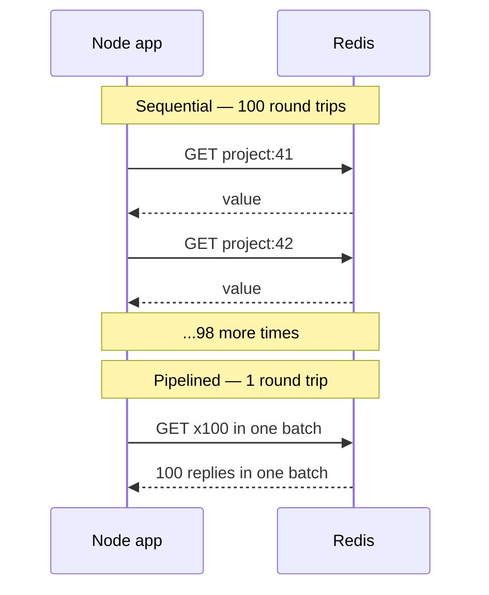

# Connecting to Redis From Node — Part 2

Part 1 got you a connection that does not crash your app. This part is about
using it well. Redis answers a command in microseconds, so almost all the time
in a Redis call is the network round trip — and almost every Redis incident is
one command that was O(n) over data that grew.

Both of those come back to the same fact from Part 1: one thread, one command
at a time.

> **⬅️ This continues [Part 1](./01-connecting-to-redis-part-1.md).**

> **📌 In one line:** batch your commands so you pay for one round trip instead
> of a hundred, and never run a command whose cost grows with how much data a
> customer happens to have.

## Table of Contents

1. [Round Trips: The Hidden Cost](#round-trips-the-hidden-cost)
2. [Pipelining](#pipelining)
3. [MGET, MSET, and When a Pipeline Is Still Needed](#mget-mset-and-when-a-pipeline-is-still-needed)
4. [Commands That Are Dangerous in Production](#commands-that-are-dangerous-in-production)
5. [KEYS to SCAN, in Full](#keys-to-scan-in-full)
6. [Key Namespacing](#key-namespacing)
7. [Seeing What Redis Is Doing](#seeing-what-redis-is-doing)
8. [Advanced: One Instance Per Job](#advanced-one-instance-per-job)
9. [Common Mistakes](#common-mistakes)
10. [Questions to Test Yourself](#questions-to-test-yourself)
11. [Related](#related)

---

## Round Trips: The Hidden Cost

Imagine you need one hundred items from a warehouse across the road. You could
walk over, ask for item 1, walk back, walk over, ask for item 2, walk back —
one hundred times. Or you could walk over once with a list of one hundred
items.

The warehouse is fast either way. The walking is the cost.

Redis answers a `GET` in a few microseconds. A network round trip between two
machines in the same datacenter is a few hundred microseconds — around a
hundred times longer. So this loop is not "one hundred fast operations". It is
"one hundred waits".

```ts
// ❌ BROKEN - 100 sequential round trips to build one dashboard
const projects: Project[] = []
for (const id of projectIds) {          // projectIds.length === 100
  const raw = await redis.get(`project:${id}`)
  if (raw) projects.push(JSON.parse(raw) as Project)
}
```

**This is exactly the N+1 query problem**, moved from your database to your
cache. The shape is identical: one loop, one network call per iteration, total
cost growing with the length of the list. The irony is that developers usually
add this loop *while fixing* an N+1 on the database side.

If the database version is not familiar yet, read
[../../databases/query-optimization/n-plus-one-queries.md](../../databases/query-optimization/n-plus-one-queries.md)
— the diagnosis and the fix are the same idea in a different place.



## Pipelining

A pipeline sends many commands in one batch and reads all the replies together.
Redis still runs them one at a time, in order. You simply stop waiting for each
reply before sending the next command.

```ts
// ✅ FIXED - one round trip for all 100 keys
const pipeline = redis.pipeline()
for (const id of projectIds) {
  pipeline.get(`project:${id}`)
}
// exec() resolves to [ [err, value], [err, value], ... ] in the same order.
const results = await pipeline.exec()

const projects = (results ?? [])
  .map(([err, value]) => (err || !value ? null : (JSON.parse(value as string) as Project)))
  .filter((p): p is Project => p !== null)
```

Note the reply shape: a tuple of error and value per command. **A pipeline does
not fail as a whole.** Command 37 can fail while the other 99 succeed, so you
must inspect each entry rather than wrapping the whole thing in one `try`.

Rough numbers, so the size of the win is concrete. Treat these as orders of
magnitude, not measurements — your own network decides the real figures.

| Approach | Round trips | Same host (~0.05 ms) | Same datacenter (~0.3 ms) | Cross-region (~30 ms) |
|---|---|---|---|---|
| 100 sequential `get` | 100 | ~5 ms | ~30 ms | ~3,000 ms |
| One pipeline of 100 | 1 | ~0.1 ms | ~0.4 ms | ~30 ms |
| One `MGET` of 100 keys | 1 | ~0.1 ms | ~0.3 ms | ~30 ms |

The cross-region column is why "just point staging at the production Redis in
the other region" turns a 40 ms endpoint into a 3-second one.

Two rules for pipelines:

- **A pipeline is not a transaction.** Other clients' commands can run in
  between the commands of your pipeline. If you need them to run with nothing
  in between, that is `MULTI`/`EXEC` — see
  [03-atomicity-and-lua-part-1.md](./03-atomicity-and-lua-part-1.md).
- **Keep each batch bounded.** A pipeline of 100,000 commands builds a huge
  reply buffer in Redis memory and occupies the single thread while it runs.
  Chunk into batches of a few hundred to a few thousand.

```ts
// Chunk large batches so one pipeline never monopolises the server.
for (let i = 0; i < keys.length; i += 500) {
  const pipeline = redis.pipeline()
  for (const key of keys.slice(i, i + 500)) pipeline.unlink(key)
  await pipeline.exec()
}
```

## MGET, MSET, and When a Pipeline Is Still Needed

If every command in your batch is the same command on plain string keys, Redis
has a built-in multi-key version that is simpler than a pipeline.

```ts
// Read many string keys in one command.
const keys = projectIds.map((id) => `project:${id}`)
const raws = await redis.mget(...keys)     // (string | null)[] in key order

// Write many string keys in one command.
await redis.mset({ 'project:41': json41, 'project:42': json42 })
```

| Situation | Use |
|---|---|
| Many `GET` on string keys | `MGET` |
| Many `SET` with **no** TTL (time to live) | `MSET` |
| Many `SET` **with** a TTL | Pipeline — `MSET` cannot set an expiry |
| Mixed commands (`get`, `hgetall`, `zadd`) | Pipeline |
| Commands that must not interleave | `MULTI`/`EXEC`, or a Lua script |
| Redis Cluster, keys on different nodes | Pipeline per node, or hash tags |

That third row catches people. There is no `MSETEX`. The moment your cache
writes need an expiry — and cache writes always should, see
[05-memory-and-operations-part-1.md](./05-memory-and-operations-part-1.md) —
you are back to a pipeline.

```ts
// Write many cache entries, each with its own TTL, in one round trip.
const pipeline = redis.pipeline()
for (const project of projects) {
  pipeline.set(`project:${project.id}`, JSON.stringify(project), 'EX', 300)
}
await pipeline.exec()
```

> **⚠️ Warning:** in Redis Cluster a single `MGET` must have all its keys on the
> same node, or it is rejected. Clients usually split pipelines by node for
> you, but multi-key commands they cannot split. This is one of the real costs
> of cluster mode — see
> [../../system-design/foundational/redis.md](../../system-design/foundational/redis.md).

## Commands That Are Dangerous in Production

Every command below is harmless on a laptop with forty keys and dangerous on a
production instance with forty million. The reason is always the same: the
command is O(n) over something that grew, and Redis runs it on the one thread
that everybody else is queueing for.

| Command | Why it hurts | Use instead |
|---|---|---|
| `KEYS pattern` | Walks the entire keyspace in one blocking command | `SCAN` with a cursor |
| `FLUSHALL` / `FLUSHDB` | Deletes everything instantly, with no undo | `SCAN` + `UNLINK` by prefix; rename the command in production |
| `SMEMBERS big:set` | Builds a reply containing the whole set | `SSCAN`, or `SRANDMEMBER key count` |
| `HGETALL big:hash` | Returns every field and every value | `HMGET` for known fields, or `HSCAN` |
| `LRANGE key 0 -1` | Copies the whole list into the reply | `LRANGE key 0 99` — always bound it |
| `ZRANGE key 0 -1` | The same problem for sorted sets | A score or index range, or `ZSCAN` |
| `DEL huge:key` | Frees a large object on the main thread | `UNLINK` — frees it in a background thread |
| `SORT`, `ZUNIONSTORE` over large inputs | O(n log n) on the main thread | Precompute, or do it in PostgreSQL |
| `SAVE`, `DEBUG SLEEP` | Block the server outright, by design | Never on a live instance; `BGSAVE` instead of `SAVE` |

Notice the pattern in the "use instead" column. Every fix is one of two moves:
**make it incremental** (a cursor), or **make it bounded** (a range). There is
no third answer.

> **💡 Tip:** `HGETALL` on a hash with twelve fields is completely fine. The
> danger is not the command, it is the command applied to a collection whose
> size you do not control. Ask "what does this look like for our largest
> customer?" before you ship it.

## KEYS to SCAN, in Full

`KEYS` is the one people reach for, because it is the obvious way to find keys
by pattern. Here it is broken, then fixed.

```ts
// ❌ BROKEN - KEYS blocks the whole server while it scans every key.
// On 5 million keys this can freeze Redis for seconds. Every client waits.
const stale = await redis.keys('cache:company:*')
if (stale.length) await redis.del(...stale)
```

```ts
// ✅ FIXED - SCAN returns a cursor and a small batch each time, so other
// clients' commands run in between batches and nothing is blocked.
export async function deleteByPrefix(prefix: string): Promise<number> {
  let cursor = '0'
  let deleted = 0

  do {
    // COUNT is a hint for how much work per call, not a guaranteed batch size.
    const [next, keys] = await redis.scan(cursor, 'MATCH', `${prefix}*`, 'COUNT', 500)
    cursor = next

    if (keys.length > 0) {
      // UNLINK frees memory in a background thread instead of the main one.
      await redis.unlink(...keys)
      deleted += keys.length
    }
  } while (cursor !== '0') // '0' means the full pass has finished

  return deleted
}
```

Three things about `SCAN` that surprise people:

- **It can return the same key twice**, and batch sizes vary a lot — sometimes
  zero keys with a non-zero cursor. It guarantees only that every key present
  for the whole scan is returned at least once. Your code must tolerate that.
- **`MATCH` filters after reading**, so a very selective pattern still walks the
  whole keyspace; it just returns less. `SCAN` is safe because it is
  *incremental*, not because it is cheap.
- **Keys added during the scan may or may not appear.** Do not use a scan to
  build a count you will report as exact.

> **💡 Tip:** if you scan to find keys regularly, that is a design smell. Keep a
> Redis set of the keys belonging to a company, and read that set instead of
> searching for them. [02-choosing-data-structures-part-2.md](./02-choosing-data-structures-part-2.md)
> covers this pattern.

## Key Namespacing

Redis has no tables. Every key sits in one flat namespace, and the key's name
is the only structure you get. So the name has to carry it.

```text
  {env}:{service}:{entity}:{id}:{detail}

  prod:api:company:4182:profile
  prod:api:project:9910:tasks:page:1
  prod:worker:lock:invoice-sweep
  staging:api:company:4182:profile
```

A convention like this buys four things: you can tell what a key is from its
name alone, you can delete a whole family with a prefix scan, `--bigkeys`
output becomes readable, and two services sharing an instance cannot collide.

**But an environment prefix is not enough on its own.** Sharing one Redis
instance between development and production is a bad idea for reasons no prefix
can fix:

- One `FLUSHALL` from a developer's terminal wipes production as well.
- Development load and production load share one single-threaded server. A
  `KEYS` run while debugging locally stalls real customer requests.
- `maxmemory` is shared, so filling it with test data evicts real cache
  entries — or, on an instance holding jobs, real jobs.
- Numbered databases (`SELECT 1`) do **not** solve this. They share memory, the
  same thread, and `FLUSHALL` clears all of them. They are also unsupported in
  cluster mode.

Use a separate instance per environment. They are cheap, and a shared one has a
habit of becoming an incident report.

## Seeing What Redis Is Doing

You cannot fix what you cannot see. Four tools, in the order you will reach for
them.

```bash
# 1. Which commands took longer than the threshold (default 10,000 microseconds)
redis-cli SLOWLOG GET 10
redis-cli SLOWLOG RESET

# 2. A broad health snapshot. Ask for one section at a time.
redis-cli INFO memory
redis-cli INFO clients
redis-cli INFO stats          # keyspace_hits, keyspace_misses, evicted_keys

# 3. Is the server slow, or is it the network between you and it?
redis-cli --latency           # live min/avg/max round trip
redis-cli --latency-history   # the same, sampled over time

# 4. Which keys are unusually large? Uses SCAN, so it is safe to run.
redis-cli --bigkeys
```

`SLOWLOG` is the first place to look when requests get slow and nobody changed
anything. It names the exact command and its arguments, which is usually enough
to find the `HGETALL` somebody added last week.

From the application side, instrument three things and nothing else at first:

```ts
// Wrap commands so every call reports its duration and outcome.
export async function timed<T>(op: string, work: Promise<T>): Promise<T> {
  const startedAt = process.hrtime.bigint()
  try {
    const result = await work
    metrics.histogram('redis.command.ms', elapsedMs(startedAt), { op, outcome: 'ok' })
    return result
  } catch (err) {
    // Record the failure too, or your latency chart lies by omission.
    metrics.histogram('redis.command.ms', elapsedMs(startedAt), { op, outcome: 'error' })
    throw err
  }
}
```

The three signals worth having on day one: **command latency** (the 99th
percentile, not the average), **error rate**, and **cache hit ratio**. How to
expose these and wire them into a health check is covered in
[../../backend-fundamentals/08-logging-and-observability/04-metrics-and-health-checks-part-1.md](../../backend-fundamentals/08-logging-and-observability/04-metrics-and-health-checks-part-1.md).

> **⚠️ Warning:** `MONITOR` prints every command the server runs. It is useful
> for ten seconds on a development box and harmful on a busy production server,
> because Redis must format and send every command to you *as well as* run it.

## Advanced: One Instance Per Job

Here is the conclusion this folder keeps building toward, stated early so you
never make the mistake.

**Do not run your cache and your job queue on the same Redis instance.**

A cache instance should throw away old keys when memory fills up
(`maxmemory-policy allkeys-lru`). That is correct: a lost cache entry costs one
database read. A queue instance must **never** throw keys away, because a lost
key there is a lost job — an invoice never generated, a notification never
sent.

These are settings on the *instance*, not on the key. You cannot have both at
once. Share one instance and the cache's eviction policy will silently delete
job data, with no error and no log line. You find out when a customer asks
where their export went.

```text
  ✅ Two instances, two policies        ❌ One instance, one policy
  ──────────────────────────────        ───────────────────────────
  redis-cache                           redis-shared
    maxmemory-policy allkeys-lru          maxmemory-policy allkeys-lru
    persistence: off                      cache keys   ─┐
                                          job payloads ─┴─ both evictable
  redis-queue
    maxmemory-policy noeviction           Memory fills. LRU picks victims.
    persistence: AOF                      Some victims are jobs. Silence.
```

The same argument applies to sessions, rate-limit counters you bill on, and
distributed locks. Ask one question of every Redis key you create: **"if this
key silently vanished right now, is that a cache miss or a bug report?"** Keys
that answer "bug report" do not belong on an evicting instance.

The full policy table and a concrete failure story are in
[05-memory-and-operations-part-1.md](./05-memory-and-operations-part-1.md), and
the queue side is in [../03-background-jobs/](../03-background-jobs/).

---

## Common Mistakes

| Mistake | Why it is wrong | Do this instead |
|---|---|---|
| A loop of `await redis.get(...)` | One round trip per item — the N+1 problem | `MGET` or a pipeline |
| Assuming a pipeline is atomic | Other clients interleave between its commands | `MULTI`/`EXEC` or a Lua script |
| One giant pipeline of 100,000 commands | Huge reply buffer, and it occupies the single thread | Chunk into batches of a few hundred |
| Wrapping `pipeline.exec()` in one `try` | Individual commands fail without throwing | Inspect the error slot of every reply tuple |
| `KEYS` in application code | Blocks the entire server for every client | `SCAN` with a cursor loop |
| Assuming `SCAN` returns each key once | It can repeat keys and return empty batches | Make the consuming code idempotent |
| `DEL` on a multi-gigabyte key | Frees memory on the main thread and stalls it | `UNLINK` |
| Keys with no environment or service prefix | Two services collide, and nothing can be bulk-deleted safely | `{env}:{service}:{entity}:{id}` |
| `SELECT 1` to separate staging from production | Shared memory, shared thread, shared `FLUSHALL` | A separate instance |
| Leaving `MONITOR` running | Doubles the server's work on every command | `SLOWLOG` and `--latency` |

## Questions to Test Yourself

1. A teammate says "pipelining makes Redis faster". Correct the statement
   precisely: what does a pipeline actually reduce, and what does it not
   change?
2. You need to write 200 cache entries, each with a 5-minute TTL. Why can you
   not use `MSET`, and what do you use?
3. `SCAN` can return the same key more than once. Why, and what must your
   deletion code do about it?
4. `HGETALL` is in the dangerous-commands table, yet you use it every day on a
   twelve-field hash. Explain why both statements are true.
5. Your cache instance and your queue share one Redis with
   `maxmemory-policy allkeys-lru`. Describe the exact failure a customer will
   report, and why nothing in your logs will mention it.
6. A request that normally takes 40 ms occasionally takes 3 seconds. Which two
   `redis-cli` commands do you run first, and what would each one tell you?
7. Why is `SELECT 1` not a real answer to "keep staging and production apart"?
8. Apply the test from the last section to four key types in your own app:
   session, cache entry, rate-limit counter, job payload. Which may be evicted?

## Related

- [Part 1](./01-connecting-to-redis-part-1.md) — what Redis is, the client, the connection lifecycle, and timeouts
- [README.md](./README.md) — the rest of this folder
- [02-choosing-data-structures-part-1.md](./02-choosing-data-structures-part-1.md) — the structures that remove whole round trips
- [03-atomicity-and-lua-part-1.md](./03-atomicity-and-lua-part-1.md) — when a pipeline is not enough
- [05-memory-and-operations-part-1.md](./05-memory-and-operations-part-1.md) — eviction policy and the cache-versus-queue rule in full
- [../01-caching-in-practice/04-stampede-and-failure-modes-part-2.md](../01-caching-in-practice/04-stampede-and-failure-modes-part-2.md) — degrading gracefully when Redis is slow or gone
- [../03-background-jobs/](../03-background-jobs/) — the queue that needs its own instance
- [../../databases/query-optimization/n-plus-one-queries.md](../../databases/query-optimization/n-plus-one-queries.md) — the same round-trip problem at the database
- [../../backend-fundamentals/08-logging-and-observability/04-metrics-and-health-checks-part-1.md](../../backend-fundamentals/08-logging-and-observability/04-metrics-and-health-checks-part-1.md) — exposing Redis latency and hit ratio as metrics
- [../../system-design/foundational/redis.md](../../system-design/foundational/redis.md) — cluster mode, hash slots, and the multi-key limitation
