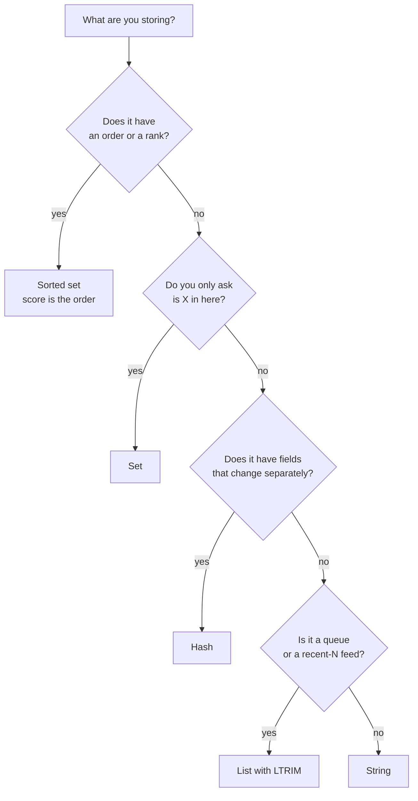

# Choosing Data Structures — Part 1

Ask a backend developer with two years of experience what Redis is and you will
usually hear "a fast key-value store". That is true, and it is also how most of
Redis goes unused. The name is *remote dictionary server*, but the useful part
is the second half of the phrase in Part 1 of the previous file: **data
structure server**.

The difference matters for a practical reason. When you pick the right
structure, application logic that would have been "read, decide, write" — three
round trips and a race condition — collapses into a single atomic command.

Part 1 walks every structure with a real SaaS use case. Part 2 covers what it
costs in memory, how expiry really works, and the patterns that make sorted
sets the most valuable structure Redis has.

> **➡️ Continued in [Part 2](./02-choosing-data-structures-part-2.md)**

> **📌 In one line:** picking the right Redis structure usually turns a
> multi-step piece of application logic into one atomic command.

## Table of Contents

1. [The Mistake: Everything Is a JSON String](#the-mistake-everything-is-a-json-string)
2. [Strings: Cached JSON and Counters](#strings-cached-json-and-counters)
3. [Hashes: An Object Whose Fields Change Independently](#hashes-an-object-whose-fields-change-independently)
4. [Lists: Ordered, Push and Pop at Both Ends](#lists-ordered-push-and-pop-at-both-ends)
5. [Sets: Membership and Uniqueness](#sets-membership-and-uniqueness)
6. [Sorted Sets: Everything With an Order](#sorted-sets-everything-with-an-order)
7. [Bitmaps and HyperLogLog: Counting at Scale](#bitmaps-and-hyperloglog-counting-at-scale)
8. [The Decision Table](#the-decision-table)
9. [Common Mistakes](#common-mistakes)
10. [Questions to Test Yourself](#questions-to-test-yourself)
11. [Related](#related)

---

## The Mistake: Everything Is a JSON String

Here is the code almost every project starts with.

```ts
// Every cached thing is a JSON blob under a string key.
await redis.set(`company:${id}`, JSON.stringify(company), 'EX', 300)
const raw = await redis.get(`company:${id}`)
```

Nothing is wrong with that. For a whole object you read and replace as a unit,
it is the right answer. The problem starts when everything else becomes the
same shape.

Watch what "count how many tasks a project has" looks like as a string:

```ts
// ❌ BROKEN - three steps, and two requests can run them at the same time
const raw = await redis.get(`project:${id}:taskCount`)
const count = raw ? Number(raw) : 0
await redis.set(`project:${id}:taskCount`, String(count + 1))
```

Two requests both read `7`, both write `8`, and one task disappears from the
count. Part 2 shows that race as a timeline. The fix is not a lock. The fix is
one command:

```ts
// ✅ FIXED - one atomic command, no read, no race, one round trip
const count = await redis.incr(`project:${id}:taskCount`)
```

That is the whole idea of this file, repeated with five other structures. Every
time you find yourself writing *read, change in JavaScript, write back*, there
is probably a Redis command that does it in one step.

> **📌 Remember:** read-modify-write in application code is a race condition
> waiting for traffic. Redis structures exist so you can express the change as
> a single command instead.

## Strings: Cached JSON and Counters

A string is a value of up to 512 MB. Redis does not care whether it holds JSON,
a number, or a PNG.

**Use case 1 — a cached company profile.** The whole object is read together
and replaced together, so one string is right.

```ts
const KEY = (id: number) => `company:${id}:profile`

export async function cacheCompany(company: Company): Promise<void> {
  // Always set an expiry on a cache key. Part 2 of file 05 explains why.
  await redis.set(KEY(company.id), JSON.stringify(company), 'EX', 300)
}
```

**Use case 2 — counters.** When the value is a number, Redis gives you atomic
arithmetic on it.

```bash
INCR      project:9910:taskCount      # +1, returns the new value
INCRBY    company:4182:apiCalls 5     # +5
DECR      event:552:seatsLeft         # -1
INCRBYFLOAT invoice:7781:total 19.99  # decimal-safe increment
```

**Use case 3 — flags and single-writer claims.** `SET` with `NX` (only set if
the key does not exist) is the basis of locks and idempotency keys:

```ts
// Returns 'OK' if we created it, null if someone else already had it.
const won = await redis.set(`lock:invoice-sweep`, token, 'NX', 'PX', 30_000)
```

| Command | What it does | Cost |
|---|---|---|
| `GET` / `SET` | Read or replace the whole value | O(1) |
| `SET k v EX n` | Set with a TTL of n seconds | O(1) |
| `SET k v NX` | Set only if absent | O(1) |
| `INCR` / `DECR` / `INCRBY` | Atomic arithmetic | O(1) |
| `APPEND` | Add to the end of the string | O(1) amortised |
| `GETRANGE` | Read a substring | O(n) over the range |

> **⚠️ Warning:** `APPEND` makes it easy to build a multi-megabyte string
> without noticing. `redis-cli --bigkeys` will find it. A string you keep
> appending to is almost always a list in disguise.

## Hashes: An Object Whose Fields Change Independently

A hash is a key holding a small map of field to value — a row, roughly.

The question that decides between a string and a hash is: **do you ever update
one part without the rest?**

**Use case — a user's presence and preferences.** `lastSeenAt` changes every
few seconds. `theme` changes twice a year. Storing them as one JSON string
means every presence ping rewrites the whole object.

```ts
// ❌ BROKEN - to change one field you must read, parse, edit, stringify, write.
// Two concurrent updates to different fields: the second overwrites the first.
const raw = await redis.get(`user:${id}:state`)
const state = JSON.parse(raw!) as UserState
state.lastSeenAt = Date.now()
await redis.set(`user:${id}:state`, JSON.stringify(state))
```

```ts
// ✅ FIXED - one field, one command, no read, no lost update
await redis.hset(`user:${id}:state`, 'lastSeenAt', Date.now())

// Read only what you need.
const [theme, locale] = await redis.hmget(`user:${id}:state`, 'theme', 'locale')

// Counters work inside a hash too.
await redis.hincrby(`user:${id}:state`, 'unreadNotifications', 1)
```

Two independent writers updating `theme` and `lastSeenAt` at the same moment
both succeed with a hash. With a JSON string, one silently loses. That is the
lost-update problem, and it is the real argument for hashes.

| Command | What it does | Cost |
|---|---|---|
| `HSET` / `HGET` | Write or read one field | O(1) |
| `HMGET` | Read several named fields | O(n) over fields asked for |
| `HGETALL` | Read every field | O(n) over the whole hash |
| `HINCRBY` | Atomic arithmetic on a field | O(1) |
| `HDEL` | Remove a field | O(1) |
| `HSCAN` | Walk fields incrementally | O(1) per call |

Use a hash when: fields update independently, you often read a subset, or you
want per-field counters. Use a string when: the object is read and replaced as
a whole, or it is deeply nested — a hash is flat, and nesting JSON inside a
hash field brings the read-modify-write problem straight back.

> **💡 Tip:** a small hash is also *cheaper in memory* than the same fields as
> separate keys, sometimes dramatically. Part 2 explains why.

## Lists: Ordered, Push and Pop at Both Ends

A list is an ordered sequence. Pushing and popping at either end is O(1);
reaching into the middle is O(n).

**Use case 1 — a recent activity feed, capped.**

```ts
export async function recordActivity(projectId: number, entry: string): Promise<void> {
  const key = `project:${projectId}:activity`
  const pipeline = redis.pipeline()
  pipeline.lpush(key, entry)      // newest at the head
  pipeline.ltrim(key, 0, 49)      // keep only the newest 50 — this is the important line
  pipeline.expire(key, 86_400)
  await pipeline.exec()
}

// Read a bounded window. Never LRANGE key 0 -1.
const recent = await redis.lrange(`project:${projectId}:activity`, 0, 19)
```

`LTRIM` after every push is what stops an activity list from growing without
limit. A list with no trim is one of the most common sources of a surprise
multi-gigabyte key.

**Use case 2 — a simple job list.** `LPUSH` to add, `BRPOP` to take the oldest
and wait if empty.

```ts
// Producer
await redis.lpush('queue:notifications', JSON.stringify(job))

// Consumer, on its own connection (a blocking command occupies it)
const popped = await blockingClient.brpop('queue:notifications', 5) // wait 5s
if (popped) await handle(JSON.parse(popped[1]) as NotificationJob)
```

This works, and you should understand it, but do not build a real queue on it.
The moment your worker crashes after `BRPOP` and before finishing, the job is
gone: there are no retries, no dead-letter queue, no visibility. Use a library
that handles those — see [../03-background-jobs/](../03-background-jobs/).

| Command | What it does | Cost |
|---|---|---|
| `LPUSH` / `RPUSH` | Add at head or tail | O(1) |
| `LPOP` / `RPOP` | Remove from head or tail | O(1) |
| `BRPOP` / `BLPOP` | Pop, or block until something arrives | O(1) |
| `LRANGE` | Read a range by index | O(n) over the range |
| `LTRIM` | Keep only a range, discard the rest | O(n) over what is removed |
| `LLEN` | Length | O(1) |

## Sets: Membership and Uniqueness

A set holds unique members with no order. Its superpower is `SISMEMBER`: "is
this in here?" in O(1), no matter how big the set is.

**Use case 1 — tags on a project, and membership checks.**

```ts
await redis.sadd(`project:${id}:tags`, 'urgent', 'billing', 'q4')
const isUrgent = await redis.sismember(`project:${id}:tags`, 'urgent') // 1 or 0
```

**Use case 2 — unique visitors per day, and set maths.** Redis computes
intersections and differences server-side, so "who visited both days" never
leaves the server.

```ts
const dayKey = (d: string) => `visitors:${d}`
await redis.sadd(dayKey('2026-09-27'), `user:${userId}`)

const uniqueToday = await redis.scard(dayKey('2026-09-27'))
const returning = await redis.sinterstore(
  'visitors:returning',                      // destination key
  dayKey('2026-09-26'), dayKey('2026-09-27'),
)
```

**Use case 3 — tracking the cache keys you will need to invalidate.** This is
the answer to "I need `SCAN` to find keys" from the previous file: keep an
index set instead of searching.

```ts
// When you cache anything belonging to a company, record the key.
const pipeline = redis.pipeline()
pipeline.set(cacheKey, payload, 'EX', 300)
pipeline.sadd(`company:${companyId}:cachekeys`, cacheKey)
pipeline.expire(`company:${companyId}:cachekeys`, 600)
await pipeline.exec()

// Invalidating is now a read and a delete, with no scan of the keyspace.
const keys = await redis.smembers(`company:${companyId}:cachekeys`)
if (keys.length) await redis.unlink(...keys, `company:${companyId}:cachekeys`)
```

| Command | What it does | Cost |
|---|---|---|
| `SADD` / `SREM` | Add or remove members | O(1) per member |
| `SISMEMBER` | Is this member present | O(1) |
| `SCARD` | How many members | O(1) |
| `SMEMBERS` | Every member — dangerous when large | O(n) |
| `SRANDMEMBER k n` | n random members | O(n) over what is returned |
| `SINTER` / `SUNION` / `SDIFF` | Set maths, server-side | O(n) over the inputs |
| `SSCAN` | Walk members incrementally | O(1) per call |

> **⚠️ Warning:** that invalidation set only stays small because it has its own
> TTL. An index set with no expiry grows forever and becomes the big key you
> were trying to avoid.

## Sorted Sets: Everything With an Order

A sorted set is a set where every member also carries a number called its
**score**, and Redis keeps the members ordered by that score. Adding, removing
and reading a range are all logarithmic — no full scan.

This is the structure worth learning properly, because three different problems
turn out to be the same problem once you see it.

**Use case 1 — a leaderboard.** The score is the value you rank by.

```ts
await redis.zadd('leaderboard:tasks-completed:2026-09', 142, `user:${userId}`)

// Top 10, highest first, with their scores.
const top = await redis.zrevrange('leaderboard:tasks-completed:2026-09', 0, 9, 'WITHSCORES')

// One user's rank, without fetching the whole board. 0-based.
const rank = await redis.zrevrank('leaderboard:tasks-completed:2026-09', `user:${userId}`)
```

**Use case 2 — anything scheduled.** Make the score a timestamp and the sorted
set becomes a delay queue: "give me everything due before now".

```ts
// Schedule a reminder for 09:00 tomorrow.
await redis.zadd('scheduled:reminders', dueAtMs, `reminder:${reminderId}`)

// A worker asks for what is due, oldest first, in a bounded batch.
const due = await redis.zrangebyscore(
  'scheduled:reminders', '-inf', Date.now(), 'LIMIT', 0, 100,
)
```

**Use case 3 — a sliding-window rate limiter.** Same trick: score is the
timestamp of a request, so "how many requests in the last minute" is a range
count. Part 2 builds this one completely.

| Command | What it does | Cost |
|---|---|---|
| `ZADD` | Add or update a member's score | O(log n) |
| `ZSCORE` / `ZRANK` | One member's score or position | O(1) / O(log n) |
| `ZINCRBY` | Atomically change a score | O(log n) |
| `ZRANGE` / `ZREVRANGE` | Members by position | O(log n + m returned) |
| `ZRANGEBYSCORE` | Members inside a score range | O(log n + m returned) |
| `ZREMRANGEBYSCORE` | Delete everything in a score range | O(log n + m removed) |
| `ZCARD` / `ZCOUNT` | Count all, or count in a score range | O(1) / O(log n) |
| `ZPOPMIN` / `ZPOPMAX` | Remove and return the lowest or highest | O(log n) |

> **📌 Remember:** if the answer involves "top N", "most recent N", "due
> before X", or "how many in the last N minutes", the structure is a sorted set
> and the score is usually a timestamp.

## Bitmaps and HyperLogLog: Counting at Scale

Two specialist structures worth knowing by name, because when they fit they are
dramatically smaller than the obvious alternative.

**A bitmap** is a string used as an array of bits. Perfect for a yes/no fact
about each user, indexed by a dense integer id.

```ts
// Did user 4182 open the app today?
await redis.setbit(`active:2026-09-27`, 4182, 1)
const wasActive = await redis.getbit(`active:2026-09-27`, 4182)
const activeToday = await redis.bitcount(`active:2026-09-27`)
```

One million users costs about 125 KB — one bit each. A set of one million user
ids costs tens of megabytes. The catch: the size depends on the *largest* id,
not the number of set bits, so sparse or non-numeric ids waste space.

**HyperLogLog** answers "roughly how many unique things have I seen?" in a
fixed 12 KB, no matter whether you added a thousand items or a billion. It
trades exactness for size — the usual error is under 1%.

```ts
await redis.pfadd(`uniq:pageviews:2026-09-27`, visitorId)
const approx = await redis.pfcount(`uniq:pageviews:2026-09-27`)
// Merge days without double-counting a visitor who came on both.
await redis.pfmerge('uniq:pageviews:week', 'uniq:pageviews:2026-09-26', 'uniq:pageviews:2026-09-27')
```

Use HyperLogLog when the number goes on a dashboard. Do not use it when the
number goes on an invoice — you cannot ask it whether a specific visitor is in
there, and it is approximate by design.

## The Decision Table



| I want to store... | Structure | Key commands | The gotcha |
|---|---|---|---|
| A cached API response | String | `SET ... EX`, `GET` | Always set a TTL |
| A counter | String | `INCR`, `INCRBY` | Never read-then-write in JS |
| A user object with independent fields | Hash | `HSET`, `HMGET`, `HINCRBY` | TTL applies to the whole hash, not a field |
| A session | Hash + TTL | `HSET`, `EXPIRE` | Refresh the TTL on activity |
| The newest 50 events | List | `LPUSH` + `LTRIM` | Without `LTRIM` it grows forever |
| A simple job list | List | `LPUSH`, `BRPOP` | No retries; use a real queue library |
| Tags, or "is this member of X" | Set | `SADD`, `SISMEMBER` | `SMEMBERS` on a big set blocks the server |
| Which cache keys to invalidate | Set | `SADD`, `SMEMBERS` | Give the index set its own TTL |
| A leaderboard | Sorted set | `ZADD`, `ZREVRANGE`, `ZREVRANK` | Trim old periods or it grows forever |
| Jobs due at a time | Sorted set | `ZADD` score = due time, `ZRANGEBYSCORE` | Popping and processing must be atomic |
| Requests in the last minute | Sorted set | `ZADD`, `ZREMRANGEBYSCORE`, `ZCARD` | One member per request — memory adds up |
| A daily yes/no flag per user | Bitmap | `SETBIT`, `BITCOUNT` | Size follows the biggest id |
| Approximate unique visitors | HyperLogLog | `PFADD`, `PFCOUNT` | Approximate, and not queryable per member |

---

## Common Mistakes

| Mistake | Why it is wrong | Do this instead |
|---|---|---|
| Storing every object as a JSON string | One field update rewrites everything and loses concurrent writes | A hash, when fields change independently |
| Read, change in JS, write back | Two requests overwrite each other | `INCR`, `HINCRBY`, `ZINCRBY`, or a Lua script |
| A list with no `LTRIM` | Grows without limit into a multi-gigabyte key | `LTRIM` in the same pipeline as the `LPUSH` |
| `SMEMBERS` on a set that grows per user | O(n) on the single thread | `SSCAN`, or keep the set bounded |
| Nesting JSON inside a hash field | Brings back read-modify-write on that field | Flatten, or accept a string |
| A leaderboard key with no period in the name | Cannot be expired, grows forever | `leaderboard:metric:2026-09`, then expire old months |
| HyperLogLog for anything billed | Approximate, and no per-member lookup | A set, or PostgreSQL |
| Using a Redis list as the real job queue | No retry, no visibility, lost on crash | A queue library — see folder 03 |

## Questions to Test Yourself

1. You store a user object as JSON in a string. Two requests update two
   different fields at the same instant. Describe exactly what is lost, and how
   a hash prevents it.
2. When is a string genuinely the better choice than a hash?
3. Why is `SISMEMBER` O(1) while `SMEMBERS` is dangerous, on the same set?
4. Explain how one structure — the sorted set — serves a leaderboard, a delayed
   job scheduler, and a rate limiter. What plays the role of the score in each?
5. A recent-activity list grew to 2 GB. Which single command was missing?
6. You need to invalidate every cache key for company 4182. Why is `SCAN` the
   wrong tool, and what do you keep instead?
7. One million users, one bit of information each. Compare a bitmap and a set
   on memory, and say when the bitmap is the wrong choice anyway.
8. Which of these may use HyperLogLog: a dashboard tile of monthly unique
   visitors, or the seat count on an invoice? Why?

## Related

- [Part 2](./02-choosing-data-structures-part-2.md) — memory cost, expiry granularity, atomic counters, and the sliding-window rate limiter in full
- [README.md](./README.md) — the rest of this folder
- [01-connecting-to-redis-part-2.md](./01-connecting-to-redis-part-2.md) — why `SMEMBERS` and `HGETALL` on large collections are dangerous
- [03-atomicity-and-lua-part-1.md](./03-atomicity-and-lua-part-1.md) — when one command is not enough to be safe
- [05-memory-and-operations-part-1.md](./05-memory-and-operations-part-1.md) — what happens to these structures when memory fills
- [../03-background-jobs/](../03-background-jobs/) — why a list is not a real queue
- [../../system-design/foundational/redis.md](../../system-design/foundational/redis.md) — the concept-level reference for the structures and TTL
- [../../system-design/foundational/rate-limiting.md](../../system-design/foundational/rate-limiting.md) — which limiting algorithm to choose before you implement one
