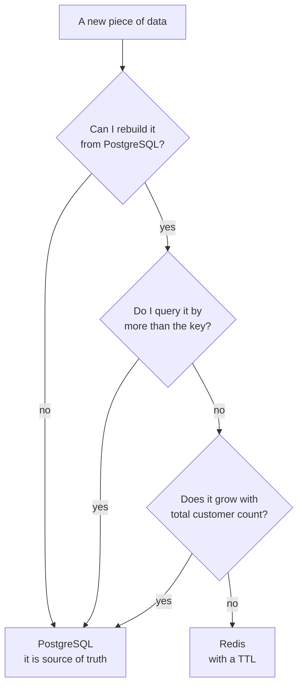

# Choosing Data Structures — Part 2

Part 1 was about picking the right shape. This part is about the four things
that decide whether that shape survives contact with production: what it costs
in memory, how expiry actually works, why a counter must be a single command,
and how to build the pattern that makes sorted sets worth learning.

It ends with the question people avoid for too long — when the honest answer is
that the data does not belong in Redis at all.

> **⬅️ This continues [Part 1](./02-choosing-data-structures-part-1.md).**

> **📌 In one line:** every Redis key carries overhead you do not see, expiry
> applies to the whole key and never to one field, and any change you express
> as read-then-write in JavaScript is a race condition.

## Table of Contents

1. [Memory Cost: The Part Nobody Checks](#memory-cost-the-part-nobody-checks)
2. [A Million Keys vs One Hash With a Million Fields](#a-million-keys-vs-one-hash-with-a-million-fields)
3. [Expiry Applies to the Key, Not the Field](#expiry-applies-to-the-key-not-the-field)
4. [Counters: Why Read-Modify-Write Loses Data](#counters-why-read-modify-write-loses-data)
5. [A Sliding-Window Rate Limiter, Complete](#a-sliding-window-rate-limiter-complete)
6. [Advanced: Finding Keys Safely](#advanced-finding-keys-safely)
7. [Advanced: Eviction Meets Your Structure Choice](#advanced-eviction-meets-your-structure-choice)
8. [When the Answer Is PostgreSQL](#when-the-answer-is-postgresql)
9. [Common Mistakes](#common-mistakes)
10. [Questions to Test Yourself](#questions-to-test-yourself)
11. [Related](#related)

---

## Memory Cost: The Part Nobody Checks

Redis keeps everything in RAM. So the real question about any structure is not
"is it fast" — they all are — but "what does a million of these cost".

The number that surprises people: **a key costs far more than the bytes in its
name and value.** Redis stores the key string, a value object, an entry in the
main hash table, and expiry bookkeeping if the key has a TTL. In practice a
trivial key with a short name and a short value lands somewhere in the region
of 50 to 100 bytes of overhead before your data is counted at all.

Do not trust that figure. Measure yours:

```bash
# How much does this one key actually cost, including overhead?
redis-cli MEMORY USAGE user:4182:state

# Total, and where it is going.
redis-cli INFO memory
redis-cli --bigkeys
```

The practical consequence is a rule of thumb worth carrying:

> **⚠️ Warning:** one million tiny keys can easily cost 100 MB or more *before*
> your values. If you are about to create one key per user per day, do the
> multiplication first.

Three habits that cost nothing and save a lot:

```ts
// 1. Short, consistent key names. Every byte is paid a million times.
//    'u:4182:st' over 'application:cache:user:4182:state:object'
//    Stay readable, but do not write prose in a key.

// 2. Store numbers as numbers. Redis encodes short integer strings compactly;
//    "42" is cheaper than a JSON object wrapping it.
await redis.set('project:9910:taskCount', 42)

// 3. Do not store what you can recompute cheaply, and never store a whole
//    table "just in case". Cache what is expensive, not what is convenient.
```

## A Million Keys vs One Hash With a Million Fields

This is the comparison that makes memory behaviour click.

```text
  A) One key per field                 B) One hash, many fields
  ───────────────────────              ───────────────────────
  user:4182:theme    = "dark"          user:4182 -> theme  = "dark"
  user:4182:locale   = "en"                        locale = "en"
  user:4182:timezone = "UTC"                       timezone = "UTC"

  3 keys × full key overhead           1 key × overhead
                                       + 3 cheap field entries
```

Option B is usually several times smaller, and it gets better at small sizes:
while a hash stays under the configured field-count and value-length thresholds
(`hash-max-listpack-entries` and `hash-max-listpack-value`, named
`hash-max-ziplist-*` in older versions), Redis stores it as a compact flat list
instead of a real hash table. Tiny hashes are remarkably cheap.

But the relationship reverses at the other end. **One hash with a million
fields is not a good idea either**, for reasons that have nothing to do with
bytes:

| | A million keys | One hash, a million fields |
|---|---|---|
| Memory | High — per-key overhead ×1,000,000 | Lower |
| Expire one item | Yes, per key TTL | **No** — TTL is on the whole hash |
| Read one item | `GET`, O(1) | `HGET`, O(1) |
| Read everything | Many round trips | `HGETALL` — one O(n) command that blocks the server |
| Evictable under memory pressure | Yes, key by key | All or nothing |
| Redis Cluster | Spread across nodes | **One node holds all of it** |

The sweet spot is in the middle: **many hashes, each holding a bounded number
of fields.** One hash per user, not one hash for all users. If a structure's
size grows with your total customer count rather than with one customer's data,
it is the wrong shape.

```ts
// ✅ One hash per user. Bounded fields, individually expirable, shards well.
await redis.hset(`user:${userId}:state`, { theme, locale, lastSeenAt })
await redis.expire(`user:${userId}:state`, 86_400)

// ❌ One hash for every user in the system. Unbounded, unexpirable, unshardable.
await redis.hset('user-states', String(userId), JSON.stringify(state))
```

## Expiry Applies to the Key, Not the Field

Here is the limitation that catches everyone exactly once.

**A TTL belongs to a key. There is no TTL on a hash field, a set member, a list
item, or a sorted set member.** You cannot say "expire `lastSeenAt` in an hour
but keep `theme` forever".

```ts
// ❌ BROKEN - this expires the ENTIRE hash, including theme and locale.
await redis.hset(`user:${id}:state`, 'otpCode', code)
await redis.expire(`user:${id}:state`, 300)   // 5 minutes for everything
```

Three workarounds, in the order you should consider them:

**1. Give the short-lived thing its own key.** Simplest, and almost always
right.

```ts
// ✅ FIXED - the OTP is its own key with its own life. The hash is untouched.
await redis.set(`user:${id}:otp`, code, 'EX', 300)
```

**2. Store the expiry time as data and check it on read.** Use this when the
values must live together for an atomic read.

```ts
await redis.hset(`session:${sid}`, { userId, elevatedUntil: Date.now() + 900_000 })

const raw = await redis.hget(`session:${sid}`, 'elevatedUntil')
const isElevated = raw !== null && Number(raw) > Date.now()
// Lazy cleanup: the stale value simply stops counting. Sweep it later if needed.
```

**3. Use a sorted set with the expiry time as the score.** This gives you real
per-member expiry, and one command removes everything that has expired.

```ts
const key = `company:${companyId}:activeSessions`
await redis.zadd(key, Date.now() + 1_800_000, sessionId)   // score = expires at

// Sweep everything already expired, then count what is left.
const pipeline = redis.pipeline()
pipeline.zremrangebyscore(key, '-inf', Date.now())
pipeline.zcard(key)
const [, [, active]] = await pipeline.exec() as [unknown, [null, number]]
```

Option 3 is the general answer to "I want per-item expiry inside a collection",
and it is the same mechanism the rate limiter below uses.

> **💡 Tip:** `EXPIRE` on a key that already has a TTL replaces it. And most
> write commands on a key do **not** reset its TTL — but `SET` without
> `KEEPTTL` does clear it. Re-setting a cached value silently makes it
> permanent if you forget the `EX`.

## Counters: Why Read-Modify-Write Loses Data

Part 1 showed the fix. Here is the failure in full, because the same shape
appears in every structure.

Two requests both complete a task on project 9910. The counter should go from 7
to 9.

| Time | Request A | Request B | Value in Redis |
|---|---|---|---|
| t1 | `GET taskCount` → 7 | | 7 |
| t2 | | `GET taskCount` → 7 | 7 |
| t3 | adds 1 in JavaScript → 8 | | 7 |
| t4 | | adds 1 in JavaScript → 8 | 7 |
| t5 | `SET taskCount 8` | | 8 |
| t6 | | `SET taskCount 8` | **8** |

Both requests succeeded. No error was logged. The count is wrong, and it stays
wrong forever, because nothing ever recomputes it.

This is a **lost update**, and it is exactly the anomaly your database's
isolation levels exist to prevent. The mechanism differs — PostgreSQL gives you
row locks and `SELECT ... FOR UPDATE`, Redis gives you atomic commands — but
the failure is the same one, described in
[../../databases/transactions-and-concurrency/02-isolation-levels-and-anomalies-part-1.md](../../databases/transactions-and-concurrency/02-isolation-levels-and-anomalies-part-1.md).

```ts
// ✅ FIXED - Redis does the read and the write as one indivisible step.
const newCount = await redis.incr('project:9910:taskCount')
```

Each structure has its own version of this. Learn to reach for them:

| Instead of read-modify-write on... | Use |
|---|---|
| A numeric string | `INCR`, `INCRBY`, `INCRBYFLOAT` |
| A number inside a hash | `HINCRBY`, `HINCRBYFLOAT` |
| A score in a sorted set | `ZINCRBY` |
| "Add if not already there" | `SADD` — it returns how many were new |
| "Create only if absent" | `SET key value NX` |
| Anything more complex | A Lua script — [03-atomicity-and-lua-part-2.md](./03-atomicity-and-lua-part-2.md) |

> **📌 Remember:** if your code reads a value from Redis, computes a new value
> in JavaScript, and writes it back, assume it will be wrong under load.
> Between your read and your write, anything can happen.

## A Sliding-Window Rate Limiter, Complete

Rate limiting is where sorted sets earn their reputation. This section builds
the implementation only. **Which algorithm to choose — fixed window, sliding
window, token bucket, leaky bucket — and the trade-offs between them are in
[../../system-design/foundational/rate-limiting.md](../../system-design/foundational/rate-limiting.md).**
Read that first if the choice is not obvious; this file does not repeat it.

The idea in one picture. Every request adds one member scored with its
timestamp. Before counting, throw away everything older than the window.

```text
  now - 60s                                            now
     |                                                  |
     |   x     x   x        x          x    x      x    |
     +--------------------------------------------------+
   ^ dropped by ZREMRANGEBYSCORE      ^ counted by ZCARD
```

```ts
const WINDOW_MS = 60_000
const MAX_REQUESTS = 100

export async function checkRateLimit(companyId: number): Promise<{
  allowed: boolean
  remaining: number
  retryAfterMs: number
}> {
  const key = `ratelimit:api:${companyId}`
  const now = Date.now()
  // A unique member per request. Two requests in the same millisecond must not
  // collide, or one of them is invisible to the count.
  const member = `${now}-${randomUUID()}`

  const pipeline = redis.pipeline()
  pipeline.zremrangebyscore(key, '-inf', now - WINDOW_MS) // drop what left the window
  pipeline.zadd(key, now, member)                          // record this request
  pipeline.zcard(key)                                      // how many are in the window
  pipeline.pexpire(key, WINDOW_MS)                         // let an idle key die on its own
  const results = await pipeline.exec()

  const count = results?.[2]?.[1] as number
  if (count <= MAX_REQUESTS) {
    return { allowed: true, remaining: MAX_REQUESTS - count, retryAfterMs: 0 }
  }

  // Over the limit: remove the member we just added so a rejected request does
  // not extend the window, and tell the caller when the oldest entry expires.
  await redis.zrem(key, member)
  const [, oldestScore] = await redis.zrange(key, 0, 0, 'WITHSCORES')
  return {
    allowed: false,
    remaining: 0,
    retryAfterMs: Math.max(0, Number(oldestScore) + WINDOW_MS - now),
  }
}
```

Four details that matter, and are usually missing from short examples:

- **`pexpire` on every call** is what stops an idle company's key living
  forever. Without it you accumulate one permanent sorted set per customer.
- **The member must be unique.** Using the timestamp alone means two requests in
  the same millisecond overwrite each other and only count once.
- **Removing your own member on rejection** stops a client that is hammering you
  from pushing its own reset time further and further away.
- **Memory is real.** This stores one member per request in the window. At 100
  requests per minute per company, across 10,000 companies, that is a million
  members. A fixed-window `INCR` counter costs one key. Sliding windows are
  more accurate and more expensive — an explicit trade, not a free upgrade.

The pipeline above is fast but **not atomic** — another client's commands can
run between its steps, so the count can briefly exceed the limit under heavy
concurrency. For a limiter that is usually acceptable. When it is not, the same
four commands go into one Lua script, which is
[03-atomicity-and-lua-part-2.md](./03-atomicity-and-lua-part-2.md).

## Advanced: Finding Keys Safely

`SCAN` with `MATCH` is the safe way to look for keys, and Part 2 of file 01
covered the cursor loop. The same incremental pattern exists *inside* the big
structures, which is what saves you when a collection has grown:

| Structure | Safe walk | Instead of |
|---|---|---|
| Keyspace | `SCAN cursor MATCH p COUNT n` | `KEYS p` |
| Hash | `HSCAN key cursor` | `HGETALL key` |
| Set | `SSCAN key cursor` | `SMEMBERS key` |
| Sorted set | `ZSCAN key cursor` | `ZRANGE key 0 -1` |

```ts
// Walk a large hash without ever holding all of it in one reply.
let cursor = '0'
do {
  // Returns a flat array: [field1, value1, field2, value2, ...]
  const [next, flat] = await redis.hscan('company:4182:settings', cursor, 'COUNT', 200)
  cursor = next
  for (let i = 0; i < flat.length; i += 2) {
    await handleSetting(flat[i], flat[i + 1])
  }
} while (cursor !== '0')
```

Remember the caveats from file 01: these can return the same element twice, and
`MATCH` filters after reading rather than before. They are safe because they are
incremental, not because they are cheap.

## Advanced: Eviction Meets Your Structure Choice

Eviction removes **whole keys**, never parts of them. That single fact changes
how you should shape data on an instance where eviction is switched on.

- A sorted set holding a leaderboard is one key. Under `allkeys-lru` the entire
  leaderboard disappears in one step — not the oldest entries, all of it.
- A hash holding a user's session is one key. It goes whole, so a half-valid
  session is impossible. That is good.
- A hash holding *every* user's session is also one key. Evicting it logs out
  every customer at once. That is very bad.
- `volatile-*` policies only consider keys that have a TTL. If your
  leaderboards have no TTL and your cache entries do, memory pressure eats the
  cache and leaves the leaderboards — which may be exactly backwards.

The rule that follows: **make the unit of eviction the unit you can afford to
lose.** One key per user, per company, per period. Never one key whose loss
affects every customer.

The policies themselves, and the cache-versus-queue rule, are in
[05-memory-and-operations-part-1.md](./05-memory-and-operations-part-1.md).

## When the Answer Is PostgreSQL

Redis is so pleasant that it starts absorbing things it should not. Ask these
questions honestly.



| If this is true... | Use PostgreSQL instead |
|---|---|
| Losing it would be a bug report, not a cache miss | It needs durability and backups |
| You need to query it by more than one field | Redis has one index: the key name |
| It must be correct even under a crash mid-operation | You need real transactions and rollback |
| It grows forever with your customer count | RAM is the most expensive storage you own |
| Two people will report different numbers if it drifts | You need a single source of truth |
| You are writing joins in application code | That is what SQL is for |

Redis is at its best as a **derived, rebuildable, expendable** copy of
something else: a cache of a query, a counter you can recompute, a lock, a
window of recent events. The moment a piece of data stops being rebuildable, it
has quietly become a database — and Redis is a worse database than the one you
already run.

> **📌 Remember:** the test is one sentence. *If this key vanished right now,
> would I recompute it, or would I have to apologise to a customer?* The second
> answer means it belongs in PostgreSQL.

---

## Common Mistakes

| Mistake | Why it is wrong | Do this instead |
|---|---|---|
| Ignoring per-key overhead | A million tiny keys costs far more than the data in them | Measure with `MEMORY USAGE`, group into bounded hashes |
| One hash holding every user | Unexpirable, unshardable, and evicted all at once | One hash per user |
| Expecting a TTL on a hash field | TTL exists only on whole keys | A separate key, or a sorted set scored by expiry |
| `SET` without `EX` on a re-cache | Clears the old TTL and makes the key permanent | Always pass `EX`, or use `KEEPTTL` deliberately |
| `GET` then `SET` for a counter | Lost updates under concurrency | `INCR` / `HINCRBY` / `ZINCRBY` |
| A rate-limit member keyed by timestamp alone | Same-millisecond requests collide and undercount | Add a unique suffix per request |
| A rate-limit key with no `PEXPIRE` | One permanent sorted set per customer, forever | Refresh the expiry on every call |
| Leaderboards with no period in the key | Cannot expire, grows without limit | `leaderboard:metric:2026-09` |
| Treating Redis as the source of truth | No transactions, no backups, evictable | PostgreSQL, with Redis as a cache of it |

## Questions to Test Yourself

1. Why can a million keys holding "1" cost over 100 MB? Name the four things
   Redis stores beyond your value.
2. One hash with a million fields uses less memory than a million keys. Give
   three separate reasons it is still the wrong design.
3. You need an OTP code to expire in 5 minutes, stored alongside a user's
   permanent preferences. Why does `EXPIRE` fail here, and what are two fixes?
4. Draw the lost-update timeline for `GET` then `SET` on a counter. At which
   step is the update lost, and which single command removes the whole risk?
5. In the rate limiter, what breaks if the member is just `Date.now()`? What
   breaks if you drop the `pexpire`?
6. The rate limiter uses a pipeline, not a transaction. What incorrect
   behaviour is possible, and why might you accept it?
7. Your instance runs `allkeys-lru`. Explain why "one hash for all sessions" is
   much more dangerous than "one hash per session".
8. Pick one thing currently stored in Redis in a project you know. Apply the
   "recompute or apologise" test. Which is it?

## Related

- [Part 1](./02-choosing-data-structures-part-1.md) — the structures themselves, with use cases and the decision table
- [README.md](./README.md) — the rest of this folder
- [01-connecting-to-redis-part-2.md](./01-connecting-to-redis-part-2.md) — `SCAN`, dangerous commands, and pipelining
- [03-atomicity-and-lua-part-2.md](./03-atomicity-and-lua-part-2.md) — making the rate limiter, and anything multi-step, truly atomic
- [05-memory-and-operations-part-1.md](./05-memory-and-operations-part-1.md) — measuring memory, eviction policies, and keys without a TTL
- [../01-caching-in-practice/04-stampede-and-failure-modes-part-2.md](../01-caching-in-practice/04-stampede-and-failure-modes-part-2.md) — what a vanished cache key costs you
- [../../databases/transactions-and-concurrency/02-isolation-levels-and-anomalies-part-1.md](../../databases/transactions-and-concurrency/02-isolation-levels-and-anomalies-part-1.md) — the same lost-update anomaly in PostgreSQL
- [../../system-design/foundational/rate-limiting.md](../../system-design/foundational/rate-limiting.md) — choosing the algorithm before you implement it
- [../../system-design/foundational/redis.md](../../system-design/foundational/redis.md) — the concept-level reference for structures, TTL, and cluster mode
