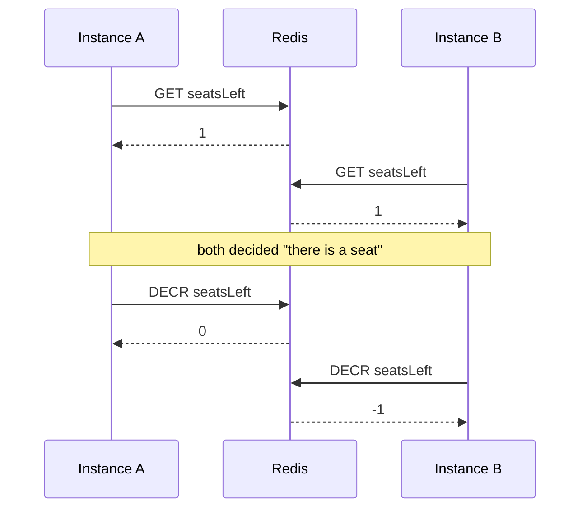
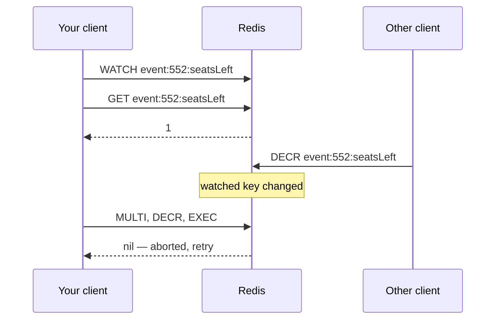

# Atomicity and Lua — Part 1

Every Redis command is atomic. That sentence is true, it is repeated
everywhere, and it quietly misleads people — because **your operation is
almost never one command.**

"Check whether this seat is still free, and if it is, take it" is two commands.
Between them, another instance of your app can run anything it likes. The
guarantee you were relying on protects each half and nothing about the whole.

Part 1 shows the race clearly, then covers the two tools Redis gives you
natively: `MULTI`/`EXEC` transactions, which are weaker than you expect, and
`WATCH`, which is optimistic locking. Part 2 covers Lua scripts, which are the
real answer.

> **➡️ Continued in [Part 2](./03-atomicity-and-lua-part-2.md)**

> **📌 In one line:** Redis guarantees that each command is indivisible, not
> that your sequence of commands is — and a Redis transaction is not a database
> transaction.

## Table of Contents

1. [The Race Hiding in Check-Then-Set](#the-race-hiding-in-check-then-set)
2. [MULTI and EXEC: What You Actually Get](#multi-and-exec-what-you-actually-get)
3. [What a Redis Transaction Does Not Do](#what-a-redis-transaction-does-not-do)
4. [Redis MULTI vs a Database Transaction](#redis-multi-vs-a-database-transaction)
5. [WATCH: Optimistic Locking](#watch-optimistic-locking)
6. [The Retry Loop WATCH Requires](#the-retry-loop-watch-requires)
7. [Advanced: When WATCH Is the Wrong Shape](#advanced-when-watch-is-the-wrong-shape)
8. [Common Mistakes](#common-mistakes)
9. [Questions to Test Yourself](#questions-to-test-yourself)
10. [Related](#related)

---

## The Race Hiding in Check-Then-Set

A workshop has 50 seats. Your API decrements a Redis counter when someone
books. The code looks obviously correct.

```ts
// ❌ BROKEN - two commands, and anything can happen between them.
export async function bookSeat(eventId: number): Promise<boolean> {
  const left = Number(await redis.get(`event:${eventId}:seatsLeft`))
  if (left <= 0) return false                      // check
  await redis.decr(`event:${eventId}:seatsLeft`)   // set
  return true
}
```

One seat remains. Two people click Book at the same moment, on two different
API instances.

| Time | Instance A (Priya) | Instance B (Omar) | `seatsLeft` |
|---|---|---|---|
| t1 | `GET seatsLeft` → 1 | | 1 |
| t2 | | `GET seatsLeft` → 1 | 1 |
| t3 | `1 > 0`, so proceed | | 1 |
| t4 | | `1 > 0`, so proceed | 1 |
| t5 | `DECR` → 0 | | 0 |
| t6 | | `DECR` → **-1** | **-1** |
| t7 | returns `true` | returns `true` | **-1** |

Both bookings succeeded. Both users have a confirmation email. There are 51
people and 50 chairs, and the counter is negative — which is itself a signal
nobody is watching for.

Notice what did **not** go wrong. `GET` was atomic. `DECR` was atomic. Neither
command interleaved with anything. The gap between t3 and t5 is where the bug
lives, and no per-command guarantee can close it.



> **📌 Remember:** the dangerous pattern is always the same shape — read a
> value, make a decision in JavaScript, then write based on that decision.
> Anywhere you see it, assume it is wrong under load.

## MULTI and EXEC: What You Actually Get

`MULTI` starts a transaction. Commands after it are queued, not run. `EXEC`
runs all of them.

```ts
// Both counters move together. No other client's command runs between them.
const results = await redis
  .multi()
  .decr(`event:${eventId}:seatsLeft`)
  .incr(`event:${eventId}:bookings`)
  .sadd(`event:${eventId}:attendees`, `user:${userId}`)
  .exec()
```

The one guarantee is real and useful: **the queued commands run as one
uninterrupted block.** No other client sees a state where `seatsLeft` went down
but `bookings` did not go up. If you were reaching for a transaction to keep
two counters consistent with each other, this does the job.

That is genuinely all it promises. Everything below is what it does not do.

## What a Redis Transaction Does Not Do

**1. There is no rollback.** If the third command fails at runtime, the first
two have already applied and they stay applied.

```ts
// WRONGTYPE on the third command. The first two are permanent.
const results = await redis
  .multi()
  .incr('company:4182:invoiceCount')   // applies
  .incr('company:4182:totalCents')     // applies
  .lpush('company:4182:profile', 'x')  // fails: profile is a hash
  .exec()

// results is [[null, 5], [null, 10400], [Error: WRONGTYPE, null]]
// You must inspect each entry. exec() does not throw for a failed command.
```

Two failure kinds behave differently, and the distinction matters:

| When the problem is found | Example | What happens |
|---|---|---|
| At queue time | Command does not exist, wrong argument count | `EXEC` is refused, nothing runs |
| At run time | `WRONGTYPE`, `INCR` on a non-number | Everything else still runs and stays |

**2. You cannot read a value and use it inside the same transaction.** Queued
commands do not return values until `EXEC`, so there is nothing to branch on.
This is fatal for our seat problem — "decrement *if* it is above zero" cannot
be expressed at all.

```ts
// ❌ BROKEN - `left` is a placeholder, not a number. There is no value yet.
const tx = redis.multi()
const left = tx.get('event:552:seatsLeft')
if (left > 0) tx.decr('event:552:seatsLeft')  // this `if` runs before EXEC
await tx.exec()
```

**3. It is not isolation in the database sense.** Nothing is locked. Between
your `GET` before the transaction and your `EXEC`, another client can change
the very key you based the decision on. `WATCH` exists precisely to detect
that.

## Redis MULTI vs a Database Transaction

Carry the wrong mental model here and you will write confident, broken code.
If you have read
[../../databases/transactions-and-concurrency/01-transactions-and-acid-part-1.md](../../databases/transactions-and-concurrency/01-transactions-and-acid-part-1.md),
this table is the correction you need.

| | PostgreSQL `BEGIN` / `COMMIT` | Redis `MULTI` / `EXEC` |
|---|---|---|
| Commands run | As you send them, immediately | Queued, all at `EXEC` |
| Read results mid-transaction | Yes — `SELECT` returns rows you can branch on | No — no values until `EXEC` |
| Branch on what you read | Yes | No |
| Rollback on error | Yes, the whole transaction is undone | **No.** Earlier commands stay |
| `ROLLBACK` command | Yes | `DISCARD`, but only *before* `EXEC` |
| Isolation from other writers | Yes, via MVCC and locks | Only "no interleaving at `EXEC`" |
| Partial failure | Impossible — all or nothing | Normal — inspect every reply |
| Deadlocks possible | Yes | No, there is nothing to lock |

The honest summary: **Redis `MULTI` is a batch that cannot be interrupted, not
a transaction.** It gives you the "A" in ACID only in the narrow sense of "no
one sees a half-applied batch", and gives you nothing resembling consistency,
isolation or durability guarantees you would expect from PostgreSQL.

> **⚠️ Warning:** the word "transaction" in the Redis documentation costs
> teams real incidents. If your operation needs "undo everything if step three
> fails", Redis cannot do it. Put that operation in PostgreSQL, or make every
> step safe to repeat.

## WATCH: Optimistic Locking

`WATCH` fills the hole. It tells Redis: *keep an eye on this key; if anybody
changes it before my `EXEC`, cancel my transaction.*

That is optimistic locking. Nothing is locked, nothing waits. You assume no
conflict, and you detect it at commit time. This is exactly the idea behind a
`version` column in PostgreSQL — same strategy, different mechanism. The
comparison with pessimistic locking is in
[../../databases/transactions-and-concurrency/06-optimistic-vs-pessimistic-locking-part-1.md](../../databases/transactions-and-concurrency/06-optimistic-vs-pessimistic-locking-part-1.md).



Here is the seat booking, correct at last:

```ts
// ✅ FIXED - WATCH makes Redis cancel the transaction if the key we based the
// decision on changed. The counter can no longer go negative.
export async function bookSeatWatch(eventId: number): Promise<boolean> {
  const key = `event:${eventId}:seatsLeft`

  await redis.watch(key)                 // start watching before you read

  const left = Number(await redis.get(key))
  if (left <= 0) {
    await redis.unwatch()                // release the watch on the early exit
    return false
  }

  // If another client touched `key` since WATCH, exec() resolves to null.
  const results = await redis.multi().decr(key).exec()
  if (results === null) throw new ConflictError('seat count changed, retry')

  return true
}
```

Three rules that are easy to get wrong:

- **`WATCH` before you read.** Watching after the read protects nothing.
- **`UNWATCH` on every path that does not reach `EXEC`.** Forgetting it leaves a
  watch on a pooled connection and aborts an unrelated later transaction.
- **`EXEC` returning `null` is not an error.** It is the mechanism working. Your
  code must handle it, which means retrying.

## The Retry Loop WATCH Requires

Optimistic locking without a retry loop is just a fancy way to return errors to
users. The loop is not optional.

```ts
export async function bookSeat(eventId: number, attempts = 5): Promise<boolean> {
  const key = `event:${eventId}:seatsLeft`

  for (let attempt = 0; attempt < attempts; attempt++) {
    await redis.watch(key)

    const left = Number(await redis.get(key))
    if (left <= 0) {
      await redis.unwatch()
      return false                       // genuinely sold out, not a conflict
    }

    const results = await redis.multi().decr(key).exec()
    if (results !== null) return true     // committed

    // null means a conflict. Back off a little so retries do not sync up.
    await sleep(2 ** attempt * 5 + Math.random() * 10)
  }

  // Give up rather than loop forever holding an HTTP request open.
  throw new ConflictError('could not book a seat, please try again')
}
```

Two properties to notice. **The backoff is randomised** — without jitter, all
the losing clients retry at the same instant and collide again. **The attempt
count is bounded** — an unbounded retry loop under heavy contention turns one
hot key into a stuck request queue.

And that points at the real weakness. Under contention, `WATCH` degrades badly:
the more clients competing for one key, the more of them abort and retry, which
increases contention further. For a hot key, this pattern spends most of its
time failing.

```text
  10 clients, 1 hot key, WATCH + retry

  round 1:  10 try  →  1 wins,  9 abort
  round 2:   9 try  →  1 wins,  8 abort
  round 3:   8 try  →  1 wins,  7 abort
  ...        45 round trips to do 10 bookings
```

The same work as a Lua script is 10 round trips, no aborts, no retries. That is
Part 2.

## Advanced: When WATCH Is the Wrong Shape

`WATCH` earns its place in one situation: **the work between the read and the
write must happen in your application**, because Redis cannot do it. You need
to call a pricing function, consult PostgreSQL, or run business logic that does
not belong in a script.

Reach for something else when any of these are true:

| Situation | Better tool |
|---|---|
| The logic is simple arithmetic or a comparison | A Lua script — [Part 2](./03-atomicity-and-lua-part-2.md) |
| The key is hot and heavily contended | A Lua script, or move the check to PostgreSQL |
| You only need "create it if it is absent" | `SET key value NX PX ttl` |
| You need mutual exclusion across a long job | A distributed lock — [04-distributed-locks-part-1.md](./04-distributed-locks-part-1.md) |
| Correctness involves money or a unique constraint | PostgreSQL — a unique index cannot be raced |

Two more sharp edges. In **Redis Cluster**, every key in one `MULTI` must live
on the same node, so a multi-key transaction across unrelated keys is simply
not available — hash tags are the workaround. And `WATCH` **occupies connection
state**: the watch belongs to the connection, so it does not compose with a
shared client used concurrently by many requests. Use `duplicate()` for a
watch-heavy path.

> **💡 Tip:** if you cannot state, in one sentence, which key you are watching
> and which client would change it, you do not yet understand the race well
> enough to fix it. Write the timeline table first.

---

## Common Mistakes

| Mistake | Why it is wrong | Do this instead |
|---|---|---|
| "Redis commands are atomic, so my code is safe" | Each command is atomic, your sequence is not | Make the whole operation one command or one script |
| Expecting `MULTI` to roll back | A failed command does not undo the earlier ones | Inspect every reply, or use PostgreSQL |
| Branching on a value inside `MULTI` | Queued commands return nothing until `EXEC` | `WATCH`, or a Lua script |
| Wrapping `exec()` in one `try/catch` | Individual command errors arrive in the reply array | Check the error slot of each reply |
| `WATCH` after the `GET` | The read is unprotected, the race remains | `WATCH` first, then read |
| No `UNWATCH` on an early return | The watch leaks and aborts a later transaction | `UNWATCH` on every path that skips `EXEC` |
| Treating `exec() === null` as a failure to log | That is the conflict signal, and it means retry | A bounded retry loop with jitter |
| Unbounded `WATCH` retries on a hot key | Contention grows, requests pile up | Cap attempts, then use a Lua script |
| `MULTI` across keys in Redis Cluster | The keys may live on different nodes | Hash tags, or redesign the keys |

## Questions to Test Yourself

1. `GET` is atomic and `DECR` is atomic, yet the seat counter went to `-1`.
   Explain precisely where the bug is.
2. Name the one guarantee `MULTI`/`EXEC` provides, in a single sentence.
3. A command inside `MULTI` fails with `WRONGTYPE`. What happened to the
   commands queued before it? What about ones queued after?
4. Why can you not write "decrement only if above zero" using `MULTI` alone?
5. Give three differences between a PostgreSQL transaction and a Redis
   transaction that would change how you write code.
6. `EXEC` returned `null`. What does that mean, what caused it, and what must
   your code do next?
7. Ten clients contend on one key using `WATCH` and retries. Why does this get
   *worse* as you add clients, and what fixes it?
8. Give one situation where `WATCH` is genuinely the right tool and a Lua
   script is not.

## Related

- [Part 2](./03-atomicity-and-lua-part-2.md) — Lua scripts, `EVALSHA`, and the atomic patterns worth memorising
- [README.md](./README.md) — the rest of this folder
- [02-choosing-data-structures-part-2.md](./02-choosing-data-structures-part-2.md) — the same lost-update race on counters, and the single-command fixes
- [04-distributed-locks-part-1.md](./04-distributed-locks-part-1.md) — when mutual exclusion has to span a whole job
- [01-connecting-to-redis-part-2.md](./01-connecting-to-redis-part-2.md) — why a pipeline is not a transaction
- [../../databases/transactions-and-concurrency/01-transactions-and-acid-part-1.md](../../databases/transactions-and-concurrency/01-transactions-and-acid-part-1.md) — what a real transaction guarantees
- [../../databases/transactions-and-concurrency/06-optimistic-vs-pessimistic-locking-part-1.md](../../databases/transactions-and-concurrency/06-optimistic-vs-pessimistic-locking-part-1.md) — the same optimistic strategy in PostgreSQL
- [../../databases/transactions-and-concurrency/02-isolation-levels-and-anomalies-part-1.md](../../databases/transactions-and-concurrency/02-isolation-levels-and-anomalies-part-1.md) — lost updates and the anomalies isolation levels prevent
- [../../system-design/foundational/redis.md](../../system-design/foundational/redis.md) — the concept-level note on atomic operations
