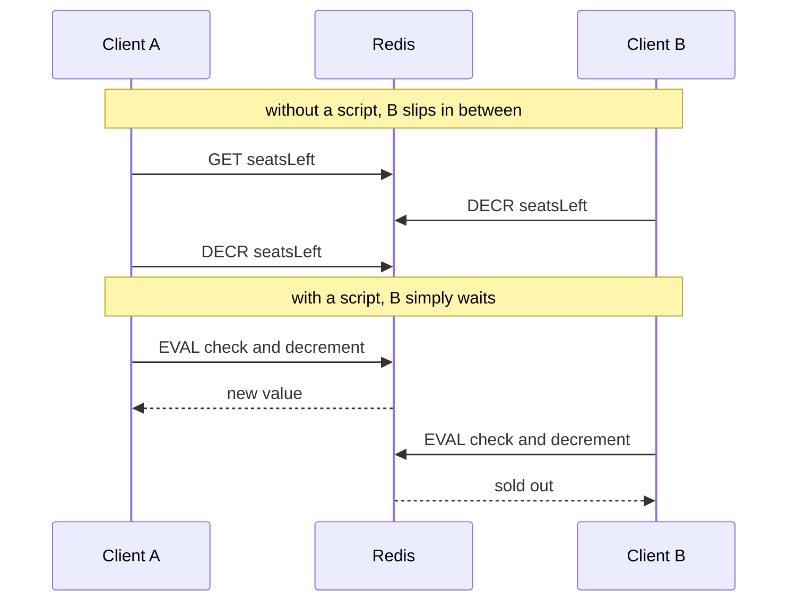

# Atomicity and Lua — Part 2

Part 1 left the seat-booking problem half-solved. `MULTI` cannot branch on a
value it read. `WATCH` can, but it degrades under contention and needs a retry
loop around every call site.

Lua scripting solves it properly. You send Redis a small program, Redis runs
the whole program as **one command** — indivisible, with no other client
interleaving — and returns the result. Read, decide and write all happen inside
that one atomic step.

That power comes with a matching danger, and it is the same one from the start
of this folder: one thread.

> **⬅️ This continues [Part 1](./03-atomicity-and-lua-part-1.md).**

> **📌 In one line:** a Lua script runs as a single atomic command, which makes
> it the right tool for multi-step logic and the wrong place for any loop over
> a large collection.

## Table of Contents

1. [A Script Is One Command](#a-script-is-one-command)
2. [The Seat Booking, Solved](#the-seat-booking-solved)
3. [KEYS and ARGV: Why Keys Must Be Passed In](#keys-and-argv-why-keys-must-be-passed-in)
4. [Calling It From Node, and EVALSHA](#calling-it-from-node-and-evalsha)
5. [The Single-Threaded Warning, Again](#the-single-threaded-warning-again)
6. [Pattern: Create Only If Absent](#pattern-create-only-if-absent)
7. [Pattern: A Fixed-Window Counter That Cannot Leak](#pattern-a-fixed-window-counter-that-cannot-leak)
8. [Pattern: Atomic Pop and Process](#pattern-atomic-pop-and-process)
9. [Advanced: SETNX vs SET NX PX](#advanced-setnx-vs-set-nx-px)
10. [Common Mistakes](#common-mistakes)
11. [Questions to Test Yourself](#questions-to-test-yourself)
12. [Related](#related)

---

## A Script Is One Command

Redis embeds a small Lua interpreter. `EVAL` sends it a script, and Redis runs
that script the same way it runs `GET` — as one unit of work on its single
thread. Nothing from any other client runs in the middle.

That single sentence gives you everything `MULTI` could not:

| | `MULTI` / `EXEC` | Lua script |
|---|---|---|
| Runs without interleaving | Yes | Yes |
| Read a value and branch on it | No | **Yes** |
| Loops and conditionals | No | Yes |
| Returns a computed value | Only raw replies | Anything you build |
| Retry loop needed | Yes, with `WATCH` | No |
| Round trips for check-then-set | 3 or more | **1** |
| Rollback on a logical failure | No | No — you decide what to write |



You do not need to know Lua well. Ninety percent of production scripts use
`redis.call`, `if`, `tonumber`, and `return`.

## The Seat Booking, Solved

The problem from Part 1: decrement the remaining seat count, but only if it is
above zero, and tell me whether it worked.

```lua
-- decrement-if-available.lua
-- KEYS[1] = the seat counter key
-- ARGV[1] = how many seats to take
local remaining = tonumber(redis.call('GET', KEYS[1]))

if remaining == nil then
  return -1                    -- the key does not exist, or is not a number
end

local wanted = tonumber(ARGV[1])
if remaining < wanted then
  return -2                    -- not enough seats; nothing was changed
end

-- Safe: the check and the write are inside the same atomic command.
return redis.call('DECRBY', KEYS[1], wanted)
```

Read it against the timeline table in Part 1. There is no t3-to-t5 gap any
more, because the whole script is t3. The second client's script cannot start
until the first one has finished writing.

```ts
const DECREMENT_IF_AVAILABLE = `
  local remaining = tonumber(redis.call('GET', KEYS[1]))
  if remaining == nil then return -1 end
  local wanted = tonumber(ARGV[1])
  if remaining < wanted then return -2 end
  return redis.call('DECRBY', KEYS[1], wanted)
`

type BookingResult =
  | { ok: true; seatsLeft: number }
  | { ok: false; reason: 'sold-out' | 'unknown-event' }

export async function bookSeats(eventId: number, count: number): Promise<BookingResult> {
  const result = (await redis.eval(
    DECREMENT_IF_AVAILABLE,
    1,                                  // how many of the arguments are KEYS
    `event:${eventId}:seatsLeft`,       // KEYS[1]
    String(count),                      // ARGV[1]
  )) as number

  if (result === -1) return { ok: false, reason: 'unknown-event' }
  if (result === -2) return { ok: false, reason: 'sold-out' }
  return { ok: true, seatsLeft: result }
}
```

One round trip. No retry loop. No conflict error reaching the user. The
counter can never go negative, no matter how many instances of your API are
running.

> **💡 Tip:** return distinct negative numbers for distinct failures, as above.
> Returning `0` or `nil` for every failure means your Node code cannot tell
> "sold out" from "that event does not exist", and the user gets the wrong
> message.

## KEYS and ARGV: Why Keys Must Be Passed In

A script receives two arrays. `KEYS` holds the keys it will touch. `ARGV` holds
everything else. The split looks like a formality. It is not.

```ts
// ❌ BROKEN - the key is built inside the script from a plain argument.
// Redis has no idea which key this script touches.
const BAD = `
  local key = 'event:' .. ARGV[1] .. ':seatsLeft'
  return redis.call('DECR', key)
`
await redis.eval(BAD, 0, String(eventId))
```

```ts
// ✅ FIXED - the key is declared, so Redis knows what the script touches.
const GOOD = `return redis.call('DECR', KEYS[1])`
await redis.eval(GOOD, 1, `event:${eventId}:seatsLeft`)
```

Three concrete reasons this matters:

- **Redis Cluster breaks outright.** The cluster routes a command to the node
  that owns its keys, and it works that out from `KEYS`. A script that hides
  its keys gets routed to the wrong node and fails, or worse, operates on a
  different shard's keyspace than you intended.
- **Tooling goes blind.** `SLOWLOG`, key-tracking, and client-side caching all
  rely on knowing which keys a command touched.
- **It is an injection risk.** Building key names by string concatenation
  inside a script is the same class of mistake as building SQL by
  concatenation — see
  [../../backend-fundamentals/11-api-security/02-injection-attacks-part-1.md](../../backend-fundamentals/11-api-security/02-injection-attacks-part-1.md).

Two more rules about script content:

- **Scripts must be deterministic.** Do not call `TIME`, `randomkey`, or
  anything else that would give a different answer on a replica. Pass the
  current timestamp in as `ARGV` instead. Recent Redis versions are more
  permissive here, but passing it in is always correct and always portable.
- **Lua indexes from 1.** `KEYS[1]` is the first key, not `KEYS[0]`. This
  catches every JavaScript developer once.

## Calling It From Node, and EVALSHA

Sending the full script text on every call wastes bandwidth. `EVALSHA` sends a
SHA-1 hash of a script Redis already has cached instead.

```text
  first call            SCRIPT LOAD  →  Redis stores it, returns the sha
  every call after      EVALSHA sha  →  a 40-character hash, not 400 bytes
  after a restart       NOSCRIPT     →  fall back to EVAL once, and continue
```

The script cache is not persistent, so any code using `EVALSHA` must handle
`NOSCRIPT` after a restart or a failover. Do not write that logic yourself —
both clients do it for you.

```ts
// ioredis: define it once at startup, then call it like a normal method.
redis.defineCommand('bookSeats', {
  numberOfKeys: 1,
  lua: DECREMENT_IF_AVAILABLE,
})

declare module 'ioredis' {
  interface RedisCommander<Context> {
    bookSeats(key: string, count: string): Promise<number>
  }
}

// Uses EVALSHA under the hood and retries with EVAL on NOSCRIPT automatically.
const result = await redis.bookSeats(`event:${eventId}:seatsLeft`, String(count))
```

Keep the actual Lua in its own `.lua` file and read it at startup. Scripts
buried in template literals never get syntax highlighting, never get reviewed
properly, and never get tested.

## The Single-Threaded Warning, Again

Everything good about a Lua script comes from the fact that nothing else runs
while it does. Everything dangerous comes from the same fact.

**While your script runs, the entire Redis server is unavailable to every
client.** Not slow. Stopped.

```lua
-- ❌ BROKEN - walks an entire set inside a script.
-- With 500,000 members this freezes the server for every client, for seconds.
local members = redis.call('SMEMBERS', KEYS[1])
for i, member in ipairs(members) do
  redis.call('ZADD', KEYS[2], tonumber(ARGV[1]), member)
end
return #members
```

```lua
-- ✅ FIXED - the caller passes a bounded batch and calls the script repeatedly.
-- Each run is short, so other clients get served between batches.
for i = 1, #ARGV - 1 do
  redis.call('ZADD', KEYS[1], tonumber(ARGV[1]), ARGV[i + 1])
end
return #ARGV - 1
```

The rules for keeping scripts safe:

| Rule | Why |
|---|---|
| No unbounded loops | Every iteration holds the whole server |
| No `KEYS`, `SMEMBERS`, `HGETALL` on collections you do not control | O(n) inside an atomic block |
| Bound any batch the caller passes in | A caller will eventually pass 100,000 items |
| Keep scripts to tens of lines | Long scripts hide long operations |
| No network calls, no sleeping | There is no such thing here, and there should not be |

If a script does overrun, `SCRIPT KILL` stops one that has not yet written
anything. A script that has already written cannot be killed safely — the only
way out is `SHUTDOWN NOSAVE`, which means losing data. Prevention is the whole
strategy.

> **⚠️ Warning:** a Lua script that takes 200 ms is not "a 200 ms command". It
> is 200 ms during which every other request in your entire system that touches
> Redis is blocked. Budget scripts in microseconds.

## Pattern: Create Only If Absent

The simplest atomic pattern, and the one you will use most.

```ts
// 'OK' if we created it; null if it already existed. One command, no race.
const created = await redis.set(
  `idempotency:${requestId}`,
  JSON.stringify({ status: 'processing' }),
  'NX',
  'EX', 86_400,
)

if (created === null) {
  // Someone already started this exact request. Do not charge the card twice.
  return replayOrConflict(requestId)
}
```

This is the mechanism behind idempotency keys, request deduplication, and the
lock in the next file. The concept, and where it belongs in an API, is covered
in
[../../system-design/reliability/idempotency.md](../../system-design/reliability/idempotency.md).

## Pattern: A Fixed-Window Counter That Cannot Leak

Count requests per minute: `INCR` the counter, and set an expiry the first time
you see it. The obvious version has a real bug.

```ts
// ❌ BROKEN - two commands. If the process dies, or Redis drops the second
// command, the key has no TTL and the customer is rate-limited forever.
const count = await redis.incr(key)
if (count === 1) {
  await redis.expire(key, 60)   // never runs if we crash right here
}
```

A key stuck at 5,000 with no expiry is a customer who cannot use your API until
someone notices and deletes it by hand. It is rare, it is silent, and it always
happens to your largest account.

```ts
// ✅ FIXED - increment and expiry in one atomic script. Either both or neither.
const INCR_WITH_TTL = `
  local current = redis.call('INCR', KEYS[1])
  if current == 1 then
    redis.call('EXPIRE', KEYS[1], tonumber(ARGV[1]))
  end
  return current
`

export async function hitFixedWindow(companyId: number): Promise<number> {
  const window = Math.floor(Date.now() / 60_000)
  return (await redis.eval(
    INCR_WITH_TTL, 1, `ratelimit:${companyId}:${window}`, '60',
  )) as number
}
```

Note the window number in the key. Even if the `EXPIRE` somehow failed, the
next minute uses a different key, so a customer is never blocked permanently.
**Design the key so the failure mode is survivable, then make it atomic
anyway** — two independent defences.

The sliding-window version, and which algorithm to pick, are in
[02-choosing-data-structures-part-2.md](./02-choosing-data-structures-part-2.md)
and
[../../system-design/foundational/rate-limiting.md](../../system-design/foundational/rate-limiting.md).

## Pattern: Atomic Pop and Process

Taking an item from a collection and marking it as yours must be one step, or
two workers take the same item.

For a list, Redis gives you a single command: `LMOVE` (or the older
`RPOPLPUSH`) moves an item from the pending list to a processing list
atomically. If the worker dies, the item is still in `processing` and a sweeper
can return it.

```ts
// One command: remove from the tail of pending, push to the head of processing.
const job = await redis.lmove('jobs:pending', 'jobs:processing', 'RIGHT', 'LEFT')
```

For a sorted-set delay queue — "everything due before now" — there is no single
command, so it needs a script.

```lua
-- claim-due-jobs.lua
-- KEYS[1] = the scheduled set, KEYS[2] = the processing set
-- ARGV[1] = now in ms, ARGV[2] = max jobs to claim, ARGV[3] = visibility ms
local due = redis.call('ZRANGEBYSCORE', KEYS[1], '-inf', ARGV[1],
                       'LIMIT', 0, tonumber(ARGV[2]))
if #due == 0 then return {} end

for i = 1, #due do
  redis.call('ZREM', KEYS[1], due[i])
  -- Park it with a deadline so a crashed worker's job comes back.
  redis.call('ZADD', KEYS[2], tonumber(ARGV[1]) + tonumber(ARGV[3]), due[i])
end
return due
```

`LIMIT 0, ARGV[2]` is the important line — it bounds the work, so the script
stays short no matter how many jobs are overdue. Two workers calling this at
the same instant cannot receive the same job.

You should understand this, and you should still use a real queue library for
production work. Retries, backoff, dead-letter queues and metrics are a lot to
rebuild. See [../03-background-jobs/](../03-background-jobs/).

## Advanced: SETNX vs SET NX PX

One last pattern, because it leads directly into the next file.

Redis has an old command, `SETNX`, that sets a key only if it does not exist.
It cannot set an expiry. So the natural code is two commands:

```ts
// ❌ BROKEN - if the process dies between these lines, the key never expires.
// For a lock, that is a deadlock that survives every restart.
const acquired = await redis.setnx('lock:invoice-sweep', token)
if (acquired === 1) {
  await redis.expire('lock:invoice-sweep', 30)  // may never run
}
```

```ts
// ✅ FIXED - one command does both. There is no gap to die in.
const acquired = await redis.set('lock:invoice-sweep', token, 'NX', 'PX', 30_000)
```

The single-command form is not a convenience. It is the difference between a
lock that always releases and a lock that can hang your nightly job forever.
The general principle:

> **📌 Remember:** whenever a piece of state and its expiry must both exist or
> neither, they have to be set by one command or one script. Two commands means
> a window where the state exists without its safety net.

That is the foundation of a distributed lock, and it is where
[04-distributed-locks-part-1.md](./04-distributed-locks-part-1.md) begins —
along with the matching problem on the way out, where releasing a lock with a
plain `DEL` lets you delete somebody else's.

---

## Common Mistakes

| Mistake | Why it is wrong | Do this instead |
|---|---|---|
| Building key names inside a script | Redis cannot route it; breaks in cluster mode | Pass every key through `KEYS` |
| `KEYS[0]` | Lua arrays start at 1 | `KEYS[1]` |
| A loop over a whole set inside a script | Blocks every client for the duration | Bound the batch, call the script repeatedly |
| `redis.call('TIME')` in a script | Non-deterministic across replicas | Pass the timestamp in as `ARGV` |
| `EVALSHA` with no `NOSCRIPT` fallback | The script cache is empty after a restart | `defineCommand`, or the client's script helper |
| Returning `nil` for every failure | Node cannot tell the failure cases apart | Distinct negative return codes |
| `INCR` then `EXPIRE` as two commands | A crash between them leaves a key with no TTL | One script, and a time window in the key |
| `SETNX` then `EXPIRE` for a lock | A crash between them deadlocks forever | `SET key token NX PX ttl` |
| Popping and marking as two commands | Two workers claim the same item | `LMOVE`, or a script |
| Lua scripts inline in template literals | Never reviewed, never tested, never highlighted | A `.lua` file loaded at startup |

## Questions to Test Yourself

1. Explain in one sentence why a Lua script solves the seat-booking race that
   `MULTI` cannot.
2. Why must keys be passed in `KEYS` rather than built inside the script? Give
   the cluster reason and the security reason.
3. Your script takes 200 ms. Describe the effect on an unrelated endpoint that
   only does a single `GET`.
4. A script is stuck in a loop and has already written a key. Why can
   `SCRIPT KILL` not help you?
5. `INCR` then `EXPIRE` as two commands has a rare failure. Describe it, its
   effect on a customer, and two independent ways to prevent it.
6. Why does `EVALSHA` sometimes fail with `NOSCRIPT`, and what should happen
   next?
7. Compare `SETNX` + `EXPIRE` with `SET key token NX PX ttl`. What exactly goes
   wrong in the gap?
8. In the delay-queue script, why is `LIMIT 0, ARGV[2]` essential rather than a
   nice-to-have?

## Related

- [Part 1](./03-atomicity-and-lua-part-1.md) — the race, `MULTI`/`EXEC`, and `WATCH`
- [README.md](./README.md) — the rest of this folder
- [04-distributed-locks-part-1.md](./04-distributed-locks-part-1.md) — `SET NX PX` turned into a real lock, and the release bug
- [02-choosing-data-structures-part-2.md](./02-choosing-data-structures-part-2.md) — the sliding-window limiter this file makes atomic
- [01-connecting-to-redis-part-1.md](./01-connecting-to-redis-part-1.md) — why one thread means one slow script stops everything
- [../03-background-jobs/](../03-background-jobs/) — why you should not hand-build the delay queue above
- [../../system-design/reliability/idempotency.md](../../system-design/reliability/idempotency.md) — where `SET NX` fits in an API
- [../../system-design/foundational/rate-limiting.md](../../system-design/foundational/rate-limiting.md) — choosing a limiting algorithm
- [../../system-design/foundational/redis.md](../../system-design/foundational/redis.md) — the concept-level note on atomic operations and `EVAL`
- [../../backend-fundamentals/11-api-security/02-injection-attacks-part-1.md](../../backend-fundamentals/11-api-security/02-injection-attacks-part-1.md) — why concatenating user input into any command string is the same bug
