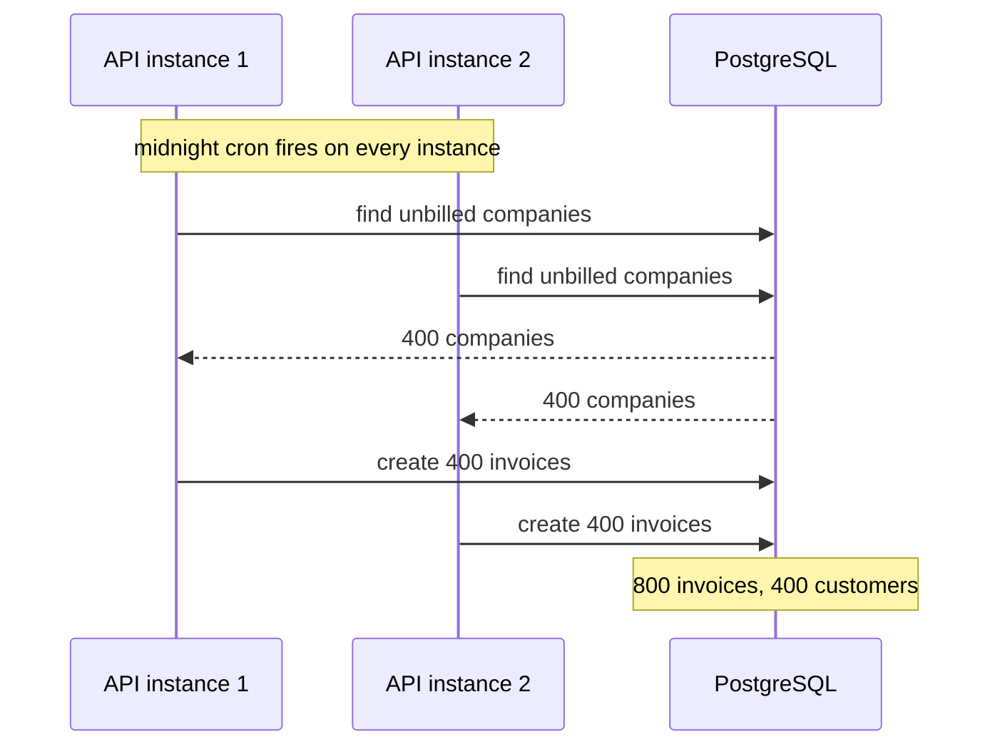

# Distributed Locks — Part 1

You run three copies of your API behind a load balancer. At midnight, each one
wakes up and starts generating monthly invoices. Every customer gets three
invoices. Or: two requests arrive at the same instant to charge the same
unpaid invoice, and the customer's card is charged twice.

Only one of them should win. A **distributed lock** is the mechanism for
"across all our servers, exactly one process may do this at a time".

Part 1 is about doing it correctly: why you often should not, how to acquire a
lock that cannot deadlock, and how to release one without deleting somebody
else's. Part 2 is about the honest limits of the whole approach, and a helper
you can actually use.

> **➡️ Continued in [Part 2](./04-distributed-locks-part-2.md)**

> **📌 In one line:** a Redis lock must be acquired with `SET NX PX` and
> released with a script that checks a unique token — and most of the time you
> should have used a database constraint instead.

## Table of Contents

1. [The Problem, in Pictures](#the-problem-in-pictures)
2. [First: You Probably Do Not Need a Lock](#first-you-probably-do-not-need-a-lock)
3. [The Naive Lock and Why It Deadlocks](#the-naive-lock-and-why-it-deadlocks)
4. [Acquiring Correctly](#acquiring-correctly)
5. [Releasing Safely: The Most Important Code Here](#releasing-safely-the-most-important-code-here)
6. [When the Work Outlives the Lock](#when-the-work-outlives-the-lock)
7. [Common Mistakes](#common-mistakes)
8. [Questions to Test Yourself](#questions-to-test-yourself)
9. [Related](#related)

---

## The Problem, in Pictures

A lock in a single Node process is easy — there is one event loop, so "am I
already doing this?" is a variable. The moment you run two processes, that
variable exists twice and agrees with nothing.



The shared state has to live somewhere both processes can see. Redis is a
reasonable place to put it: it is fast, every instance already talks to it, and
`SET NX` is a genuine atomic test-and-set.

```text
  Before                              After
  ──────                              ─────
  instance 1 ─┐                       instance 1 ─┐
  instance 2 ─┼─► the work            instance 2 ─┼─► [ Redis lock ] ─► the work
  instance 3 ─┘   (three times)       instance 3 ─┘    one winner
```

## First: You Probably Do Not Need a Lock

This section exists because reaching for a distributed lock is usually the
second-best answer, and sometimes a dangerous one. A lock is a piece of shared
state that can expire at the wrong moment. A database constraint cannot.

Before you write any of the code below, check this table.

| You think you need a lock because... | Try this first | Why it is better |
|---|---|---|
| "Only one invoice per company per month" | A unique index on `(company_id, period)` | The database refuses the duplicate. No timing involved |
| "Only one worker should take this job row" | `SELECT ... FOR UPDATE SKIP LOCKED` | Real row locks, released by the transaction, crash-safe |
| "This request must not be processed twice" | An idempotency key | Retries and duplicates become safe, not blocked |
| "Two requests must not update the same row" | A transaction, or optimistic locking with a `version` column | Held by the database, no TTL to expire |
| "Only one instance may run this cron job" | A Redis lock **or** a scheduler that runs once | Genuinely a good fit for a Redis lock |
| "Do not refresh this cache entry 50 times at once" | A Redis lock | Also a good fit — losing it costs a little extra work |
| "Money must not move twice" | A unique constraint plus an idempotency key | A lock cannot guarantee this. Part 2 explains why |

The database tools here are covered properly in
[../../databases/transactions-and-concurrency/04-locks-part-1.md](../../databases/transactions-and-concurrency/04-locks-part-1.md),
and the idempotency pattern in
[../../system-design/reliability/idempotency.md](../../system-design/reliability/idempotency.md).
Read them before you decide.

The distinction that runs through the rest of this file:

> **📌 Remember:** use a Redis lock for **efficiency** — stopping work from
> being done twice when duplicate work is merely wasteful. Do not use it as
> your only guarantee of **correctness** — when doing the work twice is a bug
> you must apologise for. For correctness, put the constraint in PostgreSQL.

If after all of that you still want a lock — and for cron jobs and cache
refreshes you legitimately do — the rest of this file gets it right.

## The Naive Lock and Why It Deadlocks

Here is the first thing everyone writes.

```ts
// ❌ BROKEN - no expiry. If this process crashes, the lock is never released,
// and the nightly invoice run stops working. Forever. Silently.
const acquired = await redis.setnx('lock:invoice-sweep', '1')
if (acquired === 1) {
  await generateInvoices()
  await redis.del('lock:invoice-sweep')
}
```

Walk the failure. The process acquires the lock, the container is killed mid-run
by a deploy or an out-of-memory kill, and `del` never executes. The key sits in
Redis with no expiry. Tomorrow night, every instance finds the lock held and
skips. Nobody is invoiced. Nothing errors. You discover it at the end of the
month.

The obvious patch is two commands, and it has its own gap:

```ts
// ❌ STILL BROKEN - a crash between these two lines is the same deadlock,
// just through a narrower window.
await redis.setnx('lock:invoice-sweep', '1')
await redis.expire('lock:invoice-sweep', 300)
```

This is exactly the pattern from
[03-atomicity-and-lua-part-2.md](./03-atomicity-and-lua-part-2.md): state and
its safety net must be created by one command, or there is a window where the
state exists without protection.

## Acquiring Correctly

One command sets the value and the expiry together.

```ts
import { randomUUID } from 'node:crypto'

const LOCK_KEY = 'lock:invoice-sweep'
const LOCK_TTL_MS = 300_000   // 5 minutes

// A token unique to THIS acquisition. The next section explains why.
const token = randomUUID()

// NX: only if absent. PX: expire after this many milliseconds.
const acquired = await redis.set(LOCK_KEY, token, 'NX', 'PX', LOCK_TTL_MS)

if (acquired === null) {
  logger.info('invoice sweep already running elsewhere, skipping')
  return
}
```

Three decisions are encoded in those lines.

- **`NX` makes it a lock.** Without it, `SET` always succeeds and everybody
  "wins".
- **`PX` makes it recoverable.** Whatever happens to this process, the lock is
  gone in five minutes. Choose the TTL as "comfortably longer than the work
  normally takes" — too short and you lose the lock mid-job, too long and a
  crash blocks the next run for ages.
- **The value is a unique token, not `"1"`.** This is the part everyone skips,
  and it is the subject of the next section.

## Releasing Safely: The Most Important Code Here

Releasing looks trivial. It is where the subtle bug lives.

```ts
// ❌ BROKEN - deletes whatever lock is there, even one you no longer own.
await redis.del(LOCK_KEY)
```

Here is how that goes wrong. Nothing crashes. Nothing errors.

| Time | Worker A | Worker B | Lock in Redis |
|---|---|---|---|
| t1 | acquires, TTL 300s | | held by A |
| t2 | starts the sweep | | held by A |
| t3 | stalls — a long GC pause, a slow query, the container is throttled | | held by A |
| t4 | *still stalled* | | **expires** |
| t5 | | acquires the lock | held by B |
| t6 | | starts the sweep | held by B |
| t7 | wakes up, finishes, calls `DEL` | | **released — but it was B's lock** |
| t8 | | *still working, believes it holds the lock* | free |
| t9 | | | Worker C acquires and starts a third sweep |

Worker A deleted a lock it did not own. Now two workers run the sweep
concurrently, which is the exact thing the lock existed to prevent — and the
lock made it *harder* to notice, because everyone believes they are protected.

The fix has two halves. First, the unique token from the acquire step. Second,
a release that checks the token and deletes **in one atomic step**. Checking
with `GET` and then calling `DEL` reintroduces the same gap between the two
commands.

```lua
-- release-if-mine.lua
-- KEYS[1] = the lock key, ARGV[1] = my token
-- Returns 1 if we released our own lock, 0 if it was not ours any more.
if redis.call('GET', KEYS[1]) == ARGV[1] then
  return redis.call('DEL', KEYS[1])
else
  return 0
end
```

```ts
// ✅ FIXED - compare-and-delete in one atomic command. A lock that is no
// longer ours is left alone, and we find out.
const RELEASE_IF_MINE = `
  if redis.call('GET', KEYS[1]) == ARGV[1] then
    return redis.call('DEL', KEYS[1])
  else
    return 0
  end
`

const released = (await redis.eval(RELEASE_IF_MINE, 1, LOCK_KEY, token)) as number

if (released === 0) {
  // We lost the lock while working. Another worker may have run the same job.
  // This is not a warning to swallow — it means the TTL is too short.
  logger.error({ lockKey: LOCK_KEY }, 'lock expired before work finished')
}
```

That `released === 0` branch is valuable on its own. It is the only signal you
will ever get that your lock TTL is wrong. Log it, alert on it, and treat it as
a bug rather than noise.

> **⚠️ Warning:** if you take one thing from this file, take this: **a lock
> value must be a unique token, and release must be a compare-and-delete
> script.** A plain `DEL` is a lock that silently stops working under exactly
> the conditions you needed it for.

## When the Work Outlives the Lock

The release check tells you the lock expired early. Now what?

There are exactly two answers, and one of them is much better than the other.

### Answer 1: extend the lock while you work (a watchdog)

A timer periodically pushes the expiry further out, for as long as the work is
running. The extension must also check the token — for the same reason the
release does.

```ts
const EXTEND_IF_MINE = `
  if redis.call('GET', KEYS[1]) == ARGV[1] then
    return redis.call('PEXPIRE', KEYS[1], tonumber(ARGV[2]))
  else
    return 0
  end
`

function startWatchdog(key: string, token: string, ttlMs: number): () => void {
  // Refresh at a third of the TTL, so a missed beat is not immediately fatal.
  const timer = setInterval(async () => {
    const ok = (await redis.eval(EXTEND_IF_MINE, 1, key, token, String(ttlMs))) as number
    if (ok === 0) {
      // We no longer hold it. Stop pretending we do.
      clearInterval(timer)
      logger.error({ key }, 'watchdog lost the lock')
    }
  }, Math.floor(ttlMs / 3))

  timer.unref()                    // do not keep the process alive for this
  return () => clearInterval(timer)
}
```

This works, and it has a limit you must understand: **a watchdog is a Node
timer.** If the process stalls — a long garbage-collection pause, a blocked
event loop, a throttled container — the timer does not fire either. The exact
condition that makes you lose the lock is the condition that stops you
renewing it. A watchdog shrinks the window. It does not close it.

### Answer 2: make the work safe to run twice

Design the job so that running it a second time changes nothing. Then losing
the lock costs you some wasted CPU and nothing else.

```ts
// The lock stops the common case of duplicate work.
// The unique index is what actually guarantees one invoice per period.
await db.transaction(async (trx) => {
  await trx
    .insertQuery('invoices')
    .insert({ companyId, period, amountCents })
    .onConflict(['company_id', 'period'])   // the real guarantee
    .ignore()
})
```

| | Watchdog | Idempotent work |
|---|---|---|
| Protects against | The job simply taking longer than expected | Everything, including losing the lock |
| Fails when | The process stalls, so the timer does not fire | It does not — that is the point |
| Complexity | A timer, a script, and cleanup on every exit path | A unique constraint, or an idempotency key |
| What you rely on | Redis, timers, and the process staying responsive | The database |

**Answer 2 is more robust, and it is the one to aim for.** Answer 1 is a
reasonable optimisation on top of it. Answer 1 *alone* is a lock you believe in
more than it deserves.

> **💡 Tip:** a good test of a job's design: "if I ran this twice right now, by
> hand, what would break?" If the answer is "nothing", the lock is an
> optimisation and you can sleep. If the answer is "a customer is charged
> twice", the lock is not enough — and Part 2 explains exactly why.

---

## Common Mistakes

| Mistake | Why it is wrong | Do this instead |
|---|---|---|
| Reaching for a lock first | A database constraint is simpler and cannot expire | Check the decision table before writing lock code |
| `SETNX` with no expiry | A crashed holder deadlocks the job forever | `SET key token NX PX ttl` |
| `SETNX` then `EXPIRE` | A crash in the gap is the same deadlock | One command |
| A constant lock value like `"1"` | You cannot tell your lock from somebody else's | A unique token per acquisition |
| Releasing with `DEL` | Deletes a lock a different worker now holds | A compare-and-delete Lua script |
| `GET` then `DEL` instead of a script | The same race, through a narrower window | One atomic script |
| Ignoring a release that returns `0` | That is your only warning the TTL is too short | Log it and alert on it |
| A TTL shorter than the work | The lock expires mid-job and two workers run | Measure the job, then leave headroom |
| A very long TTL "to be safe" | A crash blocks the next run for that whole time | A moderate TTL plus a watchdog |
| Trusting a watchdog completely | A stalled process cannot renew its own lock | Also make the work idempotent |

## Questions to Test Yourself

1. Three API instances run the same midnight cron. Explain why an in-process
   flag cannot solve this, in one sentence.
2. Give three situations where a database constraint is a better answer than a
   Redis lock, and say what the constraint is in each.
3. Walk through the deadlock caused by `SETNX` with no expiry. At what point
   does anyone find out?
4. Why must the lock value be a unique token rather than `"1"`? Describe the
   exact sequence that goes wrong otherwise.
5. Why is `GET` then `DEL` not an acceptable release, even though it checks the
   token?
6. Your release script returns `0`. What does that tell you, and what should
   you change?
7. A watchdog renews the lock every 10 seconds. Name the failure mode it cannot
   protect against, and explain why.
8. Which is more robust — extending the lock, or making the job idempotent? Say
   why, referring to what each one depends on.

## Related

- [Part 2](./04-distributed-locks-part-2.md) — Redlock and its critics, fencing tokens, a reusable `withLock()` helper
- [README.md](./README.md) — the rest of this folder
- [03-atomicity-and-lua-part-2.md](./03-atomicity-and-lua-part-2.md) — why `SET NX PX` is one command, and how the release script works
- [05-memory-and-operations-part-2.md](./05-memory-and-operations-part-2.md) — what a Redis failover does to a lock you are holding
- [../01-caching-in-practice/04-stampede-and-failure-modes-part-1.md](../01-caching-in-practice/04-stampede-and-failure-modes-part-1.md) — the cache-refresh stampede this lock prevents
- [../03-background-jobs/](../03-background-jobs/) — running a scheduled job exactly once across many instances
- [../../databases/transactions-and-concurrency/04-locks-part-1.md](../../databases/transactions-and-concurrency/04-locks-part-1.md) — row locks and `FOR UPDATE SKIP LOCKED`, usually the better tool
- [../../databases/transactions-and-concurrency/06-optimistic-vs-pessimistic-locking-part-1.md](../../databases/transactions-and-concurrency/06-optimistic-vs-pessimistic-locking-part-1.md) — the version-column alternative
- [../../system-design/reliability/idempotency.md](../../system-design/reliability/idempotency.md) — making the work safe to run twice
- [../../system-design/foundational/redis.md](../../system-design/foundational/redis.md) — the concept-level note on `SET NX EX` locking
