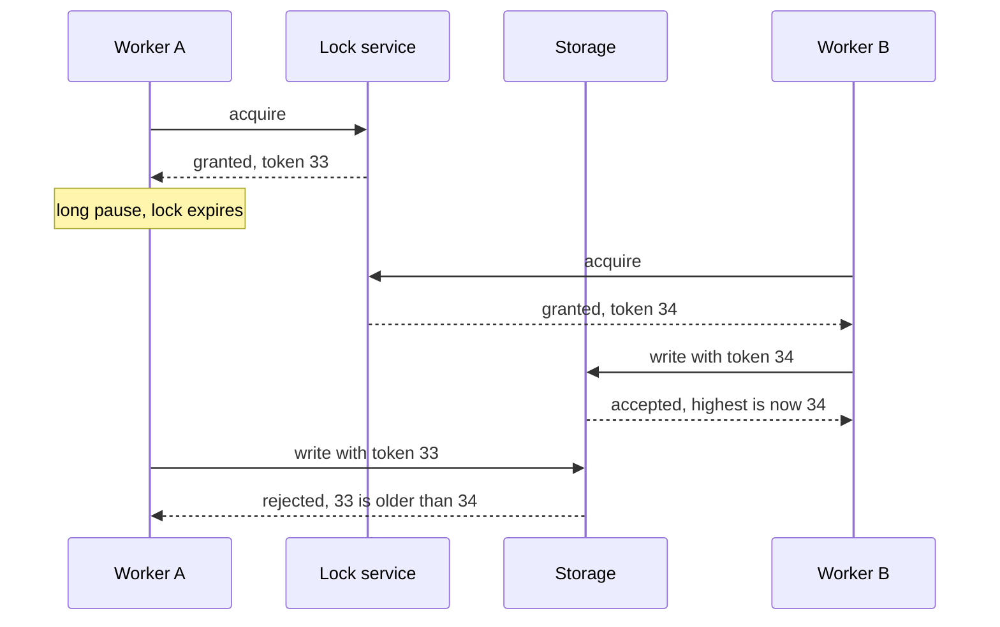

# Distributed Locks — Part 2

Part 1 built a lock that acquires safely and releases safely. This part answers
the question that should be nagging at you: **is it actually safe?**

The honest answer is "safe enough for some jobs, and not safe enough for
others" — and knowing which is which is worth more than any amount of clever
lock code. This part covers the well-known argument about Redis locks, the idea
that genuinely fixes it, the cases where a Redis lock is exactly right, and a
helper you can drop into a real project.

> **⬅️ This continues [Part 1](./04-distributed-locks-part-1.md).**

> **📌 In one line:** a Redis lock is a good way to avoid duplicate work and a
> bad way to guarantee that something happens only once — for that, the
> constraint belongs in your database.

## Table of Contents

1. [Redlock, and the Argument About It](#redlock-and-the-argument-about-it)
2. [Efficiency vs Correctness](#efficiency-vs-correctness)
3. [Fencing Tokens: What Actually Fixes It](#fencing-tokens-what-actually-fixes-it)
4. [Where a Redis Lock Is the Right Tool](#where-a-redis-lock-is-the-right-tool)
5. [A Reusable withLock Helper](#a-reusable-withlock-helper)
6. [Advanced: Reentrancy](#advanced-reentrancy)
7. [Advanced: Fairness and the Thundering Herd](#advanced-fairness-and-the-thundering-herd)
8. [Advanced: Never Hold a Lock Across an HTTP Call](#advanced-never-hold-a-lock-across-an-http-call)
9. [Common Mistakes](#common-mistakes)
10. [Questions to Test Yourself](#questions-to-test-yourself)
11. [Related](#related)

---

## Redlock, and the Argument About It

A single Redis instance is a single point of failure. If it dies while you hold
a lock, the lock dies with it. Worse: with the usual asynchronous replication,
a primary can accept your `SET NX`, fail over to a replica that never received
it, and now the lock is simply gone while you still think you hold it.

**Redlock** is an algorithm proposed to fix that. The idea: run five
independent Redis instances that do not replicate to each other. To acquire:

```text
  1. Take the current time.
  2. Try to SET NX PX the same key with the same token on all 5, quickly.
  3. Count the successes. You hold the lock only if 3 or more succeeded
     AND the whole attempt took much less than the TTL.
  4. Your effective lock time is the TTL minus how long acquiring took.
  5. If you failed, release on every instance, including the ones that said yes.
```

A majority means no other client can also hold a majority. Losing one or two
instances does not lose the lock. On paper it is reasonable.

**The criticism** — made most prominently by Martin Kleppmann, and answered by
Redis's author Salvatore Sanfilippo, in an exchange worth reading in full — is
that the algorithm's safety depends on assumptions distributed systems do not
grant you:

- **It depends on clocks.** Expiry is measured by each instance's own clock. An
  administrator adjusting time, a large NTP correction, or a virtual machine
  whose clock jumps after a migration can expire a lock early on some nodes.
- **It depends on processes not pausing.** A garbage-collection pause, an
  oversubscribed host, or a suspended container can stop your process for
  longer than the TTL. You wake up believing you hold a lock that expired long
  ago. Adding more Redis instances does nothing about this.
- **It is not a consensus system.** Systems that genuinely provide distributed
  mutual exclusion — ZooKeeper, etcd, Consul — use a consensus protocol and a
  replicated log, not wall-clock timeouts.

The pause problem is the one to internalise, because it applies to **any**
TTL-based lock, single-instance or Redlock:

```text
  your process   ──work──► [ ~~~ 40s stop-the-world pause ~~~ ] ──writes!──►
  the lock       ─────── held ───────► expired
  another worker                      ────── acquires ──────► ──writes!──►

  Both processes write. Neither did anything wrong. Neither can detect it.
```

## Efficiency vs Correctness

That is a lot of theory. Here is the practical conclusion, and it is short.

| | Efficiency lock | Correctness lock |
|---|---|---|
| What it is for | Avoiding duplicate work | Making sure something happens at most once |
| Cost of it failing | Some wasted CPU, a duplicated email | Double charge, duplicate invoice, corrupted balance |
| Is a Redis lock enough? | **Yes** | **No** |
| What you should use | `SET NX PX` plus a compare-and-delete release | A database unique constraint, a transaction, or an idempotency key |

Use a Redis lock freely for the left column. For the right column, the lock may
still be there as an optimisation, but **the thing that actually guarantees
correctness must live in the database**, where it is enforced by a constraint
rather than by a timeout.

```ts
// ✅ Both layers. The lock avoids the wasted work in the common case.
// The unique index is what makes double-charging impossible.
await withLock(`invoice:${invoiceId}:charge`, 30_000, async () => {
  await db.transaction(async (trx) => {
    await trx.insertQuery('payments')
      .insert({ invoiceId, idempotencyKey, amountCents })
      .onConflict('idempotency_key')   // the real guarantee
      .ignore()
    await chargeCard(invoiceId, idempotencyKey)
  })
})
```

If you delete the lock from that code, it is still correct — just wasteful. If
you delete the unique index, it is fast and wrong. That is the test.

> **📌 Remember:** ask "if this lock silently failed right now, would I lose
> money or lose a little CPU?" Only the second answer is a job for Redis.

## Fencing Tokens: What Actually Fixes It

If a paused process can always wake up holding an expired lock, no lock service
can prevent a late write on its own. The fix has to be at the place being
written.

A **fencing token** is a number that increases every time the lock is granted.
The lock holder passes it along with every write, and **the resource refuses
any write carrying a token lower than one it has already seen.**



Worker A's late write is refused by the storage layer, which needed no
knowledge of locks, clocks or pauses. That is why this works where a better
lock cannot.

In practice you rarely build a token service. You get the same effect from
things you already have:

```sql
-- A version column is a fencing token. The late writer updates zero rows.
UPDATE invoices
   SET status = 'paid', version = version + 1
 WHERE id = $1 AND version = $2;
```

```sql
-- A unique constraint is a fencing token for "at most once" work.
ALTER TABLE invoices ADD CONSTRAINT one_per_period UNIQUE (company_id, period);
```

Both are covered in
[../../databases/transactions-and-concurrency/06-optimistic-vs-pessimistic-locking-part-1.md](../../databases/transactions-and-concurrency/06-optimistic-vs-pessimistic-locking-part-1.md).
The lesson to carry away: **the protection has to live where the write lands.**

## Where a Redis Lock Is the Right Tool

Having spent two sections on limits, here are the cases where a Redis lock is a
genuinely good answer. All three share one property: losing the lock costs
wasted work, not correctness.

**1. One instance runs the scheduled job.** Three API pods, one nightly sweep.
Duplicate runs waste database load; the unique index on the invoice table stops
anything worse.

```ts
// Runs on every instance. Only one gets past the lock.
cron.schedule('0 0 * * *', async () => {
  await withLock('cron:invoice-sweep', 600_000, generateMonthlyInvoices)
})
```

The job-queue version of this — a scheduler that guarantees one run per
interval across a cluster — is in [../03-background-jobs/](../03-background-jobs/),
and it is usually the better choice than hand-rolled cron plus a lock.

**2. Only one process refreshes an expensive cache entry.** A popular key
expires, fifty concurrent requests miss, and all fifty run the same
eight-second report query. That is a cache stampede. One lock holder refreshes;
everyone else serves the stale value or waits briefly.

```ts
const fresh = await withLock(`refresh:report:${companyId}`, 20_000, buildReport, {
  waitMs: 0,   // do not queue — losers serve stale data instead
})
if (fresh === null) return staleValue   // someone else is already refreshing
```

The full pattern, including serving stale data while refreshing, is in
[../01-caching-in-practice/04-stampede-and-failure-modes-part-1.md](../01-caching-in-practice/04-stampede-and-failure-modes-part-1.md).

**3. Simple leader election.** One instance holds a lock and renews it; whoever
holds it is "the leader" and does the singleton work. Good enough for "one
instance publishes metrics" or "one instance cleans up temporary files". Not
good enough for anything where two leaders would corrupt data — that needs
etcd, ZooKeeper, or Consul.

## A Reusable withLock Helper

Everything from both parts, in one function.

```ts
import { randomUUID } from 'node:crypto'

const RELEASE_IF_MINE = `
  if redis.call('GET', KEYS[1]) == ARGV[1] then
    return redis.call('DEL', KEYS[1])
  else
    return 0
  end
`

interface LockOptions {
  /** How long to keep trying before giving up. 0 means try once. */
  waitMs?: number
  /** Delay between attempts. Jittered to stop clients syncing up. */
  retryDelayMs?: number
}

/**
 * Runs `work` while holding a Redis lock. Returns null if the lock was not
 * acquired. The lock is always released, on every exit path.
 */
export async function withLock<T>(
  name: string,
  ttlMs: number,
  work: () => Promise<T>,
  options: LockOptions = {},
): Promise<T | null> {
  const key = `lock:${name}`
  const token = randomUUID()
  const { waitMs = 0, retryDelayMs = 50 } = options
  const deadline = Date.now() + waitMs

  let acquired: string | null = null
  do {
    acquired = await redis.set(key, token, 'NX', 'PX', ttlMs)
    if (acquired) break
    if (Date.now() >= deadline) return null     // bounded wait, never forever
    await sleep(retryDelayMs + Math.random() * retryDelayMs)
  } while (true)

  const startedAt = Date.now()
  try {
    return await work()
  } finally {
    // finally, so a thrown error still releases the lock.
    const released = (await redis.eval(RELEASE_IF_MINE, 1, key, token)) as number
    if (released === 0) {
      logger.error(
        { key, heldMs: Date.now() - startedAt, ttlMs },
        'lock expired before work finished — raise the TTL or shorten the work',
      )
    }
  }
}
```

The details that make it correct rather than merely working:

| Detail | Why |
|---|---|
| A fresh `token` per call | Release can tell your lock from someone else's |
| `NX` and `PX` in one `SET` | No gap where the lock exists without an expiry |
| Release inside `finally` | A thrown error still releases |
| Compare-and-delete script | Never deletes a lock you no longer hold |
| `released === 0` logged at error | The only signal your TTL is too short |
| A **bounded** wait | An unbounded wait turns contention into stuck requests |
| Jittered retry delay | Losers do not all retry at the same instant |
| Returns `null` rather than throwing | The caller decides whether "skipped" is an error |

```ts
// Try once, skip if busy — the right shape for a cron job.
await withLock('cron:invoice-sweep', 600_000, generateMonthlyInvoices)

// Wait up to 2 seconds — the right shape for a user-facing request.
const result = await withLock(`project:${id}:reindex`, 30_000, reindex, { waitMs: 2_000 })
if (result === null) throw new ServiceUnavailableError('busy, please retry')
```

## Advanced: Reentrancy

A normal mutex in a single process is often **reentrant** — the same thread can
acquire a lock it already holds. This one is not. Call `withLock('x', …)` from
inside `withLock('x', …)` and the inner call waits for a lock the outer call
will not release until the inner call finishes. That is a deadlock, and the
bounded wait is what saves you: it returns `null` instead of hanging forever.

Making it reentrant means storing a holder identity and a count, and comparing
against the identity of the caller — which is hard in Node, because there is no
thread id. `AsyncLocalStorage` can carry one, but the honest advice is
different:

> **💡 Tip:** do not build reentrancy. Restructure so the lock is taken once, at
> the outermost layer. Nested locks on the same resource almost always mean the
> lock is at the wrong level of the code.

The related deadlock is taking two locks in different orders in different code
paths — exactly the database deadlock scenario in
[../../databases/transactions-and-concurrency/05-deadlocks-part-1.md](../../databases/transactions-and-concurrency/05-deadlocks-part-1.md).
Redis will not detect it for you, as PostgreSQL does. The only defences are a
consistent global ordering of lock names and the TTL eventually expiring.

## Advanced: Fairness and the Thundering Herd

This lock is **not fair**. There is no queue. When the holder releases, whoever
happens to `SET NX` first wins, which may be the client that arrived last. A
client can starve indefinitely while others keep taking the lock.

Worse, the losers are all polling. Twenty clients retrying every 50 ms is 400
extra commands per second on your single-threaded server, all of them failing.

Three practical responses, in order of preference:

- **Do not queue.** For a cache refresh, the losers should serve stale data and
  move on — `waitMs: 0`. This removes the herd entirely.
- **Jitter and back off.** The helper jitters already; add exponential backoff
  if contention is high. It spreads the retries out.
- **Use a real queue.** If work genuinely must be serialised per resource, that
  is a queue with concurrency 1 per key, not a lock. See
  [../03-background-jobs/](../03-background-jobs/).

If you truly need fairness, you need a system that maintains an ordered wait
list — ZooKeeper and etcd do this natively. Building it on Redis means building
a queue, at which point use a queue.

## Advanced: Never Hold a Lock Across an HTTP Call

A last rule that is simple and often broken.

```ts
// ❌ BROKEN - holding a lock while calling a third party.
await withLock(`company:${id}:sync`, 30_000, async () => {
  const data = await fetch(`https://billing-provider.example/v1/customers/${id}`)
  await saveSyncResult(await data.json())
})
```

The external call is the one part of this you do not control. It can take 60
seconds when its normal time is 200 ms. Your TTL is 30 seconds. Now the lock
expires mid-call, a second worker starts, and the "protection" is gone at
exactly the moment two workers are talking to your payment provider.

```ts
// ✅ FIXED - the unbounded call happens outside the lock, and it has its own
// timeout. The lock only covers the local write, which takes milliseconds.
const response = await fetch(`https://billing-provider.example/v1/customers/${id}`, {
  signal: AbortSignal.timeout(10_000),   // shorter than any lock TTL
})
const data = (await response.json()) as ProviderCustomer

await withLock(`company:${id}:sync`, 5_000, () => saveSyncResult(id, data))
```

A longer TTL is not the fix — it just means a crash blocks the resource for
longer. The general shape:

- **Take the lock around the local state change only**, not around the network
  call. Fetch first, then lock briefly to write.
- **Set a timeout on the HTTP call itself**, shorter than the lock TTL, so the
  call cannot outlive the lock. See
  [../../system-design/reliability/circuit-breakers-and-retries.md](../../system-design/reliability/circuit-breakers-and-retries.md).
- **Use an idempotency key with the provider**, so a duplicate call is safe
  regardless of locks.

The same reasoning applies to holding a Redis lock across a slow database
query, a large file upload, or anything whose duration you cannot bound.

---

## Common Mistakes

| Mistake | Why it is wrong | Do this instead |
|---|---|---|
| Believing Redlock makes a lock correctness-safe | Clock jumps and process pauses defeat it | Put the guarantee in the database |
| A Redis lock as the only defence against double charging | A paused process wakes up and writes anyway | A unique constraint or idempotency key |
| No fencing at the resource | The resource cannot reject a stale writer | A version column, or a unique constraint |
| An unbounded wait for a lock | Contention turns into a stuck request queue | A bounded `waitMs`, then give up |
| Releasing outside `finally` | A thrown error leaves the lock held until the TTL | Always `finally` |
| Nesting the same lock | Deadlock — the inner call waits on the outer | Lock once, at the outermost layer |
| Two locks taken in different orders | A deadlock Redis will not detect for you | A consistent global lock ordering |
| All losers polling every 10 ms | A thundering herd on a single-threaded server | Jitter, back off, or do not queue at all |
| Holding a lock across an HTTP call | An unbounded call outlives a bounded TTL | Lock only the local write; time out the call |
| Redis leader election for critical work | Two leaders are possible during a failover | etcd, ZooKeeper, or Consul |

## Questions to Test Yourself

1. Explain Redlock's proposal in three sentences, then name the two assumptions
   its critics say do not hold.
2. Why does adding more Redis instances not help with a 40-second
   garbage-collection pause?
3. Define an efficiency lock and a correctness lock. Give one example of each
   from a billing system.
4. What is a fencing token, and why can it succeed where a better lock cannot?
5. Name two things you already have in PostgreSQL that act as fencing tokens.
6. In `withLock`, why is the release inside `finally`, and why is the token
   generated per call rather than per process?
7. What breaks if `waitMs` is unbounded, and what breaks if the retry delay has
   no jitter?
8. A teammate holds a lock across a call to a payment provider, with a 30-second
   TTL. Describe the failure, and give two fixes that are not "raise the TTL".

## Related

- [Part 1](./04-distributed-locks-part-1.md) — acquiring, releasing safely, and lock expiry versus work duration
- [README.md](./README.md) — the rest of this folder
- [03-atomicity-and-lua-part-2.md](./03-atomicity-and-lua-part-2.md) — the Lua mechanics behind the release and extend scripts
- [05-memory-and-operations-part-2.md](./05-memory-and-operations-part-2.md) — what a failover means for a lock you are holding
- [../01-caching-in-practice/04-stampede-and-failure-modes-part-1.md](../01-caching-in-practice/04-stampede-and-failure-modes-part-1.md) — the cache-refresh case, in full
- [../03-background-jobs/](../03-background-jobs/) — schedulers that run once per cluster, and per-key serialisation done properly
- [../../databases/transactions-and-concurrency/04-locks-part-1.md](../../databases/transactions-and-concurrency/04-locks-part-1.md) — the database locks that are usually the better answer
- [../../databases/transactions-and-concurrency/05-deadlocks-part-1.md](../../databases/transactions-and-concurrency/05-deadlocks-part-1.md) — lock ordering, and why PostgreSQL detects deadlocks while Redis does not
- [../../databases/transactions-and-concurrency/06-optimistic-vs-pessimistic-locking-part-1.md](../../databases/transactions-and-concurrency/06-optimistic-vs-pessimistic-locking-part-1.md) — version columns as fencing tokens
- [../../system-design/reliability/idempotency.md](../../system-design/reliability/idempotency.md) — the pattern that makes losing a lock harmless
- [../../system-design/reliability/circuit-breakers-and-retries.md](../../system-design/reliability/circuit-breakers-and-retries.md) — bounding an external call so it cannot outlive your lock
