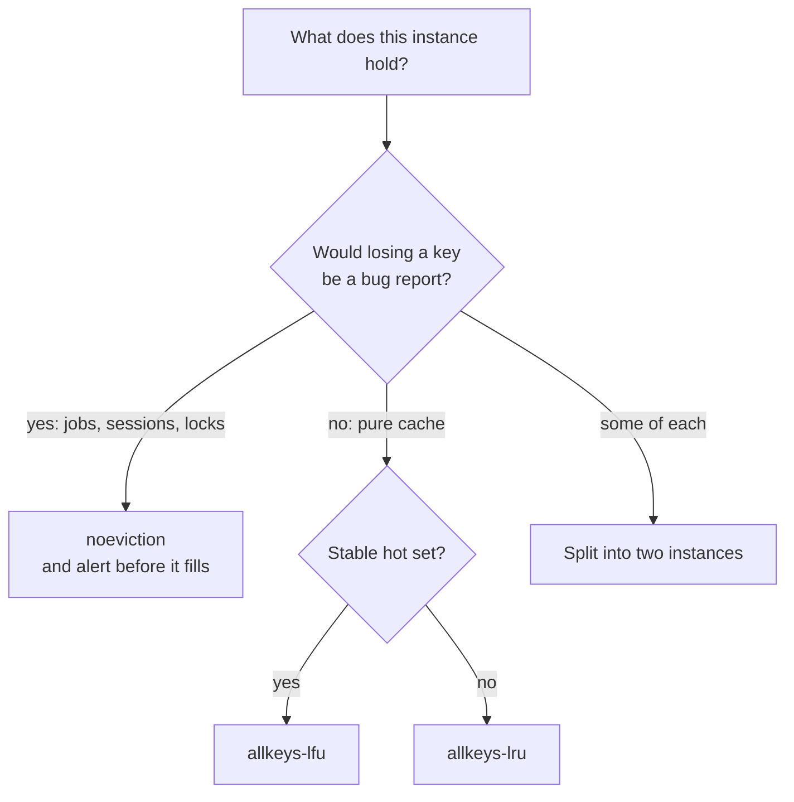

# Memory and Operations — Part 1

Redis holds everything in RAM. That one design decision is why it is fast, and
it is also why **memory is the constraint that decides everything else** — what
you may store, what happens when you store too much, and whether your data is
still there tomorrow.

A PostgreSQL table that grows too large gets slow. A Redis instance that grows
too large starts refusing writes, or starts silently deleting things you needed.
Neither failure looks like the bug you will be hunting.

Part 1 is about memory: measuring it, the eviction policy that decides what
happens when it runs out, and the single operational rule this folder has been
building toward. Part 2 is about persistence, failover, monitoring and
security.

> **➡️ Continued in [Part 2](./05-memory-and-operations-part-2.md)**

> **📌 In one line:** an instance holding cache should evict, an instance
> holding jobs or sessions must not, and because that is a setting on the
> instance, those two things cannot share one Redis.

## Table of Contents

1. [Memory Is the Whole Game](#memory-is-the-whole-game)
2. [Measuring What You Are Using](#measuring-what-you-are-using)
3. [maxmemory: The Limit You Must Set Yourself](#maxmemory-the-limit-you-must-set-yourself)
4. [Every Eviction Policy, and When Each Is Right](#every-eviction-policy-and-when-each-is-right)
5. [Never Share a Cache and a Queue](#never-share-a-cache-and-a-queue)
6. [What Happens When noeviction Fills Up](#what-happens-when-noeviction-fills-up)
7. [Keys Without a TTL Are a Slow Leak](#keys-without-a-ttl-are-a-slow-leak)
8. [Common Mistakes](#common-mistakes)
9. [Questions to Test Yourself](#questions-to-test-yourself)
10. [Related](#related)

---

## Memory Is the Whole Game

Think of Redis as a desk rather than a filing cabinet. Everything on the desk
is instantly reachable — that is the point. But a desk has an edge, and when it
is full you have exactly two choices: push something off to make room, or
refuse to put anything new down.

Redis makes you choose which of those it does. The setting is called
`maxmemory-policy`, most people never touch it, and the consequences of getting
it wrong are the two most common Redis incidents in production:

- **Writes start failing** at 3 AM and nobody knows why.
- **Data disappears** with no error, no log line, and no way to tell what went.

Everything in this file exists to make sure neither surprises you.

## Measuring What You Are Using

Four commands, from the broadest view to the narrowest.

```bash
# Where you stand overall.
redis-cli INFO memory
```

The fields that matter, and what each one means:

| Field | What it tells you |
|---|---|
| `used_memory` | Bytes Redis thinks it is using for data |
| `used_memory_rss` | Bytes the operating system has given the process |
| `maxmemory` | Your configured ceiling. **`0` means no limit** |
| `maxmemory_policy` | What happens at the ceiling |
| `mem_fragmentation_ratio` | `rss / used_memory`. Around 1.0–1.5 is normal |
| `evicted_keys` (in `INFO stats`) | How many keys Redis has thrown away |

```bash
# What a single key costs, overhead included. Try it on your biggest key.
redis-cli MEMORY USAGE company:4182:profile

# Which keys are unusually large? Uses SCAN, so it is safe on a live instance.
redis-cli --bigkeys

# How many keys exist, and how many have a TTL. The gap is what to worry about.
redis-cli INFO keyspace
# db0:keys=1482301,expires=402118,avg_ttl=0
```

That last line is the most useful diagnostic in this file. `keys=1482301`
against `expires=402118` means **1.08 million keys have no expiry at all**.
Unless you meant that, you have found your leak.

> **💡 Tip:** `mem_fragmentation_ratio` far above 1.5 usually means the
> allocator is holding memory it is not using — common after a large batch of
> deletions. `activedefrag yes` can help. A ratio *below* 1 means Redis has
> been swapped to disk, which destroys its performance entirely and should be
> treated as an emergency.

## maxmemory: The Limit You Must Set Yourself

By default, `maxmemory` is `0` — no limit. Redis will happily allocate until
the operating system kills it. On a container with a memory limit, that means
the process is terminated and everything in it is gone.

```conf
# redis.conf — always set both of these together.
maxmemory 2gb
maxmemory-policy allkeys-lru
```

Leave headroom. Redis needs memory beyond your data for client buffers,
replication buffers and copy-on-write during a background save. A common rule
is to set `maxmemory` to **around 60–70% of the machine's RAM** for an instance
that persists to disk, and higher for one that does not. Check your own
numbers — a write-heavy instance needs more headroom than a read-heavy one.

> **⚠️ Warning:** a `maxmemory` of `0` on a container with a hard memory limit
> is not "unlimited". It means the container gets killed instead of Redis
> evicting keys. The failure goes from "some cache entries were dropped" to
> "the whole instance restarted empty".

## Every Eviction Policy, and When Each Is Right

`maxmemory-policy` decides what Redis does when it reaches `maxmemory`. Two
words cover the naming: **`allkeys-`** considers every key; **`volatile-`**
considers only keys that have a TTL set.

| Policy | What it does | Right when |
|---|---|---|
| `noeviction` | Refuses writes. Reads still work | **Default.** Correct for queues, sessions, locks — anything you cannot afford to lose |
| `allkeys-lru` | Evicts the least recently *used* key | **The standard cache policy.** Everything is expendable |
| `allkeys-lfu` | Evicts the least *frequently* used key | A cache with a stable hot set, where one recent scan should not push out popular keys |
| `allkeys-random` | Evicts a random key | Rarely useful. Marginally cheaper than LRU; only when all keys are equally valuable |
| `volatile-lru` | Least recently used, **among keys with a TTL** | Mixed instance: some keys are permanent, the rest are cache |
| `volatile-lfu` | Least frequently used, among keys with a TTL | Same, with a frequency-based hot set |
| `volatile-ttl` | Evicts the key expiring soonest | Mixed instance where a shorter TTL genuinely means less valuable |
| `volatile-random` | Random, among keys with a TTL | Rarely useful |

Two traps in the `volatile-*` family, both of which turn a cache instance into
an outage:

- **If no key has a TTL, a `volatile-*` policy behaves exactly like
  `noeviction`.** Redis has nothing it is allowed to evict, so writes fail. A
  team sets `volatile-lru`, forgets `EX` on the cache writes, and the instance
  stops accepting writes while sitting at 100% memory with nothing expired.
- **It evicts the wrong things.** Suppose your cache entries have TTLs and your
  leaderboards do not. Under memory pressure Redis eats the cache and protects
  the leaderboards — which is probably backwards.

Redis's LRU and LFU are **approximate**. It samples a handful of keys and
evicts the best candidate among them rather than scanning everything, which is
what keeps eviction cheap on a single thread. `maxmemory-samples` controls how
many it looks at; higher is more accurate and slightly more expensive. For a
cache, the approximation is fine.



Note where that flowchart ends for the mixed case. It does not say "use
`volatile-lru`". It says split. Here is why.

## Never Share a Cache and a Queue

This is the operational rule the whole folder builds toward.

**The eviction policy is a property of the instance, not of the key.** You
cannot mark one key as expendable and another as precious. So the moment you
put cache entries and job payloads on the same Redis, you have to pick one
policy, and both choices are wrong:

- `allkeys-lru` — your jobs are now evictable.
- `noeviction` — your cache stops accepting writes when it fills, which it
  will, because caches are supposed to fill.

### A concrete failure

A team runs one Redis for everything: cache, BullMQ jobs, and sessions.
`maxmemory 2gb`, `maxmemory-policy allkeys-lru`, which somebody set years ago
because it is "the cache setting".

On a Tuesday, a new feature caches a large per-project report. Memory reaches
2 GB by mid-morning. LRU starts evicting the least recently used keys. Job
payloads that were enqueued for a delayed retry in six hours have not been
touched since they were written, so by definition they are the *least recently
used keys in the entire instance*.

Redis evicts them. The eviction is not an error. It is the policy working
exactly as configured. Nothing is logged, because a policy doing its job is not
an event worth logging.

| What the team saw | What was actually happening |
|---|---|
| Job counts in the dashboard slowly dropping | Delayed jobs evicted before their run time |
| No errors in the application logs | Eviction is silent by design |
| No errors in the Redis logs | Same |
| A customer: "my export never arrived" | Their job was evicted three hours earlier |
| Random users logged out | Session keys were evicted too |

They found it four days later, in `INFO stats`, where `evicted_keys` was in the
millions. Reproducing it in staging was impossible, because staging never
reached `maxmemory`.

### The rule

```text
  ✅ Separate instances, separate policies

  redis-cache                       redis-queue
    maxmemory 2gb                     maxmemory 1gb
    maxmemory-policy allkeys-lru      maxmemory-policy noeviction
    persistence: off                  persistence: AOF
    "losing a key = a cache miss"     "losing a key = a lost job"
```

Apply one test to every Redis key you create:

> **📌 Remember:** *if this key silently vanished right now, is that a cache
> miss or a bug report?* Cache misses may share an evicting instance. Bug
> reports get `noeviction`, persistence, and their own instance.

Sessions, locks, idempotency keys, queue state and rate-limit counters you bill
on all answer "bug report". Only genuinely rebuildable cache answers "cache
miss".

## What Happens When noeviction Fills Up

If the queue instance must not evict, what does it do instead? It refuses
writes.

```text
  ERR OOM command not allowed when used memory > 'maxmemory'.
```

From your application, this surfaces as a thrown error on the write. Three
things to know about it:

- **Reads still work.** `GET`, `LRANGE`, `ZRANGE` are all fine. So workers keep
  draining the queue, which may eventually free enough memory to recover on
  its own. The system is degraded, not dead.
- **Not every write fails.** Commands that cannot increase memory — `DEL`,
  `UNLINK`, `EXPIRE` — are still allowed. That is deliberate, so you can dig
  yourself out.
- **Your producers are the ones that break.** The API endpoint that enqueues a
  job starts throwing. What the customer sees depends entirely on how you
  handle it.

```ts
// ✅ An OOM on enqueue must not silently drop the work.
try {
  await queue.add('generate-export', { companyId, userId })
} catch (err) {
  // Redis is full. Do not pretend this succeeded.
  logger.error({ err, companyId }, 'failed to enqueue export job')
  throw new ServiceUnavailableError('Export queue is unavailable, please retry')
}
```

This is the failure mode you *want* on a queue. It is loud, immediate, and
attributable. Compare it with the silent eviction above: a 503 that a customer
retries is a far better outcome than a job that vanished without trace.

> **💡 Tip:** alert on memory usage crossing about 80% of `maxmemory` on a
> `noeviction` instance. That alert is the entire point of choosing
> `noeviction` — it converts "data disappeared" into "somebody was paged while
> there was still time".

## Keys Without a TTL Are a Slow Leak

A cache key with no expiry is not a cache entry. It is permanent storage that
nobody decided to create.

The growth is invisible for months. Then one Tuesday you hit `maxmemory`, and
whichever policy you chose delivers its bad news.

Find them:

```bash
# The quick check: how many keys, and how many have an expiry?
redis-cli INFO keyspace
# db0:keys=1482301,expires=402118   <- 1.08M keys will never expire

# Then find out which ones. SCAN is safe; KEYS is not.
redis-cli --scan --pattern 'cache:*' | head -1000 | while read k; do
  ttl=$(redis-cli TTL "$k")
  [ "$ttl" = "-1" ] && echo "no ttl: $k"
done
```

`TTL` returns `-1` for a key that exists with no expiry, and `-2` for a key
that does not exist. That distinction is worth remembering — they are easy to
confuse when debugging.

The discipline, in three habits:

```ts
// 1. Never call SET on a cache key without an expiry. Make it impossible.
export async function cacheSet(key: string, value: unknown, ttlSeconds: number) {
  if (ttlSeconds <= 0) throw new Error('cache writes require a positive TTL')
  await redis.set(key, JSON.stringify(value), 'EX', ttlSeconds)
}

// 2. Remember that a plain SET CLEARS an existing TTL. Re-caching a value
//    without EX quietly makes it permanent. Use KEEPTTL if you mean to keep it.
await redis.set(key, payload, 'KEEPTTL')

```

Habit 3 is the one that leaks most often, because `ZADD` and its relatives have
no place to put an expiry.

```ts
// ❌ BROKEN - ZADD creates the key with no TTL. One permanent sorted set per
// company, growing forever, and nothing in the code looks wrong.
await redis.zadd(`ratelimit:${companyId}`, now, member)
```

```ts
// ✅ FIXED - the expiry is set in the same pipeline, every time.
const pipeline = redis.pipeline()
pipeline.zadd(`ratelimit:${companyId}`, now, member)
pipeline.pexpire(`ratelimit:${companyId}`, 60_000)
await pipeline.exec()
```

Habit 3 is where most leaks come from. `SET` makes you think about expiry
because `EX` sits right there in the call. `ZADD`, `SADD`, `HSET` and `LPUSH`
do not, so the `EXPIRE` has to be a deliberate act every single time.

---

## Common Mistakes

| Mistake | Why it is wrong | Do this instead |
|---|---|---|
| Leaving `maxmemory` at `0` | The container is killed instead of keys being evicted | Set it, with headroom below the machine's RAM |
| Never choosing a `maxmemory-policy` | The default `noeviction` makes a cache refuse writes | Choose deliberately per instance |
| `allkeys-lru` on an instance holding jobs | Jobs are evicted silently, and they are the least recently used | `noeviction` plus a separate cache instance |
| `volatile-lru` with no TTLs anywhere | Behaves exactly like `noeviction` and writes start failing | Set TTLs, or use `allkeys-lru` |
| Cache and queue on one instance | One policy cannot be right for both | Two instances |
| Treating an OOM error as noise | It is the loud failure you chose over silent loss | Alert at 80% memory, surface a 503 |
| Catching an enqueue error and continuing | The work is silently lost, exactly what `noeviction` prevents | Fail the request and let the caller retry |
| Cache writes without `EX` | A permanent key pretending to be a cache entry | A wrapper that refuses a missing TTL |
| `SET` on re-cache without `KEEPTTL` | Silently removes the existing expiry | Pass `EX` again, or `KEEPTTL` |
| Forgetting `EXPIRE` after `ZADD` or `SADD` | Collections built field by field never expire | `EXPIRE` in the same pipeline |

## Questions to Test Yourself

1. Explain, to someone who has never used Redis, why memory pressure produces
   two completely different failures depending on one setting.
2. `INFO keyspace` shows `keys=1482301,expires=402118`. What is wrong, and how
   would you go about fixing it?
3. Why does `volatile-lru` behave like `noeviction` when no key has a TTL?
4. Your instance holds cache entries with TTLs and leaderboards without. Under
   `volatile-lru`, what gets evicted first, and why is that backwards?
5. Describe the cache-plus-queue failure in your own words. Why are delayed
   jobs the *first* thing LRU chooses?
6. Under `noeviction` at `maxmemory`: which commands still work, which fail,
   and why is that split deliberate?
7. Why is an OOM error on enqueue a better outcome than a silent eviction?
8. Name three ways a key ends up with no TTL when you intended it to have one.

## Related

- [Part 2](./05-memory-and-operations-part-2.md) — persistence, failover, monitoring, security, and running Redis locally
- [README.md](./README.md) — the rest of this folder
- [01-connecting-to-redis-part-2.md](./01-connecting-to-redis-part-2.md) — the same cache-versus-queue rule, introduced early
- [02-choosing-data-structures-part-2.md](./02-choosing-data-structures-part-2.md) — memory cost per key, and how eviction interacts with your structure choice
- [04-distributed-locks-part-1.md](./04-distributed-locks-part-1.md) — another kind of key you cannot afford to have evicted
- [../01-caching-in-practice/04-stampede-and-failure-modes-part-2.md](../01-caching-in-practice/04-stampede-and-failure-modes-part-2.md) — what your app does when the cache empties
- [../03-background-jobs/](../03-background-jobs/) — the queue that needs `noeviction` and its own instance
- [../../system-design/foundational/redis.md](../../system-design/foundational/redis.md) — the concept-level reference for TTL and eviction
- [../../system-design/foundational/caching-strategies.md](../../system-design/foundational/caching-strategies.md) — eviction and TTL as caching concepts
