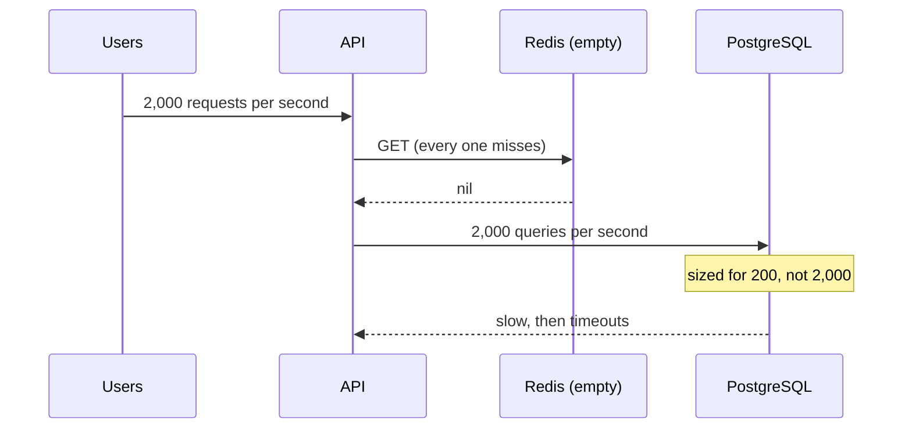

# Memory and Operations — Part 2

Part 1 answered "what happens when memory runs out". This part answers the
other operational questions: what survives a restart, what a failover does to
work in flight, what to put on a dashboard, how not to get breached, and how to
run Redis on your laptop.

One question ties the first two together, and it is the only one you need to
ask about any Redis instance: **if this instance restarts right now, what am I
allowed to lose?**

> **⬅️ This continues [Part 1](./05-memory-and-operations-part-1.md).**

> **📌 In one line:** a cache may lose everything on restart and a queue may
> not, so persistence, failover behaviour and alerting are all decided by what
> the instance holds.

## Table of Contents

1. [Persistence From an Operator's Point of View](#persistence-from-an-operators-point-of-view)
2. [Restart: The Cold Cache](#restart-the-cold-cache)
3. [Failover, and What It Does to Locks](#failover-and-what-it-does-to-locks)
4. [Monitoring That Matters](#monitoring-that-matters)
5. [Security Basics](#security-basics)
6. [Running Redis Locally](#running-redis-locally)
7. [Advanced: Managed vs Self-Hosted](#advanced-managed-vs-self-hosted)
8. [Advanced: Cluster Mode and Its Price](#advanced-cluster-mode-and-its-price)
9. [Advanced: When the Answer Is PostgreSQL](#advanced-when-the-answer-is-postgresql)
10. [Common Mistakes](#common-mistakes)
11. [Questions to Test Yourself](#questions-to-test-yourself)
12. [Related](#related)

---

## Persistence From an Operator's Point of View

Redis has two mechanisms for surviving a restart. **The mechanics are already
covered** in
[../../system-design/foundational/redis.md](../../system-design/foundational/redis.md)
— RDB takes periodic point-in-time snapshots, AOF appends every write to a log.
This section is only about choosing between them.

The choice is not a technical preference. It is an answer to one question:
**if this instance restarts right now, what am I allowed to lose?**

| | RDB (snapshot) | AOF (append-only log) | Both | Neither |
|---|---|---|---|---|
| Data lost on a crash | Everything since the last snapshot — minutes | Up to about one second with `appendfsync everysec` | Same as AOF | Everything |
| Restart speed | Fast | Slower, replays the log | Uses AOF | Instant |
| Runtime cost | A fork per snapshot, with a memory spike | A disk write per command, or batched | Both | None |
| Right for | Analytics data you could rebuild | Queues, sessions, anything not stored elsewhere | Queues where a minute of loss is unacceptable | **A pure cache** |

Walk the decision for the two instances from Part 1:

```text
  redis-cache                          redis-queue
  ───────────                          ───────────
  "What am I allowed to lose?"         "What am I allowed to lose?"
  "All of it. PostgreSQL is the        "Nothing. An enqueued job is a
   source of truth; we repopulate."     promise to a customer."

  → persistence off                    → appendonly yes
    save ""                              appendfsync everysec
                                         plus a replica
```

Two operational notes people learn the hard way:

- **A background save forks the process.** The copy-on-write copy can
  temporarily need a lot of extra memory on a write-heavy instance. This is a
  large part of why you leave headroom under `maxmemory`.
- **Persistence is not a backup.** AOF protects against a process restart. It
  does not protect against `FLUSHALL`, a bad deployment, or a deleted volume.
  If the data genuinely matters, it belongs in PostgreSQL with real backups —
  see the last section.

> **⚠️ Warning:** persistence on a *cache* instance is usually a cost with no
> benefit. You pay the fork, the disk writes and the memory spike to preserve
> data whose entire purpose is to be disposable. Turn it off and let the cache
> warm up again.

## Restart: The Cold Cache

Redis restarts with an empty keyspace unless persistence brought it back. For a
cache that is by design — and it is also the most dangerous ten minutes your
database will have that week.



Every request misses. Every miss becomes a database query. A database sized for
the 5% of traffic that normally misses now receives 100% of it. This is the
**cold cache** or **thundering herd** problem, and it is the reason a Redis
restart can take your API down even though the API never depended on Redis for
correctness.

The defences — request coalescing, a lock around expensive refreshes, serving
stale data while refreshing, staggered TTLs so keys do not all expire together,
and warming the important keys on boot — are the subject of
[../01-caching-in-practice/04-stampede-and-failure-modes-part-1.md](../01-caching-in-practice/04-stampede-and-failure-modes-part-1.md).
The lock used for the refresh is the one from
[04-distributed-locks-part-2.md](./04-distributed-locks-part-2.md).

The operational lesson for this file: **rehearse it.** Restart Redis in staging
under load and watch the database. If you have never done it, you do not know
what happens, and you will find out during an incident.

## Failover, and What It Does to Locks

With Sentinel or a managed service, a replica is promoted when the primary
fails. Replication is **asynchronous**, which means the replica may be missing
the last few writes the primary accepted.

For a cache, that is fine. For coordination state, it is the failure mode
described in [04-distributed-locks-part-2.md](./04-distributed-locks-part-2.md):

| In flight during failover | What happens |
|---|---|
| A `GET` | Fails or times out. Your client reconnects to the new primary |
| A `SET` just acknowledged | May be lost if the replica had not received it |
| **A lock you hold** | May not exist on the new primary. Another worker can acquire it and you will both believe you hold it |
| A queued job just enqueued | May be lost — this is why the queue instance needs AOF and alerting |
| An idempotency key just written | May be lost, so the duplicate is no longer blocked |

Three practical responses:

```ts
// 1. Clients must survive a failover. Reconnect with backoff, and do not
//    let a reconnection crash the process. See file 01 part 1.
redis.on('error', (err) => logger.error({ err }, 'redis error'))

// 2. Anything critical gets a second layer in the database. A lock plus a
//    unique constraint survives a failover; a lock alone does not.

// 3. Treat a failover as "the work may have run twice". Design the job to be
//    safe under that, rather than hoping it does not happen.
```

> **📌 Remember:** every guarantee you build on Redis has an asterisk that says
> "unless there is a failover". Guarantees you cannot put an asterisk on belong
> in PostgreSQL.

## Monitoring That Matters

Seven signals. Each row is a dashboard panel and, where marked, an alert.

| Signal | Where | A bad value means | Alert? |
|---|---|---|---|
| `used_memory` / `maxmemory` | `INFO memory` | Above 80%: eviction is starting, or OOM is close | **Yes**, at 80% |
| `evicted_keys` | `INFO stats` | Anything above zero on a `noeviction` instance is impossible; on a cache, a rising rate means it is too small | **Yes**, on a non-cache instance |
| Hit ratio — `keyspace_hits` vs `keyspace_misses` | `INFO stats` | A sudden drop means TTLs changed, keys changed, or the cache restarted | Yes, on a large drop |
| `connected_clients` | `INFO clients` | Climbing steadily means a connection leak — a client created per request | Yes, near `maxclients` |
| `blocked_clients` | `INFO clients` | Clients waiting on `BRPOP` and friends. Expected for workers, suspicious elsewhere | No, but chart it |
| `SLOWLOG` entry rate | `SLOWLOG GET` | Somebody shipped an O(n) command. This is the first place to look when latency rises | Yes, on a spike |
| `master_repl_offset` lag | `INFO replication` | A replica falling behind loses more data in a failover | Yes, on sustained lag |

Add two from the application side, which Redis cannot tell you:

- **Command latency at the 99th percentile.** Averages hide the two-second
  command that blocked everybody.
- **Redis error rate per endpoint.** This is how you notice that one code path
  is timing out while the rest are fine.

Both are wired up in
[../../backend-fundamentals/08-logging-and-observability/04-metrics-and-health-checks-part-1.md](../../backend-fundamentals/08-logging-and-observability/04-metrics-and-health-checks-part-1.md).

```ts
// ❌ BROKEN - a Redis blip now removes every API pod from the load balancer,
// turning a degraded cache into a total outage.
export async function readiness(): Promise<HealthStatus> {
  await redis.ping()                    // throws, so the probe fails
  return { status: 'ok' }
}
```

```ts
// ✅ FIXED - a health check that reports "degraded", not "down".
export async function redisHealth(): Promise<HealthStatus> {
  try {
    const started = Date.now()
    await withTimeout(redis.ping(), 200)
    return { name: 'redis', status: 'ok', latencyMs: Date.now() - started }
  } catch (err) {
    // The API still serves traffic from PostgreSQL. Do not fail the readiness
    // probe for a cache, or a Redis blip restarts every pod you have.
    return { name: 'redis', status: 'degraded', error: String(err) }
  }
}
```

That comment is a real operational trap. Wiring Redis into a Kubernetes
readiness probe means a Redis hiccup takes every API pod out of the load
balancer at once — turning a degraded cache into a total outage.

## Security Basics

Redis has historically been one of the most commonly breached services on the
internet, for a boring reason: for years it started up with **no password and
no network restriction**, and a lot of instances were deployed straight onto a
public IP address. Attackers scan for port 6379 continuously.

Five controls, in order of importance.

**1. Do not expose it to the internet.** Bind to a private interface and let a
security group or firewall allow only your application servers.

```conf
bind 127.0.0.1 10.0.1.15      # never 0.0.0.0 on a public host
protected-mode yes
port 6379
```

**2. Require a password, and use ACLs if your version has them.** A long random
password, from a secrets manager, never in the repository.

```conf
requirepass <long-random-string-from-your-secrets-manager>

# Recent versions support per-user ACLs. Give the API only what it needs.
user api-cache on >$CACHE_PASSWORD ~cache:* +@read +@write -@dangerous
```

The rules for where that password lives — environment variables, a secrets
manager, never a committed file, rotated on a schedule — are in
[../../backend-fundamentals/11-api-security/05-secrets-and-configuration-part-1.md](../../backend-fundamentals/11-api-security/05-secrets-and-configuration-part-1.md).

**3. Disable or rename the dangerous commands** on production instances.

```conf
rename-command FLUSHALL ""      # an empty name disables it entirely
rename-command FLUSHDB  ""
rename-command CONFIG   "CONFIG_a8f2c91e"
rename-command KEYS     ""
rename-command DEBUG    ""
```

`CONFIG` matters more than it looks: historically, the way an unauthenticated
Redis was turned into remote code execution was `CONFIG SET dir` plus
`CONFIG SET dbfilename` to write a file wherever the attacker wanted.

**4. Use TLS if traffic leaves the host.** Redis speaks a plaintext protocol.
Anything crossing a network you do not fully control — including between
availability zones on some providers — should be encrypted. Managed services
usually offer this with a flag.

**5. Do not put secrets in Redis.** It is in memory, often unencrypted at rest,
and readable by anyone who reaches the port. Session identifiers are fine;
tokens that grant access to other systems are not.

> **⚠️ Warning:** `protected-mode` only helps when there is no password and no
> explicit `bind`. It is a safety net for a default install, not a security
> control. Set `requirepass` and `bind` properly and do not rely on it.

## Running Redis Locally

For development, one container is enough.

```bash
# Ephemeral: gone when the container is removed. Correct for cache work.
docker run --name dev-redis -p 6379:6379 -d redis:7-alpine

# With persistence and a memory limit, closer to production behaviour.
docker run --name dev-redis -p 6379:6379 -d \
  -v dev-redis-data:/data \
  redis:7-alpine redis-server --appendonly yes --maxmemory 256mb \
  --maxmemory-policy allkeys-lru
```

```yaml
# docker-compose.yml — two instances, matching the production split.
services:
  redis-cache:
    image: redis:7-alpine
    command: redis-server --maxmemory 256mb --maxmemory-policy allkeys-lru --save ""
    ports: ["6379:6379"]

  redis-queue:
    image: redis:7-alpine
    command: redis-server --maxmemory 256mb --maxmemory-policy noeviction --appendonly yes
    ports: ["6380:6379"]
    volumes: ["queue-data:/data"]

volumes:
  queue-data:
```

Running both locally is worth the two lines. It forces the cache-versus-queue
split into your configuration from day one, rather than discovering it in
production. Volumes and image basics are in
[../../cloud-devops/docker/overview.md](../../cloud-devops/docker/overview.md)
and [../../cloud-devops/docker/volumes.md](../../cloud-devops/docker/volumes.md).

> **💡 Tip:** set a small `maxmemory` locally — 64 MB. You will hit eviction on
> your own machine, where it is a curiosity, instead of in production, where it
> is an incident.

## Advanced: Managed vs Self-Hosted

| | Managed (ElastiCache, MemoryStore, Upstash, Redis Cloud) | Self-hosted |
|---|---|---|
| Failover and patching | Handled | Yours |
| Backups | Usually built in | Yours to build and test |
| Cost | Noticeably higher per GB | Cheaper, plus your time |
| `CONFIG SET` at runtime | Often restricted | Full control |
| Module support | Limited to what the provider allows | Anything |
| Version | The provider's choices | Yours |

For a small team, managed is almost always right. The work Redis actually
demands is failover, patching and backups, and those are exactly what you are
buying. Note the `CONFIG` restriction, because tutorials tell you to run
`CONFIG SET maxmemory-policy` and on a managed instance you use a parameter
group instead.

## Advanced: Cluster Mode and Its Price

When one instance cannot hold your data, **Redis Cluster** shards the keyspace
across several primaries using hash slots. The mechanism is in
[../../system-design/foundational/redis.md](../../system-design/foundational/redis.md).

The operational point for this folder is the cost, which surprises people:
**multi-key operations only work when all the keys live on the same node.**

| Breaks in cluster mode | Why |
|---|---|
| `MGET` across unrelated keys | The keys hash to different slots |
| `MULTI` over several keys | Same |
| A Lua script with keys on different nodes | Same |
| `SELECT` and numbered databases | Not supported at all |
| `SINTER`, `ZUNIONSTORE` across keys | Same |

The workaround is a **hash tag**: Redis hashes only the part inside `{}`, so
these three keys land on one node.

```text
  company:{4182}:profile
  company:{4182}:settings
  company:{4182}:cachekeys
```

Design your key names with this in mind even on a single instance. Retrofitting
hash tags across a codebase after you outgrow one node is painful, and adding
them costs nothing today.

Before reaching for cluster mode, check the cheaper options: a larger instance,
shorter TTLs, smaller values, or moving something to PostgreSQL. Most teams who
think they need cluster mode actually have a key with no TTL.

## Advanced: When the Answer Is PostgreSQL

The last operational question, and the most useful one.

| If this is true | Use PostgreSQL |
|---|---|
| Losing it would require an apology, not a recompute | Durability, backups, point-in-time recovery |
| You need to query it by more than the key | Redis has one index: the key name |
| It must be exactly right across a failover | Asynchronous replication can lose writes |
| It grows forever with your customer count | RAM is the most expensive storage you own |
| It must survive `FLUSHALL` or a bad deploy | Persistence is not a backup |
| Correctness depends on a real transaction | Redis has no rollback |

Redis at its best is a **derived, rebuildable, expendable** copy of something
else. The moment a key stops being rebuildable, it has quietly become a
database, and Redis is a worse database than the one you already run and
already back up.

> **📌 Remember:** the whole folder in one question — *if this vanished right
> now, would I recompute it or apologise for it?* Recompute belongs in Redis.
> Apologise belongs in PostgreSQL.

---

## Common Mistakes

| Mistake | Why it is wrong | Do this instead |
|---|---|---|
| Persistence on a pure cache | Pays fork, disk and memory costs for disposable data | Turn it off; let it warm up |
| No persistence on a queue instance | A restart loses every queued job | `appendonly yes`, plus a replica |
| Treating AOF as a backup | It does not protect against `FLUSHALL` or a lost volume | Real backups, or PostgreSQL |
| Never rehearsing a cold cache | You discover the database cannot take 100% miss traffic during an incident | Restart Redis in staging under load |
| Assuming a lock survives a failover | Asynchronous replication can lose the write that granted it | A database constraint as the real guarantee |
| Redis in a readiness probe | One Redis blip removes every API pod from the load balancer | Report degraded, keep serving |
| Ignoring `evicted_keys` | Silent data loss on any non-cache instance | Alert on it above zero |
| Ignoring `connected_clients` climbing | A connection leak ends at `maxclients` | Alert, and check for per-request clients |
| Binding to `0.0.0.0` with no password | The most common way Redis instances are breached | `bind` to a private interface, `requirepass` |
| Leaving `FLUSHALL` and `CONFIG` enabled | One command destroys everything; `CONFIG` enables file writes | `rename-command` to disable them |
| Storing API tokens in Redis | Unencrypted in memory, readable by anyone on the port | Keep secrets in a secrets manager |
| Reaching for cluster mode first | Multi-key operations break, for a problem a TTL might fix | Check for keys with no TTL first |

## Questions to Test Yourself

1. One question decides persistence for any instance. What is it, and what are
   the answers for a cache and for a queue?
2. Why is AOF not a backup? Give two failures it does not protect against.
3. Redis restarts empty at peak traffic. Explain why your database may fall
   over, even though it was healthy a second earlier.
4. A failover happens while you hold a distributed lock. What can go wrong, and
   what prevents it?
5. `evicted_keys` is rising on your queue instance. What must be misconfigured,
   and what is being lost?
6. Why should a Redis failure not fail a Kubernetes readiness probe? What
   should the health check report instead?
7. Name three of the five security controls in this file, and say what attack
   each one prevents.
8. Give three multi-key operations that stop working in cluster mode, and
   explain how a hash tag fixes them.
9. Pick one thing stored in Redis in a project you know. Apply the
   "recompute or apologise" test. Which is it, and is it on the right instance?

## Related

- [Part 1](./05-memory-and-operations-part-1.md) — measuring memory, eviction policies, and the cache-versus-queue rule
- [README.md](./README.md) — the rest of this folder
- [01-connecting-to-redis-part-1.md](./01-connecting-to-redis-part-1.md) — a client that survives a restart and a failover
- [04-distributed-locks-part-2.md](./04-distributed-locks-part-2.md) — why a failover can invalidate a lock you believe you hold
- [../01-caching-in-practice/04-stampede-and-failure-modes-part-2.md](../01-caching-in-practice/04-stampede-and-failure-modes-part-2.md) — surviving a cold cache
- [../03-background-jobs/](../03-background-jobs/) — the queue instance whose settings this file justifies
- [../../system-design/foundational/redis.md](../../system-design/foundational/redis.md) — RDB and AOF mechanics, replication, Sentinel, and cluster hash slots
- [../../backend-fundamentals/08-logging-and-observability/04-metrics-and-health-checks-part-1.md](../../backend-fundamentals/08-logging-and-observability/04-metrics-and-health-checks-part-1.md) — turning these signals into metrics and health checks
- [../../backend-fundamentals/11-api-security/05-secrets-and-configuration-part-1.md](../../backend-fundamentals/11-api-security/05-secrets-and-configuration-part-1.md) — where the Redis password actually belongs
- [../../cloud-devops/docker/overview.md](../../cloud-devops/docker/overview.md) — the Docker basics behind the local setup
- [../../cloud-devops/docker/volumes.md](../../cloud-devops/docker/volumes.md) — persisting the queue instance's data locally
