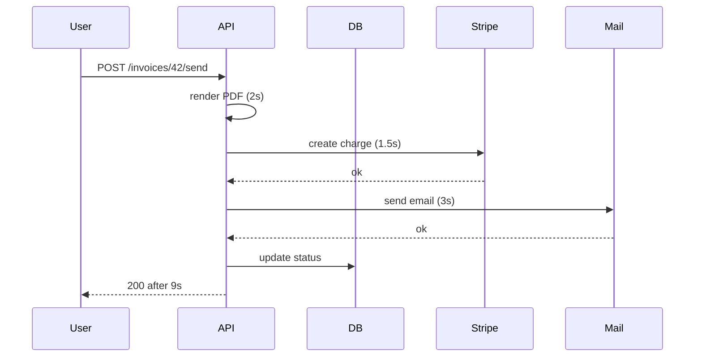
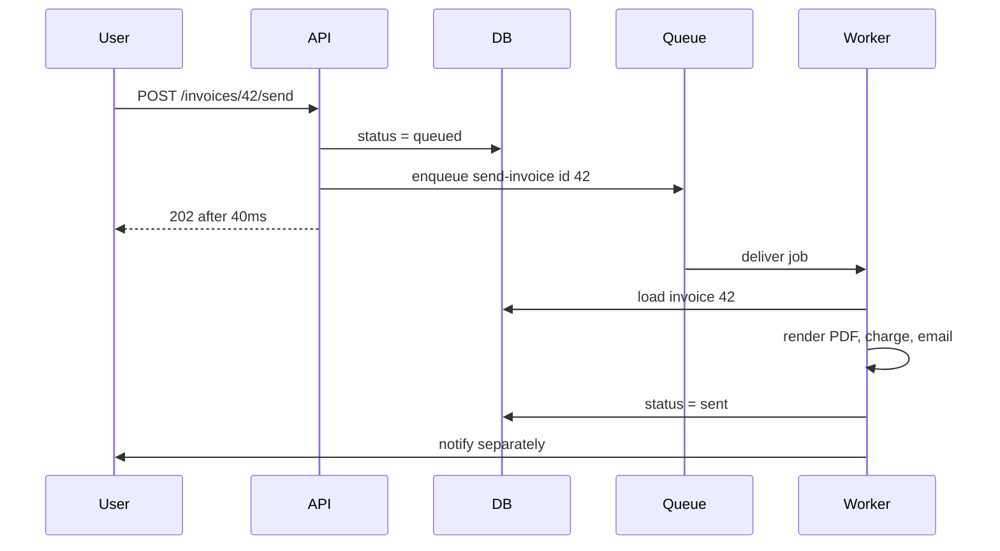
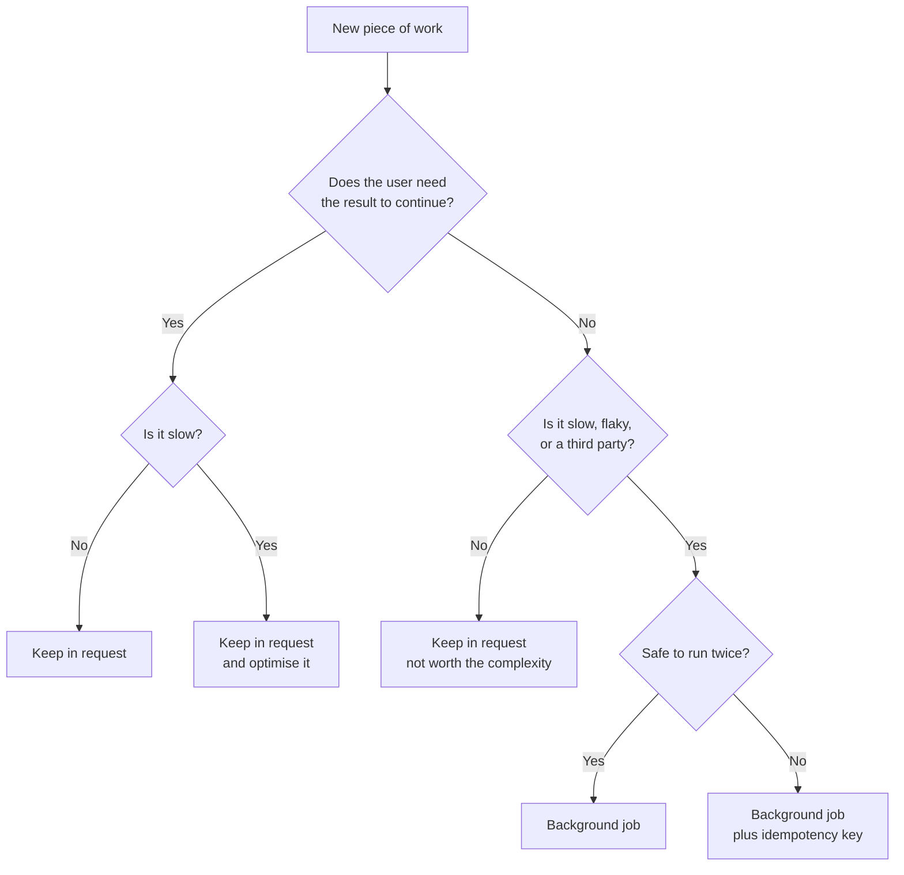

# Why Background Jobs

A user clicks **Send invoice**. Your handler generates a PDF, calls Stripe,
sends an email through SendGrid, and writes an audit log row. Then it returns.
The user watched a spinner for nine seconds, and on a bad day the request timed
out at the load balancer and they clicked again.

Nothing in that handler is written badly. The problem is *where* the work runs.
This file is about deciding what belongs inside the request and what belongs
after it, and about the mistakes people make the first time they move work out.

> **📌 In one line:** return to the user as soon as the durable write is safe,
> and do the slow or unreliable parts afterwards in a process built to retry
> them.

## Table of Contents

1. [The Nine-Second Spinner](#the-nine-second-spinner)
2. [What Moving Work Out Actually Changes](#what-moving-work-out-actually-changes)
3. [The Decision Rule](#the-decision-rule)
4. [Walking Your Domain Through the Rule](#walking-your-domain-through-the-rule)
5. [What You Lose By Going Async](#what-you-lose-by-going-async)
6. [The Request Worker Boundary](#the-request-worker-boundary)
7. [The Transactional Outbox, Briefly](#the-transactional-outbox-briefly)
8. [Why setTimeout Is Not Background Processing](#why-settimeout-is-not-background-processing)
9. [Where Jobs Fit in the Architecture](#where-jobs-fit-in-the-architecture)
10. [Common Mistakes](#common-mistakes)
11. [Questions to Test Yourself](#questions-to-test-yourself)
12. [Related](#related)

---

## The Nine-Second Spinner

Think about a restaurant. You order a coffee and a slow-cooked stew. The waiter
could stand at your table holding your order until the stew is ready in forty
minutes. Nobody runs a restaurant that way. The waiter writes the order on a
ticket, puts the ticket on the kitchen rail, and comes back to you. The ticket
is the thing that makes it safe to walk away.

Here is the handler, written the obvious way:

```ts
// ❌ BROKEN - four slow operations inside one HTTP request
async sendInvoice({ params, response }: HttpContext) {
  const invoice = await Invoice.findOrFail(params.id)

  const pdf = await this.pdfService.render(invoice)        // ~2s, CPU heavy
  await this.stripe.charges.create({ /* ... */ })          // ~1.5s, network
  await this.mailer.send(invoice.customerEmail, pdf)       // ~3s, third party
  await AuditLog.create({ action: 'invoice.sent', /* */ }) // fast

  invoice.status = 'sent'
  await invoice.save()
  return response.ok(invoice)
}
```

Four things are wrong, and only the first one is obvious.

| Problem | What the user sees | What you see |
|---|---|---|
| Total time is the **sum** of every step | A nine-second spinner | High p95 latency on one route |
| Any step can fail | "Something went wrong" | The PDF was built and thrown away |
| A failure halfway leaves a **partial result** | Charged but no email | Support tickets you cannot explain |
| The Node process holds a connection for 9s | Nothing, until traffic rises | Connection pool exhausted, whole API slows |

That last row is the one people miss. A slow request is not just slow for the
person waiting. It occupies a database connection and an event-loop slot that
every other user is also competing for.

## What Moving Work Out Actually Changes

The change is small to describe and large in effect. **You return the response
as soon as the durable write is done. Everything else happens after.**

"Durable write" means the fact you must not lose is safely in the database.
For this endpoint that fact is: *this invoice has been queued to send*. That is
one row update. It takes a few milliseconds.

Before:



After:



Two details in that second diagram matter more than the speed.

The worker loads invoice 42 **by id**, from the database, at the moment it
runs. It does not trust a copy of the invoice that the API captured nine
seconds earlier. File 02 explains why this rule is not optional.

And the worker notifies the user separately. The response no longer carries the
outcome, so something else has to.

> **💡 Tip:** `202 Accepted` is the honest status code here. It means "I have
> taken responsibility for this, it is not finished". `200 OK` implies the work
> is done, which is now a lie.

## The Decision Rule

Four questions decide it. You do not need a fifth.

| Question | If yes | Why |
|---|---|---|
| Does the user need the result to continue? | Keep it in the request | You cannot return a value you have not computed |
| Is it slow or unreliable? | Move it out | Slowness and failure both become the user's problem otherwise |
| Does it call a third party? | Move it out | Their outage becomes your outage |
| Can it be retried safely? | Move it out more confidently | A background job **will** be retried |

The first question outranks the others. If the user cannot continue without the
answer, it stays in the request no matter how slow it is. Make it faster; do
not make it invisible.



Notice that "no" on the last question never sends you back to the request. It
sends you to file 05. Making the handler safe to run twice is work you do, not
a reason to keep the work inline.

## Walking Your Domain Through the Rule

| Work | Needed to continue? | Slow or flaky? | Verdict |
|---|---|---|---|
| Send a welcome email | No | Yes, third party | **Background** |
| Generate a 40-page PDF report | No, deliver by link | Yes, CPU heavy | **Background** |
| Resize an uploaded avatar | Sometimes | Yes | **Background**, show the original meanwhile |
| Sync a company to the CRM | No | Yes, third party | **Background** |
| Recalculate a cached aggregate | No | Medium | **Background**, or cache-aside on read |
| Validate the request body | Yes | No | **Request** |
| Create the task row itself | Yes | No | **Request** |
| Charge a card | **It depends** | Yes | Read below |

**Charging a card is the interesting one.** It fails the simple test in both
directions. It is slow and it calls a third party, which says background. But
the user is standing there waiting to know whether their payment worked, which
says request.

There are two honest designs, and one wrong one.

**Design A — synchronous charge.** The user waits two seconds and learns the
result immediately. Correct for checkout, where the whole point of the screen
is the payment outcome. You still need a timeout and you still need an
idempotency key, because a timeout does not tell you whether the charge
happened.

**Design B — asynchronous charge with visible state.** You write a `payment`
row with status `pending`, return it, and a worker performs the charge. The UI
shows "Processing payment" and updates when the state changes. Correct for
subscription renewals and invoice runs, where no human is watching.

**The wrong design is "fire and forget".** Enqueue the charge, return `200`,
never look at the result. Money work has three properties that make this
unacceptable: the outcome is not guaranteed, the user must be told, and a
duplicate is a real financial event. "Fire and forget" throws away the outcome.
Background does not mean unwatched. It means *the outcome arrives through a
different channel*, and you must build that channel.

> **⚠️ Warning:** Any job that moves money, sends a legal document, or changes
> access rights needs a recorded terminal state — `succeeded` or `failed` — in
> your own database. Not just in the queue.

## What You Lose By Going Async

This is the part people skip, and it is why badly-done async feels worse to
users than a slow request.

**You lose the immediate answer.** A synchronous request has one beautiful
property: the user learns the truth at the moment they act. Once you go async,
the user learns "we started it". You now owe them a second message.

You have four ways to deliver it. Pick one deliberately:

| Channel | Good for | Cost |
|---|---|---|
| In-app notification | Most things | Needs a notifications table and a bell icon |
| Email | Things the user may have navigated away from | Slow, may land in spam |
| Polling (`GET /jobs/:id`) | A screen the user is still looking at | Extra requests, needs a status endpoint |
| WebSocket / SSE | Live progress bars | Real infrastructure, connection state |

Polling is underrated. A status endpoint that returns
`{ status: 'processing' | 'done' | 'failed', result? }` costs one table column
and solves most cases.

**You lose loud failure.** This is the bigger loss. In a request, a failure
produces a `500`, an error log, a user who complains, and a spike on your
dashboard. In a worker, a failure produces a line in a log nobody reads.

> **📌 Remember:** Failing silently in a worker is worse than failing loudly in
> a request. A request failure is reported to you by a human within minutes. A
> worker failure can run for three weeks before anyone notices the invoices
> stopped going out.

The whole of file 04 (dead-letter queues) and file 07 (operating queues) exist
to buy back that loudness. Do not move work into the background until you have
decided where its failures will be visible.

## The Request Worker Boundary

Here is the single most common bug in a first job system.

```ts
// ❌ BROKEN - the job is enqueued before the transaction commits
await db.transaction(async (trx) => {
  const invoice = await Invoice.create({ /* ... */ }, { client: trx })
  await invoiceQueue.add('send-invoice', { invoiceId: invoice.id })
  await this.ledger.debit(invoice, { client: trx })   // throws -> rollback
})
```

Redis does not participate in your Postgres transaction. The `add` call reaches
Redis immediately. If `ledger.debit` throws, Postgres rolls back and invoice 42
never existed. But a worker has already picked up a job that says `invoiceId:
42`, and it fails with `Invoice not found`.

It gets worse. Even when the transaction succeeds, the worker can win the race:
the job is visible in Redis microseconds after `add`, while the row only
becomes visible to other connections after `COMMIT`. A fast worker reads
uncommitted-and-therefore-invisible data and fails.

```ts
// ✅ FIXED - enqueue only after the commit succeeds
const invoice = await db.transaction(async (trx) => {
  const created = await Invoice.create({ /* ... */ }, { client: trx })
  await this.ledger.debit(created, { client: trx })
  return created
})

// Reached only if COMMIT succeeded. The row is visible to every connection.
await invoiceQueue.add('send-invoice', { invoiceId: invoice.id })
```

The rule: **commit the fact, then announce it.** Never announce inside the
transaction that creates it.

This fixes the ordering bug but leaves a smaller one. If the process dies
between `COMMIT` and `add`, the invoice exists and no job was ever created.
The work is silently lost. For a welcome email you may accept that. For
anything that must happen, you need the outbox.

More on why a commit is the only point at which a fact becomes real:
[transactions and ACID — part 2](../../databases/transactions-and-concurrency/01-transactions-and-acid-part-2.md).

## The Transactional Outbox, Briefly

The outbox pattern removes the gap by writing the job **into the same database
transaction** as the data, into a normal table. A separate process reads that
table and pushes to the real queue.

```text
┌─────────────────── one Postgres transaction ───────────────────┐
│  INSERT INTO invoices  ...                                     │
│  INSERT INTO outbox_messages (type, payload, published_at=NULL)│
└────────────────────────────────────────────────────────────────┘
                              │ COMMIT
                              ▼
                 ┌────────────────────────┐
                 │ relay process (polls)  │──► queue ──► worker
                 │ marks published_at     │
                 └────────────────────────┘
```

```ts
// Both rows commit together, or neither does.
await db.transaction(async (trx) => {
  const invoice = await Invoice.create({ /* ... */ }, { client: trx })
  await OutboxMessage.create(
    { type: 'send-invoice', payload: { invoiceId: invoice.id } },
    { client: trx },
  )
})
```

The relay gives you at-least-once delivery: it can crash after publishing and
before marking `published_at`, so the same message goes out twice. That is
fine, and it is the normal state of affairs — see file 05.

Use the outbox when losing the job would be a real incident: billing, legal
notices, provisioning. Skip it for a welcome email. The conceptual background,
and the same pattern applied to events rather than jobs, is in
[event-driven-architecture](../../system-design/scale-patterns/event-driven-architecture.md).

## Why setTimeout Is Not Background Processing

Someone always suggests this, because it works on their laptop.

```ts
// ❌ BROKEN - none of this survives anything
async sendInvoice({ params, response }: HttpContext) {
  const invoice = await Invoice.findOrFail(params.id)

  // Floating promise: not awaited, errors go nowhere.
  this.mailer.sendInvoice(invoice)

  setTimeout(() => this.crm.sync(invoice), 5000)

  return response.ok(invoice)
}
```

Four separate failures:

1. **It dies with the process.** A deploy, a crash, an out-of-memory kill, or a
   Kubernetes pod rotation ends the timer. The work is gone with no record that
   it was ever supposed to happen.
2. **There is no retry.** If SendGrid returns a `503`, that is the end.
3. **There is no visibility.** The work is not in any list. You cannot count
   it, inspect it, or replay it.
4. **A rejected floating promise** does not fail the request. In modern Node it
   triggers `unhandledRejection`, which by default terminates the process —
   so a third-party hiccup can kill an API server that had nothing to do with
   it.

```ts
// ✅ FIXED - the work is a durable record, not a timer in memory
async sendInvoice({ params, response }: HttpContext) {
  const invoice = await Invoice.findOrFail(params.id)
  invoice.status = 'queued'
  await invoice.save()

  await invoiceQueue.add(
    'send-invoice',
    { invoiceId: invoice.id, requestId: this.ctx.requestId },
    { attempts: 5, backoff: { type: 'exponential', delay: 2000 } },
  )

  return response.accepted(invoice)
}
```

The difference is not the syntax. It is that the job now lives **outside the
process**, in Redis or Postgres, where a restart cannot erase it and a human
can look at it.

If the difference between an awaited promise, a floating promise, and a timer
is still fuzzy, read
[async-await-promise](../../typescript-fundamentals/async-await-promise/async-await-promise.md)
first — every worker bug in this folder is easier once that is solid.

## Where Jobs Fit in the Architecture

A worker is not a second copy of your application logic. It is a second
**caller** of the same logic.

```text
   HTTP controller ──┐
                     ├──► InvoiceService.send(invoiceId)  ──► repository ──► DB
   Job handler    ───┤
                     │
   CLI command    ───┘
```

This is why the service layer must not know about HTTP. A service that reads
`ctx.request.input('amount')` or throws `HttpError(404)` cannot be called from
a worker. A service that takes plain arguments and throws domain errors can be
called from anywhere.

```ts
// The job handler is thin. All the logic already exists.
export const sendInvoiceHandler = async (job: Job<{ invoiceId: number }>) => {
  await invoiceService.send(job.data.invoiceId)
}
```

If writing that handler forces you to copy code out of a controller, the
controller had too much logic in it. Move it down first.

The full argument for that boundary is in
[service layer — part 1](../../backend-fundamentals/09-application-architecture/02-service-layer-part-1.md).

---

## Common Mistakes

| Mistake | Why it is wrong | Do this instead |
|---|---|---|
| Enqueue inside the transaction | Worker sees a row that was rolled back | Enqueue after commit, or use an outbox |
| `setTimeout` or a floating promise | Dies on deploy, no retry, no visibility | A real queue with a durable record |
| Moving work out without a result channel | User never learns if it worked | Notification, email, polling, or websocket |
| Fire-and-forget for a card charge | A payment with no recorded outcome | Terminal state in your own database |
| Returning `200` for queued work | Claims the work is finished | `202 Accepted` plus a status field |
| Putting the whole object in the payload | It is stale by the time the worker runs | Pass the id, re-fetch in the worker |
| Moving fast work out "for consistency" | Adds a queue, a worker, and a failure mode for 3 ms | Keep cheap work in the request |
| No alerting on worker failures | Silent failures for weeks | Dead-letter queue plus an alert — file 04 |

## Questions to Test Yourself

1. Your handler does five things and takes 9 seconds. Exactly which of the five
   must stay in the request, and what is the test you applied?
2. A teammate enqueues a job inside a transaction and says "it works fine in
   staging". Describe two distinct ways it fails in production.
3. Why does the outbox pattern remove a failure that "enqueue after commit"
   still has? What new problem does it introduce in exchange?
4. A checkout page charges a card. Argue for keeping it synchronous, then argue
   for making it asynchronous. What fact about the product decides it?
5. What is the difference between `200 OK` and `202 Accepted` for this
   endpoint, and who is harmed if you pick the wrong one?
6. `setTimeout(() => sync(), 5000)` runs and the pod is rotated at second 3.
   What record exists anywhere that the work was supposed to happen?
7. Why must the worker load the invoice by id rather than receive the invoice
   object in the job payload? Give a case where a snapshot is correct instead.
8. Name the one thing you lose by moving work to the background that no amount
   of queue tuning gives back, and how you compensate for it.

## Related

- [Anatomy of a Job System — Part 1](02-anatomy-of-a-job-system-part-1.md) —
  producer, queue, worker, and how to design the payload you just decided to
  send.
- [Writing Reliable Workers — Part 1](03-writing-reliable-workers-part-1.md) —
  the process on the other end of that queue.
- [Idempotent Jobs — Part 1](05-idempotent-jobs-part-1.md) — what to do about
  the "safe to run twice" branch of the decision flowchart.
- [transactions and ACID — part 2](../../databases/transactions-and-concurrency/01-transactions-and-acid-part-2.md)
  — why the commit is the only moment a fact becomes real.
- [event-driven-architecture](../../system-design/scale-patterns/event-driven-architecture.md)
  — the outbox pattern and the wider style of system it belongs to.
- [async-await-promise](../../typescript-fundamentals/async-await-promise/async-await-promise.md)
  — floating promises, unhandled rejections, and why a timer is not a plan.
- [service layer — part 1](../../backend-fundamentals/09-application-architecture/02-service-layer-part-1.md)
  — keeping business logic callable from both a controller and a worker.
- [message-queues overview](../../system-design/foundational/message-queues/overview.md)
  — the concept level: queue versus pub/sub, and which broker to choose.
