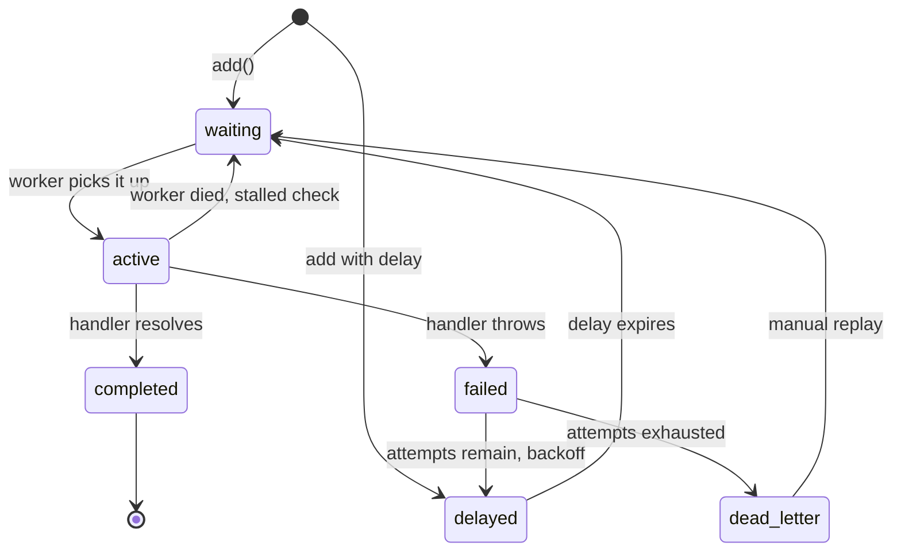

# Anatomy of a Job System — Part 1

File 01 decided *what* should leave the request. This file opens the box and
looks at the machine that carries it. Part 1 covers the moving pieces, the
states a job passes through, and the thing beginners get wrong most often:
what you put inside the job.

Everything here uses a Redis-backed queue (BullMQ style) as the concrete
example, because that is the most likely stack. The ideas are the same on
RabbitMQ, SQS, or a Postgres-backed queue.

> **📌 In one line:** a job is a name, a small payload of **ids**, and a set of
> options — and it moves through a fixed lifecycle that you must be able to
> draw from memory before you can debug one.

## Table of Contents

1. [The Four Pieces](#the-four-pieces)
2. [A Job's Lifecycle](#a-jobs-lifecycle)
3. [What a Job Actually Is](#what-a-job-actually-is)
4. [Payload Design: Pass the Id, Not the Object](#payload-design-pass-the-id-not-the-object)
5. [When a Snapshot Is Genuinely Correct](#when-a-snapshot-is-genuinely-correct)
6. [Payload Size](#payload-size)
7. [Serialization Gotchas](#serialization-gotchas)
8. [Common Mistakes](#common-mistakes)
9. [Questions to Test Yourself](#questions-to-test-yourself)
10. [Related](#related)

---

## The Four Pieces

A job system is a kitchen with a ticket rail. There are exactly four parts and
each has one responsibility.

| Piece | Plain words | In a Node app |
|---|---|---|
| **Producer** | The thing that says "this needs doing" | Your API controller or a scheduler |
| **Queue** | The rail where tickets wait, in order | A set of Redis keys, or a Postgres table |
| **Worker** | The cook who takes a ticket and does it | A separate Node process running handlers |
| **State store** | The board showing what happened | Usually the same Redis, plus your own DB |

```text
                         ┌──────────────────────────────┐
   ┌───────────┐         │            QUEUE             │        ┌──────────┐
   │ PRODUCER  │ add()   │  waiting  active  delayed    │ fetch  │  WORKER  │
   │ API / cron│────────►│  failed   completed  DLQ     │◄──────►│ handler  │
   └───────────┘         └──────────────────────────────┘        └────┬─────┘
                                      ▲                               │
                                      │  progress, result, error      │
                                      └───────────────────────────────┘
                                                  │
                                            ┌─────▼──────┐
                                            │ your DB    │
                                            │ real state │
                                            └────────────┘
```

Two things about that picture are worth saying out loud.

**The producer and the worker never talk to each other.** They only talk to the
queue. That is the entire point: the API can deploy, restart, or scale
independently of the workers.

**The queue's state store is not your source of truth.** BullMQ remembers
whether a job completed. It does not remember whether *the invoice was sent*.
Queue state is for operating the queue. Business state belongs in your own
tables. If you ever find yourself querying the queue to answer a product
question, something is misplaced.

> **💡 Tip:** A useful test — if you deleted every key in Redis right now,
> would you still know which invoices are unsent? If the answer is no, your
> business state is living in the queue.

## A Job's Lifecycle

Every job moves through the same small set of states. Learning them is the
difference between "the queue is broken" and "142 jobs are stuck in active
with no worker holding them".



| Transition | What causes it | What you should know |
|---|---|---|
| `add()` → **waiting** | Producer calls `add` | The job is durable from this instant |
| `add()` → **delayed** | `add` with a `delay` or `repeat` option | Held in a sorted set by run time |
| **delayed** → **waiting** | Its timestamp passes | Something must promote it; see part 2 |
| **waiting** → **active** | A worker has a free slot | The job is now locked to that worker |
| **active** → **completed** | The handler's promise resolves | Return value stored as the result |
| **active** → **failed** | The handler throws or rejects | The error message is recorded |
| **failed** → **delayed** | Attempts remain | Waits for the backoff, then retries |
| **active** → **waiting** | The worker died holding the lock | The **stalled** case — covered in file 03 |
| **failed** → **dead letter** | No attempts left | Must go somewhere visible — file 04 |

The transition people forget is **active → waiting**. A worker takes a job and
holds a lock with a short expiry, renewing it while it works. If the process is
killed, nobody renews the lock, it expires, and another worker picks the job up
again. This is correct behaviour and it is also exactly why a job can run
twice through no fault of the queue.

> **⚠️ Warning:** "Active" does not mean "a worker is currently running this".
> It means "a worker claimed this and has not reported back". Those are
> different, and the gap between them is where stuck queues live.

## What a Job Actually Is

Three things. That is all.

```ts
await invoiceQueue.add(
  'send-invoice',                 // 1. name — which handler runs
  { invoiceId: 42, requestId },   // 2. payload — the data, JSON-serialisable
  {                               // 3. options — how the queue treats it
    attempts: 5,
    backoff: { type: 'exponential', delay: 2000 },
    removeOnComplete: { age: 3600, count: 1000 },
    removeOnFail: { age: 7 * 24 * 3600 },
    jobId: `invoice-send-${invoiceId}`,
  },
)
```

**The name** selects the handler. Use a stable, boring string. Renaming a job
name is a breaking change, because jobs enqueued by the new code will be
invisible to workers running the old code, and vice versa. Part 2 and file 07
both come back to this.

**The options** are where most of the reliability lives:

| Option | What it does | Sensible default |
|---|---|---|
| `attempts` | How many times in total to try | 3 to 5 for network work, 1 for non-retryable |
| `backoff` | How long to wait between attempts | exponential, 2000 ms base |
| `removeOnComplete` | Stop completed jobs filling Redis | keep an hour or a few thousand |
| `removeOnFail` | Keep failures long enough to look at | keep several days |
| `jobId` | A stable id that rejects duplicates | a natural key when one exists |
| `priority` | Lower number runs first | leave unset until you need it |
| `delay` | Run no earlier than N ms from now | for reminders and manual retries |

`removeOnComplete` deserves a note. By default some setups keep every completed
job forever. At 200,000 jobs a day that is a Redis memory problem within a
week, and Redis running out of memory is one of the nastiest queue failures
there is — see file 07.

**The payload** is the rest of this file.

## Payload Design: Pass the Id, Not the Object

Here is the rule, and it is close to absolute:

> **📌 Remember:** Put **ids** in the payload. Load the data in the worker.

The reason is time. The producer runs now. The worker runs later — maybe 20
milliseconds later on a quiet system, maybe forty minutes later during a
backlog, maybe tomorrow after a replay from the dead-letter queue. Anything you
copy into the payload is frozen at producer time.

```ts
// ❌ BROKEN - the invoice is a snapshot that goes stale
await invoiceQueue.add('send-invoice', { invoice: invoice.toJSON() })

// worker
const handler = async (job: Job<{ invoice: InvoiceJson }>) => {
  const { invoice } = job.data
  await mailer.send(invoice.customerEmail, renderPdf(invoice))
}
```

Everything that can go wrong here, goes wrong eventually:

- The customer corrected their email address one minute after clicking send.
  The worker mails the old address.
- The invoice was voided while the job sat in the queue. The worker sends it
  anyway, because nothing in the payload says `status`.
- The invoice row was deleted. The worker happily emails a document for a
  record that no longer exists.
- Someone edited the line items. The PDF shows the old total.
- A retry three days later re-sends the version from three days ago.

```ts
// ✅ FIXED - id only; the worker reads the current truth and re-checks it
await invoiceQueue.add('send-invoice', { invoiceId: invoice.id, requestId })

const handler = async (job: Job<{ invoiceId: number }>) => {
  const invoice = await Invoice.find(job.data.invoiceId)

  // The row may be gone. That is not an error worth retrying.
  if (!invoice) {
    logger.info({ invoiceId: job.data.invoiceId }, 'invoice deleted, skipping')
    return
  }
  // The state may have moved on. Re-check the precondition.
  if (invoice.status !== 'queued') return

  await invoiceService.send(invoice)
}
```

Two habits in that fixed version are worth copying into every handler you
write. **Treat "the row is gone" as a normal outcome, not a crash.** And
**re-check the precondition that made this job valid.** The world changed
between enqueue and run; the handler is the only place that can notice.

## When a Snapshot Is Genuinely Correct

The rule has a real exception, and it is not "when it is more convenient".

A snapshot is correct when the job's purpose is to record or transmit **what
was true at a specific moment**, not to act on current state.

| Job | Payload | Why |
|---|---|---|
| `send-invoice` | `{ invoiceId }` | Acts on current state |
| `record-audit-entry` | `{ actorId, action, before, after, at }` | The whole point is the historical value |
| `deliver-webhook` | `{ endpointId, eventBody, eventId }` | The subscriber was promised *this* event |
| `send-password-changed-email` | `{ userId, changedAt, ipAddress }` | The IP at the time is the fact |

The webhook case is the clearest. If a customer's project was renamed from
"Alpha" to "Beta", the `project.updated` webhook you promised to deliver
contains "Alpha → Beta". Re-fetching the project at delivery time would send
"Beta → Beta", which is wrong. The event *is* the data.

The full delivery story for that case is in
[webhooks — part 1](../../backend-fundamentals/12-files-and-integrations/03-webhooks-part-1.md).

A useful phrasing: **if re-fetching would change the answer and the new answer
is better, pass an id. If re-fetching would change the answer and the old
answer is the correct one, pass a snapshot.**

Even then, pass the id *as well*. A payload of
`{ eventId, endpointId, body }` lets you look the record up when debugging.

## Payload Size

A job payload is serialised to JSON and stored in Redis. Keep it small.

| Payload | Verdict |
|---|---|
| `{ invoiceId: 42 }` | Ideal |
| `{ userIds: [1..500] }` | Acceptable for a batch job, watch the upper bound |
| A 3 MB base64 PDF | Never |
| A 40 000-row CSV as a string | Never |

Large payloads hurt in four ways at once: Redis memory, network transfer on
every fetch, JSON parse time on the worker's event loop, and — the killer — a
retry re-transfers the whole thing every attempt. Brokers also enforce hard
limits (SQS is 256 KB per message, for example), so a design that works on
Redis may not port.

The fix is always the same shape: **put the bytes in object storage, put the
key in the job.**

```ts
// Upload first, then enqueue a reference.
const key = `imports/${company.id}/${cuid()}.csv`
await storage.put(key, fileBuffer)

await importQueue.add('import-contacts', {
  companyId: company.id,
  objectKey: key,          // a few dozen bytes
  uploadedBy: user.id,
})
```

The worker streams the object rather than loading it into memory. The same
applies in reverse for output: a job that generates a report writes the PDF to
storage and returns the key, instead of returning megabytes as a job result.

See
[object storage and serving files](../../backend-fundamentals/12-files-and-integrations/02-object-storage-and-serving-files.md)
for signed URLs, lifecycle rules, and how the worker hands the finished file
back to the user.

> **💡 Tip:** A rough working limit for a Redis-backed queue is a few kilobytes
> per job. If a payload is approaching 100 KB, you are storing data, not
> describing work.

## Serialization Gotchas

The payload makes a round trip: `JSON.stringify` on the way in,
`JSON.parse` on the way out. TypeScript does not know this happened, so the
compiler will cheerfully tell you a value is a `Date` when it is a string.

```ts
// ❌ BROKEN - the types are a lie after the round trip
interface ReportJob {
  companyId: number
  from: Date            // arrives as a string
  filters?: string[]    // undefined disappears entirely
  requester: User       // arrives as a plain object, no methods
}

const handler = async (job: Job<ReportJob>) => {
  // TypeError: job.data.from.getTime is not a function
  const days = (Date.now() - job.data.from.getTime()) / 86_400_000
  // TypeError: requester.fullName is not a function
  logger.info(job.data.requester.fullName())
}
```

What actually survives JSON:

| Value in | Value out | Note |
|---|---|---|
| `new Date()` | `"2026-09-27T10:00:00.000Z"` | A string. No methods. |
| `undefined` | key is **absent** | `'filters' in data` becomes false |
| `NaN`, `Infinity` | `null` | Silently |
| `BigInt` | **throws** on stringify | Convert first |
| `Map`, `Set` | `{}` | Silently empty |
| A class instance | plain object | Prototype and methods gone |
| `Buffer` | `{ type: 'Buffer', data: [...] }` | Huge and useless |
| A circular reference | **throws** on stringify | |

```ts
// ✅ FIXED - the type describes the wire format, and parsing is explicit
interface ReportJob {
  companyId: number
  fromIso: string          // named so nobody mistakes it for a Date
  filters: string[]        // always present, empty array instead of undefined
  requesterId: number      // an id, not an object
}

const handler = async (job: Job<ReportJob>) => {
  const from = new Date(job.data.fromIso)
  const requester = await User.findOrFail(job.data.requesterId)
}
```

Two habits fix this permanently. **Name fields after their wire type**
(`fromIso`, not `from`). And **never put a class instance in a payload** —
an ORM model, a `Date`, a `Decimal`, or a custom error all lose their identity
in transit.

If "the object arrived but the methods are gone" is surprising, the underlying
model of references, copies, and prototypes is in
[objects-and-references](../../typescript-fundamentals/objects-and-references/objects-and-references.md).

Part 2 shows how to make TypeScript enforce all of this at the `add()` call
instead of finding out in production.

> **➡️ Continued in [Part 2](./02-anatomy-of-a-job-system-part-2.md)**

---

## Common Mistakes

| Mistake | Why it is wrong | Do this instead |
|---|---|---|
| Whole object in the payload | Stale, deleted, or edited by run time | Pass the id, re-fetch in the worker |
| No precondition re-check in the handler | Acts on state that has moved on | `if (invoice.status !== 'queued') return` |
| Treating "row not found" as a crash | Burns all retries on a deleted record | Log and return successfully |
| `Date` fields in the payload | Arrives as a string, `.getTime()` throws | `fromIso: string`, parse in the handler |
| Optional fields that can be `undefined` | The key vanishes in JSON | Use `null` or an empty array |
| Base64 file contents in the payload | Redis memory and re-transfer on every retry | Object storage key |
| Business state read from the queue | Redis is not your database | Keep a status column in Postgres |
| `removeOnComplete` left unset | Redis fills with finished jobs | Cap by age and count |

## Questions to Test Yourself

1. Draw the job lifecycle from memory. Which transition happens without any
   worker deciding to make it happen, and why does that matter?
2. A job is "active" but the CPU on every worker is idle. What state is the
   system really in, and what will resolve it?
3. Give one job in a SaaS app where a snapshot payload is correct, and explain
   why re-fetching would produce a wrong result.
4. Your handler does `new Date(job.data.scheduledFor)` and gets `Invalid Date`
   on some jobs but not others. Name two payload-level causes.
5. Why does re-checking `invoice.status` at the start of the handler matter
   even when the payload is just an id?
6. A 2 MB payload is retried five times before succeeding. Count everything
   that happened five times, not once.
7. What breaks if you rename a job from `send-invoice` to `invoice.send` and
   deploy the producer and the worker in that order?
8. If Redis were flushed right now, which facts in your system would be lost
   forever and which would be recoverable? What does the answer tell you about
   where your state lives?

## Related

- [Anatomy of a Job System — Part 2](02-anatomy-of-a-job-system-part-2.md) —
  typing jobs, delivery guarantees, multiple queues, choosing a library.
- [Why Background Jobs](01-why-background-jobs.md) — the decision that put this
  work in a queue in the first place.
- [Writing Reliable Workers — Part 1](03-writing-reliable-workers-part-1.md) —
  the process that consumes everything described here.
- [object storage and serving files](../../backend-fundamentals/12-files-and-integrations/02-object-storage-and-serving-files.md)
  — where large payloads actually belong.
- [webhooks — part 1](../../backend-fundamentals/12-files-and-integrations/03-webhooks-part-1.md)
  — the clearest real case for a snapshot payload.
- [objects-and-references](../../typescript-fundamentals/objects-and-references/objects-and-references.md)
  — why a class instance stops being a class instance after JSON.
- [message-queues overview](../../system-design/foundational/message-queues/overview.md)
  — queue versus pub/sub, and the broker comparison this file does not repeat.
