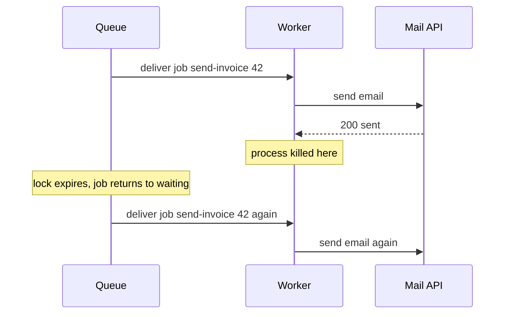
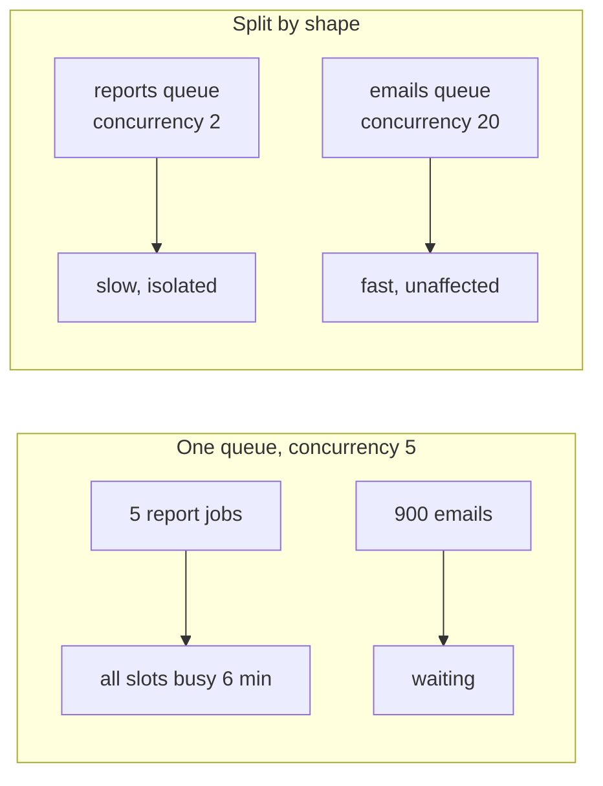

# Anatomy of a Job System — Part 2

Part 1 covered the pieces, the lifecycle, and what goes inside a payload. This
part makes the compiler enforce those payload rules, states plainly what
delivery guarantee you are actually getting, and answers two design questions
every job system reaches within a few months: how many queues should I have,
and which library should I use.

> **⬅️ This continues [Part 1](./02-anatomy-of-a-job-system-part-1.md).**

> **📌 In one line:** type your job payloads as a discriminated union so a
> producer cannot enqueue something a worker cannot read, accept that you get
> at-least-once delivery, and split queues by workload shape before one slow
> job type starves everything else.

## Table of Contents

1. [Typing Jobs So the Compiler Helps](#typing-jobs-so-the-compiler-helps)
2. [Queues and Topics in One Section](#queues-and-topics-in-one-section)
3. [Delivery Guarantees, Applied](#delivery-guarantees-applied)
4. [One Queue or Many](#one-queue-or-many)
5. [Choosing a Job Library for Node](#choosing-a-job-library-for-node)
6. [Why Postgres Is a Real Answer](#why-postgres-is-a-real-answer)
7. [Common Mistakes](#common-mistakes)
8. [Questions to Test Yourself](#questions-to-test-yourself)
9. [Related](#related)

---

## Typing Jobs So the Compiler Helps

The gap between a producer and a worker is a place where TypeScript normally
gives up. The producer calls `queue.add('send-invoice', { ... })`. The worker
reads `job.data`. Nothing connects the two, so nothing catches a typo.

```ts
// ❌ BROKEN - nothing checks the name against the payload
await invoiceQueue.add('send-invoice', { invoice_id: 42 })
//                                       ^^^^^^^^^^ snake_case typo

// worker, three weeks later, at 2 AM
const handler = async (job: Job<{ invoiceId: number }>) => {
  const invoice = await Invoice.findOrFail(job.data.invoiceId) // undefined
}
```

This compiles. It fails at runtime, on a worker, where nobody is watching.

The fix is a **discriminated union**: one type per job, all sharing a literal
`name` field, so the value of `name` tells the compiler which payload shape to
expect.

```ts
// jobs/definitions.ts — one file both sides import
export type InvoiceJob =
  | { name: 'send-invoice'; data: { invoiceId: number; requestId: string } }
  | { name: 'void-invoice'; data: { invoiceId: number; reason: string } }
  | { name: 'generate-statement'; data: { companyId: number; monthIso: string } }

export type InvoiceJobName = InvoiceJob['name']

// Given a name, extract just that member's data type.
export type PayloadFor<N extends InvoiceJobName> =
  Extract<InvoiceJob, { name: N }>['data']
```

Now wrap `add` so the two arguments have to agree:

```ts
// ✅ FIXED - the name constrains the payload at the call site
export async function enqueueInvoiceJob<N extends InvoiceJobName>(
  name: N,
  data: PayloadFor<N>,
  options?: JobsOptions,
) {
  return invoiceQueue.add(name, data, { attempts: 5, ...options })
}

await enqueueInvoiceJob('send-invoice', { invoice_id: 42 })
// Error: Object literal may only specify known properties.
// 'invoice_id' does not exist in type '{ invoiceId: number; requestId: string }'
```

The worker side gets the same benefit through narrowing:

```ts
const handler = async (job: Job): Promise<void> => {
  const typed = { name: job.name, data: job.data } as InvoiceJob

  switch (typed.name) {
    case 'send-invoice':
      return invoiceService.send(typed.data.invoiceId)
    case 'void-invoice':
      return invoiceService.void(typed.data.invoiceId, typed.data.reason)
    case 'generate-statement':
      return statementService.generate(typed.data.companyId, typed.data.monthIso)
    default: {
      // Adding a job type without a handler is now a compile error.
      const unreachable: never = typed
      throw new Error(`Unhandled job: ${JSON.stringify(unreachable)}`)
    }
  }
}
```

The `never` check in the `default` branch is the part that pays off later. Add
a fourth member to `InvoiceJob` and the build fails until you handle it.

One honest limitation: the `as InvoiceJob` cast is a promise you are making to
the compiler, not a fact it verified. Bytes came from Redis; TypeScript never
saw them. If jobs can be enqueued by an older deploy, a different service, or a
human in a dashboard, **validate at the boundary** with a schema library
(`zod`, `valibot`) instead of casting. Treat a job payload with the same
suspicion as a request body — it is the same problem, discussed in
[validation](../../backend-fundamentals/04-validation-and-input/README.md).

The mechanics of discriminated unions and `Extract`, if they are new:
[union-intersection-types](../../typescript-fundamentals/union-intersection-types/union-intersection-types.md).

## Queues and Topics in One Section

A **queue** hands each message to exactly one consumer. Three workers on one
queue split the work between them. That is what you want for "resize this
image".

A **topic** (pub/sub) hands each message to every subscriber. Three services
subscribed to a topic each get their own copy. That is what you want for "an
invoice was paid, and billing, analytics, and the CRM all care".

Almost everything in this folder is the first kind. BullMQ is a queue. SQS is a
queue. Kafka can behave as either, depending on consumer groups.

The full comparison — routing, replay, ordering, and which broker to pick — is
already written and this folder does not repeat it:
[message-queues overview](../../system-design/foundational/message-queues/overview.md),
with deep dives for [RabbitMQ](../../system-design/foundational/message-queues/rabbitmq.md),
[Kafka](../../system-design/foundational/message-queues/kafka.md), and
[SQS](../../system-design/foundational/message-queues/sqs.md).

> **💡 Tip:** If you find yourself adding a second handler to the same queue
> because two different things should happen when an invoice is paid, you want
> a topic, not a queue. The queue-based version is to publish one event and
> enqueue N separate jobs from it.

## Delivery Guarantees, Applied

Three phrases, one of which you will actually live with.

| Guarantee | Meaning | Reality |
|---|---|---|
| At-most-once | Never duplicated, may be lost | Only if you deliberately fire and forget |
| **At-least-once** | Never lost, **may be duplicated** | What you get. Plan for it. |
| Exactly-once | Processed exactly one time | Not available in the way people think |

**At-least-once is what you have.** Here is the mechanism, and once you see it
you cannot design around it:



The worker did the work and died before it could say so. The queue cannot tell
the difference between "died before doing it" and "died after doing it", so it
must assume the worse case and redeliver. Any system that never loses work must
sometimes duplicate it.

**Exactly-once delivery is essentially unavailable.** Delivering a message and
recording that it was delivered are two operations in two systems, and no
amount of protocol removes the window between them. What some brokers sell as
"exactly-once" (SQS FIFO deduplication, Kafka transactions) is deduplication
inside one system's boundary. The moment your handler sends an email or charges
a card, you are outside that boundary again.

> **📌 Remember:** You cannot get exactly-once *delivery*. You can get
> exactly-once *effect*, and you get it by writing handlers that produce the
> same end state no matter how many times they run. That is idempotency, and it
> is file 05.

This is not a limitation to route around. It is the design constraint. Write
every handler assuming it will run twice, and at-least-once delivery becomes a
non-event.

## One Queue or Many

Start with one queue. Split when you have a reason. Here are the two reasons
that actually occur.

**Reason 1: workload shape.** A `send-email` job takes 300 ms. A
`generate-annual-report` job takes 6 minutes. If they share a queue with
concurrency 5, then five report jobs occupy every slot and *every email in the
system stops for six minutes*. This is head-of-line blocking, and it is the
most common self-inflicted queue outage.



**Reason 2: priority.** A password-reset email must not queue behind a
50,000-row marketing export. Most libraries have a `priority` option, but
priority inside one queue still shares the same concurrency slots. A separate
queue with its own workers is a stronger guarantee than a priority number.

A workable starting split for a SaaS app:

| Queue | Contents | Concurrency | Why |
|---|---|---|---|
| `critical` | password reset, payment confirmation | 10 | Must never wait |
| `default` | notifications, CRM sync, cache warming | 20 | The bulk of traffic |
| `heavy` | reports, exports, bulk imports | 2 | Long, CPU or memory hungry |
| `external` | third-party calls with rate limits | rate-limited | Their quota, not your speed |

> **⚠️ Warning:** Do not create a queue per job type. Twenty queues means
> twenty dashboards, twenty alert rules, and worker processes sitting idle on
> empty queues. Split by *how the work behaves*, not by what it is called.

The other thing that shares a queue is failure. If your CRM provider goes down
and every `crm-sync` job retries, a shared queue spends its slots on retries.
Isolating third-party work into its own queue means you can pause that one
queue during their outage and leave the rest of the system running — an
operation covered in file 07.

## Choosing a Job Library for Node

| Library | Backed by | Good at | Watch out for |
|---|---|---|---|
| **BullMQ** | Redis | Mature, fast, rich features: repeat, priority, rate limit, flows, good dashboard (Bull Board) | You now operate Redis; eviction policy can silently delete jobs |
| **pg-boss** | Postgres | No new infrastructure, transactional enqueue, cron built in | Lower throughput ceiling; polling adds latency |
| **Graphile Worker** | Postgres | Very low latency for a DB queue (uses `LISTEN`/`NOTIFY`), simple | Smaller feature set, Postgres-only |
| **SQS + a small consumer** | AWS | Zero servers, effectively infinite scale, managed DLQ | Visibility timeout semantics, no built-in cron, per-message cost |
| **Temporal / Inngest** | Their service | Long-running multi-step workflows with durable state | Much bigger concept to learn; overkill for "send an email" |

Rough guidance rather than a rule:

- Already running Redis for caching, need throughput and features → **BullMQ**.
- Running Postgres, modest volume, want fewer moving parts → **pg-boss** or
  **Graphile Worker**.
- Fully on AWS, want nothing to operate → **SQS**.
- The work is a multi-day business process with human steps → a workflow
  engine, not a queue.

## Why Postgres Is a Real Answer

There is a reflex that says "a queue means Redis or RabbitMQ". For a lot of
SaaS applications that reflex adds an operational dependency to avoid a problem
they do not have.

**If you already run Postgres and your volume is modest — say, under a few
hundred jobs a second — a Postgres-backed queue is one less moving part.** You
get one thing that neither Redis nor SQS can give you: the enqueue is part of
your transaction. The whole class of bugs from file 01 disappears, because
there is no second system to get out of sync with.

The technique that makes it work is `FOR UPDATE SKIP LOCKED`:

```sql
-- Each worker claims rows nobody else has locked, without blocking.
UPDATE jobs
SET status = 'active', locked_at = now(), locked_by = $1
WHERE id IN (
  SELECT id FROM jobs
  WHERE status = 'waiting' AND run_at <= now()
  ORDER BY priority, run_at
  LIMIT 10
  FOR UPDATE SKIP LOCKED      -- the whole trick is on this line
)
RETURNING id, name, payload;
```

Without `SKIP LOCKED`, ten workers running that query would queue up behind
each other on the same rows and the system would process jobs one at a time.
With it, each worker skips rows another worker already holds and takes the next
ten. That is a parallel queue in one SQL statement.

The locking behaviour underneath — row locks, what blocks what, and why
skipping is safe — is explained in
[locks — part 1](../../databases/transactions-and-concurrency/04-locks-part-1.md).

The honest costs: workers poll (Graphile Worker softens this with
`LISTEN`/`NOTIFY`), every job is a write plus eventually a dead tuple, so
autovacuum has real work to do, and throughput tops out far below Redis. At
high volume those costs win. At the volume most B2B SaaS apps actually run,
they do not.

---

## Common Mistakes

| Mistake | Why it is wrong | Do this instead |
|---|---|---|
| Untyped `queue.add` calls everywhere | A typo in a payload key fails at 2 AM | A typed wrapper over a discriminated union |
| `as JobPayload` with no validation | The cast checks nothing at runtime | Parse with a schema at the handler boundary |
| Assuming exactly-once delivery | The duplicate arrives eventually | Design for at-least-once, add idempotency |
| Slow and fast jobs in one queue | Long jobs block every short one | Split queues by workload shape |
| One queue per job type | Twenty dashboards, idle workers | Split by behaviour, not by name |
| Adding Redis only to get a queue | A new thing to operate and monitor | Consider pg-boss or Graphile Worker first |
| A Postgres queue without `SKIP LOCKED` | Workers serialise on the same rows | `FOR UPDATE SKIP LOCKED` |
| No `default: never` in the handler switch | New job types silently do nothing | Exhaustiveness check |

## Questions to Test Yourself

1. Write the type that makes `enqueue('send-invoice', { companyId: 3 })` a
   compile error while `enqueue('generate-statement', { companyId: 3, monthIso })`
   compiles.
2. Why is `as InvoiceJob` not the same guarantee as the compile-time check on
   the producer side? When does that difference bite?
3. Explain at-least-once delivery using the moment a worker dies. Which two
   situations can the queue not tell apart?
4. Someone proposes "we will use SQS FIFO so we get exactly-once and can skip
   idempotency". What is wrong with that plan?
5. Your emails stopped for six minutes and nothing was broken. Give the queue
   configuration that caused it and the change that prevents it.
6. When is a separate queue a stronger guarantee than a `priority` option on
   the same queue?
7. Your app runs Postgres and does about 40 jobs per second. Argue for a
   Postgres-backed queue and then give the strongest argument against it.
8. What exactly does `SKIP LOCKED` skip, and what would ten workers do without
   it?

## Related

- [Anatomy of a Job System — Part 1](02-anatomy-of-a-job-system-part-1.md) —
  the four pieces, the lifecycle, and payload design.
- [Writing Reliable Workers — Part 1](03-writing-reliable-workers-part-1.md) —
  the worker process that consumes these queues.
- [Idempotent Jobs — Part 1](05-idempotent-jobs-part-1.md) — how at-least-once
  delivery stops being a problem.
- [message-queues overview](../../system-design/foundational/message-queues/overview.md)
  — queue versus pub/sub and choosing a broker, plus
  [RabbitMQ](../../system-design/foundational/message-queues/rabbitmq.md),
  [Kafka](../../system-design/foundational/message-queues/kafka.md),
  [SQS](../../system-design/foundational/message-queues/sqs.md).
- [union-intersection-types](../../typescript-fundamentals/union-intersection-types/union-intersection-types.md)
  — discriminated unions, `Extract`, and exhaustiveness checks.
- [locks — part 1](../../databases/transactions-and-concurrency/04-locks-part-1.md)
  — row locks and why `SKIP LOCKED` makes a Postgres queue parallel.
- [validation](../../backend-fundamentals/04-validation-and-input/README.md) —
  a job payload is untrusted input, exactly like a request body.
