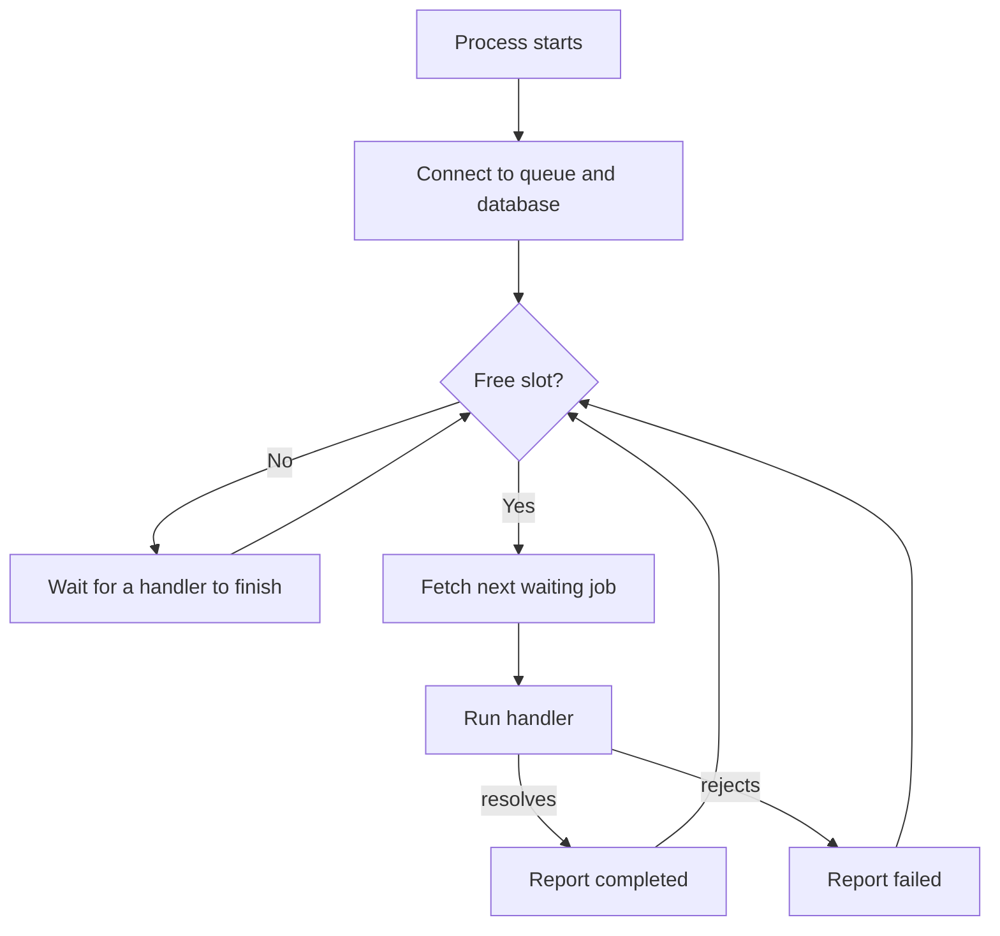
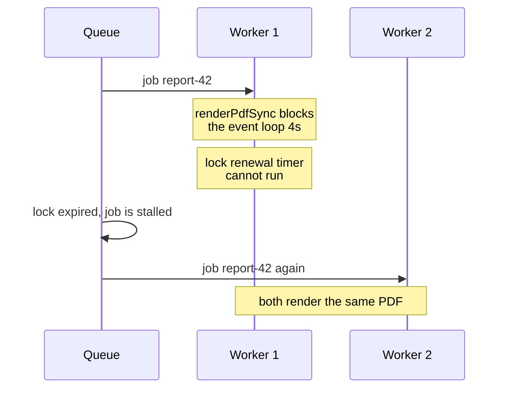

# Writing Reliable Workers — Part 1

A queue is the easy half. The worker is where jobs are actually lost, run
twice, or quietly stop running at all. This part builds a real worker process:
where it runs, what a handler looks like, how to log it so an incident is
debuggable, and the one setting people always get wrong — concurrency.

> **📌 In one line:** a worker is a separate process that pulls jobs, runs
> handlers, and logs every line with the job id and the originating request id
> — and its concurrency must be chosen against your database pool, not guessed.

## Table of Contents

1. [What a Worker Process Is](#what-a-worker-process-is)
2. [Why It Must Be Separate From the API](#why-it-must-be-separate-from-the-api)
3. [A Complete Worker](#a-complete-worker)
4. [Logging So an Incident Is Debuggable](#logging-so-an-incident-is-debuggable)
5. [Carrying the Request Id End to End](#carrying-the-request-id-end-to-end)
6. [Concurrency: What It Actually Controls](#concurrency-what-it-actually-controls)
7. [The Multiplication Trap](#the-multiplication-trap)
8. [CPU-Bound Work Blocks Anyway](#cpu-bound-work-blocks-anyway)
9. [Common Mistakes](#common-mistakes)
10. [Questions to Test Yourself](#questions-to-test-yourself)
11. [Related](#related)

---

## What a Worker Process Is

A worker is an ordinary Node program. It has no HTTP server and no routes. It
starts, connects to the queue, and then loops: ask for a job, run it, report
the outcome, ask for the next one.

```text
  node build/worker.js
        │
        ├── connect to Redis
        ├── connect to Postgres (its own pool)
        │
        └── loop forever
              ├── fetch up to N jobs (N = concurrency)
              ├── run handler for each
              ├── report completed or failed
              └── repeat
```



That is the whole idea. Everything else in this file is about the four ways
that loop goes wrong: it holds too many resources, it blocks, it is killed
mid-job, or it dies and nobody notices.

The same codebase usually ships twice — once as the API and once as the worker,
with a different entry point:

```json
{
  "scripts": {
    "start:api": "node build/bin/server.js",
    "start:worker": "node build/bin/worker.js"
  }
}
```

Same image, same build, different command. In Kubernetes that is two
Deployments from one image. In AdonisJS the worker entry point boots the
application container without the HTTP server, so services, models, and
dependency injection all work exactly as they do in a controller.

## Why It Must Be Separate From the API

You *can* start a worker inside your API process. It is one line. It is also a
decision you will undo.

| Reason | What happens when they share a process |
|---|---|
| **Resource competition** | A CPU-heavy PDF job blocks the event loop, so every HTTP request waits |
| **Independent scaling** | You need 3 API pods and 12 workers, or the reverse — you cannot have both |
| **Deploy safety** | Restarting the API to ship a route kills every in-flight job |
| **Different memory shape** | An import job needs 2 GB; your API pods now all need 2 GB |
| **Blast radius** | An unhandled rejection in a handler takes down your API |
| **Different health semantics** | "Ready to serve traffic" and "processing jobs" are not the same question |

The deploy point is the one that bites first. API deploys are frequent and
should be fast. Worker deploys need a long grace period so in-flight jobs can
finish — usually 30 to 120 seconds. If they are the same Deployment you must
pick one number, and whichever you pick is wrong for the other.

Rolling a worker Deployment safely is the same mechanism as rolling an API, but
tuned differently:
[rolling-updates](../../cloud-devops/deployment-strategies/rolling-updates.md).

> **💡 Tip:** Run the worker as a separate process from day one, even on a
> single small server. `pm2 start build/bin/worker.js` costs nothing and saves
> the migration later.

## A Complete Worker

Here is a worker with nothing left out that matters.

```ts
// bin/worker.ts
import { Worker, type Job } from 'bullmq'
import IORedis from 'ioredis'
import logger from '#services/logger'
import { handlers, type InvoiceJob } from '#jobs/handlers'

const connection = new IORedis(env.REDIS_URL, {
  maxRetriesPerRequest: null, // required by BullMQ's blocking commands
  enableReadyCheck: false,
})

const worker = new Worker<InvoiceJob['data']>(
  'invoices',
  async (job: Job) => {
    const log = logger.child({
      jobId: job.id,
      jobName: job.name,
      attempt: job.attemptsMade + 1,
      requestId: job.data.requestId,
    })

    log.info('job.started')
    const startedAt = Date.now()

    try {
      const result = await handlers.run(job, log)
      log.info({ durationMs: Date.now() - startedAt }, 'job.completed')
      return result
    } catch (error) {
      log.error({ err: error, durationMs: Date.now() - startedAt }, 'job.failed')
      throw error // rethrow, or the queue records a success
    }
  },
  {
    connection,
    concurrency: 10,
    limiter: { max: 100, duration: 1000 },
  },
)
```

Four details are load-bearing.

**The handler is `async` and returns a promise.** The queue decides
completed-versus-failed purely from whether that promise resolves or rejects.

**The `catch` block rethrows.** This is the single most common worker bug: a
`try/catch` that logs and swallows. The promise then resolves, the queue marks
the job **completed**, no retry happens, and the job disappears. Logging is not
handling.

```ts
// ❌ BROKEN - the queue thinks this succeeded
try {
  await invoiceService.send(job.data.invoiceId)
} catch (error) {
  logger.error(error)          // job is marked completed
}

// ✅ FIXED - log for humans, rethrow for the queue
try {
  await invoiceService.send(job.data.invoiceId)
} catch (error) {
  logger.error({ err: error, jobId: job.id }, 'invoice.send.failed')
  throw error                  // job is marked failed, retry policy applies
}
```

**Every `await` inside the handler must be awaited.** A floating promise inside
a handler is the same bug as a floating promise inside a controller, except the
consequences are worse: the job reports success while the work is still
running, and then the process may exit underneath it.

**`maxRetriesPerRequest: null`** is a BullMQ-specific requirement. Its blocking
Redis commands must not be given up on. Leave the default and workers randomly
stop fetching.

## Logging So an Incident Is Debuggable

A worker log line with no job id is nearly useless. Ten jobs run concurrently
and their log lines interleave, so a bare `"sending email"` tells you nothing
about which of the ten it belongs to.

Bind the context once, at the top of the handler, and pass the child logger
down:

```ts
const log = logger.child({
  jobId: job.id,
  jobName: job.name,
  attempt: job.attemptsMade + 1,
  queue: 'invoices',
  requestId: job.data.requestId,
})
```

Now every line the handler or its services write carries all five fields, and
`jobId = "1841"` in your log tool returns the complete story of one job across
all of its attempts.

A minimum set of fields per job:

| Field | Why |
|---|---|
| `jobId` | Ties every line of one execution together |
| `jobName` | Lets you compare failure rates per job type |
| `attempt` | Distinguishes "failed once, succeeded on retry" from "failed hard" |
| `requestId` | Connects the job back to the user action that caused it |
| `durationMs` | Turns logs into a latency histogram |
| `queue` | You will have more than one |

A structured logger with child contexts is exactly the tool for this:
[structured logging](../../backend-fundamentals/08-logging-and-observability/02-structured-logging.md).

> **⚠️ Warning:** Do not log the whole payload by default. Payloads contain
> email addresses, and eventually someone puts a token in one. Log ids, log the
> job name, and log the fields you deliberately chose.

## Carrying the Request Id End to End

This is a small habit with a large payoff during incidents.

A user clicks a button. Your API assigns that request an id. The request
enqueues three jobs. Those jobs run four minutes later on two different
workers, and one of them enqueues another job. Without a shared id, that is six
unrelated log streams.

**Put the request id in the payload at enqueue time and re-bind it in the
worker.**

```ts
// producer — inside the request
await invoiceQueue.add('send-invoice', {
  invoiceId: invoice.id,
  requestId: ctx.requestId,      // from AsyncLocalStorage or the middleware
})

// worker — re-establish it so services log it without being told
await requestContext.run({ requestId: job.data.requestId, jobId: job.id }, () =>
  handlers.run(job, log),
)
```

Now searching `requestId = "01J8..."` returns the HTTP request, all three jobs,
their retries, and the job the job created. One user action, one search.

If a job is enqueued by a scheduler rather than a user, generate an id anyway
and mark its source, for example `requestId: "cron:nightly-billing:2026-09-27"`.
Never leave the field empty.

The propagation mechanism, including `AsyncLocalStorage` and how this becomes a
distributed trace, is in
[correlation ids and tracing](../../backend-fundamentals/08-logging-and-observability/03-correlation-ids-and-tracing.md).

## Concurrency: What It Actually Controls

`concurrency: 10` means **this worker process will have at most 10 handler
promises in flight at once.** That is all it means.

It does not create threads. It does not create processes. It does not make
anything parallel in the CPU sense. Node runs one JavaScript thread; ten
concurrent handlers take turns on it, and progress only happens while they are
waiting on input and output.

```text
concurrency: 3, three I/O-bound jobs

job A  ──[cpu]──[ waiting on Postgres ]──[cpu]── done
job B     ──[cpu]──[ waiting on SendGrid ]────[cpu]── done
job C        ──[cpu]──[ waiting on S3 ]──[cpu]── done
              ▲
              only one of these can use the CPU at a time
```

This is why **a worker with `concurrency: 50` can still be slow**. Fifty
concurrent jobs share one thread. If each job spends 5 ms computing, fifty of
them need 250 ms of CPU before any of them can finish, and that CPU time is
serialised. Raising concurrency past the point where the event loop is
saturated adds latency to every job instead of throughput.

The right mental model of why — the single loop, the task queues, and what
"blocking" really means — is
[event-loop](../../typescript-fundamentals/event-loop/event-loop.md).

How to actually pick a number:

| Job shape | Starting concurrency | Reason |
|---|---|---|
| Network-bound (email, webhooks, third-party APIs) | 20–50 | Mostly waiting; the loop is free |
| Database-bound | 5–10 | Limited by the connection pool, not by Node |
| CPU-bound (PDF, image, crypto) | 1–2 | More does not help; see below |
| Mixed | Split into separate queues | One number cannot suit both |

Measure rather than guess: raise concurrency until throughput stops improving,
then stop. The moment p95 job duration starts climbing while throughput is flat
is the moment you went past the useful point.

## The Multiplication Trap

This is the failure that takes down the API, not the worker.

Your worker has `concurrency: 20`. Each concurrent job may hold a database
connection. You run 5 worker pods. So:

```text
   5 pods  ×  20 concurrency  =  100 connections demanded by workers
 + 3 API pods × 10 pool size  =   30 connections demanded by the API
                                 ────
                                  130 connections

   Postgres max_connections   =  100
```

The workers get there first because they are always busy. The API cannot
connect. Your users see `500`s from an application that is "healthy" by every
metric you are watching, while the queue drains beautifully.

**The rule: total worker concurrency must fit inside the connection budget you
gave workers, and that budget must leave room for the API.**

```ts
// Size the pool against concurrency, not the other way round.
const WORKER_CONCURRENCY = 10

export const dbConfig = {
  pool: {
    min: 2,
    max: WORKER_CONCURRENCY + 2, // +2 for health checks and shutdown work
  },
}
```

Then do the arithmetic before you scale:

| Symbol | Meaning | Example |
|---|---|---|
| `W` | Worker pods | 4 |
| `C` | Concurrency per pod | 10 |
| `P` | Pool max per pod | 12 |
| Worker demand | `W × P` | 48 |
| API demand | `api pods × api pool` | 3 × 10 = 30 |
| Must be under | `max_connections` minus superuser reserve | 100 − 3 |

> **📌 Remember:** Scaling workers scales connection demand linearly. Before
> you add pods to drain a backlog, check that the database can accept the
> connections those pods will open. A pooler such as PgBouncer changes this
> arithmetic and is often the real answer.

Pool sizing, why a bigger pool is not better, and where a pooler fits:
[connection pooling — part 1](../../databases/operations/01-connection-pooling-part-1.md).

## CPU-Bound Work Blocks Anyway

One more time, because people reach for the wrong lever.

```ts
// ❌ BROKEN - concurrency 20 does not help a CPU-bound handler
new Worker('reports', async (job) => {
  const rows = await loadRows(job.data.companyId)   // I/O, fine
  return renderPdfSync(rows)                        // 4 seconds of pure CPU
}, { concurrency: 20 })
```

While `renderPdfSync` runs, the JavaScript thread is occupied. Nothing else
progresses — not the other 19 jobs, not the lock renewal heartbeat, not the
health check. Worse, if the lock cannot be renewed because the loop is blocked,
the queue decides the worker is dead and hands the job to someone else. Now two
workers render the same 4-second PDF.



Three real answers:

```ts
// ✅ FIXED (a) - a worker thread keeps the main loop free
import { Worker as Thread } from 'node:worker_threads'

const renderInThread = (rows: Row[]) =>
  new Promise<Buffer>((resolve, reject) => {
    const thread = new Thread('./build/render-pdf.js', { workerData: rows })
    thread.once('message', resolve)
    thread.once('error', reject)
  })
```

```ts
// ✅ FIXED (b) - a separate queue and deployment with concurrency 1-2
new Worker('reports', handler, { concurrency: 2 })  // sized to CPU cores
```

Option (c) is to move the work out of Node entirely — a headless browser
service for PDFs, an image service for thumbnails. That is usually the best
answer for anything genuinely heavy.

The rule: **concurrency buys you overlap on waiting, never on computing.**

> **➡️ Continued in [Part 2](./03-writing-reliable-workers-part-2.md)**

---

## Common Mistakes

| Mistake | Why it is wrong | Do this instead |
|---|---|---|
| Worker started inside the API process | Jobs block requests, deploys kill jobs | A separate process and deployment |
| `catch` that logs but does not rethrow | Queue records success, no retry, job lost | Log then `throw error` |
| Raising concurrency to fix a CPU-bound job | One thread; nothing gets faster | `worker_threads` or a separate service |
| Concurrency chosen without the pool in mind | Workers exhaust connections, API returns 500 | Size pool to concurrency, do the multiplication |
| No `jobId` in log lines | Ten interleaved jobs, unreadable logs | Bind a child logger at handler entry |
| No `requestId` in the payload | Cannot connect a job to the user action | Pass it at enqueue, re-bind in the worker |
| Logging the entire payload | Leaks emails and tokens | Log ids and chosen fields |
| Floating promise inside a handler | Reports success while still running | Await everything |

## Questions to Test Yourself

1. Your handler catches an error, logs it, and does not rethrow. Walk through
   what the queue records and what happens to the retry policy.
2. Why can a worker with `concurrency: 50` be slower per job than the same
   worker with `concurrency: 10`?
3. You run 6 worker pods with concurrency 15 and a pool max of 16, plus 3 API
   pods with pool 10. `max_connections` is 100. What breaks, and who notices
   first?
4. A CPU-bound handler blocks the loop for 4 seconds. Explain how that can
   cause the *same job* to run on two workers at once.
5. What is the practical difference between putting a worker in the same
   Deployment as the API and putting it in its own, in terms of deploy timing?
6. A support ticket gives you a request id. List everything you should be able
   to find with it, and what must have been done at enqueue time for that to
   work.
7. Why is `requestId: "cron:nightly-billing:2026-09-27"` better than leaving the
   field empty for a scheduled job?
8. Give a job in your own app for each row of the concurrency table, and
   justify the number.

## Related

- [Writing Reliable Workers — Part 2](03-writing-reliable-workers-part-2.md) —
  graceful shutdown, timeouts, stalled jobs, error classification, health.
- [Anatomy of a Job System — Part 1](02-anatomy-of-a-job-system-part-1.md) —
  the lifecycle this worker drives.
- [Operating Queues — Part 1](07-operating-queues-part-1.md) — reading the
  metrics this worker produces.
- [event-loop](../../typescript-fundamentals/event-loop/event-loop.md) — why
  concurrency is overlap on waiting, not parallel computing.
- [connection pooling — part 1](../../databases/operations/01-connection-pooling-part-1.md)
  — the budget that worker concurrency has to fit inside.
- [correlation ids and tracing](../../backend-fundamentals/08-logging-and-observability/03-correlation-ids-and-tracing.md)
  — carrying one id from the click through every job it caused.
- [structured logging](../../backend-fundamentals/08-logging-and-observability/02-structured-logging.md)
  — child loggers and the field schema used here.
- [rolling-updates](../../cloud-devops/deployment-strategies/rolling-updates.md)
  — deploying a worker Deployment without killing in-flight jobs.
