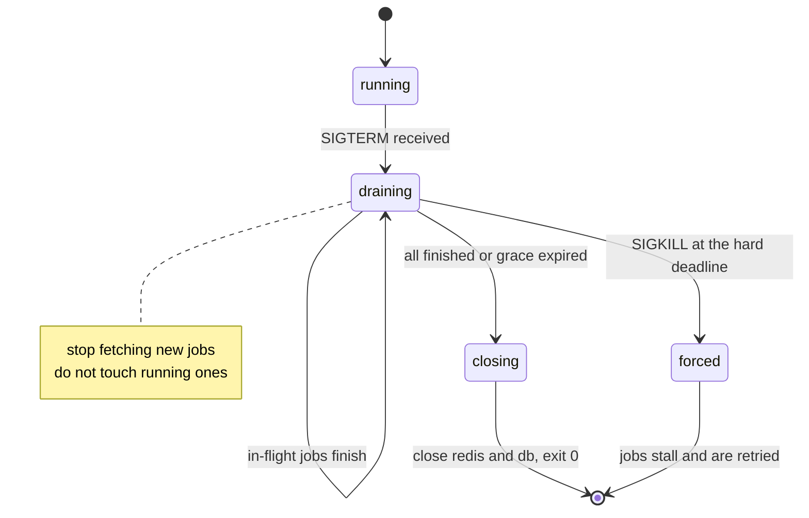

# Writing Reliable Workers — Part 2

Part 1 built a worker that runs jobs correctly while everything is calm. This
part is about the moments that are not calm: the deploy that kills a worker
mid-job, the job that never finishes, the error that should not be retried, and
the worker that dies without anyone noticing for two days.

> **⬅️ This continues [Part 1](./03-writing-reliable-workers-part-1.md).**

> **📌 In one line:** handle `SIGTERM` so in-flight jobs finish, give every job
> a maximum duration, classify errors before you rethrow them, and give a
> worker a health signal even though it has no HTTP port.

## Table of Contents

1. [Graceful Shutdown](#graceful-shutdown)
2. [What Happens If You Skip It](#what-happens-if-you-skip-it)
3. [Matching Your Platform's Termination Window](#matching-your-platforms-termination-window)
4. [Timeouts: Every Job Needs a Maximum](#timeouts-every-job-needs-a-maximum)
5. [Stalled Job Detection](#stalled-job-detection)
6. [Error Handling Inside a Handler](#error-handling-inside-a-handler)
7. [Never Let a Worker Die Quietly](#never-let-a-worker-die-quietly)
8. [Health Checks Without an HTTP Port](#health-checks-without-an-http-port)
9. [Priority, Rate Limits, and Pausing](#priority-rate-limits-and-pausing)
10. [Common Mistakes](#common-mistakes)
11. [Questions to Test Yourself](#questions-to-test-yourself)
12. [Related](#related)

---

## Graceful Shutdown

This is the section that prevents real data loss, and it is about twelve lines
of code that most first job systems do not have.

When your platform stops a worker — a deploy, a scale-down, a node
replacement — it sends `SIGTERM`. That signal means "please finish and exit".
Node's default behaviour for `SIGTERM` is to exit immediately. Whatever your
handler was doing stops in the middle of doing it.

A correct shutdown has three steps, in this order:



1. **Stop accepting new jobs.** No new work enters this process.
2. **Let in-flight jobs finish**, up to a grace period.
3. **Close connections and exit.**

```ts
// bin/worker.ts
const GRACE_MS = 30_000

let shuttingDown = false

async function shutdown(signal: string) {
  if (shuttingDown) return       // a second SIGTERM must not re-enter
  shuttingDown = true
  logger.info({ signal }, 'worker.shutdown.started')

  const timer = setTimeout(() => {
    logger.error('worker.shutdown.timeout, forcing exit')
    process.exit(1)              // non-zero so the platform records it
  }, GRACE_MS)
  timer.unref()                  // do not keep the loop alive by itself

  try {
    // false = do NOT kill running jobs; wait for them.
    await worker.close(false)
    await Promise.all([connection.quit(), db.manager.closeAll()])
    logger.info('worker.shutdown.clean')
    process.exit(0)
  } catch (error) {
    logger.error({ err: error }, 'worker.shutdown.failed')
    process.exit(1)
  }
}

process.on('SIGTERM', () => void shutdown('SIGTERM'))
process.on('SIGINT', () => void shutdown('SIGINT'))
```

The `false` argument to `close()` is the whole point. Passing `true` would
abandon running jobs immediately, which is exactly the behaviour you are trying
to avoid.

> **💡 Tip:** Test this locally. Start the worker, enqueue a job that sleeps 10
> seconds, then press `Ctrl+C`. If the process exits instantly, your shutdown
> handler is not wired up.

## What Happens If You Skip It

A job is killed at the worst possible moment. The queue never hears "completed"
or "failed", so the lock expires, the job goes back to `waiting`, and another
worker runs it again.

Walk through a concrete one. `send-invoice` is killed here:

| Step | Done before the kill? |
|---|---|
| Load invoice 42 | Yes |
| Render the PDF | Yes |
| Charge the card via Stripe | **Yes** |
| Email the invoice | No |
| Set `invoice.status = 'sent'` | No |

The retry runs the whole handler again from the top. The card is charged a
second time. The customer is charged twice because you deployed.

This is the connection between shutdown and idempotency, and it runs both ways:

- **Graceful shutdown reduces how often a job is interrupted.**
- **Idempotency makes it harmless when it happens anyway.**

You need both. Graceful shutdown alone does not save you from a node dying or
an out-of-memory kill, which send no signal at all. That is file 05.

> **⚠️ Warning:** `SIGKILL` cannot be caught. If your grace period is longer
> than your platform's termination window, the platform sends `SIGKILL` and
> your careful shutdown code never runs. The next section is about that.

## Matching Your Platform's Termination Window

Your grace period must be **shorter** than the platform's hard deadline, or it
is decoration.

```yaml
# Kubernetes: how long between SIGTERM and SIGKILL
spec:
  template:
    spec:
      terminationGracePeriodSeconds: 45   # must exceed the app's GRACE_MS
      containers:
        - name: worker
          command: ["node", "build/bin/worker.js"]
```

With `GRACE_MS = 30_000` and `terminationGracePeriodSeconds: 45`, the worker
gets 30 seconds to drain and still has 15 seconds of slack to close
connections. Reverse those numbers and every deploy kills jobs.

| Platform | Setting | Default |
|---|---|---|
| Kubernetes | `terminationGracePeriodSeconds` | 30 |
| ECS | `stopTimeout` on the container | 30 |
| Docker | `docker stop -t` | 10 |
| systemd | `TimeoutStopSec` | 90 |
| pm2 | `kill_timeout` | 1600 ms |

Two of those defaults are traps: Docker's 10 seconds and pm2's 1.6 seconds are
both shorter than most real jobs.

**Set the grace period to slightly longer than your slowest normal job.** If
reports take four minutes, they belong on a separate worker Deployment with a
five-minute window, not on the one you deploy twelve times a day. This is the
concrete reason part 1 insisted on splitting queues by workload shape.

More on how a rolling deploy sequences all of this:
[rolling-updates](../../cloud-devops/deployment-strategies/rolling-updates.md)
and [kubernetes deployment](../../cloud-devops/kubernetes/deployment.md).

## Timeouts: Every Job Needs a Maximum

A job with no timeout can hold a concurrency slot forever. Ten of them and your
worker is alive, healthy by every check, and processing nothing.

The usual cause is a network call with no timeout of its own. A TCP connection
to a hung server can sit there for many minutes before the operating system
gives up.

```ts
// ❌ BROKEN - nothing here can ever give up
const handler = async (job: Job) => {
  const response = await fetch(`${env.CRM_URL}/contacts`, {
    method: 'POST',
    body: JSON.stringify(job.data),
  })
  return response.json()
}
```

```ts
// ✅ FIXED - a deadline on the call and a deadline on the whole job
function withDeadline<T>(promise: Promise<T>, ms: number, label: string) {
  return Promise.race([
    promise,
    new Promise<never>((_, reject) =>
      setTimeout(() => reject(new JobTimeoutError(label, ms)), ms).unref(),
    ),
  ])
}

const handler = async (job: Job) => {
  const response = await fetch(`${env.CRM_URL}/contacts`, {
    method: 'POST',
    body: JSON.stringify(job.data),
    signal: AbortSignal.timeout(5_000),   // the call gives up
  })
  return response.json()
}

// and the job as a whole gives up
await withDeadline(handler(job), 60_000, job.name)
```

Two layers, because they catch different things. `AbortSignal.timeout` stops
one slow call. The job deadline stops a handler that is slow for any other
reason — a loop over 200,000 rows, a lock it is waiting on, a retry loop inside
the handler.

> **📌 Remember:** `Promise.race` does not cancel the losing promise. The work
> keeps running in the background. That is another reason the underlying call
> needs its own `AbortSignal` rather than relying on the race alone.

Pick a timeout from the job's real p99 duration, with headroom:

| Job | Typical | Timeout |
|---|---|---|
| `send-email` | 400 ms | 15 s |
| `sync-crm-contact` | 1 s | 30 s |
| `generate-report` | 90 s | 10 min |
| `import-contacts` | varies | cap the batch size instead |

## Stalled Job Detection

A worker that dies without saying anything leaves a job marked `active`
forever. The queue needs a way to notice.

The mechanism is a lease. When a worker takes a job it sets a lock with a short
expiry — 30 seconds is a common default — and renews it while it works. A
separate check looks for `active` jobs whose lock has expired and moves them
back to `waiting`.

```ts
new Worker('invoices', handler, {
  connection,
  concurrency: 10,
  lockDuration: 60_000,      // how long a lock is valid
  stalledInterval: 30_000,   // how often to scan for stalled jobs
  maxStalledCount: 2,        // after this, fail the job instead of retrying
})

worker.on('stalled', (jobId) => {
  logger.warn({ jobId }, 'job.stalled')  // always alert on this
})
```

Three causes, and they need different fixes:

| Cause | Sign | Fix |
|---|---|---|
| Worker was killed | Stalls cluster around deploy times | Graceful shutdown |
| Event loop blocked past `lockDuration` | Stalls on CPU-heavy job types only | `worker_threads`, or raise `lockDuration` |
| Job legitimately runs longer than the lock | Same job stalls every time | Raise `lockDuration` above the job's p99 |

`maxStalledCount` matters. Without a cap, a job that reliably blocks the event
loop stalls forever, is retried forever, and burns a slot forever. Capping it
sends the job to the dead-letter queue instead, where a human can see it.

> **⚠️ Warning:** A stalled job that was actually completing its work is the
> textbook duplicate. Every `job.stalled` log line is a hint that some handler
> ran twice today.

## Error Handling Inside a Handler

Not every failure deserves a retry. Handlers should classify before they throw.

```ts
const handler = async (job: Job<{ contactId: number }>) => {
  const contact = await Contact.find(job.data.contactId)

  // Gone. Nothing to do, and no retry will bring it back.
  if (!contact) return { skipped: 'contact_deleted' }

  try {
    await crm.upsert(contact)
  } catch (error) {
    if (error instanceof CrmValidationError) {
      // The CRM rejected the data. Retrying sends the same bad data again.
      throw new PermanentError('crm.rejected_contact', { cause: error })
    }
    if (error instanceof CrmRateLimitError) {
      // Retryable, but not immediately — respect their window.
      throw new RetryableError('crm.rate_limited', { retryAfterMs: error.retryAfter })
    }
    throw error // unknown: let the default retry policy decide
  }
}
```

The general shape, using the vocabulary from
[error taxonomy](../../backend-fundamentals/07-error-handling/01-error-taxonomy.md):

| Error | Family | Retry? |
|---|---|---|
| `ECONNRESET`, `ETIMEDOUT`, 502, 503 | Operational, transient | Yes |
| 429 rate limited | Operational, transient | Yes, after their window |
| 400 validation rejected | Operational, permanent | **No** |
| 404 from a third party | Operational, permanent | **No** |
| Row not found locally | Operational, normal | No — return successfully |
| `TypeError` in your own code | Programmer error | No point; fix the bug |
| Postgres deadlock | Operational, transient | Yes, immediately |

The mechanics of `PermanentError` and how the queue is told to stop retrying
are in file 04.

## Never Let a Worker Die Quietly

An API that crashes is noticed in seconds, because requests fail. A worker that
crashes is noticed when someone asks why the invoices stopped.

```ts
// ✅ Log first, then let the process die. Do not "keep going".
process.on('unhandledRejection', (reason) => {
  logger.fatal({ err: reason }, 'worker.unhandled_rejection')
  void shutdown('unhandledRejection')
})

process.on('uncaughtException', (error) => {
  logger.fatal({ err: error }, 'worker.uncaught_exception')
  process.exit(1)   // the state is unknown; a restart is the only safe move
})
```

The instinct to swallow these and continue is wrong. After an uncaught
exception the process is in an undefined state — a transaction may be open, a
lock may be held. Exit and let the supervisor restart you.

**That only works if something restarts you.** A container that exits with a
restart policy is fine. `node worker.js` inside a `screen` session is not.

The other silent death is subtler: a worker that is running, connected, and
processing nothing because Redis dropped the connection and the client is
retrying quietly. Watch for it:

```ts
connection.on('error', (err) => logger.error({ err }, 'redis.error'))
connection.on('end', () => logger.error('redis.connection_closed'))
worker.on('error', (err) => logger.error({ err }, 'worker.error'))
worker.on('failed', (job, err) =>
  logger.error({ jobId: job?.id, err }, 'job.failed'))
```

## Health Checks Without an HTTP Port

Your platform wants to probe a worker, but a worker has no port. Two options.

**Option A — a tiny HTTP server just for probes.** Simple, and it works with
every load balancer and orchestrator.

```ts
import { createServer } from 'node:http'

let lastJobCompletedAt = Date.now()
worker.on('completed', () => { lastJobCompletedAt = Date.now() })

createServer((req, res) => {
  if (req.url === '/live') {
    // Liveness: is the process alive and is the event loop responsive?
    return res.writeHead(shuttingDown ? 503 : 200).end('ok')
  }
  if (req.url === '/ready') {
    const redisOk = connection.status === 'ready'
    const idleMs = Date.now() - lastJobCompletedAt
    const healthy = redisOk && !shuttingDown && idleMs < 15 * 60_000
    return res.writeHead(healthy ? 200 : 503).end(JSON.stringify({ redisOk, idleMs }))
  }
  res.writeHead(404).end()
}).listen(3001)
```

**Option B — a heartbeat key.** The worker writes its id and a timestamp to
Redis every few seconds; a separate monitor alerts when a heartbeat goes stale.
Better when you want to see *which* workers are alive from one place.

```ts
setInterval(() => {
  void connection.set(`worker:heartbeat:${workerId}`, Date.now(), 'EX', 60)
}, 15_000).unref()
```

One caution on the `idleMs` check: on a genuinely quiet queue there is nothing
to process, and a probe that fails because no work arrived will restart a
healthy worker in a loop. Use a generous window, or base liveness on "the loop
responds" and monitor queue progress separately.

The distinction between liveness, readiness, and what belongs in each is in
[metrics and health checks — part 2](../../backend-fundamentals/08-logging-and-observability/04-metrics-and-health-checks-part-2.md).

## Priority, Rate Limits, and Pausing

Three production features worth knowing before you need them.

**Priority.** A lower number runs first among waiting jobs.

```ts
await queue.add('send-email', data, { priority: 1 })   // password reset
await queue.add('send-email', data, { priority: 10 })  // marketing digest
```

Priority only reorders what is waiting. It cannot take a slot from a running
job, and it has a cost at large queue depths because the queue must keep the
waiting set ordered. Prefer separate queues for hard guarantees.

**Rate-limited workers.** When a third-party API allows 100 requests per
minute, the limit belongs on the worker, not in the handler.

```ts
new Worker('crm-sync', handler, {
  connection,
  concurrency: 20,
  limiter: { max: 100, duration: 60_000 },   // shared across this worker
})
```

Jobs above the limit are delayed rather than failed — much better than
discovering the quota through a wall of 429s. In most libraries the limiter is
per worker instance, so five pods with `max: 100` allow 500 per minute. Divide
by pod count, or use a shared limiter.

The broader pattern, including what to do when the provider is down rather than
just slow, is
[circuit-breakers-and-retries](../../system-design/reliability/circuit-breakers-and-retries.md).

**Pausing a queue.** During an incident, stopping intake beats failing jobs.

```ts
await queue.pause()   // workers finish current jobs, fetch no more
// ... fix the provider outage ...
await queue.resume()
```

Jobs keep arriving and keep waiting. Nothing is lost, and nothing burns its
retry budget against a dead dependency. Have a script for this before you need
it at 3 AM — file 07 treats it as a standard runbook step.

---

## Common Mistakes

| Mistake | Why it is wrong | Do this instead |
|---|---|---|
| No `SIGTERM` handler | Every deploy kills jobs mid-way | Drain, then exit |
| `worker.close(true)` on shutdown | Abandons running jobs immediately | `close(false)` and wait |
| Grace period longer than the platform's | `SIGKILL` arrives first; the code never runs | Keep `GRACE_MS` below the platform window |
| No per-job timeout | One hung job holds a slot forever | Deadline on the call and on the job |
| `Promise.race` with no `AbortSignal` | The losing work keeps running | Cancel the underlying call too |
| Swallowing `unhandledRejection` to stay up | Process state is unknown; corruption follows | Log fatally and exit; let it restart |
| Retrying a 400 from a third party | The same bad data is rejected again | Throw a permanent error |
| Readiness that fails on an idle queue | Healthy workers restart in a loop | Probe the loop, monitor depth separately |
| Per-pod rate limiter treated as global | Five pods equal five times the quota | Divide by pod count or share the limiter |

## Questions to Test Yourself

1. Write the `SIGTERM` handler from memory. What does the boolean argument to
   `close()` control, and which value is correct?
2. Your grace period is 60 s and `terminationGracePeriodSeconds` is 30. Describe
   exactly what happens during a deploy.
3. A job charges a card, then emails a receipt. The pod is killed between the
   two. What does the retry do, and which two mechanisms together prevent harm?
4. Why does `Promise.race` not actually stop a slow HTTP call? What does?
5. Give three distinct causes of a stalled job and the different fix for each.
6. A handler receives a `400 Invalid email` from SendGrid. Should the job be
   retried? What about a `503`? Justify both.
7. Why is a readiness probe based on "a job completed in the last 15 minutes"
   dangerous, and what would you probe instead?
8. You run five worker pods with `limiter: { max: 100, duration: 60000 }`. How
   many requests per minute actually reach the provider?

## Related

- [Writing Reliable Workers — Part 1](03-writing-reliable-workers-part-1.md) —
  the worker, logging, and concurrency.
- [Retries, Backoff and Dead Letter — Part 1](04-retries-backoff-and-dead-letter-part-1.md)
  — what happens after your handler throws.
- [Idempotent Jobs — Part 1](05-idempotent-jobs-part-1.md) — making an
  interrupted job harmless when it runs again.
- [Operating Queues — Part 2](07-operating-queues-part-2.md) — deploying
  workers and draining backlogs in practice.
- [error taxonomy](../../backend-fundamentals/07-error-handling/01-error-taxonomy.md)
  — operational versus programmer errors, and what each one deserves.
- [metrics and health checks — part 2](../../backend-fundamentals/08-logging-and-observability/04-metrics-and-health-checks-part-2.md)
  — liveness versus readiness for a process with no port.
- [kubernetes deployment](../../cloud-devops/kubernetes/deployment.md) and
  [rolling-updates](../../cloud-devops/deployment-strategies/rolling-updates.md)
  — the termination window your grace period has to fit inside.
- [circuit-breakers-and-retries](../../system-design/reliability/circuit-breakers-and-retries.md)
  — the pattern behind rate limiting and pausing during an outage.
