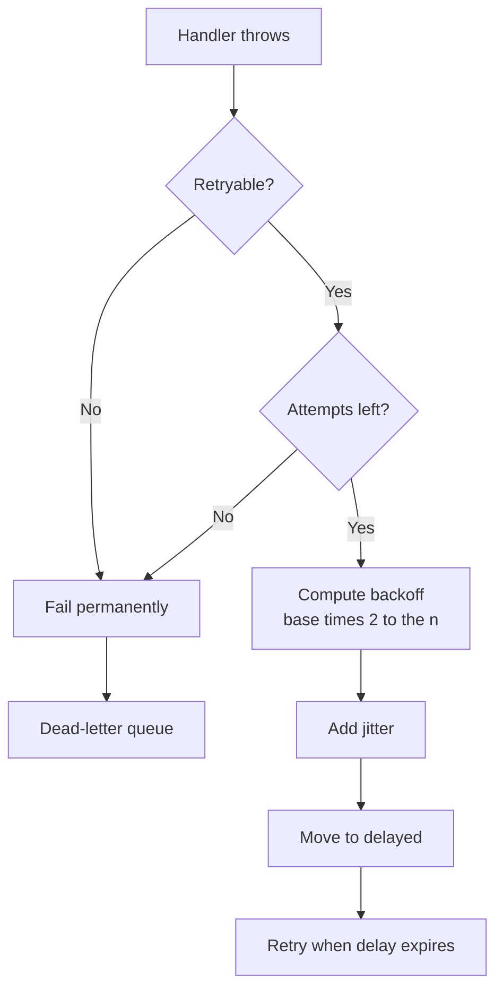

# Retries, Backoff and Dead Letter — Part 1

Most job failures are not bugs. A network blipped, a provider had a bad
second, Postgres was failing over. The work is still valid; it just needs to be
tried again. Retrying is therefore the normal case, not the exception.

But a retry policy is a loaded weapon pointed at whatever you are calling. This
part covers how long to wait between attempts, how many attempts to make, and
— the part people skip — which failures must never be retried at all.

> **📌 In one line:** retry transient failures with exponential backoff plus
> jitter and a hard cap, and never retry a failure that will fail the same way
> every time.

## Table of Contents

1. [Why Retries Are the Default](#why-retries-are-the-default)
2. [Backoff Strategies Compared](#backoff-strategies-compared)
3. [The Thundering Herd](#the-thundering-herd)
4. [Jitter, With the Formula](#jitter-with-the-formula)
5. [Choosing Max Attempts](#choosing-max-attempts)
6. [What Must Not Be Retried](#what-must-not-be-retried)
7. [Classifying Errors in a Handler](#classifying-errors-in-a-handler)
8. [The Retry Loop That Caused the Outage](#the-retry-loop-that-caused-the-outage)
9. [Common Mistakes](#common-mistakes)
10. [Questions to Test Yourself](#questions-to-test-yourself)
11. [Related](#related)

---

## Why Retries Are the Default

Think about calling a friend whose phone is engaged. You do not delete their
number. You wait a moment and call again. The call failing says nothing about
whether the call was a good idea.

The same is true of jobs. Look at what actually appears in a worker's failure
log over a month:

| Failure | Share | Transient? |
|---|---|---|
| Third-party timeout or 503 | Large | Yes |
| Connection reset mid-request | Common | Yes |
| Rate limited (429) | Common | Yes, after a wait |
| Database deadlock or serialisation failure | Occasional | Yes |
| Bad payload, invalid data | Occasional | **No** |
| Bug in the handler | Occasional | **No** |

The majority resolve themselves within seconds. A system with no retries turns
every one of those into a lost invoice, and someone has to find them by hand.

So the default is: **retry, but bounded and spaced out.** Unbounded retries and
instant retries are both worse than no retries, and the rest of this file
explains why.

> **💡 Tip:** Set `attempts` on the queue, not with a loop inside your handler.
> The queue's retry frees the worker slot between attempts. A loop inside a
> handler holds the slot, the database connection, and the lock the whole time.

## Backoff Strategies Compared

**Backoff** means waiting before the next attempt. The strategy is how that
wait is calculated.

| Strategy | Delay before attempt n | Good for | Danger |
|---|---|---|---|
| Immediate | 0 | Optimistic-lock conflicts | Hammers a struggling service |
| Fixed | constant, e.g. 5 s | Predictable, slow-moving dependencies | Still synchronised across jobs |
| Linear | `n × base` | Rarely the right answer | Grows too slowly to help an outage |
| **Exponential** | `base × 2^(n-1)` | Almost everything | All jobs still retry at the same instants |
| **Exponential + jitter** | random inside that window | **The default you should use** | Slightly harder to reason about timing |

Exponential backoff gives a struggling dependency exponentially more room:

```text
 base = 2s

 attempt 1  ──► fail
            wait 2s
 attempt 2  ──► fail
            wait 4s
 attempt 3  ──► fail
            wait 8s
 attempt 4  ──► fail
            wait 16s
 attempt 5  ──► fail  → dead letter
```

The shape is the point. A blip is absorbed by the first short wait. A real
outage gets progressively less traffic from you instead of more.



## The Thundering Herd

Here is the failure that makes plain exponential backoff insufficient.

Your CRM provider goes down at 14:00:00. In the next second, 10,000 sync jobs
fail. Every one of them was configured with `backoff: { type: 'exponential',
delay: 2000 }`. So every one of them schedules its retry for 14:00:02.

At 14:00:02 you send the provider 10,000 simultaneous requests. They are still
recovering. All 10,000 fail. All 10,000 schedule for 14:00:06.

```text
  requests
  per second
     │
10k  │   ▐                ▐                        ▐
     │   ▐                ▐                        ▐
     │   ▐                ▐                        ▐
   0 └───▐────────────────▐────────────────────────▐────► time
        t+2              t+6                     t+14
        synchronised spikes, nothing in between
```

This is a **thundering herd**: many clients that failed together retry
together, so the load arrives in spikes instead of a stream. Two things go
wrong. The provider is hit with a burst exactly when it is weakest, which can
prevent it from ever recovering. And your own workers go from idle to fully
saturated instantly, which starves every other queue that shares them.

The cause is that the backoff is *deterministic*. Same formula, same failure
time, same retry time.

> **⚠️ Warning:** The herd is self-inflicted and it can be worse than the
> original outage. A provider that would have recovered in 30 seconds can be
> held down for ten minutes by clients retrying in lockstep.

## Jitter, With the Formula

**Jitter** means adding randomness to the delay so that the herd spreads out.

```text
  requests
  per second
     │
10k  │
     │   ▂▃▂▃▂▂▃▂▃▂▂▃▂▂▃▂▃▂▂▃▂▂▃▂▂▃▂▂▃▂▂
   0 └───────────────────────────────────────► time
        same 10k jobs, spread across the window
```

Three common variants:

| Variant | Formula | Notes |
|---|---|---|
| Full jitter | `random(0, base × 2^n)` | Best spread; some retries come back very fast |
| Equal jitter | `half + random(0, half)` where `half = base × 2^n / 2` | Guarantees a minimum wait |
| Decorrelated | `random(base, previous × 3)` | Smoothest, needs the previous delay |

Full jitter is the usual recommendation and is what the code below uses.

```ts
// jobs/backoff.ts
const BASE_MS = 2_000
const MAX_MS = 5 * 60_000        // never wait longer than 5 minutes

export function fullJitterBackoff(attemptsMade: number): number {
  const exponential = Math.min(BASE_MS * 2 ** attemptsMade, MAX_MS)
  return Math.floor(Math.random() * exponential)
}
```

Wire it into the queue as a custom strategy:

```ts
// worker options
new Worker('crm-sync', handler, {
  connection,
  settings: {
    backoffStrategy: (attemptsMade: number, _type, err) => {
      // A provider that tells you when to come back wins over any formula.
      if (err instanceof CrmRateLimitError) return err.retryAfterMs
      return fullJitterBackoff(attemptsMade)
    },
  },
})

await crmQueue.add('sync-contact', data, {
  attempts: 6,
  backoff: { type: 'custom' },
})
```

Two rules that matter as much as the jitter itself.

**Always cap the delay** (`MAX_MS`). Exponential growth is fast: by attempt 12
a 2-second base is over two hours. A job that retries in two hours is a job
nobody is watching.

**Always prefer the server's own answer.** If a `429` comes back with a
`Retry-After` header, use it. The provider knows when their window resets; your
formula is guessing.

The concept-level treatment of backoff and jitter — including the maths and how
it pairs with a circuit breaker — is
[circuit-breakers-and-retries](../../system-design/reliability/circuit-breakers-and-retries.md).

## Choosing Max Attempts

`attempts` is not a feeling. Work out the total elapsed time it produces and
check that the answer is acceptable for that job.

With `base = 2s`, full exponential (no cap), the worst case looks like this:

| attempts | Longest total wait | Reasonable for |
|---|---|---|
| 3 | ~6 s | Fast internal work, deadlocks |
| 5 | ~30 s | Normal third-party API calls |
| 7 | ~2 min | Flaky providers |
| 10 | ~17 min | Long provider outages |
| 15 | ~9 hours | Almost never — use a scheduled reconciler |

Three questions decide the number:

1. **How long is a normal outage for this dependency?** Your attempts should
   comfortably outlast it. A provider whose incidents last five minutes needs a
   policy that spans more than five minutes.
2. **How stale can the result become?** A "your trial expires tomorrow" email
   retried for nine hours is fine. A one-time password retried for nine hours
   is actively harmful — after two minutes it should fail, not succeed.
3. **What happens after the last attempt?** If the answer is "it lands in a
   dead-letter queue someone checks every morning", fewer attempts are fine. If
   the answer is "it vanishes", no number of attempts is enough — fix that
   first. Part 2 is about exactly this.

> **📌 Remember:** More attempts is not more reliable. Past a certain point you
> are just delaying the moment a human finds out something is broken.

Different job types need different policies, and this is a good reason to have
per-queue defaults:

```ts
export const retryPolicies = {
  transactional: { attempts: 5, backoff: { type: 'custom' } },   // ~30s
  thirdParty:    { attempts: 8, backoff: { type: 'custom' } },   // ~4 min
  timeSensitive: { attempts: 2, backoff: { type: 'fixed', delay: 3000 } },
  reporting:     { attempts: 3, backoff: { type: 'custom' } },
} as const
```

## What Must Not Be Retried

A retry only makes sense if the next attempt might behave differently. When the
failure is deterministic, every retry produces the identical failure — it just
costs you a worker slot, a database connection, and time that real jobs needed.

| Failure | Retry? | Why |
|---|---|---|
| `400 Bad Request` from a provider | **No** | The same payload will be rejected again |
| `401` / `403` | **No** | Credentials will not fix themselves mid-backoff |
| `404` on a resource you referenced | **No** | It is gone |
| `422` validation rejected | **No** | Your data is wrong |
| Local row not found | **No** | Return successfully; there is nothing to do |
| `TypeError` in your handler | **No** | It is a bug; retrying runs the same bug |
| Payload fails schema validation | **No** | Poison message — see part 2 |
| `429` rate limited | Yes | After the window they tell you about |
| `500` / `502` / `503` / `504` | Yes | Their problem, probably temporary |
| `ETIMEDOUT`, `ECONNRESET` | Yes | Network |
| Deadlock, serialisation failure | Yes | Retry usually succeeds immediately |

There is one honest grey area: `401`. If your token is short-lived and
refreshed automatically, a single retry after refreshing is reasonable. Retry
the *refresh*, not the request, and do it once.

The reasoning behind this split — operational versus programmer errors,
expected versus unexpected — is
[error taxonomy](../../backend-fundamentals/07-error-handling/01-error-taxonomy.md).

## Classifying Errors in a Handler

Give yourself an error type that means "stop, do not retry", and make the
worker honour it.

```ts
// app/exceptions/permanent_error.ts
export class PermanentError extends Error {
  readonly permanent = true as const

  constructor(
    public readonly code: string,
    options?: { cause?: unknown; context?: Record<string, unknown> },
  ) {
    super(code, { cause: options?.cause })
    this.name = 'PermanentError'
    this.context = options?.context
  }

  readonly context?: Record<string, unknown>
}

export function isPermanent(error: unknown): error is PermanentError {
  return error instanceof PermanentError
}
```

Throw it where the classification is known:

```ts
const syncContact = async (job: Job<{ contactId: number }>) => {
  const contact = await Contact.find(job.data.contactId)
  if (!contact) return { skipped: 'deleted' }   // success, nothing to do

  try {
    await crm.upsert(contact)
  } catch (error) {
    if (error instanceof HttpError && error.status >= 400 && error.status < 500) {
      if (error.status === 429) throw error     // retryable, let backoff handle it
      throw new PermanentError('crm.rejected', {
        cause: error,
        context: { status: error.status, contactId: contact.id },
      })
    }
    throw error                                  // 5xx and network: retry
  }
}
```

And make the worker skip the remaining attempts:

```ts
// BullMQ exposes this as discarding the job's remaining attempts.
const wrapped = async (job: Job) => {
  try {
    return await handlers.run(job)
  } catch (error) {
    if (isPermanent(error)) {
      await job.discard()   // no more retries; this failure is final
      logger.warn({ jobId: job.id, code: error.code }, 'job.permanent_failure')
    }
    throw error
  }
}
```

`discard()` sends the job straight to failed. It still ends up where failed
jobs go — which must be somewhere a human can see it. That is part 2.

## The Retry Loop That Caused the Outage

```ts
// ❌ BROKEN - no backoff, no cap, inside the handler
const handler = async (job: Job<{ contactId: number }>) => {
  const contact = await Contact.findOrFail(job.data.contactId)

  while (true) {
    try {
      return await crm.upsert(contact)   // 400 Bad Request, every time
    } catch {
      // try again immediately
    }
  }
}
```

Count the damage. The loop never exits, because a `400` is deterministic. It
holds a concurrency slot forever, so that worker is down one slot permanently.
It holds a database connection. It sends the provider thousands of requests per
second from a single job, which gets your API key rate limited or blocked. And
ten such jobs take the entire worker offline while every metric reports it as
healthy and busy.

```ts
// ✅ FIXED - classification, the queue's backoff, a bounded attempt count
const handler = async (job: Job<{ contactId: number }>) => {
  const contact = await Contact.find(job.data.contactId)
  if (!contact) return { skipped: 'deleted' }

  try {
    return await crm.upsert(contact)
  } catch (error) {
    if (error instanceof HttpError && error.status === 400) {
      throw new PermanentError('crm.invalid_contact', { cause: error })
    }
    throw error   // the queue applies jittered exponential backoff
  }
}

await crmQueue.add('sync-contact', { contactId }, retryPolicies.thirdParty)
```

The differences are all structural. The retry lives in the queue, so the slot
is released between attempts. The count is bounded. Non-retryable failures stop
immediately. And every attempt is a separate, visible, countable job execution
rather than an invisible loop.

> **➡️ Continued in [Part 2](./04-retries-backoff-and-dead-letter-part-2.md)**

---

## Common Mistakes

| Mistake | Why it is wrong | Do this instead |
|---|---|---|
| Retry loop inside the handler | Holds a slot, a connection and a lock | Throw; let the queue retry |
| Exponential backoff without jitter | 10,000 jobs retry at the same instant | Full jitter |
| No cap on the exponential delay | Attempt 12 is two hours away | `MAX_MS`, around 5 minutes |
| Retrying a 400 or 422 | Identical failure, wasted capacity | `PermanentError` and discard |
| Ignoring `Retry-After` | Your guess beats their answer | Use the header when present |
| One retry policy for every job type | An OTP and a report need opposite policies | Per-queue policies |
| `attempts: 20` as a safety measure | Delays discovery by hours | Fewer attempts plus a dead-letter alert |
| Treating "row not found" as a failure | Burns every attempt on a deleted record | Return successfully |

## Questions to Test Yourself

1. Why is a retry loop inside a handler worse than the same number of retries
   done by the queue? Name three resources it holds.
2. Ten thousand jobs fail at the same second with `exponential, delay: 2000`.
   Draw the request rate at the provider over the next 30 seconds.
3. Write full jitter from memory. What does it guarantee, and what does it give
   up compared with equal jitter?
4. Your base is 2 s and `attempts` is 10. Roughly how long until the final
   attempt? Is that acceptable for a one-time password email?
5. A provider returns `429` with `Retry-After: 60`. Why should that override
   your backoff formula?
6. Give three failures that must not be retried and say what each one costs you
   if you do retry it.
7. What does `job.discard()` change compared with simply throwing, and why does
   the job still need somewhere to land?
8. Why is `attempts: 20` not a more reliable system than `attempts: 5`?

## Related

- [Retries, Backoff and Dead Letter — Part 2](04-retries-backoff-and-dead-letter-part-2.md)
  — where a job goes once it is out of attempts.
- [Writing Reliable Workers — Part 2](03-writing-reliable-workers-part-2.md) —
  the error classification this file builds on.
- [Idempotent Jobs — Part 1](05-idempotent-jobs-part-1.md) — why retrying is
  only safe when the handler can run twice.
- [circuit-breakers-and-retries](../../system-design/reliability/circuit-breakers-and-retries.md)
  — the pattern background: backoff, jitter, and breakers.
- [error taxonomy](../../backend-fundamentals/07-error-handling/01-error-taxonomy.md)
  — the operational versus programmer split that drives the retry decision.
- [Operating Queues — Part 1](07-operating-queues-part-1.md) — the metrics that
  tell you a retry policy is misbehaving.
