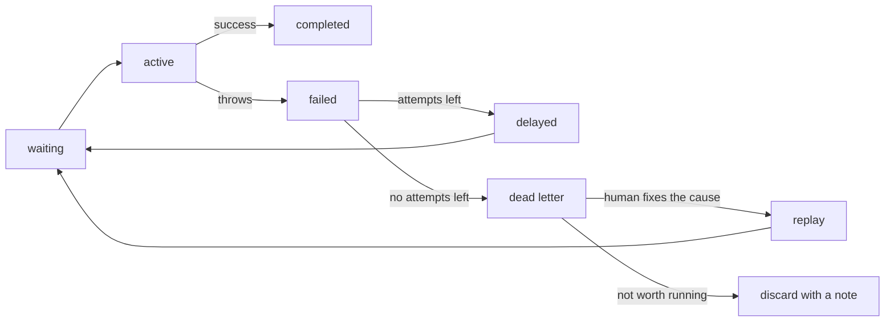

# Retries, Backoff and Dead Letter — Part 2

Part 1 ended with a job that has used its last attempt. This part answers the
question that decides whether your job system is trustworthy: **where does that
job go?**

If the answer is "nowhere", you do not have a reliable system. You have a
system that loses work quietly, which is the worst kind.

> **⬅️ This continues [Part 1](./04-retries-backoff-and-dead-letter-part-1.md).**

> **📌 In one line:** an exhausted job must land somewhere a human will look,
> carrying enough context to diagnose and replay it — and one malformed job
> must never be able to take the whole worker down.

## Table of Contents

1. [What a Dead-Letter Queue Is](#what-a-dead-letter-queue-is)
2. [What to Record With a Dead Job](#what-to-record-with-a-dead-job)
3. [Replaying After a Fix](#replaying-after-a-fix)
4. [Poison Messages](#poison-messages)
5. [Retrying Against a Failing Dependency](#retrying-against-a-failing-dependency)
6. [Alerting: Page, Ticket, or Ignore](#alerting-page-ticket-or-ignore)
7. [The Habit That Makes All of This Work](#the-habit-that-makes-all-of-this-work)
8. [Common Mistakes](#common-mistakes)
9. [Questions to Test Yourself](#questions-to-test-yourself)
10. [Related](#related)

---

## What a Dead-Letter Queue Is

A **dead-letter queue** (DLQ) is a separate holding area for jobs that failed
every attempt. The name comes from the post office: a letter that cannot be
delivered and cannot be returned goes to the dead letter office, where a human
opens it and works out what to do.

That is exactly the role. A DLQ is not a bin. It is an inbox.



Some systems give you this natively. SQS has a real `RedrivePolicy` that moves
a message after N receives. BullMQ does not, but the `failed` set plus
`removeOnFail` serves the same purpose, and many teams add an explicit DLQ so
that "failed and finished" is distinct from "failed and will retry".

```ts
// A real dead-letter queue you control.
const deadLetterQueue = new Queue('invoices-dlq', { connection })

worker.on('failed', async (job, error) => {
  if (!job) return
  const exhausted = job.attemptsMade >= (job.opts.attempts ?? 1)
  if (!exhausted && !isPermanent(error)) return   // it will retry; leave it

  await deadLetterQueue.add('dead', {
    originalQueue: 'invoices',
    originalJobId: job.id,
    name: job.name,
    payload: job.data,
    attemptsMade: job.attemptsMade,
    failedAt: new Date().toISOString(),
    error: { message: error.message, name: error.name, stack: error.stack },
    history: job.stacktrace?.slice(-5) ?? [],
  })

  logger.error({ jobId: job.id, jobName: job.name }, 'job.dead_lettered')
})
```

Three properties make a DLQ worth having:

| Property | Why it matters |
|---|---|
| **Separate** | A growing DLQ is a signal; failures mixed into the main queue are noise |
| **Durable** | It must outlive a Redis eviction policy and a deploy — consider a table |
| **Replayable** | The point is to run the job again after you fix the cause |

> **⚠️ Warning:** If your DLQ lives only in Redis and Redis is configured with
> an eviction policy, your failed jobs can be silently deleted under memory
> pressure. For anything that matters, write dead jobs to a Postgres table as
> well. File 07 covers this failure in detail.

## What to Record With a Dead Job

The test: **six weeks from now, can someone who was not involved understand
this failure and decide what to do?**

| Field | Why you need it |
|---|---|
| Job name and original queue | Which handler, which policy |
| Original job id | Cross-reference with logs |
| Full payload | You cannot replay without it |
| `requestId` | Ties back to the user action — see file 03 |
| Attempts made | Distinguishes "tried once" from "tried eight times" |
| Error message, name, and stack | The actual diagnosis |
| Error history across attempts | "Timeout, timeout, then 400" tells a story |
| First failed at, last failed at | How long the problem lasted |
| Worker id and release version | Whether a deploy caused it |

The **error history** is the field people leave out and then wish they had.
Five identical timeouts mean a dependency was down. Four timeouts and then a
`400` means the retries caused a duplicate that the provider then rejected —
completely different problem, and you cannot tell them apart from the last
error alone.

```ts
// A durable table is a better home than a Redis key for this.
await DeadJob.create({
  queue: 'invoices',
  jobName: job.name,
  jobId: job.id!,
  requestId: job.data.requestId ?? null,
  payload: job.data,
  attemptsMade: job.attemptsMade,
  errorName: error.name,
  errorMessage: error.message,
  errorStack: error.stack ?? null,
  attemptHistory: job.stacktrace ?? [],
  release: env.APP_RELEASE,
  status: 'open',              // open | replayed | discarded
})
```

The `status` column is what turns the table into a work queue for humans. Rows
stay `open` until someone decides.

## Replaying After a Fix

A DLQ you cannot replay from is just a log with extra steps.

```ts
// commands/replay_dead_jobs.ts — an Ace command in AdonisJS
export default class ReplayDeadJobs extends BaseCommand {
  static commandName = 'jobs:replay'

  async run() {
    const dead = await DeadJob.query()
      .where('status', 'open')
      .where('job_name', this.jobName)
      .limit(this.limit ?? 100)

    for (const row of dead) {
      await invoiceQueue.add(row.jobName, row.payload, {
        ...retryPolicies.transactional,
        jobId: `replay-${row.id}`,     // stable id: replaying twice is one job
      })
      row.status = 'replayed'
      row.replayedAt = DateTime.now()
      await row.save()
    }

    this.logger.info(`replayed ${dead.length} jobs`)
  }
}
```

Four rules for a safe replay.

**Fix the cause first.** Replaying into the same failure just re-fills the DLQ
and doubles the noise.

**Replay in batches.** Forty thousand jobs replayed at once is a self-inflicted
thundering herd against a dependency that has only just recovered. Use `limit`,
and add a delay between batches.

**Filter before you replay.** The DLQ usually holds several unrelated problems.
Replay by job name, by error, or by time window — never "everything".

**The handler must be idempotent.** This is the one that is not optional. You
are about to run work that may have partially succeeded before it failed. If
the job charged a card and then failed on the email step, a naive replay
charges again.

> **📌 Remember:** Replay is only safe because the handler is idempotent. If
> you cannot say confidently that re-running a job is harmless, you cannot
> replay it — you have to inspect each case by hand. File 05 is how you buy
> your way out of that.

## Poison Messages

A **poison message** is a single job that does not just fail — it kills the
worker process. Then it is redelivered, kills the next worker, and so on.

```ts
// ❌ BROKEN - a malformed payload takes the process down
const handler = async (job: Job) => {
  // payload was enqueued by an old release: `recipients` is a string, not an array
  for (const email of job.data.recipients) {   // TypeError: not iterable
    await mailer.send(email, job.data.body)
  }
}
```

Watch the cascade:

```text
  t+0   job 991 → worker A → TypeError → uncaughtException → worker A exits
  t+5   job 991 redelivered → worker B → worker B exits
  t+10  job 991 redelivered → worker C → worker C exits
  ...
  every worker in a crash loop. The other 8,000 jobs never run.
```

One bad row has taken down the entire background system. The crash loop also
means your orchestrator keeps restarting pods, so the incident looks like an
infrastructure problem rather than a data problem.

Three defences, applied together:

```ts
// ✅ FIXED (1) - validate the payload at the boundary; bad shape is permanent
const SendDigestPayload = z.object({
  recipients: z.array(z.string().email()).min(1),
  body: z.string(),
})

const handler = async (job: Job) => {
  const parsed = SendDigestPayload.safeParse(job.data)
  if (!parsed.success) {
    throw new PermanentError('payload.invalid', {
      context: { issues: parsed.error.issues },
    })
  }
  for (const email of parsed.data.recipients) {
    await mailer.send(email, parsed.data.body)
  }
}
```

```ts
// ✅ FIXED (2) - nothing escapes the handler wrapper uncaught
const wrapped = async (job: Job) => {
  try {
    return await handlers.run(job)
  } catch (error) {
    if (isPermanent(error)) await job.discard()
    throw error              // fails the JOB, never the PROCESS
  }
}
```

```ts
// ✅ FIXED (3) - cap stalls so a loop-blocking job cannot cycle forever
new Worker('digests', wrapped, { connection, maxStalledCount: 2 })
```

The principle is worth stating on its own: **a job failing must never mean the
process failing.** If an error can escape your handler and reach
`uncaughtException`, one bad payload is one outage away.

The most common source of poison messages, by a distance, is a deploy where a
new producer enqueues a payload shape an old worker cannot read. That is
version skew, and file 07 covers how to avoid it.

## Retrying Against a Failing Dependency

There is a point where retrying is not helping anyone. Your CRM has been down
for eleven minutes. Every job in that queue is going to fail every attempt and
land in the DLQ. You will end up with 30,000 dead jobs that were all perfectly
valid, and a manual replay ahead of you.

The better move is to **stop trying and hold the work**.

```ts
// A breaker in front of the dependency, checked at the top of the handler.
const handler = async (job: Job) => {
  if (crmBreaker.isOpen()) {
    // Do not consume an attempt on a dependency we know is down.
    await job.moveToDelayed(Date.now() + 60_000)
    return
  }
  await crmBreaker.run(() => crm.upsert(contact))
}
```

Or, for a declared incident, pause the whole queue:

```ts
await crmQueue.pause()    // workers finish current jobs and fetch no more
// ... provider posts an all-clear ...
await crmQueue.resume()   // the backlog drains, no attempts were wasted
```

| Situation | Best response |
|---|---|
| One job failing, others fine | Normal retry with backoff |
| One dependency failing, high error rate | Circuit breaker; delay rather than consume attempts |
| Declared provider outage | Pause the queue; resume after the all-clear |
| Your own bug causing every job to fail | Pause, deploy the fix, resume |

Pausing is underrated. It costs nothing, loses nothing, and converts a
30,000-job DLQ cleanup into a backlog that drains by itself. The trade-off is
queue depth: paused work still accumulates, so watch memory and job age.

The breaker states, thresholds, and half-open probing are covered in
[circuit-breakers-and-retries](../../system-design/reliability/circuit-breakers-and-retries.md).

## Alerting: Page, Ticket, or Ignore

Alerting on jobs goes wrong in both directions. Alert on every failure and
people mute the channel within a week. Alert on nothing and you find out from a
customer.

| Signal | Severity | Reason |
|---|---|---|
| A single job failed | **Ignore** | Retries exist for this |
| Failure rate above ~5% for 10 min | Page | Something systemic, not a blip |
| **Dead-letter queue grew by more than N in an hour** | Page | Work is being permanently lost |
| Dead-letter queue is non-empty at all | Ticket | Somebody must triage it |
| Oldest waiting job older than the SLO for that queue | Page | The queue is not keeping up |
| Stalled job count above zero | Ticket | Duplicates are happening |
| Worker heartbeat missing for 2 min | Page | Nothing is processing |
| Queue paused for more than 30 min | Ticket | Someone forgot to resume |

Two rules that keep the signal high.

**Alert on the rate of change, not the absolute number.** A DLQ with 400 jobs
in it that has not grown in a week is a backlog of work to triage. A DLQ that
gained 400 jobs in the last hour is an active incident. The same number means
completely different things.

**Alert per queue, not globally.** A 20% failure rate on `crm-sync` during a
provider incident is expected. The same rate on `charge-invoice` is an
emergency. One global threshold cannot express that.

Building these signals — counters, gauges, and what a good threshold looks
like — is covered in
[metrics and health checks — part 2](../../backend-fundamentals/08-logging-and-observability/04-metrics-and-health-checks-part-2.md).

## The Habit That Makes All of This Work

None of the machinery above matters if nobody opens the DLQ.

The failure mode is boring and extremely common. The DLQ is built, the
dashboard exists, and six months later it has 14,000 jobs in it from four
different causes, and nobody can face it. At that point it is a landfill, not
an inbox.

What works in practice:

- **Someone owns it.** A named person or rotation checks it at a fixed time.
- **It should normally be empty.** Non-empty is abnormal, not background noise.
- **Every entry gets a decision**, recorded: replayed, discarded with a reason,
  or converted into a bug ticket. `status` stops being `open`.
- **Triage the cause, not the job.** Forty dead jobs are usually one bug.
- **Old entries expire loudly.** If a job has sat for 30 days, either it
  mattered and you failed the customer, or it did not and it should never have
  been dead-lettered.

> **💡 Tip:** A weekly five-minute review of the DLQ finds bugs earlier than
> almost anything else you can do. The jobs in there are real user actions that
> did not happen.

---

## Common Mistakes

| Mistake | Why it is wrong | Do this instead |
|---|---|---|
| Failed jobs deleted after N days | The evidence disappears with the work | Durable DLQ table with a status |
| DLQ stored only in Redis | Eviction can delete it silently | Mirror to Postgres |
| Recording only the last error | "Timeout then 400" tells a different story | Keep the attempt history |
| Replaying everything at once | Thundering herd on a just-recovered provider | Batch, filter, delay |
| Replaying before fixing the cause | The DLQ refills and doubles | Fix first, then replay |
| Replaying non-idempotent jobs | Double charges, duplicate emails | Make handlers idempotent first |
| A handler error that crashes the process | One bad payload stops all jobs | Catch at the wrapper; fail the job |
| Alerting on every failed job | The channel gets muted | Alert on rate and on DLQ growth |
| Burning all attempts during a known outage | 30,000 dead jobs to replay by hand | Pause the queue or open a breaker |

## Questions to Test Yourself

1. Why is "delete failed jobs after 7 days" different from having a dead-letter
   queue, even though both end with the job gone?
2. A dead job records only its final error. Give two different root causes that
   produce the same final error and would be distinguishable from the history.
3. Walk through the poison-message cascade. At which single point is it easiest
   to break the loop, and why?
4. You have 40,000 jobs in the DLQ after a provider outage. Write the plan for
   replaying them and say what could go wrong at each step.
5. Why is replay unsafe without idempotency? Give a concrete job where a naive
   replay costs money.
6. Compare pausing a queue with letting jobs burn their attempts during a
   declared outage. What does each cost you?
7. Which of these should page someone at 3 AM: one failed job, a 6% failure
   rate for 15 minutes, a DLQ that gained 500 jobs in an hour, a DLQ with 500
   jobs that has not changed in a week? Justify each.
8. Your DLQ has 14,000 entries from four causes. What went wrong
   organisationally, and what would you change?

## Related

- [Retries, Backoff and Dead Letter — Part 1](04-retries-backoff-and-dead-letter-part-1.md)
  — backoff, jitter, attempt counts, and what not to retry.
- [Idempotent Jobs — Part 1](05-idempotent-jobs-part-1.md) — the property that
  makes retry and replay safe.
- [Operating Queues — Part 1](07-operating-queues-part-1.md) — the metrics and
  the runbook these alerts feed into.
- [circuit-breakers-and-retries](../../system-design/reliability/circuit-breakers-and-retries.md)
  — breaker states and when to stop calling a dependency.
- [metrics and health checks — part 2](../../backend-fundamentals/08-logging-and-observability/04-metrics-and-health-checks-part-2.md)
  — turning these signals into alerts that are worth waking up for.
- [Writing Reliable Workers — Part 2](03-writing-reliable-workers-part-2.md) —
  the handler wrapper that stops a job failure becoming a process failure.
- [SQS deep dive](../../system-design/foundational/message-queues/sqs.md) — a
  broker with native dead-letter support and a redrive policy.
