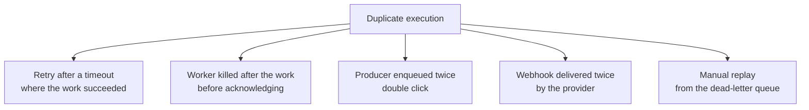
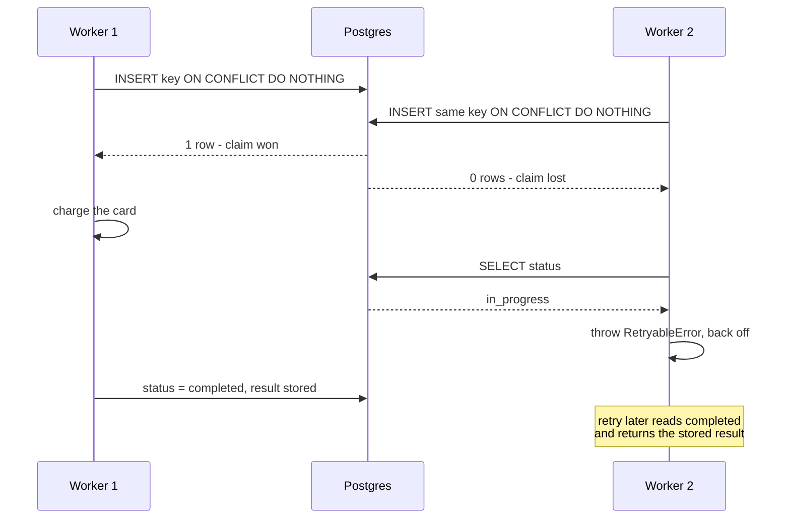

# Idempotent Jobs — Part 1

Start with the rule, because everything else follows from it.

> **📌 In one line:** assume every job will run more than once, and make the
> second run produce the same end state as the first.

This is not a worst case to defend against. It is the normal operating
condition of every queue you will ever use. At-least-once delivery, retries,
replays, and duplicate producers each guarantee it independently.

**Idempotent** means: doing it twice has the same effect as doing it once.
Pressing a lift button five times does not summon five lifts. This part covers
why duplicates happen, what they cost, and the two strongest techniques for
stopping them.

The concept in the abstract — idempotency keys, naturally idempotent
operations, retry ambiguity — is already written up in
[idempotency](../../system-design/reliability/idempotency.md). This file is
about implementing it inside a worker.

## Table of Contents

1. [Why This Is Not Optional](#why-this-is-not-optional)
2. [Five Ways a Job Runs Twice](#five-ways-a-job-runs-twice)
3. [The Damage, Made Concrete](#the-damage-made-concrete)
4. [The Techniques, Ranked](#the-techniques-ranked)
5. [Technique 1: A Natural Unique Constraint](#technique-1-a-natural-unique-constraint)
6. [Technique 2: An Idempotency Key With a Stored Result](#technique-2-an-idempotency-key-with-a-stored-result)
7. [The Claim-Then-Execute Race](#the-claim-then-execute-race)
8. [Common Mistakes](#common-mistakes)
9. [Questions to Test Yourself](#questions-to-test-yourself)
10. [Related](#related)

---

## Why This Is Not Optional

Developers usually meet this idea as a warning and treat it as a corner case.
It is not a corner case. Walk through the arithmetic.

Suppose you run 200,000 jobs a day, deploy twice a day, and 0.5% of jobs fail
once and succeed on retry. Then:

- Deploys interrupt jobs twice a day — dozens of in-flight jobs each time.
- 1,000 jobs a day retry after a failure, and some of those failures happened
  *after* the work was done.
- Nodes are replaced, pods are evicted, and memory limits are hit.

A handler that is unsafe to run twice will run twice this week. The only
question is whether the second run does damage.

> **💡 Tip:** A quick test for any handler: if you ran it twice in a row on the
> same payload right now, in production, what would be different? If you cannot
> answer immediately, it is not idempotent.

## Five Ways a Job Runs Twice



**1. A retry after a timeout where the work actually succeeded.** Your handler
calls SendGrid with a 5-second timeout. SendGrid takes 6 seconds but does send
the email. Your call throws `ETIMEDOUT`, the job fails, the queue retries, and
a second email goes out. The timeout told you nothing about whether the work
happened — this is *retry ambiguity*, and it is unavoidable.

**2. A worker killed after doing the work, before acknowledging it.** The
handler charged the card. Then the pod was evicted. The queue never heard
"completed", the lock expired, another worker picked the job up, and it charged
again. This is the case from file 03, and no shutdown handling fully removes it
because `SIGKILL` and node failures give no warning.

**3. A duplicate producer.** The user double-clicks "Send invoice". Two HTTP
requests, two jobs, two identical emails. Nothing failed anywhere; the system
did exactly what it was told twice.

**4. A webhook delivered twice.** Stripe, GitHub, and every other provider
guarantee at-least-once delivery of webhooks for the same reason your queue
does. If their call to you times out, they send it again. Your handler for
`invoice.payment_succeeded` will see the same event twice.

**5. A manual replay.** You fixed a bug and replayed 4,000 dead jobs. Some of
them had already done half their work before failing. Replay is the case where
*you* caused the duplicate deliberately — and it is why file 04 said replay is
only safe on an idempotent handler.

| Cause | Can you prevent it? | Can you make it harmless? |
|---|---|---|
| Retry after timeout | No | Yes |
| Worker killed mid-job | Partly (graceful shutdown) | Yes |
| Double-click producer | Partly (UI, stable `jobId`) | Yes |
| Duplicate webhook | No | Yes |
| Manual replay | You chose it | Yes |

Every row ends the same way. Prevention is partial; making it harmless is
complete. Spend your effort on the second column.

## The Damage, Made Concrete

Abstract warnings do not change behaviour. These do.

| Handler | Runs twice | Result |
|---|---|---|
| `send-invoice` | Email sent per run | Customer gets the same invoice four times and emails support |
| `charge-subscription` | Stripe charge per run | Customer charged twice, chargeback, a refund, and a lost customer |
| `increment-usage-counter` | `usage += 1` per run | Billing metering is wrong, and quietly, forever |
| `apply-credit` | `balance += 50` per run | You gave away money |
| `provision-user` | Creates a user per run | Duplicate accounts, broken unique lookups |
| `post-to-slack` | Message per run | Noise, and a team that disables the integration |
| `expire-trial` | Sets `expired` per run | Harmless — already idempotent |

Look at the last row. `UPDATE companies SET status = 'expired' WHERE id = 3`
run twice is the same as run once, because it *sets* a value. That is the
cheapest form of idempotency, and section "Technique 4" in part 2 is about
reaching for it by design.

> **⚠️ Warning:** The counter case is the most dangerous, because nothing
> breaks. No error, no duplicate email, no complaint. Your numbers are just
> wrong, and you find out during an audit.

## The Techniques, Ranked

From strongest to weakest:

| # | Technique | Enforced by | Use when |
|---|---|---|---|
| 1 | Natural unique constraint | **The database** | A real-world uniqueness rule exists |
| 2 | Idempotency key with stored result | Your code + a unique index | Multi-step work, or you must return the first result |
| 3 | Conditional update on state | The database, via row count | The job moves a record through states |
| 4 | Naturally idempotent design | Nothing needed | You can choose "set" instead of "add" |

"Enforced by the database" is why the ranking is in this order. Application
logic can be bypassed by a code path you forgot, a script, or a race between
two workers. A `UNIQUE` constraint cannot.

## Technique 1: A Natural Unique Constraint

The strongest protection is a rule the database will not let you break. Look
for a uniqueness rule that already exists in the business domain.

```sql
-- One invoice per company per billing period. This is a real business rule.
ALTER TABLE invoices
  ADD CONSTRAINT invoices_company_period_unique
  UNIQUE (company_id, period_start);

-- One processed record per external event. Also a real rule.
CREATE TABLE processed_events (
  event_id    text PRIMARY KEY,
  source      text NOT NULL,
  processed_at timestamptz NOT NULL DEFAULT now()
);
```

Then let the insert be the guard:

```ts
const handler = async (job: Job<{ companyId: number; periodStart: string }>) => {
  try {
    const invoice = await Invoice.create({
      companyId: job.data.companyId,
      periodStart: job.data.periodStart,
      status: 'draft',
    })
    await invoiceService.finalise(invoice)
    return { invoiceId: invoice.id }
  } catch (error) {
    if (isUniqueViolation(error, 'invoices_company_period_unique')) {
      // A previous run already created it. This is success, not failure.
      const existing = await Invoice.query()
        .where('company_id', job.data.companyId)
        .where('period_start', job.data.periodStart)
        .firstOrFail()
      return { invoiceId: existing.id, deduplicated: true }
    }
    throw error
  }
}

function isUniqueViolation(error: unknown, constraint: string): boolean {
  return (
    typeof error === 'object' && error !== null &&
    'code' in error && error.code === '23505' &&      // Postgres unique_violation
    'constraint' in error && error.constraint === constraint
  )
}
```

Two things to notice.

**Check the constraint name, not just the error code.** `23505` means "some
unique constraint was violated". If you treat every `23505` as "already done",
a genuinely different conflict gets swallowed.

**Catching the violation is better than checking first.**

```ts
// ❌ BROKEN - a race lives between the SELECT and the INSERT
const existing = await Invoice.query().where(/* ... */).first()
if (existing) return { invoiceId: existing.id }
const invoice = await Invoice.create(/* ... */)   // two workers both get here
```

Two workers can both run the `SELECT`, both find nothing, and both `INSERT`.
The check-then-act pattern is a race in every language. The constraint is
evaluated atomically by the database, so letting it fail and handling the
failure is the correct shape.

Constraint design, including partial unique indexes for soft-deleted rows:
[constraints and data integrity — part 1](../../databases/data-modeling/02-constraints-and-data-integrity-part-1.md).

## Technique 2: An Idempotency Key With a Stored Result

Sometimes there is no natural uniqueness rule. The job does several things, or
you need the second run to return the same answer as the first rather than
just skipping.

An **idempotency key** is a string that identifies one logical operation. Every
attempt of the same operation carries the same key.

```sql
CREATE TABLE job_idempotency (
  key          text PRIMARY KEY,
  job_name     text        NOT NULL,
  status       text        NOT NULL,   -- 'in_progress' | 'completed' | 'failed'
  result       jsonb,
  claimed_by   text,                   -- worker id, for debugging a stuck claim
  claimed_at   timestamptz NOT NULL DEFAULT now(),
  completed_at timestamptz,
  expires_at   timestamptz NOT NULL
);

CREATE INDEX ON job_idempotency (expires_at);
```

The key must be **derived from the work**, not generated at run time:

```ts
// ✅ Same logical operation always produces the same key.
const key = `charge-invoice:${invoiceId}:${billingPeriod}`

// ❌ A new key every attempt defeats the entire mechanism.
const key = `charge-invoice:${randomUUID()}`
```

The flow is **claim, then execute, then record**:

```ts
async function withIdempotency<T>(
  key: string,
  jobName: string,
  workerId: string,
  work: () => Promise<T>,
): Promise<T> {
  // 1. CLAIM — atomic insert. Only one caller can win.
  const claimed = await db.rawQuery(
    `INSERT INTO job_idempotency (key, job_name, status, claimed_by, expires_at)
     VALUES (?, ?, 'in_progress', ?, now() + interval '24 hours')
     ON CONFLICT (key) DO NOTHING
     RETURNING key`,
    [key, jobName, workerId],
  )

  if (claimed.rows.length === 0) {
    // 2. Someone else has this key. Read what they did.
    const existing = await db
      .from('job_idempotency').where('key', key).first()

    if (existing.status === 'completed') return existing.result as T
    if (existing.status === 'in_progress') {
      // Still running elsewhere, or a crashed claim. Back off and retry.
      throw new RetryableError('idempotency.claim_in_progress')
    }
    // 'failed' — allow a fresh attempt by releasing the claim.
    await db.from('job_idempotency').where('key', key).delete()
    throw new RetryableError('idempotency.previous_attempt_failed')
  }

  // 3. EXECUTE — we own this key.
  try {
    const result = await work()
    await db.from('job_idempotency').where('key', key).update({
      status: 'completed', result, completed_at: new Date(),
    })
    return result
  } catch (error) {
    await db.from('job_idempotency').where('key', key)
      .update({ status: 'failed' })
    throw error
  }
}
```

Used from a handler:

```ts
const handler = async (job: Job<{ invoiceId: number; period: string }>) => {
  return withIdempotency(
    `charge-invoice:${job.data.invoiceId}:${job.data.period}`,
    job.name,
    workerId,
    () => billingService.charge(job.data.invoiceId),
  )
}
```

Note `expires_at`. Keys cannot live forever or the table grows without bound.
Pick a window comfortably longer than your longest retry policy plus any
plausible replay — 24 hours to 7 days is typical — and delete expired rows with
a scheduled job.

## The Claim-Then-Execute Race

The interesting case is two workers reaching the same key at the same
microsecond. This happens more often than you would expect: a stalled job
redelivered while the original is still running, or a user double-clicking.



`INSERT ... ON CONFLICT DO NOTHING RETURNING key` is what makes this safe. It
is a single atomic statement: exactly one caller gets a row back. No
application-level check can give you that, because any check-then-act has a gap
between the two halves.

Two details that decide whether this works in production.

**The loser must not proceed.** It sees `in_progress` and backs off. Returning
success would be a lie — the work may still fail. Throwing a retryable error
lets the queue's backoff bring it back later, by which time the winner has
usually finished and the stored result is available.

**A crashed claim must not block forever.** If worker 1 dies between the claim
and the update, the key sits at `in_progress` and every later attempt backs
off. Two defences: `expires_at`, and a sweeper that releases claims whose
`claimed_at` is older than your maximum job duration.

```ts
// Release abandoned claims so a dead worker cannot block a key forever.
await db.rawQuery(
  `DELETE FROM job_idempotency
   WHERE status = 'in_progress' AND claimed_at < now() - interval '30 minutes'`,
)
```

> **⚠️ Warning:** That sweeper is a trade-off, not a free fix. Releasing a
> claim from a worker that was merely slow lets the work run twice. Set the
> interval well above your job timeout, and keep the timeout from file 03 tight
> so the two numbers stay far apart.

> **➡️ Continued in [Part 2](./05-idempotent-jobs-part-2.md)**

---

## Common Mistakes

| Mistake | Why it is wrong | Do this instead |
|---|---|---|
| Assuming a job runs once | It will not, this week | Design for two runs |
| `SELECT` then `INSERT` | Two workers both find nothing | `INSERT ... ON CONFLICT`, handle the violation |
| Treating any `23505` as "already done" | Hides a different conflict | Match the constraint name |
| A random idempotency key per attempt | Every attempt looks new | Derive the key from the work |
| No `expires_at` on the key table | Grows forever | Expire beyond the longest retry window |
| The claim loser returning success | The work may still fail | Throw retryable and back off |
| No sweeper for `in_progress` claims | A dead worker blocks a key forever | Release claims older than the job timeout |
| A sweeper interval near the job timeout | Releases a claim from a slow worker | Keep the two numbers far apart |

## Questions to Test Yourself

1. Give the five causes of a duplicate execution and, for each, say whether you
   can prevent it or only make it harmless.
2. A handler times out calling SendGrid. What do you know about whether the
   email was sent? What follows from that?
3. Why is catching a unique violation better than checking whether the row
   exists first? Describe the race precisely.
4. What is wrong with `key = charge-invoice:${randomUUID()}`?
5. Two workers claim the same key at once. Which statement decides the winner,
   and what must the loser do?
6. A worker dies holding an `in_progress` claim. What happens to every later
   attempt, and what are the two defences?
7. Why is the sweeper interval dangerous if it is close to the job timeout?
8. Which of these is already idempotent: `usage = usage + 1`, `status =
   'expired'`, `INSERT INTO invoices`, `balance = balance - 50`? Explain each.

## Related

- [Idempotent Jobs — Part 2](05-idempotent-jobs-part-2.md) — conditional
  updates, side effects you cannot undo, ordering, and testing.
- [idempotency](../../system-design/reliability/idempotency.md) — the concept,
  idempotency keys, and retry ambiguity in the abstract.
- [Retries, Backoff and Dead Letter — Part 2](04-retries-backoff-and-dead-letter-part-2.md)
  — replay, which is only safe because of everything in this file.
- [Writing Reliable Workers — Part 2](03-writing-reliable-workers-part-2.md) —
  graceful shutdown, which reduces how often duplicates happen.
- [constraints and data integrity — part 1](../../databases/data-modeling/02-constraints-and-data-integrity-part-1.md)
  — designing the unique constraints that do the enforcing.
- [Anatomy of a Job System — Part 2](02-anatomy-of-a-job-system-part-2.md) —
  why at-least-once delivery makes all of this mandatory.
