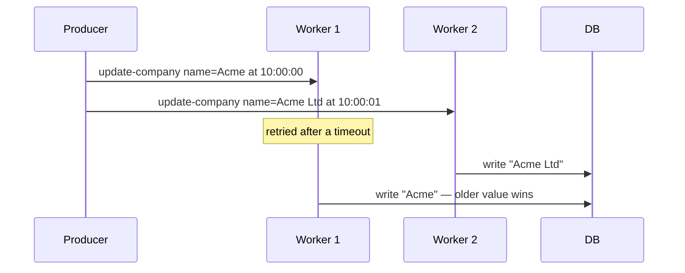

# Idempotent Jobs — Part 2

Part 1 covered the two techniques where the database does the enforcing. This
part covers the two lighter ones, then the problem none of them solve: side
effects you cannot take back. You can roll back a database write. You cannot
un-send an email or un-charge a card.

> **⬅️ This continues [Part 1](./05-idempotent-jobs-part-1.md).**

> **📌 In one line:** guard state changes with conditional updates, design
> operations to set values instead of adding to them, and for irreversible side
> effects record your intent *before* you act and use the provider's own
> idempotency key.

## Table of Contents

1. [Technique 3: Conditional Updates](#technique-3-conditional-updates)
2. [Technique 4: Design It to Be Naturally Idempotent](#technique-4-design-it-to-be-naturally-idempotent)
3. [Side Effects You Cannot Take Back](#side-effects-you-cannot-take-back)
4. [Record Before You Act](#record-before-you-act)
5. [Use the Provider's Idempotency Key](#use-the-providers-idempotency-key)
6. [When a Small Duplicate Risk Is Acceptable](#when-a-small-duplicate-risk-is-acceptable)
7. [Ordering: Jobs Do Not Run in Order](#ordering-jobs-do-not-run-in-order)
8. [Testing Idempotency](#testing-idempotency)
9. [Common Mistakes](#common-mistakes)
10. [Questions to Test Yourself](#questions-to-test-yourself)
11. [Related](#related)

---

## Technique 3: Conditional Updates

Many jobs move a record from one state to the next: `queued → sent`,
`pending → paid`, `draft → published`. For these, the guard is free. Put the
expected current state in the `WHERE` clause and check how many rows changed.

```ts
// ❌ BROKEN - the update always succeeds, so the job always proceeds
const invoice = await Invoice.findOrFail(job.data.invoiceId)
invoice.status = 'sent'
await invoice.save()
await mailer.sendInvoice(invoice)   // runs on every duplicate
```

```ts
// ✅ FIXED - the update is the lock; only one run can win the transition
const updated = await db
  .from('invoices')
  .where('id', job.data.invoiceId)
  .where('status', 'queued')          // the precondition, enforced atomically
  .update({ status: 'sending', sending_started_at: new Date() })

if (updated === 0) {
  // Either another run took it, or the invoice is no longer sendable.
  logger.info({ invoiceId: job.data.invoiceId }, 'invoice.already_claimed')
  return { deduplicated: true }
}

await mailer.sendInvoice(invoice)
await db.from('invoices').where('id', job.data.invoiceId)
  .update({ status: 'sent', sent_at: new Date() })
```

The whole mechanism is in the return value. `UPDATE ... WHERE status = 'queued'`
either matches a row or it does not, and Postgres decides that atomically while
holding a row lock. If two workers run it at the same instant, one gets `1` and
the other gets `0`. **The row count is the answer.** Ignoring it is the mistake.

This is optimistic concurrency control. A version column works the same way and
is better when several different jobs can update the same row:

```ts
const updated = await db
  .from('invoices')
  .where('id', id)
  .where('version', expectedVersion)
  .update({ status: 'sent', version: expectedVersion + 1 })

if (updated === 0) throw new StaleDataError('invoice.changed_underneath')
```

The full comparison between this and taking a lock up front is in
[optimistic vs pessimistic locking — part 2](../../databases/transactions-and-concurrency/06-optimistic-vs-pessimistic-locking-part-2.md).

Note the intermediate `sending` state in the fixed example. It matters. Without
it, a worker that crashes between the update and the email leaves the invoice
at `sent` with no email ever delivered. With it, you can find every invoice
stuck in `sending` for more than ten minutes and investigate.

## Technique 4: Design It to Be Naturally Idempotent

The cheapest idempotency is the kind you never have to enforce, because the
operation does not care how many times it runs.

The rule of thumb: **setting is idempotent, changing-by-an-amount is not.**

| Not idempotent | Idempotent version |
|---|---|
| `usage = usage + 1` | `usage = (SELECT count(*) FROM events WHERE ...)` |
| `balance = balance - 50` | Insert a ledger row keyed by transaction id, sum the ledger |
| `tags.push('urgent')` | `tags = ARRAY['urgent', ...]`, set the whole value |
| `retries = retries + 1` | `retries = <attempt number from the job>` |
| "Send the next reminder" | "Send reminder number 3 if it has not been sent" |

The counter case deserves the detail, because it is the most common.

```ts
// ❌ BROKEN - every duplicate inflates the number, silently
await db.from('companies').where('id', companyId)
  .increment('api_calls_this_month', job.data.callCount)
```

```ts
// ✅ FIXED (a) - insert a uniquely-keyed fact, derive the total
await db.rawQuery(
  `INSERT INTO usage_events (id, company_id, call_count, occurred_at)
   VALUES (?, ?, ?, ?)
   ON CONFLICT (id) DO NOTHING`,
  [job.data.eventId, companyId, job.data.callCount, job.data.occurredAt],
)

// The total is a query, not a mutable number.
const total = await db.from('usage_events')
  .where('company_id', companyId)
  .whereRaw("occurred_at >= date_trunc('month', now())")
  .sum('call_count')
```

```ts
// ✅ FIXED (b) - if you must keep a cached counter, make it a recomputation
await db.rawQuery(
  `UPDATE companies SET api_calls_this_month = (
     SELECT coalesce(sum(call_count), 0) FROM usage_events
     WHERE company_id = companies.id
       AND occurred_at >= date_trunc('month', now())
   ) WHERE id = ?`, [companyId],
)
```

Version (a) is the pattern behind every ledger, every event log, and every
double-entry accounting system, and the reason is exactly this: **a stored
total can be corrupted by a duplicate, a set of immutable facts cannot.**

> **💡 Tip:** When you catch yourself writing `+= amount` in a job handler,
> stop and ask whether there is a row you could insert instead. There usually
> is, and the insert can carry a unique key.

## Side Effects You Cannot Take Back

Everything so far guards *your database*. The database is forgiving: it has
transactions, constraints, and rollback. The outside world does not.

```text
  ┌──────────────────────────┐   ┌──────────────────────────────┐
  │ You can undo             │   │ You cannot undo              │
  ├──────────────────────────┤   ├──────────────────────────────┤
  │ INSERT / UPDATE / DELETE │   │ An email that was delivered  │
  │ A cache write            │   │ An SMS that was received     │
  │ A file you wrote         │   │ A card that was charged      │
  │ A local counter          │   │ A Slack message posted       │
  │                          │   │ A webhook you sent           │
  │                          │   │ A row created in someone     │
  │                          │   │   else's system              │
  └──────────────────────────┘   └──────────────────────────────┘
```

There are three practical answers, and you generally use all three.

## Record Before You Act

The instinct is to do the work and then record it. That instinct is wrong. Look
at the window it opens.

| Time | Do it, then record it | Record it, then do it |
|---|---|---|
| t0 | Send the email | Insert `email_sends` row, status `sending` |
| t1 | **Process crashes** | **Process crashes** |
| t2 | Retry: no record found | Retry: finds the `sending` row |
| t3 | Sends a **second** email | Does not send; flags for review |
| Outcome | Guaranteed duplicate | Possible missed send, detectable |

Both orderings have a failure window. They fail in different directions, and
the direction is the entire point.

**Do-then-record fails towards duplication, silently.** **Record-then-do fails
towards omission, visibly** — the row sits in `sending` and you can find it.

For anything irreversible, choose the visible failure. A stuck `sending` row is
an alert. A duplicate charge is a refund, an apology, and a lost customer.

```ts
const sendInvoiceEmail = async (invoiceId: number) => {
  // 1. Record the intent. The unique index is the real guard.
  const attempt = await db.rawQuery(
    `INSERT INTO email_sends (invoice_id, kind, status)
     VALUES (?, 'invoice', 'sending')
     ON CONFLICT (invoice_id, kind) DO NOTHING
     RETURNING id`,
    [invoiceId],
  )

  if (attempt.rows.length === 0) {
    const existing = await db.from('email_sends')
      .where({ invoice_id: invoiceId, kind: 'invoice' }).first()
    if (existing.status === 'sent') return { deduplicated: true }
    // 'sending' from a crashed run: do not blindly resend.
    throw new PermanentError('email.needs_manual_review')
  }

  // 2. Do the irreversible thing.
  const providerId = await mailer.sendInvoice(invoiceId)

  // 3. Close the record.
  await db.from('email_sends').where('id', attempt.rows[0].id)
    .update({ status: 'sent', provider_id: providerId, sent_at: new Date() })
}
```

The window between step 2 and step 3 still exists — the email went out and the
crash prevented the update. But now that window leaves a `sending` row you can
query, instead of leaving nothing at all.

> **📌 Remember:** You cannot close the window. You can only choose which side
> of it you fail on, and make the failure visible. Pick omission over
> duplication for anything irreversible, then monitor for the omissions.

## Use the Provider's Idempotency Key

The best answer for third-party calls is to make the *provider* deduplicate.
Most serious APIs support this, because they have the same problem you do.

```ts
// Stripe: the same key returns the original charge instead of creating a new one.
const charge = await stripe.paymentIntents.create(
  {
    amount: invoice.totalCents,
    currency: 'usd',
    customer: invoice.stripeCustomerId,
  },
  {
    // Derived from the work. Same on every attempt of this job.
    idempotencyKey: `invoice-charge-${invoice.id}-${invoice.periodStart}`,
  },
)
```

Now every retry is safe at the only place that can truly guarantee it: inside
Stripe. The second call returns the first call's result. No second charge
exists to refund.

| Provider | Mechanism |
|---|---|
| Stripe | `Idempotency-Key` header, 24-hour window |
| PayPal | `PayPal-Request-Id` header |
| SendGrid / most mailers | No native key — use your own `email_sends` table |
| Twilio | No native key for sends — same approach |
| Your own internal APIs | Add one; it is the same table from part 1 |

Two rules. **Derive the key from the work**, never from `randomUUID()` per
attempt — a fresh key on every retry means no deduplication at all. And **know
the window**: Stripe's keys expire after roughly 24 hours, so a replay from the
dead-letter queue three days later will charge again. Your own `email_sends` or
`payments` table is the backstop for that case.

## When a Small Duplicate Risk Is Acceptable

Not every job earns a `job_idempotency` table. Judge by what a duplicate costs.

| Job | Cost of a duplicate | Effort worth spending |
|---|---|---|
| Charge a card | Money, trust, a chargeback | Everything: provider key + local record + constraint |
| Send an invoice email | Confusion, a support ticket | A unique `email_sends` row |
| Send a "new comment" notification | Mild annoyance | Low — a short-TTL Redis key is enough |
| Warm a cache entry | None | Nothing; it is already idempotent |
| Write an analytics event | A slightly wrong chart | A unique event id if convenient |
| Sync a contact to a CRM | An upsert; usually none | Use an upsert keyed on your id |

A cheap guard for the low-cost cases:

```ts
// Good enough for a notification: a short-lived Redis marker.
const key = `notified:comment:${commentId}:${userId}`
const first = await redis.set(key, '1', 'EX', 3600, 'NX')   // NX = only if absent
if (first === null) return { deduplicated: true }
await pushNotifications.send(userId, payload)
```

This is not a guarantee. If Redis evicts the key or restarts, the duplicate
gets through. For a notification that is fine. For a charge it is not.

> **⚠️ Warning:** Be explicit about which category a job is in, and write it in
> a comment. The failure is not "we used a weak guard" — it is "nobody noticed
> the job graduated from notifications to money".

## Ordering: Jobs Do Not Run in Order

A related assumption that quietly breaks: jobs enqueued in order do not
necessarily *finish* in order.



Causes: concurrency means several jobs run at once, retries push a job later
than jobs enqueued after it, and multiple workers have no shared clock.

The fix is not to force ordering — that costs you all your parallelism. The fix
is to make the handler **reject stale work**:

```ts
// Ignore an update older than what the row already has.
const updated = await db
  .from('companies')
  .where('id', companyId)
  .where('updated_at', '<', job.data.changedAt)   // only if we are newer
  .update({ name: job.data.name, updated_at: job.data.changedAt })

if (updated === 0) return { skipped: 'stale_update' }
```

A monotonic version number is stronger than a timestamp, because clocks on
different machines disagree:

```ts
.where('version', '<', job.data.version)
```

If you truly need strict ordering for a group of jobs, the tools are a single
partition key (Kafka), a FIFO group (SQS), or a per-entity lock. All of them
trade throughput for order — see
[message-queues overview](../../system-design/foundational/message-queues/overview.md).

## Testing Idempotency

Idempotency is one of the few reliability properties that is genuinely easy to
test. **Run the handler twice and assert the end state is the same.**

```ts
test('sending an invoice twice sends exactly one email', async ({ assert }) => {
  const invoice = await InvoiceFactory.merge({ status: 'queued' }).create()
  const mailer = mail.fake()

  const job = makeJob('send-invoice', { invoiceId: invoice.id })

  await sendInvoiceHandler(job)
  await sendInvoiceHandler(job)          // the whole test is this line

  assert.equal(mailer.sent().length, 1)
  await invoice.refresh()
  assert.equal(invoice.status, 'sent')
  assert.equal(await EmailSend.query().where('invoice_id', invoice.id).count(), 1)
})
```

Three more tests worth having for anything that touches money:

```ts
// 1. Concurrent duplicates — the claim race from part 1.
await Promise.all([handler(job), handler(job)])
assert.equal(stripe.charges().length, 1)

// 2. Crash between the side effect and the record.
stripe.onCharge(() => { throw new ProcessKilled() })
await assert.rejects(() => handler(job))
await handler(job)                       // the retry
assert.equal(stripe.charges().length, 1) // the provider key saved us

// 3. Out-of-order delivery.
await handler(makeJob('update-company', { name: 'New', version: 5 }))
await handler(makeJob('update-company', { name: 'Old', version: 3 }))
assert.equal((await company.refresh()).name, 'New')
```

Make the double-run test a standing rule for every new handler. It costs one
extra line and it catches the entire class of bug.

Fakes, factories, and how to make a third party testable:
[test data and mocking — part 1](../../backend-fundamentals/13-testing-and-quality/04-test-data-and-mocking-part-1.md).

---

## Common Mistakes

| Mistake | Why it is wrong | Do this instead |
|---|---|---|
| Ignoring the affected row count | The conditional update was pointless | Branch on the count |
| `+= amount` in a handler | A duplicate silently corrupts the total | Insert a keyed fact and sum it |
| Doing the side effect then recording it | Fails towards a silent duplicate | Record intent first |
| No intermediate `sending` state | A crash is invisible | `queued → sending → sent` |
| A random provider idempotency key | The provider sees every retry as new | Derive it from the work |
| Relying on Stripe's key after 3 days | The window expired; it charges again | Your own table is the backstop |
| Assuming jobs finish in order | Older data overwrites newer | Reject stale work by version |
| Timestamps for ordering across machines | Clocks disagree | A monotonic version |
| Never testing the second run | The bug ships | `await handler(job)` twice |

## Questions to Test Yourself

1. `UPDATE invoices SET status = 'sent' WHERE id = 42 AND status = 'queued'`
   returns 0. Name two different situations that produce that, and say how the
   handler should behave in each.
2. Why is an intermediate `sending` state better than going straight from
   `queued` to `sent`?
3. Rewrite `usage = usage + 1` so a duplicate cannot corrupt it. What did you
   trade away?
4. Fill in the two-column timeline for do-then-record versus record-then-do.
   Which direction does each fail in, and which do you want for a card charge?
5. You pass Stripe an idempotency key. What exactly does that protect you from,
   and what does it *not* protect you from?
6. Give one job where a Redis `SET NX` guard is adequate and one where it is
   not. What separates them?
7. Two `update-company` jobs are enqueued one second apart and the newer one
   finishes first. How does the handler avoid writing stale data, and why is a
   version better than a timestamp?
8. Write the shortest test that would have caught a duplicate-email bug.

## Related

- [Idempotent Jobs — Part 1](05-idempotent-jobs-part-1.md) — why duplicates
  happen, unique constraints, and the idempotency key table.
- [idempotency](../../system-design/reliability/idempotency.md) — the concept
  and its place in distributed systems generally.
- [optimistic vs pessimistic locking — part 2](../../databases/transactions-and-concurrency/06-optimistic-vs-pessimistic-locking-part-2.md)
  — conditional updates, version columns, and the alternative.
- [test data and mocking — part 1](../../backend-fundamentals/13-testing-and-quality/04-test-data-and-mocking-part-1.md)
  — the fakes that make the double-run test possible.
- [Retries, Backoff and Dead Letter — Part 2](04-retries-backoff-and-dead-letter-part-2.md)
  — replay, which this file makes safe.
- [message-queues overview](../../system-design/foundational/message-queues/overview.md)
  — what strict ordering costs, if you decide you need it.
- [webhooks — part 2](../../backend-fundamentals/12-files-and-integrations/03-webhooks-part-2.md)
  — the same deduplication problem on the receiving side.
