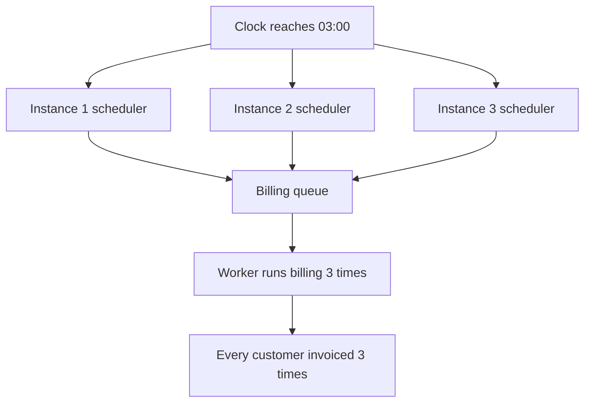

# Scheduled and Recurring Jobs — Part 1

Not every job starts because a user clicked something. Some start because a
clock reached a certain time: the nightly billing run, the trial-ending
reminder, the hourly CRM sync.

These look simple and they are the source of some of the strangest production
bugs in this whole track — jobs that run three times, jobs that run twice a
year on one specific Sunday, and jobs that stop running for a month without
anyone noticing.

> **📌 In one line:** know which of the three kinds of time-based job you are
> building, and make sure exactly one instance of your app decides when it
> runs.

## Table of Contents

1. [The Three Kinds](#the-three-kinds)
2. [Delayed Jobs](#delayed-jobs)
3. [Cron Expressions in Five Minutes](#cron-expressions-in-five-minutes)
4. [The Day-of-Week Trap](#the-day-of-week-trap)
5. [The Multi-Instance Problem](#the-multi-instance-problem)
6. [The Four Answers Compared](#the-four-answers-compared)
7. [What to Actually Do](#what-to-actually-do)
8. [Common Mistakes](#common-mistakes)
9. [Questions to Test Yourself](#questions-to-test-yourself)
10. [Related](#related)

---

## The Three Kinds

People say "scheduled job" for three different things. They have different
failure modes, so it is worth separating them.

| Kind | Meaning | Runs | SaaS example |
|---|---|---|---|
| **Delayed job** | Run once, N time units from now | Once | Send a trial-ending reminder 3 days before the trial ends |
| **Recurring job** | Run repeatedly on a pattern | Forever | Sync every company to the CRM every hour |
| **Scheduled-at-a-time job** | Run once, at a specific instant | Once | Publish this blog post at 09:00 on 1 October |

The distinction that matters:

- A **delayed** job already exists in the queue. It is a normal job with a
  future run time. Nothing needs to decide later whether to create it.
- A **recurring** job needs something that keeps deciding, forever. That
  something is a scheduler, and the scheduler is the hard part.
- A **scheduled-at-a-time** job is a delayed job whose delay you computed from
  a target timestamp. It is the same mechanism, and the interesting part is the
  time zone.

> **💡 Tip:** If you can express a requirement as a delayed job instead of a
> recurring one, do it. "Check every hour whether any trial ends in three days"
> becomes "when the trial starts, enqueue one reminder for the right moment".
> The second version has no scheduler, no multi-instance problem, and no way to
> silently stop.

## Delayed Jobs

```ts
// Run once, in three days.
await reminderQueue.add(
  'trial-ending',
  { companyId: company.id, trialEndsAtIso: company.trialEndsAt.toISO() },
  { delay: 3 * 24 * 60 * 60 * 1000 },
)

// Or: run once, at a specific instant.
const runAt = DateTime.fromISO('2026-10-01T09:00:00Z')
await publishQueue.add('publish-post', { postId }, {
  delay: Math.max(0, runAt.toMillis() - Date.now()),
})
```

**How the delay actually works.** The job is not held in memory and it is not
waiting on a timer. It is stored in a **sorted set** — a Redis structure that
keeps members ordered by a numeric score. The score is the timestamp at which
the job should run.

```text
  ZADD queue:invoices:delayed  1790000000000  job:8821
                               1790000060000  job:8822
                               1790000900000  job:8823
                                    ▲
                            score = run-at in milliseconds

  Periodically:
    ZRANGEBYSCORE queue:invoices:delayed  -inf  <now>
      → move those job ids into the waiting list
```

A promotion step runs on an interval, asks the sorted set for every member
whose score has passed, and moves those jobs to `waiting`. This is why a
delayed job can be a few hundred milliseconds late but never years late, and
why delays survive a restart: the data is in Redis, not in a `setTimeout`.

Why a sorted set and not a list: "give me everything due" is a range query on
the score, which a sorted set answers in logarithmic time. The same structure
is the right answer for leaderboards, rate limit windows, and time-series
buckets — see
[choosing data structures](../02-redis-in-practice/02-choosing-data-structures-part-1.md).

Realistic uses:

| Use | Delay |
|---|---|
| Trial-ending reminder | Computed from `trial_ends_at` minus 3 days |
| Retry after a provider outage | 30 minutes |
| "Are you still there?" onboarding nudge | 48 hours after signup, cancelled if they log in |
| Cancel an unpaid order | 15 minutes after creation |
| Delete a soft-deleted record | 30 days |

That fourth one shows the pattern's real strength. Instead of a job that scans
every order every minute looking for unpaid ones, each order schedules its own
expiry when it is created. No scan, no scheduler, and the work scales with
orders rather than with time.

> **⚠️ Warning:** A delayed job you enqueued is a promise you cannot easily
> take back. If the trial is cancelled, the reminder is still in the sorted
> set. Either remove it by `jobId`, or — better — re-check the precondition in
> the handler, exactly as file 02 insisted.

## Cron Expressions in Five Minutes

A **cron expression** is a compact way to describe a repeating time pattern. It
comes from Unix and every job library understands it.

```text
 ┌───────────── minute        (0 - 59)
 │ ┌─────────── hour          (0 - 23)
 │ │ ┌───────── day of month  (1 - 31)
 │ │ │ ┌─────── month         (1 - 12)
 │ │ │ │ ┌───── day of week   (0 - 6, Sunday = 0)
 │ │ │ │ │
 * * * * *
```

Five fields. `*` means "every". A number means "exactly that". The operators
you will actually use:

| Symbol | Meaning | Example |
|---|---|---|
| `*` | Every value | `* * * * *` — every minute |
| `,` | A list | `0 9,17 * * *` — 09:00 and 17:00 |
| `-` | A range | `0 9-17 * * *` — every hour from 09:00 to 17:00 |
| `/` | A step | `*/15 * * * *` — every 15 minutes |

Patterns worth memorising:

| Expression | Meaning |
|---|---|
| `*/5 * * * *` | Every 5 minutes |
| `0 * * * *` | Every hour, on the hour |
| `0 3 * * *` | Every day at 03:00 |
| `0 3 * * 1` | Every Monday at 03:00 |
| `0 0 1 * *` | The first day of every month, at midnight |
| `0 9 * * 1-5` | 09:00 on weekdays only |
| `30 2 1 1 *` | 02:30 on 1 January — once a year |

```ts
await billingQueue.add(
  'nightly-billing',
  {},
  {
    repeat: { pattern: '0 3 * * *', tz: 'UTC' },
    jobId: 'nightly-billing',   // a stable id stops duplicate schedules
  },
)
```

Note `jobId`. Registering the same repeatable job on every boot without a
stable identifier is how you end up with four copies of the same schedule.

> **💡 Tip:** Do not guess at a cron expression. Write it, then write the next
> five run times in a comment above it. If you cannot list them, the expression
> is wrong.

## The Day-of-Week Trap

One rule in cron surprises everybody, and it is worth knowing before it bites.

**When both day-of-month and day-of-week are restricted (neither is `*`), most
cron implementations treat them as OR, not AND.**

```text
  0 0 1 * 1     "midnight on the 1st of the month"  ... AND Monday?
                No. It runs on the 1st of every month,
                AND on every Monday. Roughly 5 times a month.
```

Someone writes that intending "the first Monday of the month". They get twelve
runs a year plus fifty-two more. If the job sends an invoice, that is fifty-two
wrong invoices.

The rules:

| Expression | Runs |
|---|---|
| `0 0 1 * *` | 1st of the month only (day-of-week is `*`) |
| `0 0 * * 1` | Every Monday only (day-of-month is `*`) |
| `0 0 1 * 1` | 1st of the month **or** any Monday |

So: **restrict at most one of those two fields.** For "the first Monday", run
every Monday and check the date in your handler:

```ts
const handler = async () => {
  const today = DateTime.utc()
  if (today.day > 7) return { skipped: 'not_first_week' }
  await reportService.sendMonthlyDigest()
}
```

This is also a good habit in general: put the precise condition in code where
it can be tested, and keep the cron expression coarse.

## The Multi-Instance Problem

This is the most important section in this file.

Your app runs three instances behind a load balancer. That is normal and good.
Each instance boots the same code, and that code registers the nightly billing
schedule. At 03:00, all three schedulers fire.



Everything about this is invisible in development, because you run one
instance. It appears the first time you scale to two, which is usually the
first time you have real customers.

```ts
// ❌ BROKEN - every instance that boots registers its own schedule
// providers/app_provider.ts, running in all three API pods
export default class AppProvider {
  async ready() {
    cron.schedule('0 3 * * *', () => billingService.runNightly())
  }
}
```

```ts
// ✅ FIXED - only the scheduler process schedules, and only it enqueues
// bin/scheduler.ts, deployed separately with replicas: 1
for (const entry of schedule) {
  await queues[entry.queue].add(entry.jobName, entry.payload, {
    repeat: { pattern: entry.pattern, tz: 'UTC' },
    jobId: entry.jobName,      // stable id: re-registering is a no-op
  })
}
```

It is not limited to cron. Any "do this once" logic that lives in application
startup has the same problem: a cache warm, a data migration, a leader-only
cleanup.

> **⚠️ Warning:** This bug does not announce itself. Billing runs three times
> and, if the billing job happens to be idempotent, nothing visible happens
> except three times the database load. Then someone adds a non-idempotent step
> and it becomes a financial incident.

Note the interaction with file 05. A schedule that fires N times is just
another duplicate-execution cause. Idempotent handlers make it survivable.
They do not make it correct — you are still doing the work three times.

## The Four Answers Compared

| Approach | How it works | Strengths | Weaknesses |
|---|---|---|---|
| **Dedicated scheduler process** | One deployment, replicas = 1, that only schedules | Simple, obvious, easy to reason about | A single point of failure; a rolling deploy can briefly run two |
| **Distributed lock** | Every instance tries to acquire a lock; only the winner schedules | Works with any number of instances, no special deployment | Lock correctness is subtle; needs a TTL and careful release |
| **Database leader lease** | A row holds `leader_id` and `expires_at`; instances renew it | Uses infrastructure you already trust, easy to inspect | You write the lease logic; a slow instance can lose leadership |
| **Platform scheduler** | Kubernetes `CronJob`, cloud scheduler, or a cron container | Nothing in your app decides; runs even if the app is idle | Schedule lives outside your codebase; needs its own deploy path |

A distributed lock in outline:

```ts
// Only the instance that wins the lock enqueues the work.
const acquired = await redis.set(
  'schedule:nightly-billing:2026-09-27',
  instanceId,
  'EX', 3600,   // TTL, so a crashed holder cannot block tomorrow
  'NX',         // only if the key does not exist
)

if (acquired === 'OK') {
  await billingQueue.add('nightly-billing', { forDate: '2026-09-27' })
}
```

The date in the key is the important detail. It makes the lock mean "the
nightly billing for the 27th has been scheduled", which is the fact you
actually want to be unique. A key without the date would block tomorrow's run.

The failure modes of that `SET NX` pattern — a holder that dies, a holder whose
TTL expires while it is still working, and why this is not a general mutual
exclusion primitive — are covered in
[distributed locks](../02-redis-in-practice/04-distributed-locks-part-1.md).

The platform option, for comparison:

```yaml
apiVersion: batch/v1
kind: CronJob
metadata:
  name: nightly-billing
spec:
  schedule: "0 3 * * *"
  timeZone: "UTC"
  concurrencyPolicy: Forbid       # never start a run while one is going
  startingDeadlineSeconds: 600    # skip rather than pile up after downtime
  successfulJobsHistoryLimit: 3
  jobTemplate:
    spec:
      backoffLimit: 2
      template:
        spec:
          restartPolicy: Never
          containers:
            - name: billing
              command: ["node", "build/bin/console.js", "billing:run"]
```

`concurrencyPolicy: Forbid` and `startingDeadlineSeconds` are two of part 2's
problems solved by configuration. More on Deployments and the objects around
them: [kubernetes deployment](../../cloud-devops/kubernetes/deployment.md).

## What to Actually Do

A clear recommendation, since "it depends" is not useful at 2 AM.

**Default: one dedicated scheduler process with a single replica, whose only
job is to enqueue.** It reads a schedule defined in your code, enqueues jobs
onto your normal queues, and does no work itself. Your existing workers process
those jobs, so you keep retries, backoff, dead-lettering, and metrics.

```text
 ┌────────────────┐        ┌────────────────┐        ┌──────────────┐
 │ scheduler      │ enqueue│  normal queue  │  pull  │   workers    │
 │ replicas: 1    │───────►│                │◄──────►│ replicas: N  │
 │ enqueues only  │        └────────────────┘        └──────────────┘
 └────────────────┘
```

Why this over the alternatives:

- The schedule lives in your repository, reviewed and deployed like code.
- Scheduling is separated from doing, so a slow job never delays the next
  tick.
- Testing is easy: assert that the scheduler enqueued the right job.
- Scaling workers does not multiply schedules.

**Add a short-TTL distributed lock around each enqueue anyway.** Replicas: 1 is
not a guarantee — during a rolling deploy two scheduler pods briefly overlap,
and that overlap is exactly 03:00 often enough to matter. The lock costs three
lines and closes the window.

**Use the platform scheduler when the work is genuinely standalone** — a
database backup, a `VACUUM`, a data export — especially if it should run even
when your app is scaled to zero.

**Never rely on every instance running its own scheduler with no coordination.**
That is the bug, not an option.

> **➡️ Continued in [Part 2](./06-scheduled-and-recurring-jobs-part-2.md)**

---

## Common Mistakes

| Mistake | Why it is wrong | Do this instead |
|---|---|---|
| Every app instance registers the schedule | The job runs once per instance | Dedicated scheduler plus a lock |
| A repeatable job with no stable `jobId` | Duplicate schedules accumulate on each boot | A fixed `jobId` |
| Restricting both day-of-month and day-of-week | They are combined with OR, not AND | Restrict one, check the rest in code |
| A polling cron where a delayed job would do | Scans everything every minute forever | Schedule the work when the record is created |
| A delayed job with no precondition re-check | Sends a reminder for a cancelled trial | Re-check state in the handler |
| The scheduler also does the work | A slow run delays the next tick | The scheduler only enqueues |
| `setInterval` in the API process | Dies on deploy, runs per instance | A real repeatable job |
| Trusting `replicas: 1` alone | Rolling deploys overlap two pods | Add a short-TTL lock |

## Questions to Test Yourself

1. Give a requirement that could be built as either a recurring job or a
   delayed job. Which is better and why?
2. How does a delayed job survive a process restart? What data structure holds
   it, and why that one?
3. What does `0 0 1 * 1` actually run on? What did the author probably mean,
   and how should they have written it?
4. You scale from one instance to three and billing runs three times. Explain
   why, and give two different fixes with their trade-offs.
5. Why does the distributed lock key include the date?
6. Your billing job is idempotent, so the triple run does no visible harm. Give
   two reasons it is still a bug worth fixing.
7. Why should the scheduler enqueue work rather than do it?
8. When is a Kubernetes `CronJob` a better answer than an in-app scheduler?

## Related

- [Scheduled and Recurring Jobs — Part 2](06-scheduled-and-recurring-jobs-part-2.md)
  — time zones, missed runs, overlap, batching, and monitoring.
- [Anatomy of a Job System — Part 1](02-anatomy-of-a-job-system-part-1.md) —
  the `delayed` state these jobs live in.
- [Idempotent Jobs — Part 1](05-idempotent-jobs-part-1.md) — what makes a
  triple-fired schedule survivable.
- [choosing data structures](../02-redis-in-practice/02-choosing-data-structures-part-1.md)
  — the sorted set that makes delayed jobs work.
- [distributed locks](../02-redis-in-practice/04-distributed-locks-part-1.md) — how to
  make "only one instance does this" actually true.
- [kubernetes deployment](../../cloud-devops/kubernetes/deployment.md) — the
  platform scheduler option and the deployment the scheduler runs in.
- [Operating Queues — Part 1](07-operating-queues-part-1.md) — noticing when a
  schedule has quietly stopped.
