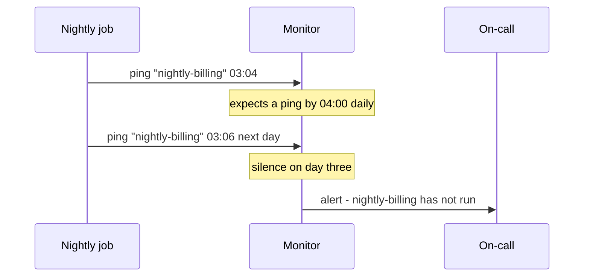

# Scheduled and Recurring Jobs — Part 2

Part 1 got the job firing once, from one place. This part is about everything
that goes wrong afterwards: the clock change that makes a job run twice, the
downtime that makes it run zero times, the nightly job that grew until it takes
twenty-five hours, and the worst failure of all — a schedule that quietly stops
and nobody notices for a month.

> **⬅️ This continues [Part 1](./06-scheduled-and-recurring-jobs-part-1.md).**

> **📌 In one line:** schedule in UTC, decide deliberately whether a missed run
> catches up or is skipped, batch long work with a cursor, stop runs
> overlapping, and alert on the **absence** of a run.

## Table of Contents

1. [Time Zones and Daylight Saving](#time-zones-and-daylight-saving)
2. [Missed Runs: Catch Up or Skip](#missed-runs-catch-up-or-skip)
3. [Long-Running Scheduled Work](#long-running-scheduled-work)
4. [Overlap Prevention](#overlap-prevention)
5. [Observability: The Job That Stopped](#observability-the-job-that-stopped)
6. [Backfills](#backfills)
7. [Keep the Schedule in Code](#keep-the-schedule-in-code)
8. [Common Mistakes](#common-mistakes)
9. [Questions to Test Yourself](#questions-to-test-yourself)
10. [Related](#related)

---

## Time Zones and Daylight Saving

A recurring job has a time. A time without a zone is ambiguous, and ambiguity
in a schedule becomes a bug twice a year.

**Daylight saving time (DST)** is a clock change — in many countries the local
clock jumps forward one hour in spring and back one hour in autumn. Two things
follow, and both break naive schedules.

```text
  Spring forward (Europe/London, late March)
    01:59:59  →  03:00:00        02:30 never happens
    A job at "0 30 2 * * *" runs ZERO times that day.

  Autumn back (Europe/London, late October)
    01:59:59  →  01:00:00        01:30 happens twice
    A job at "0 30 1 * * *" runs TWICE that day.
```

If that job sends invoices, you have just billed everyone twice, or not at all.
And it happens on one specific Sunday, six months after you wrote the code.

**The rule: store and schedule in UTC. Convert to local only for display.**
UTC has no DST, so 03:00 UTC is 03:00 UTC every single day of the year.

```ts
// ✅ Schedule in UTC. The run interval is always exactly 24 hours.
{ repeat: { pattern: '0 3 * * *', tz: 'UTC' } }

// ❌ Schedule in a DST zone and accept two broken days a year.
{ repeat: { pattern: '0 2 * * *', tz: 'Europe/London' } }
```

Three practical consequences.

**Pick a UTC hour that is safe everywhere you operate.** 03:00 UTC is 04:00 in
Berlin and 22:00 the previous day in New York. If "nightly" is supposed to mean
"after the business day closes", say which business.

**Anything user-facing must carry the user's zone explicitly.** A "daily
digest at 9 AM" means 9 AM *to them*. Store their zone, compute the next UTC
instant for their 09:00, and enqueue a delayed job for it. Recompute after
each send rather than adding exactly 24 hours, because a DST change makes the
real gap 23 or 25 hours.

```ts
// The next 09:00 in the user's own zone, expressed as a UTC instant.
const next = DateTime.now()
  .setZone(user.timezone)          // e.g. 'Europe/Berlin'
  .plus({ days: 1 })
  .set({ hour: 9, minute: 0, second: 0, millisecond: 0 })

await digestQueue.add('daily-digest', { userId: user.id }, {
  delay: next.toUTC().diffNow().toMillis(),
})
```

**Use `timestamptz`, never `timestamp`.** A bare `timestamp` column stores a
wall-clock reading with no zone, so the same value means different instants to
different readers. Column types, `timestamptz`, and how Postgres actually
stores them:
[postgres data types — part 1](../../databases/data-modeling/05-postgres-data-types-part-1.md).

> **⚠️ Warning:** Schedule times chosen for human convenience ("02:30, nobody
> is using the system") are exactly the times DST destroys. Pick a UTC hour and
> document what it means locally.

## Missed Runs: Catch Up or Skip

Your scheduler was down from 01:00 to 09:00. An hourly job missed eight runs.
When it comes back, what should happen?

There is no universally right answer, so it must be a decision you make per
job.

| Strategy | Behaviour | Right for |
|---|---|---|
| **Skip** | Only the next scheduled run happens | Anything that recomputes current state |
| **Catch up** | All eight missed runs are enqueued | Anything where each run covers a distinct period |
| **Catch up, capped** | Run the last N, skip the rest | A middle ground when only recent periods matter |
| **Coalesce** | One run that covers the whole gap | The best answer when the job takes a time range |

The skip case is easy to recognise: if the job is "recalculate every company's
current usage", running it eight times in a row produces the same answer eight
times. Skip.

The catch-up case is also easy: if the job is "generate the hourly export for
hour H", each missed hour is a distinct missing artefact. You need them all.

> **⚠️ Warning:** A catch-up that fires 200 queued runs at once is its own
> outage. Eight hourly jobs is fine. Eight hundred minute-jobs after a long
> outage will saturate every worker, exhaust the database pool, and push every
> normal job behind them.

Cap it, and prefer coalescing:

```ts
// ✅ Coalesce: one run that covers the whole missed range.
const lastRun = await ScheduleState.find('hourly-export')
const from = lastRun?.completedThrough ?? DateTime.utc().minus({ hours: 1 })
const to = DateTime.utc().startOf('hour')

const hours = to.diff(from, 'hours').hours
if (hours > 24) {
  // Too big to be a normal catch-up. Alert a human instead of guessing.
  logger.error({ hours }, 'schedule.gap_too_large')
  throw new PermanentError('schedule.gap_requires_review')
}

await exportQueue.add('hourly-export', { fromIso: from.toISO(), toIso: to.toISO() })
```

That `completedThrough` column is the key idea. **A scheduled job should record
the period it covered, not just that it ran.** With it, a missed run is
self-healing: the next run sees the gap and covers it. Without it, the gap is
invisible and permanent.

Platform schedulers expose the same choice as configuration. Kubernetes
`startingDeadlineSeconds` says "if you could not start within this window, skip
this run instead of starting late".

## Long-Running Scheduled Work

The nightly job that processes every row is a rite of passage. It works for two
years and then stops working, usually during your busiest month.

```ts
// ❌ BROKEN - loads every company into memory, one transaction, no progress
const handler = async () => {
  const companies = await Company.all()          // 400,000 rows
  for (const company of companies) {
    await billingService.generateInvoice(company)
  }
}
```

Four failures compound. Memory grows with your customer base until the pod is
killed. The run time grows linearly until it no longer fits in a night. A
failure at row 399,000 loses everything, because there is no record of
progress. And a single long transaction holds locks and prevents `VACUUM` from
cleaning up, which degrades the whole database.

```ts
// ✅ FIXED - keyset pagination, bounded batches, recorded progress
const BATCH = 500

const handler = async (job: Job<{ cursor?: number }>) => {
  let cursor = job.data.cursor ?? 0

  for (let i = 0; i < 20; i++) {          // bounded work per job execution
    const companies = await Company.query()
      .where('id', '>', cursor)           // keyset, not OFFSET
      .where('billing_enabled', true)
      .orderBy('id', 'asc')
      .limit(BATCH)

    if (companies.length === 0) return { done: true }

    for (const company of companies) {
      // One job per company: independent retries, isolated failures.
      await invoiceQueue.add('generate-invoice', { companyId: company.id }, {
        jobId: `invoice-${company.id}-${job.data.periodStart}`,   // idempotent
      })
    }

    cursor = companies[companies.length - 1].id
  }

  // Not finished: continue in a fresh job so the slot is released.
  await billingQueue.add('nightly-billing', { ...job.data, cursor })
}
```

Four changes, each fixing one failure:

| Change | Fixes |
|---|---|
| `WHERE id > cursor` instead of `OFFSET` | `OFFSET 200000` makes the database walk 200,000 rows every page |
| Batches of 500 | Memory stays flat regardless of customer count |
| One child job per company | A single bad company fails one job, not the run |
| Cursor passed to the next job | A crash resumes instead of restarting |

Why keyset beats `OFFSET`, and what happens to `OFFSET` at depth:
[pagination performance](../../databases/query-optimization/pagination-performance.md).

The child-job pattern is the important one. The nightly job becomes a
**fan-out**: it does no business work itself, it just enqueues. Every child
gets its own retries, its own backoff, its own dead-lettering, and its own
metrics. A nightly run that "failed" becomes "398,412 succeeded, 4 in the
dead-letter queue" — which is a triage task, not an incident.

## Overlap Prevention

The nightly job now takes four hours. Then six. Then twenty-five. Run N+1
starts while run N is still going, and now two runs process the same rows at
once.

Depending on the job, that is either wasted work or corrupted data.

Three defences, from cheapest to strongest:

```ts
// 1. A lock with a TTL longer than the longest plausible run.
const lock = await redis.set('lock:nightly-billing', runId, 'EX', 6 * 3600, 'NX')
if (lock !== 'OK') {
  logger.warn('nightly-billing.still_running, skipping this tick')
  return { skipped: 'overlap' }
}
try {
  await runBilling()
} finally {
  // Release only if we still hold it — a TTL may have expired underneath us.
  await redis.eval(RELEASE_IF_MINE, 1, 'lock:nightly-billing', runId)
}
```

```ts
// 2. A state row, which also gives you history and an audit trail.
const claimed = await db.from('schedule_runs')
  .where({ name: 'nightly-billing', status: 'idle' })
  .update({ status: 'running', started_at: new Date(), run_id: runId })

if (claimed === 0) return { skipped: 'overlap' }
```

```yaml
# 3. Let the platform enforce it.
spec:
  concurrencyPolicy: Forbid    # Allow | Forbid | Replace
```

Whichever you choose, **log the skip**. A schedule that silently skips every
night looks identical to a schedule that runs perfectly, and the difference is
that no work is being done.

> **📌 Remember:** Overlap prevention treats the symptom. A job that now needs
> twenty-five hours needs the batching from the previous section. The lock buys
> you time to fix it, not a fix.

## Observability: The Job That Stopped

Here is the hardest failure in this whole folder.

The nightly billing job stops running. Not failing — *stopping*. The scheduler
pod was removed in a Helm change, or the repeatable job was deleted during a
Redis flush, or a cron expression was edited to something that never matches.

Your dashboards show zero failures. Your error rate is zero. Your dead-letter
queue is empty. Everything is green, because **nothing is happening**, and
monitoring failures cannot detect an absence of runs.

You find out five weeks later when someone asks why revenue is down.

> **⚠️ Warning:** "No alert" does not mean "it worked". It means "nothing sent
> an alert", and a job that never started cannot send one.

The fix is a **dead-man's switch**, also called heartbeat monitoring. Invert
the logic: instead of the job reporting failure, the job reports *success*, and
an external system alerts when that report does not arrive.



```ts
const handler = async () => {
  const result = await billingService.runNightly()

  // Ping only after real success. A ping in a finally block is worthless.
  await fetch(`${env.HEARTBEAT_URL}/nightly-billing`, {
    method: 'POST',
    body: JSON.stringify({ invoices: result.count, runId }),
    signal: AbortSignal.timeout(5_000),
  })

  await ScheduleRun.create({
    name: 'nightly-billing', status: 'success',
    completedAt: DateTime.utc(), itemsProcessed: result.count,
  })
}
```

The monitor can be a hosted service or your own scheduled check against the
`schedule_runs` table. What matters is that **it lives outside the system it
watches**. A monitor inside the same scheduler pod dies with it.

What to alert on:

| Signal | Severity |
|---|---|
| No successful run within the expected window | **Page** |
| The run succeeded but processed 0 items when it normally processes thousands | **Page** |
| Run duration more than double the normal | Ticket |
| A run skipped due to overlap, twice in a row | Ticket |

The second row catches the sneakiest version: the job runs, reports success,
and does nothing because a query filter is wrong. Always assert on the *volume*
of work, not only on completion.

Building these into your metrics:
[metrics and health checks — part 1](../../backend-fundamentals/08-logging-and-observability/04-metrics-and-health-checks-part-1.md).

## Backfills

A **backfill** is a one-off run over historical data: recompute a column you
just added, re-send failed notifications from last week, re-index everything.

Treat it as scheduled work, because it has the same shape and the same risks.

```ts
// A backfill is a cursor job you can start, watch, pause, and resume.
await maintenanceQueue.add('backfill-invoice-totals', {
  cursor: 0,
  batchSize: 500,
  dryRun: true,              // always start here
  throttleMs: 200,           // deliberately slow: do not starve live traffic
})
```

Rules that keep a backfill from becoming an incident:

- **Dry run first**, logging what would change, and read the log.
- **Throttle.** A backfill competing with live traffic for the connection pool
  is an outage. Slower is nearly always correct.
- **Make it resumable** with a cursor, and store the cursor.
- **Make it idempotent**, so a restart is harmless — file 05.
- **Give it a kill switch**: a flag the handler checks each batch, so you can
  stop it without a deploy.
- **Delete it when it is done.** A backfill left in the schedule is a landmine.

## Keep the Schedule in Code

Many hosted queue dashboards let you add a repeating job through a web form. It
is quick and it is a trap.

| Schedule in a dashboard | Schedule in code |
|---|---|
| No history of who changed what | Git blame |
| Not reviewed | Pull request |
| Does not exist in staging | Same file in every environment |
| Vanishes if the instance is recreated | Recreated on every deploy |
| Invisible to a developer reading the repo | Right there in the repo |

```ts
// app/schedule.ts — the single source of truth, reviewed like any code.
export const schedule = [
  { jobName: 'nightly-billing',  queue: 'billing', pattern: '0 3 * * *',   tz: 'UTC' },
  { jobName: 'hourly-crm-sync',  queue: 'crm',     pattern: '0 * * * *',   tz: 'UTC' },
  { jobName: 'expire-trials',    queue: 'default', pattern: '0 * * * *',   tz: 'UTC' },
  { jobName: 'clean-idempotency',queue: 'default', pattern: '30 4 * * *',  tz: 'UTC' },
] as const
```

The scheduler reads this list on boot and reconciles: register anything new,
remove anything that is no longer listed. Removal matters — a job deleted from
the file but left registered in Redis keeps running forever, which is the
inverse of the silent-stop problem and just as confusing.

---

## Common Mistakes

| Mistake | Why it is wrong | Do this instead |
|---|---|---|
| Scheduling in a DST zone | Runs twice or zero times on clock-change days | Schedule in UTC |
| `timestamp` instead of `timestamptz` | The same value means different instants | `timestamptz` everywhere |
| Adding exactly 24 hours for a daily user job | Drifts by an hour across a DST change | Recompute in the user's zone |
| Unbounded catch-up after downtime | 800 runs at once is an outage | Cap, or coalesce into one range |
| Recording only "it ran" | A gap becomes invisible and permanent | Record `completedThrough` |
| A nightly job that loads every row | Memory and time grow until it fails | Keyset batches plus child jobs |
| `OFFSET` for batching | The database re-walks the rows each page | `WHERE id > cursor` |
| No overlap guard on a growing job | Two runs process the same rows | Lock or `concurrencyPolicy: Forbid` |
| Skipping silently | Looks identical to running perfectly | Log and count every skip |
| Monitoring only failures | A job that stopped cannot fail | Dead-man's switch on success |
| Schedules created in a dashboard | Unreviewed, unreproducible | A list in the repository |

## Questions to Test Yourself

1. A job runs at 02:30 in `Europe/London`. Describe precisely what happens on
   each of the two clock-change days, and give the fix.
2. A user wants a digest at 9 AM their time. Why is "add 24 hours to the last
   run" wrong?
3. Your scheduler was down for eight hours. Give one job that should catch up
   and one that should skip, with reasons.
4. What does a `completedThrough` column buy you that a `last_run_at` column
   does not?
5. Why does a nightly job that enqueues one child job per company behave better
   under failure than one that loops over companies directly?
6. Why is `OFFSET 200000` a bad way to page through a batch job?
7. Your nightly job now takes 25 hours. Name the immediate mitigation and the
   actual fix, and say why they are different.
8. Every dashboard is green and the billing job has not run for five weeks.
   Explain how that is possible and what would have caught it on day one.

## Related

- [Scheduled and Recurring Jobs — Part 1](06-scheduled-and-recurring-jobs-part-1.md)
  — the three kinds, cron, and the multi-instance problem.
- [Operating Queues — Part 1](07-operating-queues-part-1.md) — the metrics and
  alerts that make all of this visible.
- [Idempotent Jobs — Part 2](05-idempotent-jobs-part-2.md) — what makes a
  backfill or a catch-up safe to re-run.
- [postgres data types — part 1](../../databases/data-modeling/05-postgres-data-types-part-1.md)
  — `timestamptz` versus `timestamp`, and why the choice matters here.
- [pagination performance](../../databases/query-optimization/pagination-performance.md)
  — keyset pagination, and what `OFFSET` costs at depth.
- [metrics and health checks — part 1](../../backend-fundamentals/08-logging-and-observability/04-metrics-and-health-checks-part-1.md)
  — counters and gauges for "did this run, and how much did it do".
- [distributed locks](../02-redis-in-practice/04-distributed-locks-part-1.md) — the
  overlap guard, and the ways a TTL-based lock can betray you.
