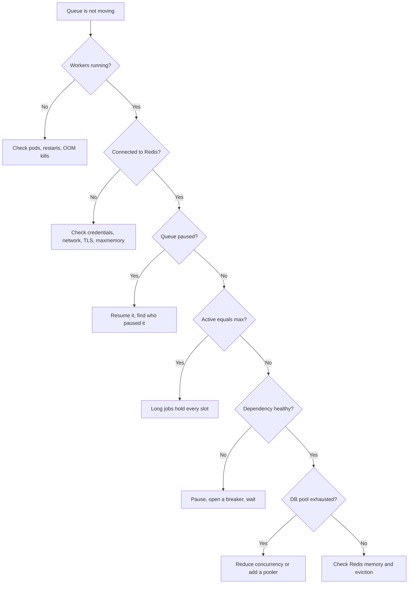

# Operating Queues — Part 1

It is 09:20. Someone says invoices are not going out. You open the dashboard
and there are 42,000 jobs waiting. What do you look at, and in what order?

This file is written as a runbook rather than a tutorial. Part 1 is the
diagnosis half: which numbers tell you the truth, which ones lie, and the
ordered checklist for a queue that has stopped moving.

> **📌 In one line:** queue depth tells you almost nothing — **the age of the
> oldest waiting job** is the number that says whether you have a problem.

## Table of Contents

1. [The Numbers That Matter](#the-numbers-that-matter)
2. [Why Depth Alone Lies](#why-depth-alone-lies)
3. [Job Age Is the Real Signal](#job-age-is-the-real-signal)
4. [Collecting the Metrics](#collecting-the-metrics)
5. [Alerts Worth Setting](#alerts-worth-setting)
6. [Runbook: The Queue Is Stuck](#runbook-the-queue-is-stuck)
7. [When Cache and Queue Share One Redis](#when-cache-and-queue-share-one-redis)
8. [Common Mistakes](#common-mistakes)
9. [Questions to Test Yourself](#questions-to-test-yourself)
10. [Related](#related)

---

## The Numbers That Matter

Seven numbers per queue. Learn what a bad value of each one means.

| Metric | What it is | A bad value means |
|---|---|---|
| **Waiting (depth)** | Jobs ready but not started | On its own, almost nothing — see below |
| **Active** | Jobs claimed by a worker | Pinned at max means every slot is busy; **zero with depth above zero is an incident** |
| **Oldest waiting job age** | How long the front of the queue has waited | **The single best signal.** Rising means you are not keeping up |
| **Completed rate** | Jobs finished per minute | A drop to zero means nothing is being processed |
| **Failed rate** | Jobs failed per minute | A spike means a dependency or a deploy broke something |
| **Duration p50 / p95 / p99** | How long a job takes | A rising p95 with flat volume means a dependency is slowing |
| **Dead-letter size and growth** | Jobs that exhausted retries | **Growth** means work is being permanently lost |

Two combinations are worth reading as a pair, because each is meaningless
alone:

- **Active = 0 and waiting > 0** — no worker is taking jobs. Workers are down,
  disconnected, or the queue is paused. This is the clearest incident signal
  there is.
- **Active = max and waiting rising** — workers are fully busy and losing. Jobs
  are either slower than usual or arriving faster than usual. The p95 tells you
  which.

## Why Depth Alone Lies

Depth is the number everyone puts on a dashboard, and it is close to useless
without a rate.

```text
  Queue A:  depth 10,000   drains in 45 seconds     → fine
  Queue B:  depth      5   unchanged for 90 minutes → incident
```

Queue A is a bulk import that enqueued 10,000 image resizes. Forty workers are
chewing through it happily. Nobody is waiting on any individual job. Depth
10,000 is the system working.

Queue B has five password-reset emails that have not moved in ninety minutes.
Five people cannot log in. Depth 5 is a production incident.

An alert on `depth > 1000` pages you for queue A every single time someone
uploads a spreadsheet, and never pages you for queue B. People then mute the
alert, and the mute is what makes the next real incident long.

> **⚠️ Warning:** A depth threshold is the most commonly configured queue alert
> and the one most likely to be muted within a month. Alert on age instead.

## Job Age Is the Real Signal

**Oldest waiting job age** answers the question you actually care about: *how
long is someone waiting?*

It is also self-scaling. You do not need to know whether 10,000 is a lot for
this queue. If the oldest job is four seconds old, the queue is healthy at any
depth. If it is forty minutes old, it is not, even at depth 5.

Set a target per queue, and alert on the target:

| Queue | Target oldest age | Why |
|---|---|---|
| `critical` (password reset, payment receipt) | under 30 s | A human is waiting right now |
| `default` (notifications, CRM sync) | under 5 min | Nobody is staring at it |
| `heavy` (reports, exports) | under 1 h | Delivered by email anyway |
| `backfill` | unbounded | Deliberately slow |

That table is a service level objective for your queues, and it is worth
writing down before an incident rather than during one.

```ts
// Oldest waiting job age, per queue.
export async function oldestWaitingAgeMs(queue: Queue): Promise<number> {
  const [oldest] = await queue.getJobs(['waiting'], 0, 0, true)  // asc = true
  if (!oldest) return 0
  return Date.now() - oldest.timestamp
}
```

> **💡 Tip:** If you only have budget for one queue dashboard panel per queue,
> make it oldest-waiting-age. If you have two, add the failed rate.

## Collecting the Metrics

Expose the numbers from a small process that polls each queue and publishes
gauges. Do not compute them inside a worker — a saturated worker is exactly
when you need the numbers most, and exactly when it cannot produce them.

```ts
// bin/queue-metrics.ts — a tiny separate process
const gauges = {
  waiting: new Gauge({ name: 'queue_waiting', labelNames: ['queue'], help: '...' }),
  active: new Gauge({ name: 'queue_active', labelNames: ['queue'], help: '...' }),
  failed: new Gauge({ name: 'queue_failed', labelNames: ['queue'], help: '...' }),
  oldestAge: new Gauge({ name: 'queue_oldest_waiting_seconds', labelNames: ['queue'], help: '...' }),
  dlq: new Gauge({ name: 'queue_dead_letter_total', labelNames: ['queue'], help: '...' }),
}

setInterval(async () => {
  for (const [name, queue] of Object.entries(queues)) {
    const counts = await queue.getJobCounts('waiting', 'active', 'failed', 'delayed')
    gauges.waiting.set({ queue: name }, counts.waiting)
    gauges.active.set({ queue: name }, counts.active)
    gauges.failed.set({ queue: name }, counts.failed)
    gauges.oldestAge.set({ queue: name }, (await oldestWaitingAgeMs(queue)) / 1000)
  }
}, 15_000).unref()
```

Durations belong in a histogram, recorded by the worker when a job finishes,
because you want percentiles rather than an average:

```ts
worker.on('completed', (job) => {
  jobDuration.observe(
    { queue: 'invoices', name: job.name },
    (job.finishedOn! - job.processedOn!) / 1000,
  )
})
```

Why an average is misleading and a p95 is not, and how to pick labels that do
not explode your metrics bill:
[metrics and health checks — part 1](../../backend-fundamentals/08-logging-and-observability/04-metrics-and-health-checks-part-1.md).

## Alerts Worth Setting

The goal is a small number of alerts that are almost always real.

| Alert | Condition | Severity |
|---|---|---|
| Queue not moving | `active == 0 AND waiting > 0` for 5 min | **Page** |
| SLO breach | oldest waiting age above the queue's target for 10 min | **Page** |
| Dead-letter growth | DLQ grew by more than 50 in an hour | **Page** |
| Failure rate | above 5% for 10 min, per queue | **Page** |
| No worker heartbeat | no heartbeat for 2 min | **Page** |
| Redis memory | above 80% of `maxmemory` | **Page** |
| Scheduled job missing | no success inside its window | **Page** |
| DLQ non-empty | more than 0, checked daily | Ticket |
| Stalled jobs | above 0 in an hour | Ticket |
| Duration regression | p95 doubled week over week | Ticket |
| Queue paused | paused for more than 30 min | Ticket |

And the ones that are noise:

| Not worth an alert | Why |
|---|---|
| A single job failed | That is what retries are for |
| Depth above a fixed number | Fires on every bulk import |
| Any job took longer than N | Outliers are normal; watch the percentile |
| Worker CPU above 80% | A busy worker is a working worker |
| Completed count dropped overnight | Traffic has a daily shape |

Two principles behind that split. **Alert on symptoms, not causes** — "nobody's
invoice is going out" is a symptom; "Redis latency is up" is a cause you find
during the investigation. And **alert per queue** — one global threshold cannot
express that 20% failures on `crm-sync` is a bad day while 2% on
`charge-invoice` is an emergency.

## Runbook: The Queue Is Stuck

Work down this list in order. It is ordered by how often each cause is the
answer, and each step is cheap.



**1. Are workers running at all?**

```bash
kubectl get pods -l app=worker
kubectl logs -l app=worker --tail=100 --since=15m
kubectl get events --field-selector reason=OOMKilling
```

A worker in `CrashLoopBackOff` is the most common answer. A poison message
(file 04) is the most common cause of that crash loop.

**2. Are they connected to the queue?** A worker can be `Running` and healthy
by liveness while its Redis client reconnects silently. Look for
`redis.error` and `redis.connection_closed` lines. Check credentials, the
network policy, and whether Redis itself is rejecting writes.

**3. Is the queue paused?** Someone paused it during last week's incident and
did not resume it. This is embarrassing and it is common.

```ts
console.log(await queue.isPaused())
await queue.resume()
```

**4. Is every slot occupied by a long-running job?**

```ts
const active = await queue.getJobs(['active'])
for (const job of active) {
  console.log(job.id, job.name, Date.now() - (job.processedOn ?? 0))
}
```

If five jobs have been active for forty minutes, that is your answer: either a
job with no timeout (file 03) or a dependency that hangs instead of failing.

**5. Is a dependency down?** A slow provider turns 400 ms jobs into 30-second
jobs and your effective throughput drops by 75×. Check the dependency's status
page and your own p95.

**6. Is the database pool exhausted?** Workers waiting for a connection look
exactly like workers doing slow work.

```sql
SELECT state, wait_event_type, count(*)
FROM pg_stat_activity
WHERE datname = current_database()
GROUP BY 1, 2 ORDER BY 3 DESC;
```

Many connections in `idle in transaction` means a handler opened a transaction
and is waiting on something else inside it — usually an HTTP call inside a
transaction, which should never happen.

**7. Is Redis out of memory or evicting?** The next section.

## When Cache and Queue Share One Redis

This one deserves its own section because it is silent, it destroys data, and
almost everyone does it at least once.

You have Redis for caching. You add BullMQ. Pointing it at the same Redis is
one environment variable. So you do.

Then, to stop the cache filling memory, someone sets a sane-sounding eviction
policy:

```bash
# ❌ BROKEN - correct for a cache, catastrophic for a queue
maxmemory 2gb
maxmemory-policy allkeys-lru     # evict ANY key when memory is full
```

`allkeys-lru` means: when memory is full, delete whatever was used least
recently. Redis does not know which keys are cache entries and which are your
queue. Under memory pressure it evicts both.

```text
  memory fills (a big cache warm, or a backlog)
        │
        ▼
  Redis evicts least-recently-used keys
        │
        ├── some cache entries        → fine, they get recomputed
        └── queue:invoices:delayed    → 4,200 delayed jobs gone
            queue:invoices:8821       → the payload for an active job gone
        │
        ▼
  No error. No log line. The jobs simply never existed.
```

There is no warning. The queue does not know it lost anything, because the
sorted set that would have told it is the thing that was deleted. You discover
it when a customer asks about a reminder that never arrived.

```bash
# ✅ FIXED (a) - separate instances, or at minimum separate databases
REDIS_CACHE_URL=redis://cache.internal:6379/0     # maxmemory-policy allkeys-lru
REDIS_QUEUE_URL=redis://queue.internal:6379/0     # maxmemory-policy noeviction
```

```bash
# ✅ FIXED (b) - if you truly must share, never evict arbitrary keys
maxmemory-policy volatile-lru    # only keys that have a TTL may be evicted
```

Option (b) works because queue keys have no TTL, so `volatile-lru` cannot touch
them. But it has its own edge: when nothing evictable remains, writes start
failing with `OOM command not allowed`, which at least is a loud error rather
than silent deletion. Separate instances are still the right answer.

Whichever you choose, monitor it:

| Signal | Meaning |
|---|---|
| `used_memory` above 80% of `maxmemory` | Act now, before eviction starts |
| `evicted_keys` above 0 on the **queue** instance | Data loss is happening right now |
| `rdb_last_bgsave_status` not `ok` | Persistence is failing; a restart loses everything |
| `blocked_clients` rising | Workers are waiting on blocking reads |

Redis memory and eviction policies in detail:
[memory and operations — part 1](../02-redis-in-practice/05-memory-and-operations-part-1.md).
Persistence, failover, and what a restart actually costs:
[part 2](../02-redis-in-practice/05-memory-and-operations-part-2.md).

> **📌 Remember:** A cache is allowed to lose data. A queue is not. Never give
> them the same eviction policy, and preferably do not give them the same
> server.

> **➡️ Continued in [Part 2](./07-operating-queues-part-2.md)**

---

## Common Mistakes

| Mistake | Why it is wrong | Do this instead |
|---|---|---|
| Alerting on queue depth | Fires on every bulk import, misses a stuck queue of 5 | Alert on oldest-waiting-age |
| No per-queue SLO | One threshold cannot fit reports and password resets | A target age per queue |
| Metrics collected inside a worker | Unavailable exactly when you need them | A separate metrics process |
| Watching averages, not percentiles | An average hides the slow tail | p50, p95, p99 |
| Queue and cache on one Redis with `allkeys-lru` | Jobs are silently evicted | Separate instances, `noeviction` for the queue |
| Not monitoring `evicted_keys` | Data loss with no error | Alert on any eviction on the queue instance |
| Forgetting a queue was paused | Looks like a mystery outage | Alert on paused for more than 30 min |
| Ignoring `active = 0, waiting > 0` | The clearest incident signal there is | Page on it |

## Questions to Test Yourself

1. Queue A has depth 10,000; queue B has depth 5. Which is more likely to be an
   incident, and what single metric would settle it?
2. What does `active = 0` with `waiting = 3000` tell you? List the three causes
   in the order you would check them.
3. Why is oldest-waiting-age self-scaling in a way that depth is not?
4. Write the per-queue age targets for your own app and justify each one.
5. Why should queue metrics be collected by a separate process?
6. Explain exactly how `allkeys-lru` on a shared Redis loses jobs, and why
   there is no error.
7. `volatile-lru` protects queue keys. What new failure does it introduce, and
   why is it still better?
8. `pg_stat_activity` shows 40 connections `idle in transaction` from workers.
   What is the likely bug in the handler?

## Related

- [Operating Queues — Part 2](07-operating-queues-part-2.md) — backlog
  recovery, deploys, version skew, capacity, and manual intervention.
- [Writing Reliable Workers — Part 2](03-writing-reliable-workers-part-2.md) —
  timeouts and stalled jobs, two causes on the stuck-queue checklist.
- [Retries, Backoff and Dead Letter — Part 2](04-retries-backoff-and-dead-letter-part-2.md)
  — the dead-letter growth alert and what to do about it.
- [metrics and health checks — part 1](../../backend-fundamentals/08-logging-and-observability/04-metrics-and-health-checks-part-1.md)
  — counters, gauges, histograms, and why percentiles beat averages.
- [memory and operations — part 1](../02-redis-in-practice/05-memory-and-operations-part-1.md)
  and [part 2](../02-redis-in-practice/05-memory-and-operations-part-2.md) —
  eviction policies, Redis memory, and the monitoring signals above.
- [connection pooling — part 1](../../databases/operations/01-connection-pooling-part-1.md)
  — the pool exhaustion step of the runbook.
- [Scheduled and Recurring Jobs — Part 2](06-scheduled-and-recurring-jobs-part-2.md)
  — the dead-man's switch for the failure no queue metric can see.
