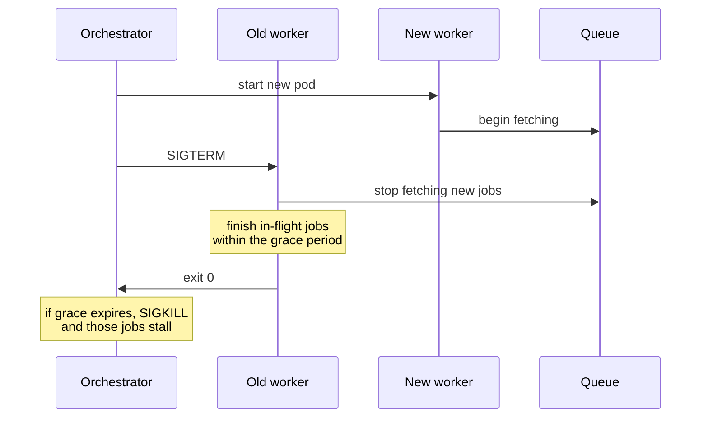

# Operating Queues — Part 2

Part 1 was diagnosis. This part is intervention: you know what is wrong, now
what do you actually do? Draining a 200,000-job backlog without taking the
database down, deploying workers without losing jobs, deciding whether you have
enough workers at all, and touching jobs by hand safely.

> **⬅️ This continues [Part 1](./07-operating-queues-part-1.md).**

> **📌 In one line:** drain a backlog against the limit that is actually
> binding, make payload changes additive so an old worker can still read a new
> job, and remember that every manual retry or replay assumes idempotency.

## Table of Contents

1. [Backlog Recovery](#backlog-recovery)
2. [When to Deliberately Drop Jobs](#when-to-deliberately-drop-jobs)
3. [Deploying Workers](#deploying-workers)
4. [Version Skew](#version-skew)
5. [Capacity: Arrival Rate vs Service Rate](#capacity-arrival-rate-vs-service-rate)
6. [Manual Intervention](#manual-intervention)
7. [What to Log Per Job](#what-to-log-per-job)
8. [Common Mistakes](#common-mistakes)
9. [Questions to Test Yourself](#questions-to-test-yourself)
10. [Related](#related)

---

## Backlog Recovery

Two hundred thousand jobs are waiting. The instinct is to scale workers from 4
to 40. Sometimes that is right. Often it turns one incident into three.

**Work out what is actually limiting you before you scale.** Scaling the wrong
resource makes things worse.

| Limit | How to tell | What scaling workers does |
|---|---|---|
| Worker CPU or slots | Workers at high CPU, p95 normal | Helps — scale up |
| Database connections | Pool wait time rising, `pg_stat_activity` full | **Exhausts the pool, breaks the API** |
| Database throughput | Slow queries, lock waits, disk saturated | **Makes the database slower for everyone** |
| Third-party rate limit | 429s in the logs | **Gets your API key throttled or blocked** |
| One slow dependency | p95 up, CPU low | Nothing; you are waiting, not working |

The safe procedure:

```text
 1. Identify the binding limit (the table above).
 2. Check the headroom in that resource, not in the workers.
 3. Scale in steps: 4 → 8 → 16, watching after each step.
 4. Watch the API, the database, and the dependency — not the queue.
 5. Stop when the drain rate stops improving.
```

```bash
# Step, do not leap. Watch between steps.
kubectl scale deployment/worker-default --replicas=8
# check: pool wait, API p95, provider 429 rate, DB CPU
kubectl scale deployment/worker-default --replicas=16
```

Two specific dangers to watch for.

**The database pool.** This is the multiplication from file 03. Sixteen pods
with a pool of 12 is 192 connections. If Postgres allows 100, you have just
taken the API down to drain a backlog of notifications. Put a pooler in front,
or reduce per-pod concurrency as you add pods so the product stays constant.

**Third-party rate limits.** Forty workers hitting a provider that allows 100
requests a minute means 39 of them generate 429s. Worse, sustained abuse gets
API keys suspended, which converts a backlog into an outage. Use a shared rate
limiter (file 03), not a per-worker one, before you scale.

> **💡 Tip:** Move the backlog to its own queue and its own worker deployment
> before draining it. Then a backfill of 200,000 CRM syncs cannot starve the
> password-reset queue, and you can scale the two independently.

## When to Deliberately Drop Jobs

This feels wrong and is sometimes correct.

A backlog is only worth draining if the work still has value when it finishes.
Some jobs expire.

| Job | Still valuable 6 hours late? |
|---|---|
| Generate an invoice | Yes — drain it |
| Sync a contact to the CRM | Yes, and the last one wins anyway |
| "Your report is ready" email | Yes |
| Real-time "new message" push notification | **No** — the user has seen it in-app |
| A cache warm | **No** — the cache has been populated by real traffic |
| A "trial ends in 3 days" reminder, now 5 days late | **No** — it is wrong, not just late |
| A one-time password email | **No** — it has expired and is a security smell |

```ts
// Encode expiry in the job so a late run skips rather than doing harm.
const handler = async (job: Job<{ userId: number; enqueuedAtIso: string }>) => {
  const ageMs = Date.now() - Date.parse(job.data.enqueuedAtIso)
  if (ageMs > 15 * 60_000) {
    return { skipped: 'expired', ageMs }   // success: nothing useful to do
  }
  await pushNotifications.send(job.data.userId, job.data.payload)
}
```

Building expiry into the handler is much better than deciding during an
incident, because it happens automatically and it is reviewed in a pull
request. Dropping a whole queue by hand is the emergency version:

```ts
// Emergency only, and say so in the incident channel.
await notificationQueue.drain()      // removes waiting and delayed jobs
```

> **⚠️ Warning:** `drain()` and `obliterate()` are irreversible. Count first,
> export the payloads to a file if you might want them, and write down what you
> removed. "We dropped 40,000 notification jobs at 09:40" belongs in the
> incident timeline.

## Deploying Workers

A worker deploy is different from an API deploy because a worker is in the
middle of something.

The correct sequence, which your platform performs if you configure it
properly:



The three settings that make it work, from file 03:

| Setting | Value | Why |
|---|---|---|
| App `GRACE_MS` | slowest normal job plus headroom | Time to finish in-flight work |
| `terminationGracePeriodSeconds` | above `GRACE_MS` | Room to close connections before `SIGKILL` |
| `maxUnavailable` | 25% or fewer | Keep throughput during the roll |

Two extra points specific to workers.

**Long-job queues need their own deployment.** A four-minute report job needs a
five-minute grace period. Putting it in the same deployment as the emails you
ship twelve times a day means every deploy takes five minutes or kills reports.

**Do not deploy workers during a backlog drain** unless the deploy is the fix.
Each rolling restart costs you a grace period of reduced throughput, and every
interrupted job is retried from the beginning.

Rolling strategy, surge, and unavailability:
[rolling-updates](../../cloud-devops/deployment-strategies/rolling-updates.md).

## Version Skew

During a rolling deploy — and for however long it takes — **the new code and
the old code run at the same time**. A new API pod enqueues a job. An old
worker pod picks it up.

```ts
// ❌ BROKEN - a renamed field the old worker has never heard of
// new producer
await queue.add('send-invoice', { invoice_id: 42, locale: 'de' })

// old worker, still running for another 90 seconds
const handler = async (job: Job) => {
  const invoice = await Invoice.findOrFail(job.data.invoiceId)  // undefined
}
```

This is also how poison messages are born (file 04): a payload shape the old
worker cannot parse, crashing it on every attempt.

The rule that prevents it: **make payload changes additive and backward
compatible for at least one release.**

```ts
// ✅ FIXED - add, never rename or remove, and tolerate the missing field
interface SendInvoiceJobV2 {
  invoiceId: number        // unchanged
  requestId: string        // unchanged
  locale?: string          // NEW and optional
}

const handler = async (job: Job<SendInvoiceJobV2>) => {
  const locale = job.data.locale ?? 'en'    // old jobs have no locale
  await invoiceService.send(job.data.invoiceId, locale)
}
```

The safe change sequence, which takes three deploys:

| Release | Producer | Worker |
|---|---|---|
| 1 | Still writes the old field | Reads both old and new; new is optional |
| 2 | Writes the new field | Reads both |
| 3 | Writes only the new field | Reads only the new field |

Between releases you must be sure no old jobs remain — including delayed jobs
scheduled weeks out and anything sitting in the dead-letter queue waiting to be
replayed. That is the detail people forget: a job enqueued today with a
three-day delay will be handled by code from three releases later.

The same rules that keep an old mobile client working against a new API apply
here, because it is the same problem — an old consumer and a new producer:
[api versioning](../../backend-fundamentals/02-rest-api-design/04-api-versioning.md).

The other half of version skew is the **job name**. Renaming `send-invoice` to
`invoice.send` means jobs enqueued under the old name have no handler. Add the
new name as an alias, deploy, then remove the old one later.

## Capacity: Arrival Rate vs Service Rate

Two numbers decide whether your queue is viable at all.

- **Arrival rate (λ)** — jobs enqueued per second.
- **Service rate (μ)** — jobs your workers can complete per second.

```text
  μ = workers × concurrency ÷ average job duration

  Example:
    4 workers × 10 concurrency = 40 slots
    average job = 0.5 s
    μ = 40 ÷ 0.5 = 80 jobs/second
```

Three regimes, and only one of them is stable:

| Relationship | What happens |
|---|---|
| λ < μ | The queue stays near empty. Healthy. |
| λ ≈ μ | Depth swings wildly; any hiccup creates a backlog that does not clear |
| **λ > μ** | **Depth grows forever.** No amount of waiting fixes it |

The third row is the one to internalise. **If arrivals exceed service rate
indefinitely, the queue never recovers.** It is not "slow" — it is diverging.
Depth grows linearly with time, Redis memory grows with it, and the oldest job
age grows without bound until something runs out.

Only three things fix it, and waiting is not one of them:

1. Increase μ — more workers, more concurrency, or a faster job.
2. Decrease λ — enqueue less work, batch, or deduplicate at the producer.
3. Shed load — drop jobs that no longer have value.

Running at λ ≈ μ is also a trap, even though the graph looks fine on a calm
day. Queueing behaviour is non-linear near saturation: at 95% utilisation, a
small traffic spike produces a very large delay, because there is no spare
capacity to absorb it. **Size for roughly 60–70% utilisation** so a burst has
somewhere to go.

```ts
// Worth computing and logging once a day per queue.
const slots = workerCount * concurrency
const serviceRate = slots / avgDurationSeconds
const utilisation = arrivalRate / serviceRate      // aim for 0.6 - 0.7
```

> **📌 Remember:** A backlog that is draining and a backlog that is growing
> look identical in a single screenshot. Always look at the *slope* of depth
> and of oldest-job age, never the value alone.

## Manual Intervention

Four operations you will perform during an incident. Every one of them assumes
your handlers are idempotent — if they are not, each is a way to cause the
damage from file 05 deliberately.

**Retry a failed job.**

```ts
const job = await queue.getJob('8821')
await job?.retry()          // back to waiting, attempt counter continues
```

Safe only if the cause is fixed. Retrying into the same failure just moves the
job to the back of the queue and wastes an attempt.

**Retry many at once.**

```ts
const failed = await queue.getJobs(['failed'], 0, 999)
const target = failed.filter((j) => j.failedReason?.includes('ETIMEDOUT'))

for (const job of target) {
  await job.retry()
  await setTimeout(50)      // deliberate pacing: do not create a herd
}
```

Filter first. Bulk-retrying everything mixes unrelated failures and can
re-trigger the outage you just recovered from.

**Remove a job.**

```ts
const job = await queue.getJob('8821')
logger.warn({ payload: job?.data }, 'job.removed_manually')   // log it first
await job?.remove()
```

Log the payload before removing. The most common regret here is deleting the
only copy of something you later need.

**Replay from the dead-letter queue.** Covered in file 04. The rules: fix the
cause first, filter, batch, pace, and be certain the handler is idempotent.

| Action | Assumes | Main risk |
|---|---|---|
| Retry one | The cause is fixed | Wastes an attempt |
| Retry many | The cause is fixed; handler is idempotent | Thundering herd |
| Remove | The work is genuinely not needed | Irreversible loss |
| Replay from DLQ | Handler is idempotent | Duplicate side effects |
| Pause | Nothing | Forgetting to resume |

> **⚠️ Warning:** Do these through a reviewed script or an Ace command, not a
> Node REPL against production. A typo in a REPL — `getJobs(['completed'])`
> instead of `['failed']` — can retry everything you have ever run.

## What to Log Per Job

An incident is debugged afterwards from logs. Decide now what will be there.

| Event | Fields |
|---|---|
| `job.enqueued` | `jobId`, `jobName`, `queue`, `requestId`, `userId`, key entity ids |
| `job.started` | `jobId`, `jobName`, `attempt`, `queue`, `requestId`, `workerId` |
| `job.completed` | `jobId`, `durationMs`, `outcome` (e.g. `sent`, `deduplicated`, `skipped`) |
| `job.failed` | `jobId`, `attempt`, `errorName`, `errorMessage`, `willRetry`, `nextAttemptInMs` |
| `job.dead_lettered` | everything above, plus the payload and the attempt history |
| `job.stalled` | `jobId`, `jobName`, `stalledCount` |
| `job.skipped` | `jobId`, `reason` — `expired`, `deduplicated`, `precondition_failed` |

Three field choices are worth arguing for.

**`outcome` on completion, not just "completed".** The difference between "sent
the email" and "skipped because it was already sent" is the difference between
a working idempotency guard and a bug, and both look like success without it.

**`willRetry` and `nextAttemptInMs` on failure.** Otherwise you cannot tell a
transient failure that recovered from a permanent one, and every retry looks
like a new incident.

**`requestId` everywhere**, as file 03 argued. It is what connects a job back
to the user action.

And the things never to log: full payloads on normal paths, email bodies,
tokens, card details, or anything you would not want in your log vendor for 30
days. Log ids, and fetch the details when you need them.

---

## Common Mistakes

| Mistake | Why it is wrong | Do this instead |
|---|---|---|
| Scaling workers 4 → 40 to drain a backlog | Exhausts the pool or trips a rate limit | Find the binding limit, scale in steps |
| Scaling without adjusting per-pod concurrency | Total connections multiply | Keep pods × concurrency inside the budget |
| Draining a backlog on the shared queue | Starves urgent jobs | Move it to its own queue and deployment |
| Renaming a payload field in one release | Old workers break on new jobs | Additive changes over three releases |
| Forgetting delayed and dead-lettered jobs during a migration | Old payloads surface days later | Confirm none remain before removing support |
| Deploying workers mid-drain | Loses throughput and restarts jobs | Wait unless the deploy is the fix |
| Running at 95% utilisation | Any spike creates a backlog that will not clear | Size for 60–70% |
| Bulk-retrying every failed job | Mixes causes, recreates the herd | Filter, batch, pace |
| Removing a job without logging it | The only copy is gone | Log the payload first |
| Manual operations in a production REPL | One typo touches everything | A reviewed command |

## Questions to Test Yourself

1. You have 200,000 waiting jobs. Give the order of checks before you scale
   workers, and name three ways scaling could make it worse.
2. Which jobs in your own app would you deliberately drop rather than drain,
   and how would you encode that decision in code?
3. Describe version skew in one sentence. Why do delayed jobs and the
   dead-letter queue make it last longer than the deploy?
4. Write the three-release sequence for renaming a payload field.
5. `λ = 120/s`, 4 workers, concurrency 10, average duration 0.4 s. Compute μ.
   What is going to happen, and what are your three options?
6. Why is running at 95% utilisation dangerous even when the graph looks flat?
7. You bulk-retry 8,000 failed jobs after a provider recovers. What goes wrong,
   and what should you have done?
8. Which single log field distinguishes "the email was sent" from "the
   idempotency guard skipped it", and why does that matter during an incident?

## Related

- [Operating Queues — Part 1](07-operating-queues-part-1.md) — the metrics and
  the stuck-queue runbook.
- [Writing Reliable Workers — Part 1](03-writing-reliable-workers-part-1.md) —
  concurrency and the connection multiplication behind backlog scaling.
- [Writing Reliable Workers — Part 2](03-writing-reliable-workers-part-2.md) —
  graceful shutdown, which makes a worker deploy safe.
- [Idempotent Jobs — Part 1](05-idempotent-jobs-part-1.md) — the assumption
  behind every manual retry, replay, and bulk operation here.
- [Retries, Backoff and Dead Letter — Part 2](04-retries-backoff-and-dead-letter-part-2.md)
  — replaying safely and in batches.
- [api versioning](../../backend-fundamentals/02-rest-api-design/04-api-versioning.md)
  — the same backward-compatibility rules at the API layer.
- [rolling-updates](../../cloud-devops/deployment-strategies/rolling-updates.md)
  — the deploy mechanics that create the version-skew window.
- [structured logging](../../backend-fundamentals/08-logging-and-observability/02-structured-logging.md)
  — the field schema behind the log table above.
