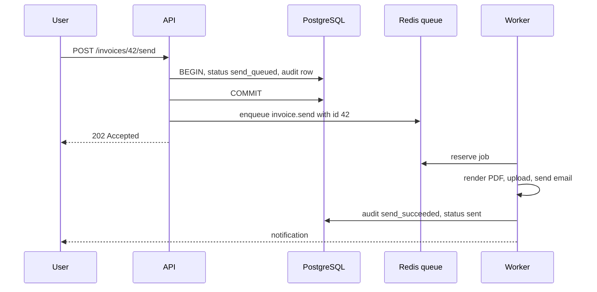
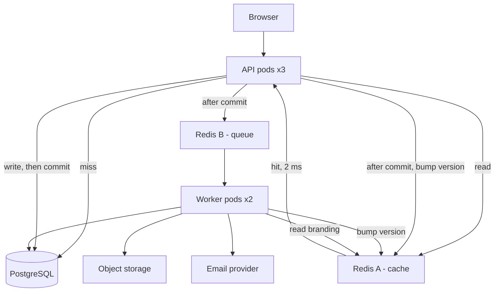

# The Feature and the Plan

This folder builds one thing. Before any of it is written, this file decides
what it should be. That decision is made on paper, in a fixed order, with a
table at every step — because the expensive mistakes in caching and background
work are made before the first line of code, not inside it.

Nothing here is new material. Every rule used below already has a file in this
track. This file is the part where you stop reading about the rules and apply
them to one real feature.

> **📌 In one line:** design the cache keys, the staleness budget and the job
> boundary before you write the feature, and most of the hard problems in the
> three previous folders never get a chance to happen.

## Table of Contents

1. [The Feature](#the-feature)
2. [Step 1: What Does This Cost Today](#step-1-what-does-this-cost-today)
3. [Step 2: Is Caching Even the Right Answer](#step-2-is-caching-even-the-right-answer)
4. [Step 3: The Staleness Budget, Field by Field](#step-3-the-staleness-budget-field-by-field)
5. [Step 4: Where the Request Ends](#step-4-where-the-request-ends)
6. [Artefact 1: The Architecture](#artefact-1-the-architecture)
7. [Artefact 2: Every Cache Key](#artefact-2-every-cache-key)
8. [Artefact 3: Every Job](#artefact-3-every-job)
9. [What I Deliberately Did Not Do](#what-i-deliberately-did-not-do)
10. [The Checklist You Implement in File 02](#the-checklist-you-implement-in-file-02)
11. [Common Mistakes](#common-mistakes)
12. [Questions to Test Yourself](#questions-to-test-yourself)
13. [Related](#related)

---

## The Feature

Two endpoints in the same SaaS product. They are chosen because they pull in
opposite directions: one is a read problem, one is a write problem.

| | `GET /companies/:id/dashboard` | `POST /invoices/:id/send` |
|---|---|---|
| What it returns | Project counts, task counts by status, last five invoices | `202 Accepted` and an invoice id |
| How often | ~40 times a minute at peak; every user opens it on login | ~30 times a day |
| Cost | 4 queries, ~800 ms at p95 | PDF render, an email provider call, an audit row |
| Changes | A few times an hour per company | Once per invoice, ever |
| Worst failure | Someone sees yesterday's task count | The customer is emailed the same invoice twice |

The dashboard is **expensive, read often, and changes occasionally** — the
classic shape of a caching candidate. Sending an invoice is **slow, depends on
a third party, and must not happen twice** — the classic shape of a job.

Neither of those sentences is a decision yet. They are a reason to look.

---

## Step 1: What Does This Cost Today

Measure first. Not because measuring is virtuous, but because the number tells
you which of the three folders you actually need.

Turn on query logging for one request and count what the endpoint really does.
This is the smallest useful version:

```ts
// app/middleware/query_log_middleware.ts
// Temporary. Counts and times every query for one request, then logs the total.
export default class QueryLogMiddleware {
  async handle(ctx: HttpContext, next: NextFn) {
    const queries: Array<{ sql: string; ms: number }> = []
    const off = db.on('query', (q) => queries.push({ sql: q.sql, ms: q.duration }))

    await next()

    off()
    logger.info(
      { count: queries.length, totalMs: queries.reduce((a, q) => a + q.ms, 0), queries },
      'request.queries',
    )
  }
}
```

One request to the dashboard produces this:

```text
request.queries  count=4  totalMs=793
  1   180ms  select status, count(*) from projects where company_id = $1 group by status
  2   518ms  select t.status, count(*) from tasks t join projects p on ... where p.company_id = $1 ...
  3    68ms  select * from invoices where company_id = $1 order by issued_at desc limit 5
  4    27ms  select * from companies where id = $1
```

Four queries, 793 ms of database time. Now the important part — **a total is
not a diagnosis**. Break it down:

| # | Query | p95 | First suspicion |
|---|---|---|---|
| 1 | Project counts by status | 180 ms | Filtering `projects` by `company_id` with no index for it |
| 2 | Task counts by status across the company | 518 ms | Aggregating ~180,000 task rows through a join |
| 3 | Last five invoices | 68 ms | Sorting the whole `invoices` table to take 5 rows |
| 4 | Company row | 27 ms | Primary-key lookup, already fine |

Reading a plan and turning a suspicion into a fact is
[slow-query-fixes.md](../../databases/query-optimization/slow-query-fixes.md).
Do that now, before the next section, because the next section depends on it.

> **💡 Tip:** also check whether the 4 queries are really 4. If the invoice list
> loads a `customer` relation per row, that is 9 queries, and the problem is
> [an N+1](../../databases/query-optimization/n-plus-one-queries.md), not a
> missing cache.

---

## Step 2: Is Caching Even the Right Answer

**This is the most important section in this folder.** Everything after it is
mechanics.

[When to Cache](../01-caching-in-practice/01-when-to-cache.md) says it in one
line: a cache does not make a query faster, it makes the query run less often.
So before trading freshness for speed, make the query itself as fast as it can
be — that win is permanent, costs no staleness, and helps every request rather
than the lucky ones that hit.

Run `EXPLAIN (ANALYZE, BUFFERS)` on query 1:

```text
HashAggregate  (cost=4821.00..4821.04 rows=4 width=15) (actual time=178.9..178.9 rows=4)
  ->  Seq Scan on projects  (cost=0.00..4702.00 rows=23800 width=7)
        Filter: (company_id = 42)
        Rows Removed by Filter: 196200
```

196,200 rows read and thrown away to count 23,800. That is not a caching
problem. That is a missing index, and the same is true of query 3.

| # | Query | Before | Fix | After | Still worth caching? |
|---|---|---|---|---|---|
| 1 | Project counts | 180 ms | `create index on projects (company_id, status)` | **4 ms** | No |
| 2 | Task counts | 518 ms | `create index on tasks (project_id, status)` | **196 ms** | **Yes** |
| 3 | Last five invoices | 68 ms | `create index on invoices (company_id, issued_at desc)` | **5 ms** | No |
| 4 | Company row | 27 ms | Nothing; already a primary-key lookup | 27 ms | No |

Do the arithmetic honestly:

```text
  before            793 ms
  after 3 indexes   232 ms      <- two one-line migrations, zero staleness
  after caching #2   40 ms      <- a whole new dependency and a correctness debt
```

**The indexes bought 561 ms. The cache buys 192 ms.** The cheap fix was three
times bigger than the expensive one. If you had added Redis first you would
have shipped a 232 ms improvement, called it a 753 ms improvement, and still
been sitting on three missing indexes — which would surface later on a
different endpoint, at a worse hour.

Why does query 2 survive the index? Because the index narrows which task rows
are read, but the work is still *counting 180,000 of them*. No index makes an
aggregate over a large row set cheap. That is the real signature of a caching
candidate: **expensive because of how much data it touches, not because of how
badly it reaches it.**

```ts
// ❌ BROKEN - the cache hides four problems and fixes none of them
const dashboard = await remember({ key: `dashboard:${companyId}`, ttlSeconds: 60 }, loadDashboard)

// ✅ FIXED - index the three cheap wins, cache only the aggregate that stays expensive
const taskCounts = await remember({ key: taskCountsKey, ttlSeconds: 120 }, loadTaskCounts)
```

> **📌 Remember:** the question is never "is this endpoint slow?" It is "is this
> endpoint slow *after* the free fixes?" Only the remainder deserves a cache.

Partial and covering indexes, and why `(company_id, status)` is in that order,
are in [composite-index-ordering.md](../../databases/query-optimization/composite-index-ordering.md)
and [covering-indexes.md](../../databases/query-optimization/covering-indexes.md).

---

## Step 3: The Staleness Budget, Field by Field

The dashboard is not one piece of data. It is four, and they do not tolerate
the same staleness. Caching the whole response forces the strictest field's
budget onto everything, or quietly violates it.

Ask one question per field: **who notices if this is 60 seconds old, and what
does it cost them?**

| Field | Who notices | Staleness budget | Decision |
|---|---|---|---|
| Task counts by status | A manager watching progress; drifts all day anyway | 2 minutes | Cache, TTL 120 s, invalidate on task writes |
| Project counts | The person who just created a project, immediately | **0 s for their own write** | Not cached — 4 ms from the index |
| Last five invoices | Finance, right after sending one | **0 s for their own write** | Not cached — 5 ms from the index |
| Company name and plan | Everyone, rarely changes | Hours | Not cached — primary-key lookup is already 27 ms |
| Seat limit used for enforcement | Billing, at the moment of enforcement | **Never stale** | Must never be cached |

Three things fall out of this table.

**Read-your-own-writes is the strict constraint, not the average user.** Nobody
complains that a number is 90 seconds old. They complain that *the thing they
just did* is not there. That is why both fields with a zero budget are the ones
a user changes and then immediately looks at.

**A field you enforce a rule on cannot be cached.** If the seat limit decides
whether an invite succeeds, a stale copy means selling a seat you do not have
or blocking one you do. [When to Cache](../01-caching-in-practice/01-when-to-cache.md)
covers this class of data.

**The budget sets the TTL, not habit.** 120 seconds is chosen because two
minutes of drift on a progress count harms nobody. It is not chosen because 60
is a round number.

> **⚠️ Warning:** a TTL is the *maximum* staleness only if nothing else is
> broken. Invalidation is what keeps the typical case near zero. A TTL alone
> means every user sees stale data for up to the full TTL, every time.

---

## Step 4: Where the Request Ends

Now the write path. `POST /invoices/:id/send` currently does everything inline
and takes about nine seconds. Draw the boundary explicitly, step by step.

The rule from [Why Background Jobs](../03-background-jobs/01-why-background-jobs.md):
**stay in the request for anything the caller must learn right now, or anything
that must be durable before you answer. Everything else leaves.**

| Step | Cost | Inside the request? | Why |
|---|---|---|---|
| Load the invoice, check it belongs to the company | 3 ms | **Yes** | A 404 must be a 404, not an email that never arrives |
| Authorise the actor | 1 ms | **Yes** | A security decision is never deferred |
| Check status is `draft` or `issued` | 0 ms | **Yes** | The caller must be told "already sent" immediately |
| Set status to `send_queued`, insert audit row `send_requested` | 6 ms | **Yes, one transaction** | The durable record of intent; survives a crash one line later |
| Commit | 2 ms | **Yes** | The boundary |
| Enqueue `invoice.send` | 2 ms | **Immediately after commit** | Never inside the transaction |
| Respond `202 Accepted` | — | **Yes** | ~15 ms total |
| Render the PDF | 2.8 s | No | CPU heavy, no caller decision depends on it |
| Upload the PDF to object storage | 400 ms | No | Network, retryable |
| Call the email provider | 1.6 s | No | Third party, slow, fails in ways only a retry fixes |
| Insert audit row `send_succeeded` | 5 ms | No | It describes something that happened in the worker |
| Notify the sender it went out | 20 ms | No | The completion path, covered in file 02 |



Two details that are the whole reason this order is written down.

**The enqueue is after the commit, not inside it.** If it is inside, a
rollback leaves a job pointing at an invoice that does not exist in the state
the job expects. The failure mode and the outbox alternative are in
[Why Background Jobs](../03-background-jobs/01-why-background-jobs.md).

**The payload is the invoice id, not the invoice.** By the time the worker runs
the row may have changed, and a serialised copy inside the queue is a second
source of truth that nobody updates. See
[Anatomy of a Job System — Part 1](../03-background-jobs/02-anatomy-of-a-job-system-part-1.md).

---

## Artefact 1: The Architecture



Read it as three independent paths. The cache path can fail and leave the read
path slower. The queue path can fail and leave writes durable but unprocessed.
Neither can take the database down with it. That separation is the design.

---

## Artefact 2: Every Cache Key

Every key the application can produce, in one table. If a key is not here, it
does not exist; if it is here, something invalidates it.

| Key | Holds | TTL | Invalidation trigger |
|---|---|---|---|
| `app:v1:company:{id}:dash:ver` | Generation counter for the dashboard family | None | `INCR` on any dashboard write |
| `app:v1:company:{id}:dash:g{ver}:task-counts:range:{range}` | Task counts by status for one range | 120 s ± 20% jitter | Generation bump |
| `app:v1:company:{id}:invoice-branding` | Logo URL, address, footer, used by the worker | 3600 s ± 20% jitter | `DEL` on company settings update |
| *(not cached)* company row, plan limits, project counts, invoice list | — | — | Deliberately read live |

Three decisions encoded in that table.

**The counts key varies by `range`** (`7d`, `30d`, `all`), and tomorrow it will
vary by something else. You cannot list those keys to delete them, so the
family carries a generation number and one `INCR` retires all of them at once.
That is the versioned-collection approach from
[Invalidation in Practice — Part 2](../01-caching-in-practice/03-invalidation-in-practice-part-2.md).

**The branding key is read by the worker, not the API.** A cache is not a
request-path tool. The worker reads the same five fields on every send and they
change twice a year.

**Every TTL carries jitter**, so 400 keys written in the same minute do not
expire in the same second. Why that matters is
[Stampede and Failure Modes — Part 1](../01-caching-in-practice/04-stampede-and-failure-modes-part-1.md).

---

## Artefact 3: Every Job

| | `invoice.send` | `dashboard.warm` |
|---|---|---|
| Queue | `invoices` | `maintenance` |
| Trigger | After commit in `POST /invoices/:id/send` | Repeatable, every 2 minutes |
| Payload | `{ invoiceId, requestId }` | `{ limit: 50 }` |
| Attempts | 5 | 1 |
| Backoff | Exponential, base 2 s, cap 60 s, full jitter | None |
| Idempotency key | `invoice-send:{invoiceId}` plus the provider's own key | Naturally idempotent — it only writes cache entries |
| Timeout | 60 s | 30 s |
| On permanent error | No retry: dead-letter, status `send_failed` | Log and skip |
| On attempts exhausted | DLQ `invoices-dlq`, status `send_failed`, notify the sender | — |
| Overlap protection | One claim row per invoice | A lock, because two instances will run the schedule |

`invoice.send` does three things in one job rather than three chained jobs. Each
handoff between jobs is another at-least-once boundary and another place to
lose context, and the PDF is checkpointed in object storage so a retry after a
successful render does not render again. Retry policy and dead-letter design
are in [Retries, Backoff and Dead Letter — Part 1](../03-background-jobs/04-retries-backoff-and-dead-letter-part-1.md);
the duplicate-run rules are in
[Idempotent Jobs — Part 1](../03-background-jobs/05-idempotent-jobs-part-1.md).

---

## What I Deliberately Did Not Do

A design is also the list of things you rejected. Write it down, because in six
months someone will ask why.

| Rejected | Why |
|---|---|
| **Write-through cache** | It makes every write slower and depends on the cache being up to accept a write. Deleting on write is simpler and fails safe. The pattern itself is in [caching-strategies.md](../../system-design/foundational/caching-strategies.md). |
| **In-process memory cache** | Three API pods means three copies, and an invalidation reaching one pod leaves two serving old data for the full TTL. Two-level caching and its cost are in [Invalidation — Part 2](../01-caching-in-practice/03-invalidation-in-practice-part-2.md). |
| **One Redis for cache and queue** | Memory pressure plus an eviction policy deletes jobs. A cache wants `allkeys-lru`; a queue needs `noeviction`. Those are incompatible on one instance — [Memory and Operations — Part 1](../02-redis-in-practice/05-memory-and-operations-part-1.md). |
| **Caching the plan limits** | They are enforced on. A stale limit sells a seat that does not exist. |
| **Serving the dashboard from a read replica** | Replication lag reintroduces exactly the read-your-own-writes problem the staleness table protects — [read replicas and replication lag](../../databases/operations/04-read-replicas-and-replication-lag.md). |
| **A separate `invoice.render-pdf` job** | A second at-least-once boundary for no gain; the render is already checkpointed. |

> **📌 Remember:** two Redis instances is not over-engineering. It is the one
> piece of infrastructure this whole track tells you not to share, and file 03
> makes you watch what happens when you do.

---

## The Checklist You Implement in File 02

Work down this list in order. Each line is a step in
[Building It — Part 1](./02-building-it-part-1.md) and
[Part 2](./02-building-it-part-2.md).

- [ ] Three index migrations shipped and verified with `EXPLAIN` **before** any Redis
- [ ] A service layer that returns the correct dashboard with no cache and no queue
- [ ] One shared Redis client per role, with timeouts and an error handler that does not crash the process
- [ ] Cache-aside on the task-count fragment, with a key builder that requires `companyId`
- [ ] Invalidation on every write path that touches it, placed **after** commit
- [ ] The queue, with the enqueue after commit and the invoice id as the payload
- [ ] A worker with concurrency sized against the database pool and graceful shutdown
- [ ] The job made idempotent: claim row plus the provider's idempotency key
- [ ] Retries with jittered backoff, and a defined destination for a job that gives up
- [ ] A completion path so the user learns the invoice was sent
- [ ] Cache hit ratio, job duration, queue depth, and a request id threaded end to end

---

## Common Mistakes

| Mistake | Why it is wrong | Do this instead |
|---|---|---|
| Adding Redis before reading the query plan | Hides missing indexes that cost more than the cache saves | `EXPLAIN` first, cache the remainder |
| Caching the whole endpoint response | Forces the strictest field's staleness budget onto all fields, or violates it | Cache only the fragment that is genuinely expensive |
| Picking a TTL by habit | 300 s is not a decision, it is a default | Derive the TTL from who notices and what it costs them |
| Caching a value you enforce a rule on | Sells seats you do not have | Read enforcement data live |
| Enqueueing inside the transaction | The job can run against a rolled-back row | Enqueue after commit |
| Putting the whole object in the payload | A second source of truth nobody updates | Send the id |
| Not writing down what you rejected | The same debate restarts every quarter | Keep the "did not do" table next to the design |
| One Redis for cache and queue | Eviction silently deletes jobs | Two instances, two eviction policies |

## Questions to Test Yourself

1. The dashboard was 793 ms and is now 232 ms without any cache. Explain, from
   the plan output, where the 561 ms went.
2. Query 2 is still 196 ms after its index. What property makes it a genuine
   caching candidate when query 1 is not?
3. Two fields on the same page have staleness budgets of 120 seconds and 0
   seconds. What goes wrong if you cache the whole response for 120 seconds?
4. Why is "read your own writes" the binding constraint rather than the average
   user's tolerance?
5. Name the exact moment the `invoice.send` job is enqueued, and describe the
   bug that appears if you move it one line earlier.
6. The task-counts key contains `g{ver}`. What problem does that solve that a
   list of `DEL` calls cannot?
7. Give two reasons the cache and the queue are on different Redis instances.
   One is about eviction. What is the other?
8. Which single field in the dashboard must never be cached, and why is that a
   correctness argument rather than a performance one?

## Related

- [Building It — Part 1](./02-building-it-part-1.md) — the service layer, the
  Redis client, cache-aside, invalidation, and the enqueue.
- [Breaking It on Purpose](./03-breaking-it-on-purpose.md) — the drills that
  prove the decisions on this page were real.
- [When to Cache](../01-caching-in-practice/01-when-to-cache.md) — the decision
  framework applied in step 2.
- [Why Background Jobs](../03-background-jobs/01-why-background-jobs.md) — the
  rule used to draw the boundary in step 4.
- [slow-query-fixes.md](../../databases/query-optimization/slow-query-fixes.md)
  — how step 1 turns a slow endpoint into a plan you can act on.
- [Memory and Operations — Part 1](../02-redis-in-practice/05-memory-and-operations-part-1.md)
  — why the queue gets its own Redis.
