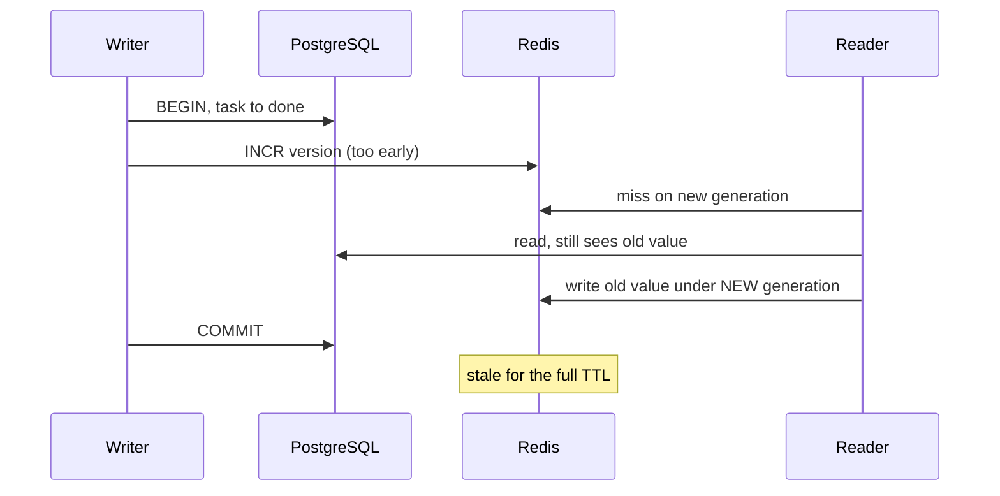

# Building It — Part 1

This is the plan from [file 01](./01-the-feature-and-the-plan.md) turned into
code, in the order you would really write it. Part 1 covers the read path and
the enqueue: a correct service with no cache and no queue, the Redis client,
cache-aside, invalidation, and producing the job. Part 2 covers the worker and
everything around it.

Every step is the same shape: **the code, one sentence on why, and a link to
the file that already explains it.** Nothing is taught twice. If a step feels
thin, the link is where the depth is.

> **📌 In one line:** build the correct version first, then add the cache, then
> the invalidation, then the queue — in that order, because each step is only
> safe if the one before it is already right.

## Table of Contents

1. [The Shape of the Code](#the-shape-of-the-code)
2. [Step 0: The Indexes, Before Anything Else](#step-0-the-indexes-before-anything-else)
3. [Step 1: The Service Layer, No Cache, No Queue](#step-1-the-service-layer-no-cache-no-queue)
4. [Step 2: The Redis Clients](#step-2-the-redis-clients)
5. [Step 3: Cache-Aside on the Dashboard Read](#step-3-cache-aside-on-the-dashboard-read)
6. [Step 4: Invalidation, After Commit](#step-4-invalidation-after-commit)
7. [Step 5: The Queue and the Producer](#step-5-the-queue-and-the-producer)
8. [Common Mistakes](#common-mistakes)
9. [Questions to Test Yourself](#questions-to-test-yourself)
10. [Related](#related)

---

## The Shape of the Code

Decide where things live before writing them, so the cache does not end up in a
controller.

```text
app/
  controllers/
    dashboard_controller.ts      HTTP only: parse, authorise, call a service
    invoices_controller.ts
  services/
    dashboard_service.ts         the business logic, cache-aware
    invoice_service.ts           the write path, transaction + enqueue
    cache/
      redis.ts                   one shared client for the cache
      keys.ts                    every cache key the app can produce
      remember.ts                the cache-aside helper
      invalidate.ts              one function per entity
  jobs/
    queues.ts                    queue instances, on the OTHER Redis
    invoice_send.ts              the handler, imported by the worker
bin/
  worker.ts                      a separate process
```

The controller never touches Redis. The service decides. That boundary is
[the service layer](../../backend-fundamentals/09-application-architecture/02-service-layer-part-1.md),
and it is what makes every later step a change in one file.

---

## Step 0: The Indexes, Before Anything Else

File 01 found that three of the four dashboard queries were index problems.
Ship those first, because the next steps are measured against them.

```sql
-- database/migrations/1720000000_dashboard_indexes.sql
create index concurrently if not exists projects_company_status_idx
  on projects (company_id, status);

create index concurrently if not exists tasks_project_status_idx
  on tasks (project_id, status);

create index concurrently if not exists invoices_company_issued_idx
  on invoices (company_id, issued_at desc);
```

`concurrently` keeps the table writable while the index builds, which matters
on a live table — see [migrations — part 2](../../backend-fundamentals/10-database-integration/02-migrations-part-2.md).

Re-run the measurement from file 01 before moving on. If the endpoint is now
fast enough, **stop here**. A feature that does not need a cache is the best
outcome this folder can produce.

---

## Step 1: The Service Layer, No Cache, No Queue

Write the correct version first. You cannot tell whether a cache is returning
the right answer until you have something to compare it against, and you cannot
test the worker's logic until the logic exists somewhere simpler.

```ts
// app/services/dashboard_service.ts
import type { DashboardRange, Dashboard } from './types.js'

export class DashboardService {
  /** The plain version: four queries, no cache. This stays the source of truth. */
  async load(companyId: number, range: DashboardRange): Promise<Dashboard> {
    const [company, projectCounts, taskCounts, invoices] = await Promise.all([
      this.companies.findOrFail(companyId),
      this.projects.countByStatus(companyId),
      this.tasks.countByStatus(companyId, range),
      this.invoices.latest(companyId, 5),
    ])

    return { company, projectCounts, taskCounts, invoices }
  }
}
```

Two things to notice. `Promise.all` is free parallelism — four queries that do
not depend on each other should not run one after another. And **every query
takes `companyId`**: the tenant filter is a parameter of the repository method,
not something a caller can forget.

The write path, equally plain for now:

```ts
// app/services/invoice_service.ts
export class InvoiceService {
  async requestSend(invoiceId: number, companyId: number, actorId: number) {
    const invoice = await this.invoices.findForCompany(invoiceId, companyId)
    if (invoice.status !== 'draft' && invoice.status !== 'issued') {
      throw new InvoiceAlreadySentError(invoiceId) // a 409, decided in the request
    }

    await db.transaction(async (trx) => {
      await this.invoices.setStatus(trx, invoiceId, 'send_queued')
      await this.audit.record(trx, { invoiceId, actorId, event: 'send_requested' })
    })

    return invoice
  }
}
```

The validity check happens before the transaction and returns an error the
caller can act on. Everything slow is still missing, and that is deliberate.

> **💡 Tip:** commit this. A reviewable "correct but slow" commit is the thing
> you diff against when the cached version returns something strange.

---

## Step 2: The Redis Clients

Two clients, because file 01 decided on two instances. Both are created once at
startup and shared — a client per request exhausts sockets.

```ts
// app/services/cache/redis.ts
import Redis from 'ioredis'
import logger from '#services/logger'

export const cacheRedis = new Redis(env.CACHE_REDIS_URL, {
  commandTimeout: 150,        // a cache must never be slower than the database
  maxRetriesPerRequest: 1,    // fail fast; the database is the fallback
  lazyConnect: false,
})

// Without this listener, a connection error is an unhandled 'error' event and
// Node kills the process. The cache going down must not take the API with it.
cacheRedis.on('error', (err) => logger.warn({ err }, 'cache.redis.error'))
```

`commandTimeout: 150` is the single most important line. It converts "Redis is
hanging" into "this request missed the cache", which is the behaviour file 03
drills. The full reasoning, including why BullMQ needs different options, is in
[Connecting to Redis — Part 1](../02-redis-in-practice/01-connecting-to-redis-part-1.md).

```ts
// app/jobs/queues.ts
import { Queue } from 'bullmq'
import Redis from 'ioredis'

// A SECOND instance. Different URL, different eviction policy, different failure.
export const queueRedis = new Redis(env.QUEUE_REDIS_URL, {
  maxRetriesPerRequest: null, // BullMQ's blocking commands require this
  enableReadyCheck: false,
})
queueRedis.on('error', (err) => logger.error({ err }, 'queue.redis.error'))

export const invoiceQueue = new Queue('invoices', { connection: queueRedis })
export const maintenanceQueue = new Queue('maintenance', { connection: queueRedis })
```

Note the different log levels. A cache error is a `warn` — the request still
works. A queue error is an `error` — work is being lost.

---

## Step 3: Cache-Aside on the Dashboard Read

Only the task-count fragment is cached. The key builder lives in one file and
takes `companyId` as its first required argument.

```ts
// app/services/cache/keys.ts
export const cacheKeys = {
  dashboardVersion: (companyId: number) =>
    `app:v1:company:${companyId}:dash:ver`,

  // companyId is required and first. A key without it can serve another
  // tenant's numbers, which is a data leak, not a cache bug.
  dashboardTaskCounts: (companyId: number, ver: number, range: DashboardRange) =>
    `app:v1:company:${companyId}:dash:g${ver}:task-counts:range:${range}`,

  invoiceBranding: (companyId: number) =>
    `app:v1:company:${companyId}:invoice-branding`,
} as const
```

TypeScript is doing real work here: `dashboardTaskCounts` cannot be called
without a `companyId`, so the cross-tenant leak is a compile error rather than
a code-review habit. Key design in full is
[Implementing Cache-Aside — Part 1](../01-caching-in-practice/02-implementing-cache-aside-part-1.md).

Now the read path, using the `remember` helper from that same file:

```ts
// app/services/dashboard_service.ts
async load(companyId: number, range: DashboardRange): Promise<Dashboard> {
  const ver = await this.dashboardVersion(companyId)

  const [company, projectCounts, taskCounts, invoices] = await Promise.all([
    this.companies.findOrFail(companyId),
    this.projects.countByStatus(companyId),             // 4 ms, not cached
    remember(
      {
        key: cacheKeys.dashboardTaskCounts(companyId, ver, range),
        ttlSeconds: jittered(120),                      // ±20%, so keys do not expire together
        revive: reviveTaskCounts,                       // JSON.parse returns unknown
      },
      () => this.tasks.countByStatus(companyId, range), // 196 ms, cached
    ),
    this.invoices.latest(companyId, 5),                 // 5 ms, not cached
  ])

  return { company, projectCounts, taskCounts, invoices }
}
```

The diff from step 1 is one argument out of four. That is what the service
layer bought you.

```ts
// app/services/cache/version.ts
/** Missing counter means generation 1. A cache read must never throw. */
async function dashboardVersion(companyId: number): Promise<number> {
  try {
    const raw = await cacheRedis.get(cacheKeys.dashboardVersion(companyId))
    return raw === null ? 1 : Number(raw)
  } catch {
    return 1 // Redis is down: serve from the database, do not fail the request
  }
}
```

> **⚠️ Warning:** if the version lookup throws, the whole dashboard 500s and
> your cache is now load-bearing. Catching here is what makes the first drill in
> [file 03](./03-breaking-it-on-purpose.md) pass.

Jitter, the revive step and metrics are covered in
[Cache-Aside — Part 2](../01-caching-in-practice/02-implementing-cache-aside-part-2.md).

---

## Step 4: Invalidation, After Commit

Every write that changes a task's status changes the cached counts. Name those
paths once, in one function, instead of scattering `del` calls.

```ts
// app/services/cache/invalidate.ts
/** Every write that affects the dashboard calls exactly this. */
export async function invalidateDashboard(companyId: number): Promise<void> {
  try {
    // INCR retires every key in the family: all ranges, all future filters.
    await cacheRedis.incr(cacheKeys.dashboardVersion(companyId))
  } catch (err) {
    // A failed invalidation is serious. Log it loudly; do not fail the write.
    logger.error({ err, companyId }, 'cache.invalidate.failed')
  }
}
```

One `INCR` covers `range=7d`, `range=30d`, `range=all`, and whatever filter
gets added next quarter. That is the versioned-collection approach from
[Invalidation in Practice — Part 2](../01-caching-in-practice/03-invalidation-in-practice-part-2.md);
why deleting beats updating, and why this must not run inside the transaction,
are in [Part 1](../01-caching-in-practice/03-invalidation-in-practice-part-1.md).

Placement is the part people get wrong:

```ts
// ❌ BROKEN - invalidated inside the transaction
await db.transaction(async (trx) => {
  await this.tasks.setStatus(trx, taskId, 'done')
  await invalidateDashboard(companyId)   // a concurrent read repopulates the
})                                       // OLD value before this commits

// ✅ FIXED - invalidate after the commit returns
await db.transaction(async (trx) => {
  await this.tasks.setStatus(trx, taskId, 'done')
})
await invalidateDashboard(companyId)
```

Inside the transaction, another request can miss the cache, read the
pre-commit value, and write it back — after your bump. The cache is then stale
until the TTL expires, and nothing in the logs says why.



> **📌 Remember:** the bug is not the `INCR`. It is that the `INCR` happened
> while the old value was still the only committed truth.

---

## Step 5: The Queue and the Producer

The enqueue goes immediately after the commit, and the payload is an id.

```ts
// app/services/invoice_service.ts
async requestSend(invoiceId: number, companyId: number, actorId: number, requestId: string) {
  const invoice = await this.invoices.findForCompany(invoiceId, companyId)
  if (invoice.status !== 'draft' && invoice.status !== 'issued') {
    throw new InvoiceAlreadySentError(invoiceId)
  }

  await db.transaction(async (trx) => {
    await this.invoices.setStatus(trx, invoiceId, 'send_queued')
    await this.audit.record(trx, { invoiceId, actorId, event: 'send_requested' })
  })
  // The commit has returned. Only now does the job exist.

  await invoiceQueue.add(
    'invoice.send',
    { invoiceId, companyId, actorId, requestId }, // ids and context, never the row
    {
      jobId: `invoice-send:${invoiceId}`, // the queue's own duplicate guard
      attempts: 5,
      backoff: { type: 'exponential', delay: 2000 },
      removeOnComplete: { age: 86_400, count: 1000 },
      removeOnFail: false,                // keep failures: they are the DLQ input
    },
  )

  return invoice
}
```

Four options worth naming:

| Option | Why it is there |
|---|---|
| `jobId` | A deterministic id means a double click does not create two jobs. It is a convenience, not the idempotency guarantee — that is step 7. |
| `attempts: 5` | Chosen in file 01 from how long the provider is usually down. |
| `removeOnComplete` | Without it, completed jobs accumulate in Redis until memory runs out. |
| `removeOnFail: false` | A failed job you deleted is a failure you cannot investigate. |

And the typed payload, so the worker and the producer cannot drift apart:

```ts
// app/jobs/types.ts
export type InvoiceSendPayload = {
  invoiceId: number
  companyId: number
  actorId: number     // who asked, so the worker can notify them at the end
  requestId: string   // carried from the HTTP request into the worker's logs
}
```

`requestId` travels with the job on purpose. It is what lets you follow one
user action from the API log into the worker log — picked up again in part 2.
Typed payloads, at-least-once delivery and queue splitting are in
[Anatomy of a Job System — Part 2](../03-background-jobs/02-anatomy-of-a-job-system-part-2.md);
the enqueue-after-commit rule and the outbox alternative are in
[Part 1](../03-background-jobs/02-anatomy-of-a-job-system-part-1.md).

At this point the API is finished. Nothing consumes the queue yet, so jobs pile
up — which is exactly what you should see if you look.

> **➡️ Continued in [Part 2](./02-building-it-part-2.md)** — the worker,
> idempotency, retries, the completion path, metrics, and a `docker-compose`
> file that runs all of it locally.

---

## Common Mistakes

| Mistake | Why it is wrong | Do this instead |
|---|---|---|
| Adding the cache before the service is correct | You cannot tell a cache bug from a logic bug | Ship the plain version first |
| `new Redis()` inside a handler | A handshake per request, then socket exhaustion | One shared client per role |
| No `error` listener on the client | Node kills the process on an unhandled error event | Attach one at creation |
| No `commandTimeout` | A hanging Redis hangs every request | 100–200 ms; the database is the fallback |
| Building a key with a template literal at the call site | A typo creates a key family nobody invalidates | One `keys.ts` with builders |
| A key builder where `companyId` is optional | One tenant's numbers served to another | Make it required and first |
| Invalidating inside the transaction | A concurrent reader repopulates the old value | Invalidate after commit returns |
| Enqueueing inside the transaction | The job can run for a rolled-back row | Enqueue after commit |
| Putting the invoice object in the payload | A stale copy the worker trusts | Send the id |
| No `removeOnComplete` | Finished jobs fill Redis | Cap by age and count |

## Questions to Test Yourself

1. Why does step 1 exist at all? What can you not do if you skip it?
2. What exactly happens to an incoming request if `commandTimeout` is missing
   and Redis stops responding but keeps the socket open?
3. Why are there two Redis clients with different `maxRetriesPerRequest`?
4. `dashboardVersion` catches and returns 1 on error. Describe the request flow
   after that, and say why it is the correct behaviour.
5. Draw the timeline of the invalidate-inside-transaction bug. Which process
   writes the stale value, and when?
6. One `INCR` replaces how many `DEL` calls in this design, and what happens to
   that number when a new dashboard filter ships?
7. `jobId` deduplicates, so why is step 7 of part 2 still necessary?
8. What breaks if the producer sends the whole invoice object and the worker
   runs four minutes later?

## Related

- [The Feature and the Plan](./01-the-feature-and-the-plan.md) — the design
  this file implements.
- [Building It — Part 2](./02-building-it-part-2.md) — the worker and
  everything that keeps it honest.
- [the service layer](../../backend-fundamentals/09-application-architecture/02-service-layer-part-1.md)
  — why the cache lives here and not in a controller.
- [Connecting to Redis — Part 1](../02-redis-in-practice/01-connecting-to-redis-part-1.md)
  — the client options used in step 2.
- [Implementing Cache-Aside — Part 1](../01-caching-in-practice/02-implementing-cache-aside-part-1.md)
  — the `remember` helper and key design.
- [Invalidation in Practice — Part 1](../01-caching-in-practice/03-invalidation-in-practice-part-1.md)
  and [Part 2](../01-caching-in-practice/03-invalidation-in-practice-part-2.md)
  — placement, and the versioned collection.
- [Anatomy of a Job System — Part 1](../03-background-jobs/02-anatomy-of-a-job-system-part-1.md)
  — the producer rules applied in step 5.
