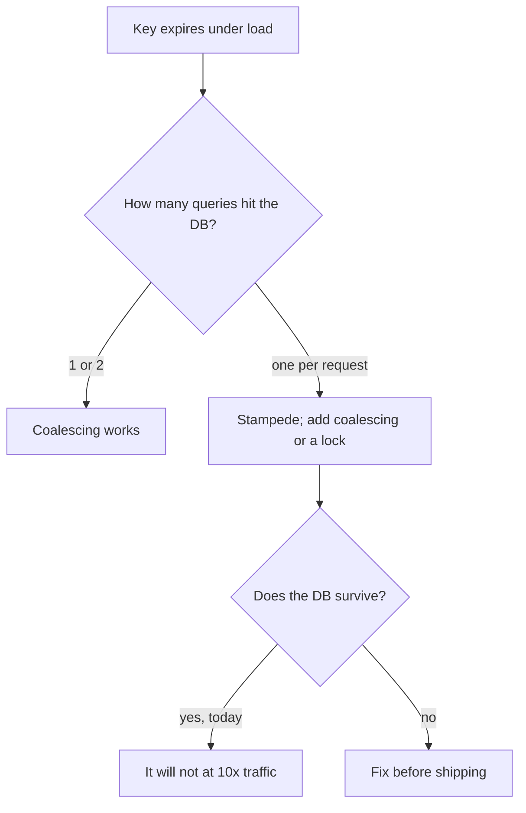

# Breaking It on Purpose

The build from file 02 works. That is not the same as being correct. Every
design decision in [file 01](./01-the-feature-and-the-plan.md) was a claim
about how the system behaves when something goes wrong, and none of those
claims has been tested.

This file is nine deliberate failures, run against your own running stack. Each
one has an expected observation. The value is not in the drills that pass — it
is in the one that does not, because that is a production incident you found on
a Tuesday afternoon instead of at 3 AM.

> **📌 In one line:** you do not know what your system does when Redis dies
> until you have killed Redis while it was serving traffic and watched what
> happened.

## Table of Contents

1. [How to Run a Drill](#how-to-run-a-drill)
2. [Drill 1: Kill Redis While Serving Traffic](#drill-1-kill-redis-while-serving-traffic)
3. [Drill 2: Expire a Hot Key Under Load](#drill-2-expire-a-hot-key-under-load)
4. [Drill 3: Write, Then Immediately Read](#drill-3-write-then-immediately-read)
5. [Drill 4: SIGKILL the Worker Mid-Job](#drill-4-sigkill-the-worker-mid-job)
6. [Drill 5: Stop the Worker, Keep Enqueueing](#drill-5-stop-the-worker-keep-enqueueing)
7. [Drill 6: Make the Email Provider Fail for Two Minutes](#drill-6-make-the-email-provider-fail-for-two-minutes)
8. [Drill 7: Enqueue a Malformed Job](#drill-7-enqueue-a-malformed-job)
9. [Drill 8: One Redis for Both, Then Fill It](#drill-8-one-redis-for-both-then-fill-it)
10. [Drill 9: Run the Scheduled Job on Two Instances](#drill-9-run-the-scheduled-job-on-two-instances)
11. [You Are Done When](#you-are-done-when)
12. [Common Mistakes](#common-mistakes)
13. [Questions to Test Yourself](#questions-to-test-yourself)
14. [Related](#related)

---

## How to Run a Drill

Three rules, or the results mean nothing.

1. **Keep traffic running.** A failure with no load is a different failure. Use
   anything that holds a steady rate: `autocannon -c 10 -d 60 <url>` is enough.
2. **Watch the logs and the metrics, not the terminal you broke.** The question
   is what the *user* saw, which lives in your status codes and latencies.
3. **Write down the prediction first.** If you only look afterwards you will
   explain whatever you find as expected.

| # | Drill | The claim it tests | Most common failure |
|---|---|---|---|
| 1 | Kill Redis | The cache is optional | Unhandled error, 500s |
| 2 | Expire a hot key | One miss is not a stampede | Hundreds of identical queries |
| 3 | Write then read | Invalidation is correct and ordered | Stale for the full TTL |
| 4 | `SIGKILL` the worker | The job is idempotent | **A second email** |
| 5 | Stop the worker | Monitoring notices | Nobody notices for hours |
| 6 | Provider returns 500 | Backoff with jitter works | A retry storm |
| 7 | Malformed job | Poison messages are contained | The worker crash-loops |
| 8 | Shared Redis, full | Jobs are not evictable | Jobs silently disappear |
| 9 | Two scheduler instances | The schedule runs once | It runs twice |

> **⚠️ Warning:** run these against local or staging, never production, and
> make sure your email provider is in test mode before drills 4, 6 and 7.

---

## Drill 1: Kill Redis While Serving Traffic

**Do this.** Start load against `GET /companies/42/dashboard`, then:

```text
$ docker compose stop redis-cache
```

**You should see.** p95 latency rises from ~40 ms to ~230 ms — the uncached
cost from file 01. Status codes stay 200. The log fills with `cache.redis.error`
at `warn` level. Nothing pages anyone.

**If you see something else.**

| Observation | What it means | Fix |
|---|---|---|
| 500s on the dashboard | A cache read is not wrapped; the cache is load-bearing | [Stampede and Failure Modes — Part 2](../01-caching-in-practice/04-stampede-and-failure-modes-part-2.md) |
| The API process exits | No `error` listener on the client | Attach one at creation (file 02, step 2) |
| Requests hang for 30 s | No `commandTimeout` | 100–200 ms, so a dead Redis is a miss |
| The database also falls over | Every request now runs the uncached query at full rate | Add a concurrency limit, then re-run |

```ts
// ❌ BROKEN - one unwrapped read makes the cache mandatory
const ver = Number(await cacheRedis.get(cacheKeys.dashboardVersion(companyId)))

// ✅ FIXED - Redis down means generation 1 and a database read, not a 500
try { ... } catch { return 1 }
```

**Then restart it** and confirm latency returns without a deploy. A cache that
needs a restart to recover is not failing open.

---

## Drill 2: Expire a Hot Key Under Load

**Do this.** With 10 concurrent clients hitting one company's dashboard, delete
the live key:

```text
$ docker compose exec redis-cache redis-cli --scan --pattern 'app:v1:company:42:dash:*'
app:v1:company:42:dash:g3:task-counts:range:30d
$ docker compose exec redis-cache redis-cli del app:v1:company:42:dash:g3:task-counts:range:30d
```

**You should see.** A single spike: a handful of slow requests, then back to
normal. In the database log, **one or two** executions of the task-count query,
not ten.

**If you see something else.** Ten identical 196 ms queries in the same
millisecond is a stampede in miniature. At 400 concurrent users it is an
outage. The defences — request coalescing, a short lock per key, probabilistic
early expiry, stale-while-revalidate — are in
[Stampede and Failure Modes — Part 1](../01-caching-in-practice/04-stampede-and-failure-modes-part-1.md).



> **💡 Tip:** also delete 50 keys at once to simulate an eviction wave. If every
> TTL carries jitter, the recovery is spread out instead of synchronised.

---

## Drill 3: Write, Then Immediately Read

**Do this.** In one script: move a task to `done`, then request the dashboard
with no delay.

```text
$ curl -XPATCH .../tasks/991 -d '{"status":"done"}' && curl -s .../companies/42/dashboard
```

**You should see.** The new count, on the first read, every time. Run it fifty
times in a loop — this is a race, and a race that fails one time in twenty
still fails.

**If you see something else.**

- **Stale sometimes, fresh sometimes.** The invalidation runs inside the
  transaction, so a concurrent reader repopulates the pre-commit value. Move it
  after the commit returns — [Invalidation in Practice — Part 1](../01-caching-in-practice/03-invalidation-in-practice-part-1.md).
- **Stale for exactly the TTL.** The write path does not invalidate at all. Find
  every path that touches tasks and route them through one function.
- **Only one range is fresh.** You are deleting named keys instead of bumping
  the generation. One `INCR` covers every variant —
  [Part 2](../01-caching-in-practice/03-invalidation-in-practice-part-2.md).

Repeat the drill for **every** write path: task status, task delete, project
archive, invoice sent. The one you forgot is the one that reaches support.

---

## Drill 4: SIGKILL the Worker Mid-Job

**The drill most likely to fail.** Everything before this is latency. This one
is a customer receiving the same invoice twice.

**Do this.** Add a temporary 5-second sleep after the provider call and before
the claim is marked done, then:

```text
$ curl -XPOST .../invoices/4821/send
$ docker compose kill -s SIGKILL worker      # during the sleep
$ docker compose start worker
```

**You should see.** The job retried on restart, `job.duplicate.skipped` or a
provider response saying the idempotency key was already used, and **exactly
one email** in the provider's test inbox.

**If you see something else.**

| Observation | Cause |
|---|---|
| Two emails | No idempotency key, or a new one per attempt |
| The job never retries | The lock duration is longer than you waited; BullMQ reclaims a stalled job after `lockDuration` |
| Every later attempt skips forever | A dead worker left `in_progress` and there is no sweeper |
| The invoice is stuck in `send_queued` | Nothing moves the status on the final failure |

The third row is the subtle one: a claim row with no release means the invoice
can never be sent again, by anyone. Claim tables, sweepers and the
claim-then-execute race are in
[Idempotent Jobs — Part 1](../03-background-jobs/05-idempotent-jobs-part-1.md).

Now run the same test with `SIGTERM` instead. The job should **finish**, not
retry — that is graceful shutdown working,
[Writing Reliable Workers — Part 2](../03-background-jobs/03-writing-reliable-workers-part-2.md).

---

## Drill 5: Stop the Worker, Keep Enqueueing

**Do this.** Stop the worker. Enqueue 200 jobs over ten minutes. Do not look at
the queue — look at your dashboards and your inbox.

```text
$ docker compose stop worker
$ for i in $(seq 1 200); do curl -s -XPOST .../invoices/$i/send; sleep 3; done
```

**You should see.** `queue.waiting` climbing steadily and
`queue.oldest_waiting_seconds` climbing linearly. An alert fires on the age
metric within a few minutes, without you looking.

**If you see something else.** If nothing alerted, the queue can be dead for a
full working day before anyone notices, and that is the failure this drill
exists to find.

**Alert on age, not depth.** A queue with 3 waiting jobs looks healthy; if the
oldest has waited 40 minutes, the worker is gone. Depth measures how busy you
are. Age measures whether anything is moving.

```text
$ docker compose exec redis-queue redis-cli llen bull:invoices:wait
(integer) 187
```

Then start the worker and watch it drain. Note the drain rate — that number is
your recovery time after any outage. Backlog recovery and the metrics worth
paging for are in
[Operating Queues — Part 1](../03-background-jobs/07-operating-queues-part-1.md).

---

## Drill 6: Make the Email Provider Fail for Two Minutes

**Do this.** Point the mailer at a local stub that returns 503 for 120 seconds
and then succeeds. Send 50 invoices into it.

**You should see.** Attempt 1 fails for all 50. Retries arrive **spread out**,
not in bursts. Every invoice eventually sends. The stub's request log shows a
roughly even rate, not 50 requests in one millisecond repeated four times.

**If you see something else.**

- **All 50 retry at the same instant.** Backoff has no jitter. You have built a
  synchronised hammer that keeps a recovering dependency down.
- **Retries every 2 seconds, forever.** The delay is fixed, not exponential.
- **Jobs dead-lettered before the stub recovered.** `attempts: 5` with base 2 s
  covers roughly 2+4+8+16 = 30 seconds of outage, not 120. Either raise the
  attempts or accept the dead letter and replay.

That last point is the real lesson: **your retry policy encodes an assumption
about how long your dependency is down.** Write that assumption next to the
number. The formula and the thundering-herd argument are in
[Retries, Backoff and Dead Letter — Part 1](../03-background-jobs/04-retries-backoff-and-dead-letter-part-1.md).

> **📌 Remember:** jitter is not an optimisation. Without it, retries turn one
> outage into a repeating outage.

---

## Drill 7: Enqueue a Malformed Job

**Do this.** Push a job whose payload cannot possibly work.

```text
$ docker compose exec redis-queue redis-cli \
    lpush bull:invoices:wait '{"name":"invoice.send","data":{"invoiceId":"not-a-number"}}'
```

**You should see.** One attempt, classified as permanent, moved straight to the
dead-letter queue. The worker logs an `error` and **keeps processing the next
job**. Total damage: one dead-lettered message.

**If you see something else.**

| Observation | What it means |
|---|---|
| The worker process exits | An unhandled throw outside the handler's try block |
| It crash-loops | The same message is reserved on every restart — a poison message |
| Five attempts over 30 s | The error is not classified; it is retried like a 503 |
| The whole queue stops | One bad message is blocking everything behind it |

A poison message is the only failure here that can stop *all* work. The
classification rule is simple: **if attempt 5 will fail identically to attempt
1, do not retry it.** Poison messages, DLQ design and replay are in
[Retries, Backoff and Dead Letter — Part 2](../03-background-jobs/04-retries-backoff-and-dead-letter-part-2.md).

Then replay it after fixing the payload, and confirm the replay is safe —
which it only is because of drill 4.

---

## Drill 8: One Redis for Both, Then Fill It

The trap this whole track warns about. Watch it happen once and you will never
argue about the second instance again.

**Do this.** Point `QUEUE_REDIS_URL` at the *cache* instance (128 MB,
`allkeys-lru`). Enqueue 100 jobs, stop the worker, then fill memory with cache
entries:

```text
$ docker compose exec redis-cache redis-cli debug populate 2000000 filler:
$ docker compose exec redis-cache redis-cli info stats | grep evicted_keys
evicted_keys:1184930
$ docker compose exec redis-cache redis-cli llen bull:invoices:wait
(integer) 61
```

**You should see.** The job count going **down** while nothing consumed it. 39
invoices will never be sent. No error, no log line, no failed job, no alert.
The evidence is a counter called `evicted_keys` that nobody watches.

**Why it happens.** `allkeys-lru` means *any* key may be deleted under memory
pressure, and BullMQ's state is ordinary Redis keys. The policies the two
workloads need are mutually exclusive:

| | Cache | Queue |
|---|---|---|
| Losing a key costs | A slower request | A job that never runs |
| Correct policy | `allkeys-lru` | `noeviction` |
| Correct persistence | None needed | AOF on |
| A big backlog means | — | Memory pressure on the cache |

**Now restore two instances** and repeat. The queue instance returns an OOM
error on `add` — loud, catchable, visible. That is the difference between a
failure and a silent loss. Full argument:
[Memory and Operations — Part 1](../02-redis-in-practice/05-memory-and-operations-part-1.md).

---

## Drill 9: Run the Scheduled Job on Two Instances

**Do this.** Start a second worker container, so `dashboard.warm` is registered
twice, and watch one two-minute tick.

```text
$ docker compose up -d --scale worker=2
$ docker compose logs -f worker | grep dashboard.warm
```

**You should see.** One execution per tick. With BullMQ's repeatable jobs the
scheduler deduplicates by key, so a second registration does not create a
second run.

**If you see something else.** Two executions per tick means every scheduled
job in your system runs once per instance. For a cache warm that is wasted
work. For a "charge all overdue invoices" job it is double billing.

The defence is a lock around the work itself, not trust in the scheduler:

```ts
// Only one instance proceeds. The TTL must exceed the job's worst-case runtime.
const ok = await cacheRedis.set('lock:dashboard-warm', instanceId, 'NX', 'EX', 110)
if (ok !== 'OK') return
```

Scale to three, confirm it still runs once. Then kill the holder mid-run and
confirm the next tick recovers — a lock that cannot expire is a schedule that
stops forever. Scheduling in full:
[Scheduled and Recurring Jobs — Part 1](../03-background-jobs/06-scheduled-and-recurring-jobs-part-1.md);
the lock itself:
[Distributed Locks — Part 1](../02-redis-in-practice/04-distributed-locks-part-1.md).

---

## You Are Done When

You can answer each line below about **your own real project**, not this
exercise. Say "pass", "fail" or "I do not know" — and treat the third as a fail.

- [ ] Redis dying makes my API slower and returns zero 500s
- [ ] A hot key expiring under load produces one database query, not one per request
- [ ] Every write path that changes cached data invalidates it, after the commit
- [ ] A `SIGKILL` mid-job never produces a second email, charge, or webhook
- [ ] A deploy's `SIGTERM` lets in-flight jobs finish
- [ ] A dead worker is noticed by monitoring, by oldest-waiting-age, within minutes
- [ ] A dependency down for two minutes recovers without a retry storm
- [ ] A malformed job is dead-lettered and the worker survives
- [ ] My cache and my queue are on different Redis instances with different policies
- [ ] A scheduled job runs once no matter how many instances are running
- [ ] One request id follows a user action from the API into the worker's logs

> **📌 Remember:** the honest answer to most of these, on a real project today,
> is "I do not know". Finding that out is the point of this folder.

---

## Common Mistakes

| Mistake | Why it is wrong | Do this instead |
|---|---|---|
| Running a drill with no traffic | A quiet failure is a different failure | Hold a steady request rate |
| Looking at results before predicting | You will rationalise whatever happens | Write the prediction first |
| Declaring drill 3 passed after one try | Races fail intermittently | Loop it fifty times |
| Testing `SIGTERM` and calling it drill 4 | `SIGTERM` is the graceful path | `SIGKILL` is the drill |
| Alerting only on queue depth | Depth is low while nothing moves | Alert on oldest-waiting-age |
| Retry policy chosen without an outage length in mind | It silently covers 30 s of a 120 s outage | Write the assumption next to the number |
| Running one Redis locally | You never test the split you shipped | Two in `docker-compose` |
| Trusting the scheduler to deduplicate | Some do not, and configuration changes | Lock the work itself |
| Doing these once | The next refactor undoes them | Automate the ones you can |

## Questions to Test Yourself

1. Redis is down and the dashboard still returns 200 but the database is now
   saturated. Which drill passed, which one revealed a second problem, and what
   is the fix?
2. Drill 3 fails one time in twenty. What does the intermittency tell you about
   where the bug is?
3. Why is `SIGKILL` the meaningful test for idempotency and `SIGTERM` the test
   for shutdown?
4. A claim row is left `in_progress` by a dead worker. What is the user-visible
   consequence, and what are the two defences?
5. Your queue has 3 waiting jobs. Give one situation where that is healthy and
   one where it is an emergency. Which metric separates them?
6. `attempts: 5` with exponential base 2 s — how long an outage does that
   survive? Show the arithmetic.
7. In drill 8, which log line told you jobs were lost? Explain why that is the
   most dangerous property of the shared-Redis setup.
8. A scheduled job runs twice per tick on two instances. Name two jobs where
   that is harmless and one where it is a serious bug.

## Related

- [The Feature and the Plan](./01-the-feature-and-the-plan.md) — the claims
  these drills test.
- [Building It — Part 1](./02-building-it-part-1.md) and
  [Part 2](./02-building-it-part-2.md) — the system under test.
- [Stampede and Failure Modes — Part 1](../01-caching-in-practice/04-stampede-and-failure-modes-part-1.md)
  and [Part 2](../01-caching-in-practice/04-stampede-and-failure-modes-part-2.md)
  — drills 1 and 2.
- [Invalidation in Practice — Part 1](../01-caching-in-practice/03-invalidation-in-practice-part-1.md)
  — drill 3.
- [Idempotent Jobs — Part 1](../03-background-jobs/05-idempotent-jobs-part-1.md)
  — drill 4.
- [Operating Queues — Part 1](../03-background-jobs/07-operating-queues-part-1.md)
  — drill 5, and the runbook for a stuck queue.
- [Retries, Backoff and Dead Letter — Part 1](../03-background-jobs/04-retries-backoff-and-dead-letter-part-1.md)
  — drills 6 and 7.
- [Memory and Operations — Part 1](../02-redis-in-practice/05-memory-and-operations-part-1.md)
  — drill 8.
- [Scheduled and Recurring Jobs — Part 1](../03-background-jobs/06-scheduled-and-recurring-jobs-part-1.md)
  — drill 9.
