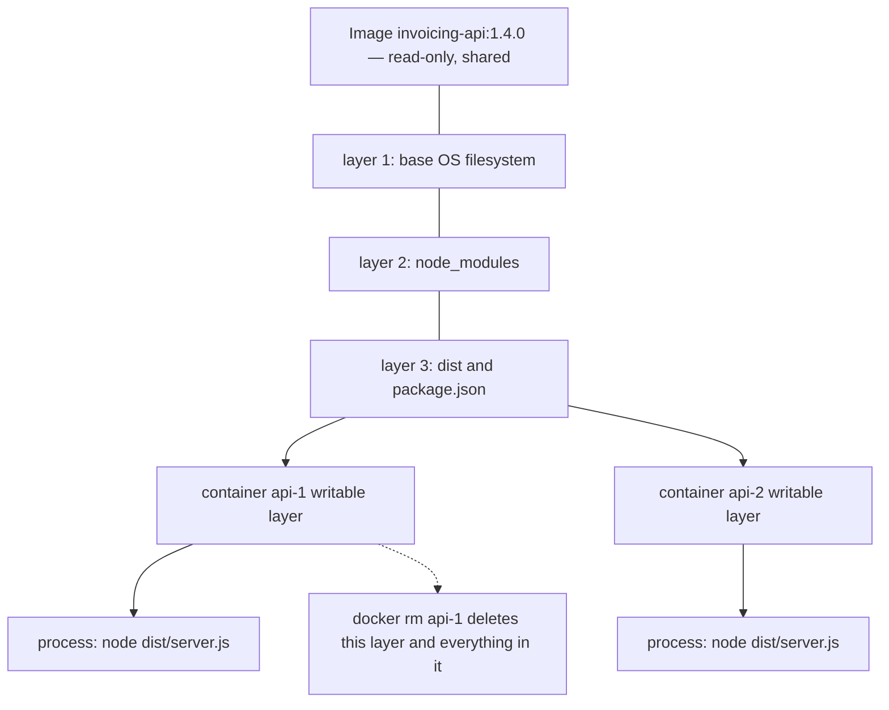
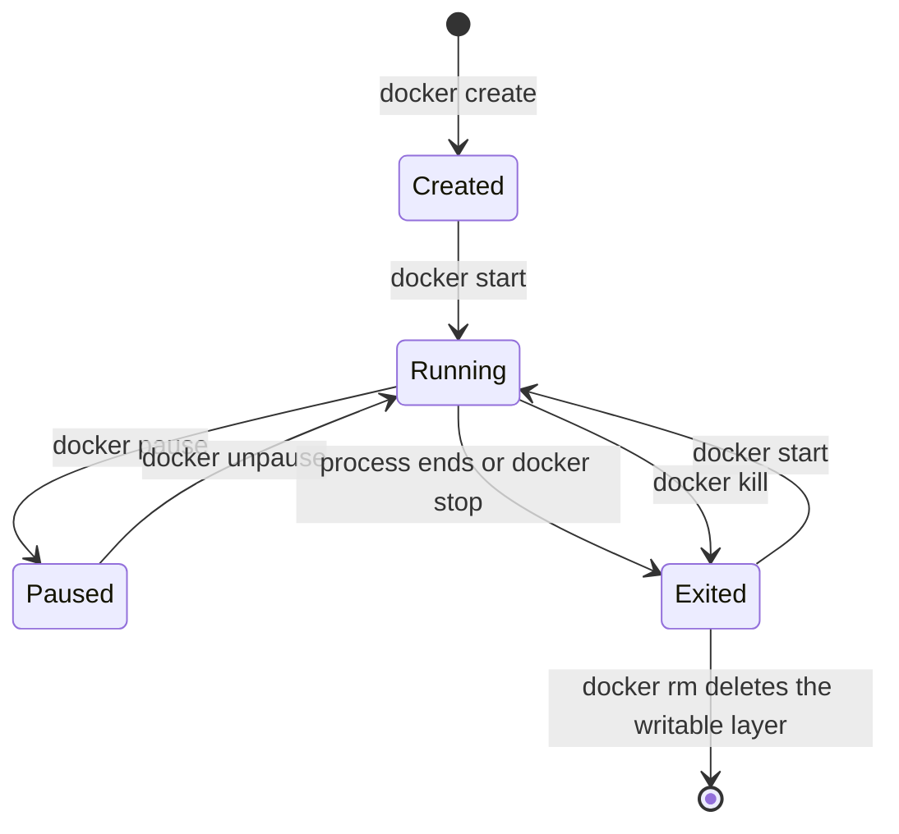

# Docker Image vs Container

"Image" and "container" get used almost interchangeably in casual
conversation, but the distinction is exactly the class-vs-instance
relationship from object-oriented programming: an image is a blueprint,
a container is a running (or stopped) instance of that blueprint. One
image can produce any number of independent containers.

Getting this one distinction right removes a whole category of confusion:
why a change you made inside a running container disappeared, why `latest` is
not a version, why ten replicas do not cost ten times the disk, and why
"just save the uploaded file" is a bug rather than a feature.

> **📌 In one line:** an image is an immutable stack of read-only layers plus
> metadata; a container is that same stack plus one thin writable layer plus a
> running process — and only the image is meant to survive.

## Table of Contents

1. [The Core Distinction](#the-core-distinction)
2. [What's Actually in an Image](#whats-actually-in-an-image)
3. [Tags and Digests: How Images Are Named](#tags-and-digests-how-images-are-named)
4. [What Changes When You Run a Container](#what-changes-when-you-run-a-container)
5. [The Writable Layer](#the-writable-layer)
6. [Why You Rebuild Instead of Modifying](#why-you-rebuild-instead-of-modifying)
7. [One Image, Many Containers](#one-image-many-containers)
8. [Container Lifecycle](#container-lifecycle)
9. [Quick Reference](#quick-reference)
10. [Common Mistakes](#common-mistakes)
11. [Questions to Test Yourself](#questions-to-test-yourself)
12. [Related](#related)

---

## The Core Distinction

```
Image:      a read-only template — layered filesystem + metadata
            (what the app is, before anything runs)

Container:  a running instance of an image — the image's filesystem,
            plus a writable layer on top, plus an actual running process
            (the app, actually executing)
```

```bash
docker images        # lists templates — nothing is running
docker ps             # lists running instances — actual live processes
docker ps -a          # lists ALL instances, including stopped ones
```

Analogy: an image is like a class definition; a container is like an
object instantiated from that class. `docker run myapp:1.0` is
conceptually `new Container(myapp_1_0)` — and you can call it as many
times as you want, getting independent instances each time.

The analogy is good, and it is worth knowing the two places it breaks down,
because both of them matter in practice:

| Where it holds | Where it breaks down |
|---|---|
| One definition, many independent instances | A class lives in memory; an image lives on disk and is shared **byte for byte** between instances, not copied |
| Instances have their own state | A container's state is a *filesystem* that is thrown away, not an object that a garbage collector reclaims |
| Instantiating is cheap | It is cheap **because** the read-only layers are shared, not because the image is small |

A better mental image for day-to-day work: an image is an **installer plus the
installed files, frozen** — and a container is one machine that booted from that
frozen copy, with a scratch disk attached.

## What's Actually in an Image

An image is a stack of read-only layers (see the build-cache discussion
in [overview.md](overview.md)) plus metadata — the default command to
run, exposed ports, environment variable defaults:

```bash
docker inspect myapp:1.0   # shows layers, config, exposed ports, etc.
docker history myapp:1.0   # shows each layer and the instruction that created it
```

Images are identified by name:tag (`myapp:1.0`) and, underlying that, a
content-addressable hash (a `sha256:...` digest) — the same image content
always produces the same digest, which is how Docker knows whether a
layer is already cached locally or needs pulling.

Concretely, an image is three things on disk and nothing else:

| Part | What it holds | Example |
|---|---|---|
| **Layers** | Compressed filesystem diffs, each with its own digest | The Debian userland, then `node_modules`, then `dist/` |
| **Config** | The metadata the runtime needs | `Cmd`, `Entrypoint`, `Env`, `WorkingDir`, `User`, `ExposedPorts` |
| **Manifest** | The list that ties the config and the layer digests together, under one digest | `sha256:9f2b...` |

Two consequences are worth stating plainly:

1. **There is no process in an image.** `CMD ["node", "dist/server.js"]` is a
   *string in the config*. Nothing runs until a container is created.
2. **An image is immutable by construction.** Its digest is computed from its
   content, so changing the content produces a different image with a different
   digest. You never edit an image; you build a new one.

```bash
docker history invoicing-api:1.4.0
```

```text
IMAGE          CREATED        CREATED BY                                      SIZE
7c1a9e4b2f80   2 hours ago    CMD ["node" "dist/server.js"]                   0B
<missing>      2 hours ago    COPY /app/dist ./dist # buildkit                 4.1MB
<missing>      2 hours ago    RUN npm ci --omit=dev # buildkit                 118MB
<missing>      2 hours ago    WORKDIR /app                                    0B
<missing>      3 weeks ago    ... base image layers ...                       195MB
```

Note that `CMD` and `WORKDIR` are `0B`. They changed no files; they only wrote
config. That is a layer too, just an empty one.

> **💡 Tip:** `docker history` is the fastest answer to "why is this image so
> big?". Read the `SIZE` column, find the one instruction responsible, and fix
> that instruction rather than guessing.

## Tags and Digests: How Images Are Named

This section is short and saves entire afternoons.

An image has exactly one permanent name — its **digest**, a `sha256:` hash of
its manifest. Everything else is a **tag**: a human-friendly label that *points
at* a digest, and can be repointed at any time.

```
registry.example.com/team/invoicing-api : 1.4.0
└────────── registry ──────────┘ └ repo ┘  └ tag ┘

registry.example.com/team/invoicing-api@sha256:9f2b1c...
                                        └──── digest ────┘
```

| Reference form | Points at | Can it change later? |
|---|---|---|
| `postgres` | The `latest` tag of that repository | **Yes** |
| `postgres:16` | Whatever `16` currently points at | **Yes** — it moves on every 16.x patch release |
| `postgres:16.4` | Whatever `16.4` currently points at | Usually no, but a tag is always technically mutable |
| `postgres@sha256:3b1a...` | Exactly those bytes | **No. Ever.** |

### `latest` is a pointer, not a version

`latest` is not special to Docker. It is an ordinary tag with an unfortunate
name, applied by convention to the most recent push. It carries no promise of
being newest, stable, or compatible.

Two things follow, and both bite:

- **`docker pull node:latest` on Tuesday and on Thursday can give you different
  images, including a different major version**, with nothing in your repository
  changed. A build that passed yesterday fails today and the diff is empty.
- **`docker run myapp:latest` does not re-pull by default** if an image with
  that tag already exists locally. So your server can keep running last week's
  bytes while everyone believes the deploy went out.

```dockerfile
# ❌ BROKEN - a moving pointer in the one line that defines your whole runtime
FROM node:latest
```

```dockerfile
# ✅ FIXED - a pinned major version, so the base image cannot change under you
FROM node:22-slim
```

> **⚠️ Warning:** the same argument applies to the tags *you* push. Deploying
> `invoicing-api:latest` means you cannot say what is running in production and
> cannot roll back to a specific build. Tag every build with something unique —
> the version, or the git commit SHA — and deploy that.

> **📌 Remember:** tags are for humans, digests are for machines. When you need
> certainty — reproducible builds, an audit, a rollback — use the digest.

## What Changes When You Run a Container

`docker run` takes an image and adds exactly what's needed to actually
execute it:

- **A writable layer** on top of the image's read-only layers
- **A process** — the command specified by `CMD`/`ENTRYPOINT` (or
  overridden at `docker run` time), actually running
- **Its own network namespace** — its own IP inside Docker's network,
  its own view of ports
- **A container ID** — a unique identifier for this specific running
  instance, distinct from the image it was created from

```bash
docker run -d --name web1 myapp:1.0
docker run -d --name web2 myapp:1.0
# web1 and web2 are two independent containers, same image, separate
# processes, separate writable layers, separate container IDs
```

Said as a boundary: the image supplies **code**, the run command supplies
**configuration and identity**, and the kernel supplies **isolation**.

| Supplied by the image | Supplied at `docker run` |
|---|---|
| The filesystem, including the runtime and dependencies | Environment variables and secrets |
| The default `CMD` and `ENTRYPOINT` | An override of that command |
| `WORKDIR`, `USER`, `ENV` defaults | Published ports, mounted volumes, resource limits |
| `EXPOSE` metadata | The network to join, and the container's name |

That split is the whole reason one image can be promoted unchanged from staging
to production: the bytes are identical, only the configuration handed to it
differs. If you need a *different image* per environment, something has leaked
across the boundary — usually a secret or a hostname baked in at build time.

## The Writable Layer

Any file changes a running container makes (writing a log file, creating
a temp file, modifying a config at runtime) go into that container's own
writable layer — **not** back into the shared, read-only image:

```
Image layers (read-only, shared across every container from this image):
  [ base OS ] [ dependencies ] [ app code ]

Container's writable layer (unique to THIS container):
  [ any file changes made while running ]
```



The dotted arrow is the entire point of this file. `docker rm` removes the
writable layer. The read-only layers are untouched, because they were never
modified and they are still in use by `api-2`.

### Copy-on-write, in one paragraph

Writes do not modify the layers below, so what happens when a container edits a
file that came from the image? The union filesystem copies that file up into the
writable layer first, then applies the change to the copy. Reads now find the
copy, because reads check the top layer first. The original is still sitting in
the read-only layer, unchanged, which is why a second container from the same
image sees the original version.

Deleting works in reverse: the file cannot be removed from a read-only layer, so
a marker is written in the writable layer that hides it. The bytes are still
there, which is why deleting a secret in a later Dockerfile instruction does not
remove it from the image.

This is why stopping and removing a container discards any changes it
made unless they were explicitly persisted — the writable layer dies with
the container. **This is exactly the problem
[volumes](volumes.md) solve** — anything that needs to survive a
container being removed (a database's actual data, uploaded files)
belongs in a volume, not the writable layer.

```bash
docker run -d --name test myapp:1.0
docker exec test touch /app/temp_file.txt   # written to test's writable layer only
docker rm -f test                            # temp_file.txt is gone — the writable layer is destroyed
docker run -d --name test2 myapp:1.0         # fresh container, back to the image's original state
```

You can see exactly what a container has written, without guessing:

```bash
docker diff api-1
```

```text
C /app
A /app/uploads
A /app/uploads/inv-2041.pdf
C /tmp
A /tmp/npm-cache
```

`A` means added, `C` changed, `D` deleted — relative to the image. Everything in
that list is in the writable layer and will not survive the next deploy.

> **📌 Remember:** the writable layer is scratch space, not storage. Treat it the
> way you treat `/tmp` on a machine that reboots every few hours.

## Why You Rebuild Instead of Modifying

Two habits follow from "the writable layer is scratch space", and both show up
in real incidents.

### Storing data in the container

```ts
// ❌ BROKEN - the attachment is written into this container's writable layer
async function storeInvoiceAttachment(invoiceId: string, file: Buffer): Promise<string> {
  const path = `/app/uploads/${invoiceId}.pdf`
  await writeFile(path, file)
  return path            // a path that exists in exactly one container
}
```

It passes your tests, because your tests use one container that never gets
removed. Then the next deploy replaces the container and every attachment
uploaded before it is gone. Scale to two containers and the download lands on
the one that does not have the file, so it returns 404 about half the time.

```ts
// ✅ FIXED - the bytes go somewhere durable, the database stores the key
async function storeInvoiceAttachment(invoiceId: string, file: Buffer): Promise<string> {
  const key = `invoices/${invoiceId}.pdf`
  await objectStorage.put(key, file, { contentType: 'application/pdf' })
  return key             // meaningful from any container, on any host, forever
}
```

### Fixing a container with `docker commit`

`docker commit` turns a container's writable layer into a new image layer. It
exists, it works, and it is almost always the wrong answer.

```bash
# ❌ BROKEN - patch the running container, then freeze the result as an image
docker exec -it api-1 bash
#   ... apt-get install a missing library, edit a config file by hand ...
docker commit api-1 invoicing-api:1.4.1
```

```bash
# ✅ FIXED - put the change in the Dockerfile and rebuild from source
#   the Dockerfile now contains:  RUN apt-get install -y --no-install-recommends libvips
docker build -t invoicing-api:1.4.1 .
```

The committed image works. The problem is that nothing explains *why* it works.
Nobody can reproduce it, code review never saw the change, the next clean build
from `main` silently loses it, and `docker history` shows one opaque layer with
no instruction attached. The Dockerfile is the source of truth precisely because
it is a reviewed, versioned text file in your repository.

> **💡 Tip:** the legitimate uses of `docker commit` are forensic — freezing a
> misbehaving container so you can dig through it after restarting the service.
> Not as a build step.

## One Image, Many Containers

Because the image itself never changes when a container runs, the same
image can safely back many containers simultaneously — this is exactly
how horizontal scaling of containerized apps works (see
[horizontal-vs-vertical-scaling.md](../../system-design/scale-patterns/horizontal-vs-vertical-scaling.md)):

```bash
docker run -d --name worker1 myapp:1.0
docker run -d --name worker2 myapp:1.0
docker run -d --name worker3 myapp:1.0
# 3 independent, identical containers from ONE image —
# this is the mechanism behind scaling replica count in Kubernetes
# (see kubernetes/deployment.md)
```

The cost model is the part people underestimate. Three containers from an
800 MB image do **not** use 2.4 GB of disk. The read-only layers are stored
once and shared; each container adds only its own writable layer, which is
usually a few megabytes of logs and temporary files.

| Resource | Shared between containers from one image | Private to each container |
|---|---|---|
| Image layers on disk | **Yes** — stored once | — |
| Page cache for files read from those layers | **Yes** — the kernel caches them once | — |
| Writable layer | — | **Yes** |
| Process memory | — | **Yes** |
| Network namespace and IP | — | **Yes** |

> **⚠️ Warning:** "identical and disposable" is a property your *application*
> has to earn. If your code keeps sessions, counters, caches or uploaded files
> in local memory or on local disk, two containers will disagree with each
> other, and the bug will look random because it depends on which container the
> load balancer picked.

## Container Lifecycle

```
docker create  -> container exists, not running
docker start   -> container's process begins running
docker pause   -> process suspended, still resident in memory
docker stop    -> graceful shutdown (SIGTERM, then SIGKILL after a timeout)
docker kill    -> immediate shutdown (SIGKILL)
docker rm      -> container and its writable layer are deleted entirely
```



`docker run` is shorthand for `create` + `start` in one step — the most
common way containers actually get started, but understanding the
underlying states matters when debugging why a container that exists
isn't actually doing anything (it might be created but never started, or
stopped but not removed).

Two details in that diagram earn their place:

- **`Exited` is not `removed`.** A stopped container still holds its writable
  layer and its disk space. That is useful — you can still read its logs and run
  `docker diff` on it — and it is also why `docker ps -a` slowly fills with
  dozens of dead containers and your disk fills with them.
- **`stop` sends `SIGTERM` first, then waits.** The default grace period is ten
  seconds in recent versions. If your process ignores `SIGTERM`, it is killed
  outright at the end of that window, mid-request. Handling that signal is what
  turns a deploy from "drops a few requests every time" into a clean one; the
  mechanics are in
  [01-a-dockerfile-for-node-part-2.md](../../linux-and-deployment/02-docker-in-practice/01-a-dockerfile-for-node-part-2.md).

---

## Quick Reference

| Question                                          | Answer                                             |
| :-------------------------------------------------------- | :--------------------------------------------------------- |
| Is this a blueprint or a running thing?                       | Image = blueprint, Container = running instance                |
| Can one image produce many containers?                        | Yes — each independent, each with its own writable layer          |
| Do changes made inside a running container affect the image?  | No — they go to that container's own writable layer only             |
| What happens to those changes when the container is removed?  | Lost, unless stored in a volume                                        |
| How do I list images vs running containers?                    | `docker images` vs `docker ps`                                          |
| How do I see what a container has written?                      | `docker diff <container>`                                                |
| Is `latest` a version?                                           | No — it is a tag that can be repointed. Only a digest is immutable        |

**Bottom line:** an image is the immutable template; a container is a
live, disposable instance of it. Anything you need to survive beyond a
single container's lifetime — data, uploaded files, logs you actually
care about — needs to live outside the container's writable layer, in a
[volume](volumes.md).

## Common Mistakes

| Mistake | Why it is wrong | Do this instead |
|---|---|---|
| Saving uploads or generated files inside the container | The writable layer is deleted on the next deploy, and a second replica cannot see them | Object storage for files, a volume or managed database for state |
| `docker commit` to capture a fix made by hand | The change is unreviewed, unreproducible, and lost on the next clean build | Put it in the Dockerfile and rebuild |
| Deploying `myapp:latest` | You cannot say which build is running and cannot roll back to a specific one | Tag with the version or the git commit SHA |
| `FROM node:latest` in a Dockerfile | The base image can change major version with no change in your repo | Pin at least the major version |
| Assuming `docker run myapp:latest` fetches the newest image | Docker uses the local copy if that tag already exists | `docker pull` first, or use a unique tag per build |
| Keeping session state or an in-memory cache in the app | Replicas disagree, and the bug looks random because routing decides it | Shared store such as Redis, or a stateless design |
| Thinking one image per environment is normal | A hostname or secret has been baked in at build time | One image, promoted unchanged; configuration at run time |

## Questions to Test Yourself

1. The class-and-instance analogy is useful but wrong in one important way.
   What does a class *not* share between instances that an image *does* share
   between containers, and what does that save you?
2. You run `docker exec api-1 sh -c "echo hi > /app/note.txt"`, then
   `docker rm -f api-1`, then start a new container from the same image. Why is
   `note.txt` missing, and which specific thing was deleted?
3. A Dockerfile copies `.env` in on line 4 and runs `rm .env` on line 12. Is
   the secret in the shipped image? Explain using copy-on-write.
4. Your colleague says "we deploy `latest`, so production always has the newest
   build". Give two separate reasons that statement can be false.
5. You have a 900 MB image and five containers running from it. Roughly how
   much disk does the whole set use, and why?
6. What is the difference between `invoicing-api:1.4.0` and
   `invoicing-api@sha256:9f2b...`, and when do you actually need the second?
7. Someone fixed a production container by installing a missing system library
   with `docker exec`, then ran `docker commit`. The service works now. Name
   three concrete problems you still have.
8. A container shows `Exited (143)` in `docker ps -a`. What signal is that,
   who most likely sent it, and is it a bug?

## Related

- [overview.md](overview.md) — what a container is at the kernel level,
  namespaces and cgroups, layers and the build cache.
- [volumes.md](volumes.md) — where the data goes when the writable layer will
  not do, and the trade-offs between the three options.
- [../../linux-and-deployment/02-docker-in-practice/](../../linux-and-deployment/02-docker-in-practice/)
  — the practical track for building, running and debugging these images.
- [02-running-containers-locally-part-2.md](../../linux-and-deployment/02-docker-in-practice/02-running-containers-locally-part-2.md)
  — ephemeral filesystems and lost uploads, demonstrated on a real stack.
- [04-debugging-containers-part-2.md](../../linux-and-deployment/02-docker-in-practice/04-debugging-containers-part-2.md)
  — `docker inspect`, `docker diff`, and finding why an image is so large.
- [05-secrets-and-configuration-part-2.md](../../backend-fundamentals/11-api-security/05-secrets-and-configuration-part-2.md)
  — why a secret in a layer is permanent, and what to do instead.
- [../kubernetes/deployment.md](../kubernetes/deployment.md) — replica counts,
  which are this idea with an orchestrator managing it.
