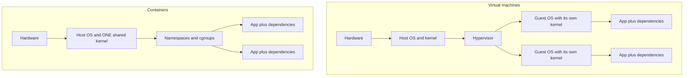
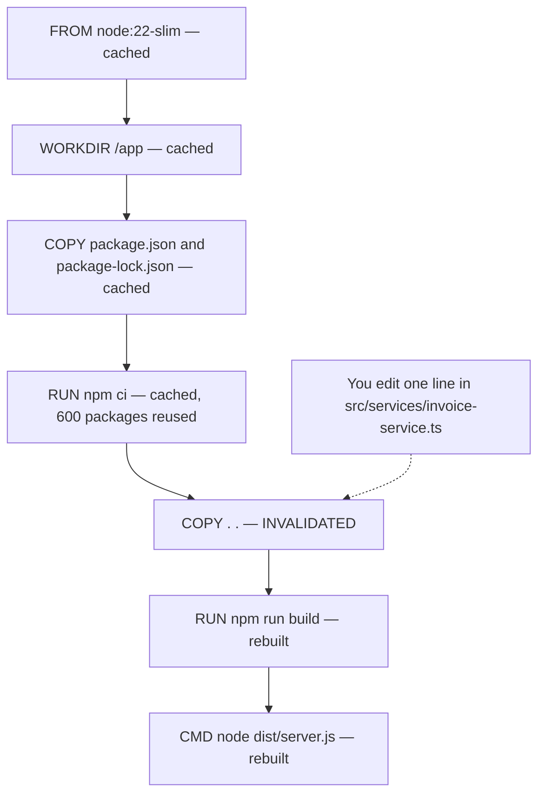

# Docker

Docker packages an application with everything it needs to run — code,
runtime, libraries, system dependencies — into a single unit that behaves
the same on a developer's laptop, a CI runner, and a production server.
The problem it solves is "it works on my machine" — by making "my
machine" irrelevant to whether the application runs correctly.

This file is the **concept note**. It explains what a container is, what an
image is made of, and why the build cache behaves the way it does. It does not
walk you through containerising your own project — that is the job of
[linux-and-deployment/02-docker-in-practice/](../../linux-and-deployment/02-docker-in-practice/),
and this file links there every time the next question is "how do I do this?".

> **📌 In one line:** a container is not a small virtual machine — it is an
> ordinary Linux process that the kernel has been told to show a different
> filesystem, a different network, and a smaller slice of the machine.

## Table of Contents

1. [The Problem Docker Solves](#the-problem-docker-solves)
2. [Containers vs Virtual Machines](#containers-vs-virtual-machines)
3. [What a Container Actually Is](#what-a-container-actually-is)
4. [The Dockerfile](#the-dockerfile)
5. [Layers and the Build Cache](#layers-and-the-build-cache)
6. [Multi-Stage Builds](#multi-stage-builds)
7. [Basic Commands](#basic-commands)
8. [Docker Compose: Running Multiple Containers Together](#docker-compose-running-multiple-containers-together)
9. [Quick Reference](#quick-reference)
10. [Common Mistakes](#common-mistakes)
11. [Questions to Test Yourself](#questions-to-test-yourself)
12. [Related](#related)

---

## The Problem Docker Solves

Before containers, "deploying an app" meant ensuring the target machine
had the right language runtime version, the right system libraries, the
right environment variables — and that nothing else on that machine
conflicted with any of it. Docker packages all of that into an image, so
"does this run correctly" stops depending on what else is installed on
the host.

```
Without Docker: app depends on the host having Node 22, libpq-dev,
                 specific env vars set correctly, no conflicting versions
                 of anything else installed system-wide

With Docker: app + Node 22 + libpq-dev + env vars, all bundled into
             one image — the host only needs Docker itself installed
```

An image removes the runtime version, the missing system library and the host's
Linux distribution from the list of things that can differ. It does **not**
remove the CPU architecture, the kernel version, or the configuration and data
you hand the container at run time.

> **⚠️ Warning:** those three exceptions are where most "but it worked in Docker
> on my laptop" incidents come from. The image is reproducible; the environment
> you hand it is not. The architecture trap is in
> [04-debugging-containers-part-2.md](../../linux-and-deployment/02-docker-in-practice/04-debugging-containers-part-2.md).

## Containers vs Virtual Machines

A VM virtualizes an entire machine, including its own OS kernel — heavy,
but fully isolated. A container shares the host's kernel and only
isolates the process and its filesystem view — much lighter, starts in
milliseconds instead of minutes, but with a thinner isolation boundary
(more on the concept split between images and containers in
[image-vs-container.md](image-vs-container.md)):

```
VM:        [ Hardware ] -> [ Hypervisor ] -> [ Full Guest OS ] -> [ App ]
                                              (own kernel, GBs of overhead)

Container: [ Hardware ] -> [ Host OS + Kernel ] -> [ Container: App + deps only ]
                            (shared kernel, MBs of overhead)
```

The same picture as a diagram, which makes the one structural difference
obvious — where the kernel sits:



Three kernels in the VM column, one in the container column. Everything else
about containers follows from that one difference.

| | Virtual machine | Container |
|---|---|---|
| Kernel | Its own, booted from scratch | The host's, shared with every container |
| Start time and size | Tens of seconds, gigabytes | Milliseconds, tens to hundreds of megabytes |
| Can run a different OS kernel | Yes | **No** — Linux containers need a Linux kernel |
| Blast radius of a kernel bug | Contained to that VM | Potentially every container on the host |

> **📌 Remember:** Docker Desktop on macOS or Windows runs a small Linux virtual
> machine behind the scenes, and your containers live inside it. That is why
> file access across a bind mount is noticeably slower there than on Linux — the
> bytes cross a VM boundary.

## What a Container Actually Is

This is the section that makes containers stop feeling like magic. There is no
"container" object in the Linux kernel, and no system call named
`create_container`. A container is an ordinary process — the same kind as your
editor or your shell — started with three kernel features switched on. Docker's
job is to set those three things up and then run your command.

```
A container = a normal Linux process
            + namespaces   (what it can SEE)
            + cgroups      (what it can USE)
            + a union filesystem as its root (what it READS and WRITES)
```

### Namespaces: what the process can see

A **namespace** is a kernel feature that gives a process its own private copy of
one global resource. The process asks the kernel the same questions as always —
"what processes exist?", "what is my hostname?", "what network interfaces do I
have?" — and the kernel answers from inside the namespace instead of from the
whole machine.

| Namespace | What it isolates | What you notice |
|---|---|---|
| PID | The process ID table | Your app is process 1, and cannot see host processes |
| Mount | The set of mounted filesystems | Its own `/`, with its own `/usr`, `/etc`, `/app` |
| Network | Interfaces, IPs, ports, routing | Its own IP, and its own idea of what `localhost` means |
| UTS, IPC and User | Hostname, shared memory, user ID mapping | `hostname` returns the container ID, and root inside can map to an unprivileged user outside |

The network namespace causes the most confused debugging sessions, because of
one consequence: **`localhost` inside a container means that container**, not
your machine and not another container. Each container has its own `127.0.0.1`,
which is why an API container cannot reach its database at `localhost:5432` even
though both are "running on my laptop". The practical version is in
[02-running-containers-locally-part-1.md](../../linux-and-deployment/02-docker-in-practice/02-running-containers-locally-part-1.md).

### cgroups: what the process can use

**Control groups**, usually written `cgroups`, are the other half. Namespaces
limit what a process can *see*; cgroups limit what it can *consume* — CPU time,
memory, disk bandwidth, how many processes it may create.

```bash
docker run -d --memory 512m --cpus 1.5 invoicing-api:1.4.0
```

That flag does not ask the application to behave. It writes limits into a cgroup
and the kernel enforces them. Exceed the memory limit and the kernel's
out-of-memory killer terminates the process immediately — which surfaces as a
container that vanishes with **exit code 137** and nothing unusual in the logs,
because the application never got a chance to log anything.

> **💡 Tip:** exit code 137 means the process received `SIGKILL` (128 + 9).
> Inside a container that is nearly always the memory cgroup. Exit code 143 is
> `SIGTERM` (128 + 15), a normal requested shutdown. They look alike and mean
> opposite things.

### Union filesystems: what the process reads and writes

The third piece is the filesystem. A container's root directory is not a copy of
the image. It is a **union filesystem** — commonly OverlayFS on Linux — which
stacks several read-only directories and presents them as one tree, with a
single writable directory on top.

```
            what the process sees as "/"
                      ▲  one merged view
┌──────────────────────────────────────────────┐
│  writable layer   —  this container only     │  every write lands here
├──────────────────────────────────────────────┤
│  layer 3: app code            read-only      │
│  layer 2: node_modules        read-only      │  shared by every container
│  layer 1: base OS filesystem  read-only      │  built from this image
└──────────────────────────────────────────────┘
```

Two rules fall out of this, and almost everything else about images follows:

1. **Reads walk down the stack.** The kernel checks the top layer first, then the
   one below, until it finds the file. A file in a higher layer hides one with
   the same path lower down.
2. **Writes never touch the layers below.** Modifying a file from a read-only
   layer copies it up into the writable layer first — a *copy-on-write* — and
   changes the copy. Deleting writes a marker that hides it.

This is why ten containers from the same image cost almost nothing extra on
disk: they share every read-only layer and own only their small writable layer.
It is also why anything written inside a container disappears when the container
is removed, and why [volumes.md](volumes.md) exists.

> **📌 Remember:** a layer is not a diff of your source code. It is a diff of the
> **filesystem**, recorded after one Dockerfile instruction finished running.

Because the kernel is shared, a kernel vulnerability is a container-escape
vulnerability; a VM would still contain it. For a team running its own code that
is a reason to follow two habits rather than avoid containers: run as a non-root
user, and grant no more privilege than needed. Both are in
[01-a-dockerfile-for-node-part-2.md](../../linux-and-deployment/02-docker-in-practice/01-a-dockerfile-for-node-part-2.md).

## The Dockerfile

A Dockerfile is a recipe for building an image — a sequence of
instructions describing what goes into it:

```dockerfile
FROM node:22-slim                   # start from a base image

WORKDIR /app                        # set the working directory inside the image

COPY package.json package-lock.json ./
RUN npm ci                          # install dependencies

COPY . .                            # copy the rest of the application code
RUN npm run build                   # compile TypeScript into dist/

EXPOSE 3333                         # document which port the app listens on

CMD ["node", "dist/server.js"]      # the command that runs when a container starts
```

```bash
docker build -t invoicing-api:1.4.0 .          # build an image from this Dockerfile
docker run -p 3333:3333 invoicing-api:1.4.0    # run a container from that image
```

Knowing which category each instruction belongs to explains a lot:

| Instruction | Runs at | Effect |
|---|---|---|
| `FROM` | Build | Chooses the stack of layers to start from |
| `RUN` | **Build** | Executes a command and saves the result as a layer |
| `COPY` / `ADD` | **Build** | Copies files from the build context into a new layer |
| `WORKDIR`, `ENV`, `USER` | Build and run | Metadata that also applies to the running process |
| `EXPOSE`, `LABEL` | Build | Metadata only. `EXPOSE` publishes nothing |
| `CMD` / `ENTRYPOINT` | **Run** | Records the default command. Nothing runs at build time |

> **⚠️ Warning:** `RUN` and `CMD` are frequently mixed up. A `RUN npm start`
> would hang your build forever, and a `CMD npm ci` would reinstall every
> dependency on every container start.

The line-by-line version for a real TypeScript project — base image choice,
pinning, `npm ci` versus `npm install`, `.dockerignore` — is
[01-a-dockerfile-for-node-part-1.md](../../linux-and-deployment/02-docker-in-practice/01-a-dockerfile-for-node-part-1.md).

## Layers and the Build Cache

Each instruction in a Dockerfile creates a new filesystem layer, cached
independently. Docker reuses a cached layer if nothing that would affect
it has changed — this is why instruction *order* in a Dockerfile matters
for build speed. The rule is short and worth memorising exactly:

> **📌 Remember:** a cached layer is reused only if the instruction is unchanged
> **and** every layer before it was also reused. The first instruction that
> changes invalidates itself and **everything below it**, to the end of the file.

That second half is what people forget: the cache is a chain, not a set of
independent entries.



One character changed in one source file. Layers 1 to 4 are reused, so the
install is skipped and rebuilding the rest takes seconds. Move `COPY . .` above
`RUN npm ci` and the same edit invalidates layer 3 instead, putting `npm ci`
below the break so it reruns from scratch:

```dockerfile
# ❌ BROKEN - source is copied before dependencies are installed, so every
# code change invalidates the install layer and reinstalls all 600 packages
FROM node:22-slim
WORKDIR /app
COPY . .
RUN npm ci
RUN npm run build
CMD ["node", "dist/server.js"]
```

```dockerfile
# ✅ FIXED - manifests first, install, then source. Editing TypeScript cannot
# invalidate the install layer, because that layer never saw the source
FROM node:22-slim
WORKDIR /app
COPY package.json package-lock.json ./
RUN npm ci
COPY . .
RUN npm run build
CMD ["node", "dist/server.js"]
```

The general principle, in every language: **order instructions from
least-frequently-changing to most-frequently-changing.** Base image, system
packages, dependency install, then application source — which changes on every
commit, so it goes last. The measured cost of getting this wrong, and how to
find the first broken layer in a slow build, are in
[01-a-dockerfile-for-node-part-1.md](../../linux-and-deployment/02-docker-in-practice/01-a-dockerfile-for-node-part-1.md)
and
[04-debugging-containers-part-1.md](../../linux-and-deployment/02-docker-in-practice/04-debugging-containers-part-1.md).

> **⚠️ Warning:** layers are additive, so a file deleted in a later layer is
> still present in the earlier one. `COPY .env .` followed by `RUN rm .env`
> leaves the secret readable by anyone who can pull the image. You cannot delete
> your way out of a layer.

## Multi-Stage Builds

Compiling/building an application often needs tools (compilers, build
dependencies) that the final running image shouldn't carry — multi-stage
builds let you use one stage to build, and copy only the final artifact
into a clean, minimal final image:

```dockerfile
# Stage 1: build — has the TypeScript compiler and every dev dependency
FROM node:22-slim AS builder
WORKDIR /app
COPY package.json package-lock.json ./
RUN npm ci
COPY . .
RUN npm run build

# Stage 2: final image — production dependencies and compiled output only
FROM node:22-slim
WORKDIR /app
COPY package.json package-lock.json ./
RUN npm ci --omit=dev
COPY --from=builder /app/dist ./dist
CMD ["node", "dist/server.js"]
```

The mechanism is simple once you see it: each `FROM` starts a **new, empty layer
stack**. Nothing from the builder reaches the final image unless a
`COPY --from=` brings it across. The builder is still built and still cached —
it is just discarded rather than shipped.

That buys a smaller image, a smaller attack surface (a shell, a package manager
and a compiler in a production image are all tools an attacker can use), and no
risk of a build-time credential reaching a shipped layer. Smaller images also
pull and start faster, which matters most during a rollback. The full Node
version, with the non-root user and the `--omit=dev` detail, is in
[01-a-dockerfile-for-node-part-2.md](../../linux-and-deployment/02-docker-in-practice/01-a-dockerfile-for-node-part-2.md).

## Basic Commands

```bash
docker build -t myapp:1.0 .          # build an image from a Dockerfile
docker images                         # list local images
docker run -d -p 8080:80 myapp:1.0    # run a container, detached, port-mapped
docker ps                              # list running containers
docker logs <container_id>             # view a container's stdout/stderr
docker exec -it <container_id> bash    # get a shell inside a running container
docker stop <container_id>             # stop a running container
docker rm <container_id>               # remove a stopped container
docker rmi myapp:1.0                   # remove an image

# and two that answer "what is actually IN this thing?"
docker history myapp:1.0     # every layer, its size, and the instruction that made it
docker inspect myapp:1.0     # entrypoint, env, exposed ports, layer digests
```

`docker history` is the fastest answer to "why is this image 843 MB?" — it
shows which single instruction added 400 MB. Flag-level detail on `docker run`:
[02-running-containers-locally-part-1.md](../../linux-and-deployment/02-docker-in-practice/02-running-containers-locally-part-1.md).

## Docker Compose: Running Multiple Containers Together

Real applications are rarely one container — a web app usually needs a
database, maybe a cache, maybe a background worker. Compose defines
multiple services and their relationships in one file:

```yaml
# docker-compose.yml
services:
  api:
    build: .
    ports:
      - "3333:3333"
    depends_on:
      - db
      - redis
    environment:
      - DATABASE_URL=postgresql://db:5432/invoicing

  db:
    image: postgres:16
    volumes:
      - pgdata:/var/lib/postgresql/data   # see volumes.md for why this matters

  redis:
    image: redis:7

volumes:
  pgdata:
```

```bash
docker compose up -d      # start everything defined in the file
docker compose down       # stop and remove everything
```

Conceptually Compose adds two things to what you could do by hand: a **shared
network** where every service name resolves as a hostname, and a file instead of
your shell history. The first matters most — `db` in that `DATABASE_URL` is the
service name, resolved by Docker's internal DNS.

> **⚠️ Warning:** `depends_on` waits for the database *container* to start, not
> for Postgres to be *ready to accept connections*. Your API will start and fail
> its first connection. The two real fixes — a healthcheck condition, and
> retrying in the application — are in
> [03-compose-for-local-development-part-1.md](../../linux-and-deployment/02-docker-in-practice/03-compose-for-local-development-part-1.md).

This is primarily a local-development and simple-deployment tool — production
orchestration at scale is what [Kubernetes](../kubernetes/pod.md) is for. Where
to draw that line is argued in
[03-compose-for-local-development-part-2.md](../../linux-and-deployment/02-docker-in-practice/03-compose-for-local-development-part-2.md).

---

## Quick Reference

| Task                                          | Command / concept                        |
| :-------------------------------------------------- | :----------------------------------------------- |
| Build an image, then run a container from it           | `docker build -t name:tag .` then `docker run name:tag` |
| Speed up rebuilds                                       | Order Dockerfile instructions least-to-most-changing   |
| Keep final image small, and see what made it huge        | Multi-stage build; `docker history image:tag`           |
| Run app + database + cache together locally              | Docker Compose                                            |
| Persist data across container restarts                    | Volumes — see [volumes.md](volumes.md)                      |
| Understand why a change inside a container vanished        | The writable layer — see [image-vs-container.md](image-vs-container.md) |

**Bottom line:** a container is a process with namespaces, cgroups and a union
filesystem. A Dockerfile describes how to build the image that process starts
from; instruction order determines build-cache efficiency; multi-stage builds
keep the final image lean. Compose handles simple multi-container setups —
production-scale orchestration is Kubernetes' job.

## Common Mistakes

| Mistake | Why it is wrong | Do this instead |
|---|---|---|
| Thinking of a container as a lightweight VM | It has no kernel of its own, so it cannot run a different OS and shares every kernel bug with the host | Think "isolated process", and expect process-shaped behaviour such as signals and exit codes |
| Copying source before installing dependencies | Every code change invalidates the install layer, so every rebuild reinstalls everything | Copy the manifests, install, then copy source |
| Deleting a secret in a later `RUN` | Layers are additive. The earlier layer still contains the file | Never copy secrets in. Pass them at run time |
| Expecting `EXPOSE` to publish a port | It is documentation metadata and opens nothing | Publish with `-p host:container` at run time |
| Treating a running container as a place to keep files | The writable layer is deleted with the container | Named volume for state, object storage for uploads |
| Using `localhost` to reach another container | Each container has its own network namespace, so `localhost` is itself | Use the service or container name as the hostname |
| Assuming an image built on a Mac runs on the server | An `arm64` image will not start on an `amd64` host | Build for the target platform |

## Questions to Test Yourself

1. There is no `create_container` system call in Linux. So what exactly does
   Docker ask the kernel to do when you run `docker run`?
2. A container can run a different Linux distribution than its host, but not a
   different kernel version. Explain why both are true at once.
3. You edit one line of TypeScript and your build reinstalls 600 npm packages.
   Which property of the layer cache causes this, and which instruction is in
   the wrong place?
4. Someone adds `RUN rm /app/.env` as the last line of a Dockerfile to remove a
   secret copied in earlier. Why does this not work?
5. A container dies with exit code 137 and your application logs show nothing
   unusual. Which of the three kernel features is responsible, and why were
   there no logs?
6. Ten containers run from the same 800 MB image. Roughly how much disk does the
   set use, and which part of the container filesystem explains your answer?

## Related

- [image-vs-container.md](image-vs-container.md) — the template-and-instance
  split, tags versus digests, and what the writable layer really is.
- [volumes.md](volumes.md) — where data goes when the writable layer will not
  do, which is nearly always.
- [../../linux-and-deployment/02-docker-in-practice/](../../linux-and-deployment/02-docker-in-practice/)
  — the practical track: your own Dockerfile, Compose, and the debug runbook.
- [../kubernetes/pod.md](../kubernetes/pod.md) — what runs containers once one
  host is not enough.
