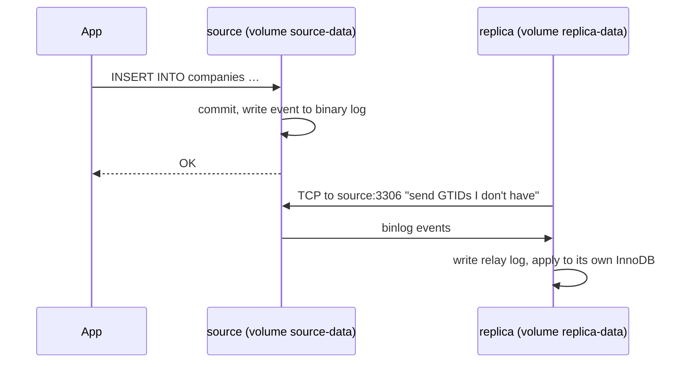

# Stateful Containers

You pull one `mysql:8` image and start three containers from it. You insert a
company through container 1, an invoice through container 2, and a user through
container 3. Will the three containers sync with each other?

No. You have three unrelated databases that share a binary. Mounting one named
volume into all three does not fix it either: the second server refuses to start.
Containers sync state through a **network protocol** the database speaks, for
MySQL replication, never through a disk. This note uses MySQL because the
question did; the PostgreSQL equivalent is
[04-read-replicas-and-replication-lag.md](../../databases/operations/04-read-replicas-and-replication-lag.md).
All output is real, from `mysql:8` (MySQL 8.4.9 LTS) on Docker 29, trimmed with `…`.

> **📌 In one line:** one container, one datadir, one database process; to make
> several of them agree, connect them over the network, never through a shared
> disk.

## Table of Contents

1. [One Image, Three Containers, Three Databases](#one-image-three-containers-three-databases)
2. ["Fix" It With One Shared Volume](#fix-it-with-one-shared-volume)
3. [Why InnoDB Refuses a Second Server](#why-innodb-refuses-a-second-server)
4. [Do Not Rely on That Lock](#do-not-rely-on-that-lock)
5. [The Right Shape: One Volume per Container](#the-right-shape-one-volume-per-container)
6. [Running It: Replication Over the Docker Network](#running-it-replication-over-the-docker-network)
7. [The General Rule: Share State Over the Network](#the-general-rule-share-state-over-the-network)
8. [Why --scale and replicas: 3 Are the Wrong Tool](#why---scale-and-replicas-3-are-the-wrong-tool)
9. [Quick Reference](#quick-reference)
10. [Common Mistakes](#common-mistakes)
11. [Questions to Test Yourself](#questions-to-test-yourself)
12. [Related](#related)

---

## One Image, Three Containers, Three Databases

Three containers, same image, no `-v` flag. Each one gets a different row:

```bash
for i in 1 2 3; do docker run -d --name rpl-c-db$i -e MYSQL_ROOT_PASSWORD=root-pass -e MYSQL_DATABASE=saas mysql:8; done
for i in 1 2 3; do   # once all three log "ready for connections"
  docker exec -e MYSQL_PWD=root-pass rpl-c-db$i mysql -uroot saas -e \
    "CREATE TABLE companies (id INT PRIMARY KEY, name VARCHAR(50));
     INSERT INTO companies VALUES ($i, 'written-in-db$i');"
done
```

Now ask each one what it holds (table borders trimmed for db2 and db3):

```text
$ docker exec rpl-c-db1 mysql -uroot saas -t -e "SELECT @@server_uuid, id, name FROM companies"
+--------------------------------------+----+----------------+
| @@server_uuid                        | id | name           |
+--------------------------------------+----+----------------+
| 0473f537-da08-11f1-81d5-d6a7748361aa |  1 | written-in-db1 |
+--------------------------------------+----+----------------+
$ docker exec rpl-c-db2 mysql -uroot saas -t -e "SELECT @@server_uuid, id, name FROM companies"
| 04f487af-da08-11f1-8a48-e2c506cb9b1e |  2 | written-in-db2 |
$ docker exec rpl-c-db3 mysql -uroot saas -t -e "SELECT @@server_uuid, id, name FROM companies"
| 05cd8ee1-da08-11f1-bd63-067a4ddf93df |  3 | written-in-db3 |
```

Each server sees exactly one row, its own, and each has a different
`server_uuid`. MySQL itself considers them three different servers. Where did
each `/var/lib/mysql` go?

```text
$ docker image inspect mysql:8 --format '{{json .Config.Volumes}}'
{"/var/lib/mysql":{}}
$ docker inspect rpl-c-db1 --format '{{range .Mounts}}{{.Type}} {{.Name}} -> {{.Destination}}{{end}}'
volume 3a85d7c28324f08397b15878530bb686b08d8a2d8f3b2c58ab7dc46e679f7c76 -> /var/lib/mysql
```

The `mysql` image declares `VOLUME /var/lib/mysql`, so with no `-v` Docker
creates an **anonymous volume per container**: a random-named directory only
that container uses. An image without a `VOLUME` line puts the same files in
[the container's writable layer](image-vs-container.md#the-writable-layer)
instead. Either way: private storage per container, no path between them.
[volumes.md](volumes.md) covers both kinds. The image is shared. The data never was.

> **⚠️ Warning:** `docker rm -f` leaves anonymous volumes behind as nameless
> orphans. Use `docker rm -fv` for throwaway database containers, or every
> experiment leaves a full dead MySQL datadir in `docker volume ls`.

---

## "Fix" It With One Shared Volume

The obvious next idea: give them all the same named volume, so they all read the
same files. Here it is as a Compose file, which is how it usually happens:

```yaml
# ❌ BROKEN - one named volume, and the plan is to run more than one db container on it
name: rpl-c-broken
services:
  db:
    image: mysql:8
    environment: { MYSQL_ROOT_PASSWORD: root-pass, MYSQL_DATABASE: saas }
    volumes:
      - mysql-data:/var/lib/mysql      # every container of this service gets THIS volume
    healthcheck: { test: [CMD, mysqladmin, ping, -h, 127.0.0.1, -uroot, -proot-pass], interval: 5s, retries: 30 }
volumes:
  mysql-data:
```

Start one, let it become healthy, then scale to two:

```text
$ docker compose up -d --wait
 Container rpl-c-broken-db-1 Healthy
$ docker compose up -d --scale db=2
 Container rpl-c-broken-db-1 Running
 Container rpl-c-broken-db-2 Started
$ docker inspect rpl-c-broken-db-1 rpl-c-broken-db-2 --format '{{.Name}} {{range .Mounts}}{{.Name}}{{end}}'
/rpl-c-broken-db-1 rpl-c-broken_mysql-data
/rpl-c-broken-db-2 rpl-c-broken_mysql-data
```

Same volume, two containers. Container 2's log, then its fate:

```text
db-2  | … [Server] /usr/sbin/mysqld (mysqld 8.4.9) starting as process 1
db-2  | … [InnoDB] InnoDB initialization has started.
db-2  | …17:37:05.839174Z 1 [ERROR] [MY-012574] [InnoDB] Unable to lock ./ibdata1 error: 11
db-2  | …17:37:06.839376Z 1 [ERROR] [MY-012574] [InnoDB] Unable to lock ./ibdata1 error: 11
db-2  | …                (one attempt per second, for about 100 seconds)
db-2  | …17:38:45.859019Z 1 [ERROR] [MY-012592] [InnoDB] Operating system error number 11 in a file operation.
db-2  | …17:38:45.859198Z 1 [ERROR] [MY-012596] [InnoDB] Error number 11 means 'Resource temporarily unavailable'
db-2  | …17:38:45.859286Z 1 [ERROR] [MY-012215] [InnoDB] Cannot open datafile './ibdata1'
db-2  | …17:38:46.360637Z 0 [ERROR] [MY-010119] [Server] Aborting

$ docker compose ps -a
NAME                STATUS
rpl-c-broken-db-1   Up 2 minutes (healthy)
rpl-c-broken-db-2   Exited (1) Less than a second ago
```

Error 11 is `EAGAIN`: the file is locked by someone else, try later. Two plain
`docker run -v rpl-c-shared:/var/lib/mysql` containers did the same: 101 "Unable
to lock" lines, then `Exited (1)` about 100 seconds after start. During those
100 seconds container 2 shows `Up (health: starting)`, which looks like a slow
start; with `restart: always` it would retry and abort forever.

---

## Why InnoDB Refuses a Second Server

The lock is not bureaucracy. A running `mysqld` keeps part of the truth **in its
own memory**; the files on disk are only correct combined with that memory.

| In-process state | What it holds | Size here (8.4 default) |
|---|---|---|
| Buffer pool | Recently read and **modified** pages, flushed to disk later | `innodb_buffer_pool_size` = 128 MB |
| Redo log buffer and checkpoint position | Which committed changes are not yet in the data files | `innodb_redo_log_capacity` = 100 MB on disk |
| Lock table and transaction list | Which rows are locked, which transactions are open | Memory only |
| Dictionary cache, auto-increment counters | Table definitions, the next `id` to hand out | Memory, persisted lazily |

A commit is durable once its redo record is on disk; the page in
`companies.ibd` may stay stale for minutes while the newer version sits dirty in
the buffer pool. Now imagine a second server opening the same files:

- It reads a **stale page** and builds new changes on top of it.
- Both hand out the **same auto-increment `id`** and append to the **same redo
  log**, each believing it owns the next offset.
- Each flushes its own version of a page: **last writer wins at page level**.
- Crash recovery replays redo onto pages it was never written against, the kind
  of corruption `CHECK TABLE` finds weeks later.

Even identity is a file: `server-uuid` lives in `auto.cnf` in the datadir.

InnoDB is a **single-process storage engine**: correctness depends on one
process owning the files and the memory together. So on startup it takes an
exclusive `fcntl()` lock on its system tablespace, `ibdata1`, and stops if it
cannot. PostgreSQL enforces the same rule with a `postmaster.pid` lock file in
the data directory: one server per data directory.

> **📌 Remember:** a database's datadir is not shared data. It is one process's
> private working state that happens to be stored in files.

---

## Do Not Rely on That Lock

The lock saved you in the lab. Treat it as a smoke alarm, not a design. It only
works when every condition below holds:

| Condition | When it fails |
|---|---|
| Both processes use the same kernel's lock table | Two **hosts** mounting one network filesystem: NFS and SMB locking depends on the lock service and mount options, and is often off or unreliable |
| The engine takes a lock at all | MySQL runs with `skip_external_locking = ON` by default (checked: `SELECT @@skip_external_locking` → `1`), so a MyISAM table gets no file lock between two servers |
| The second server starts *after* the first holds it | Two containers starting at the same moment on an **empty** volume both attempt first-time initialisation of the same files |
| Nobody "fixes" the error | A forum answer telling you to delete lock or `#innodb_redo` files turns a refusal into corruption |

> **⚠️ Warning:** never try to make two database servers write to one datadir,
> whatever the storage. A clustered filesystem does not change this: the problem
> is two independent in-memory caches, not the disk.

---

## The Right Shape: One Volume per Container

The fix has two halves. Each `mysqld` owns its own datadir. And the servers agree
by **talking**: the source records every committed transaction in its binary
log, and the replica connects over TCP, pulls those events and applies them to
its own copy.



This section only builds the minimal setup; how the binlog, relay log and replica
threads work is [01-mysql-binlog-replication-part-1.md](../../databases/replication/01-mysql-binlog-replication-part-1.md).

> **💡 Tip:** MySQL 8.4 says **source/replica**. Old posts say master/slave
> (`SHOW SLAVE STATUS`, `CHANGE MASTER TO`), and a few names keep it: the
> privilege `REPLICATION SLAVE` and the table `mysql.slave_master_info`.

```yaml
# ✅ FIXED - one volume per mysqld, and the replica syncs over the network
# Lab / local-dev only: no failover, no backups, passwords in plain text.
name: rpl-c
services:
  source:
    image: mysql:8                      # 8.4.9 LTS at the time of writing
    command: [--server-id=1, --log-bin=mysql-bin, --gtid-mode=ON,
              --enforce-gtid-consistency=ON, --report-host=source]
    environment: { MYSQL_ROOT_PASSWORD: root-pass, MYSQL_DATABASE: saas }
    volumes:
      - source-data:/var/lib/mysql                       # source's own datadir
      - ./source-init:/docker-entrypoint-initdb.d:ro      # runs once, on an empty datadir
    healthcheck: { test: [CMD, mysqladmin, ping, -h, 127.0.0.1, -uroot, -proot-pass], interval: 5s, retries: 30 }

  replica:
    image: mysql:8
    command: [--server-id=2, --log-bin=mysql-bin, --gtid-mode=ON,   # server-id must differ
              --enforce-gtid-consistency=ON, --report-host=replica]
    environment: { MYSQL_ROOT_PASSWORD: root-pass }
    volumes:
      - replica-data:/var/lib/mysql                      # replica's own datadir
    depends_on:
      source: { condition: service_healthy }
    healthcheck: { test: [CMD, mysqladmin, ping, -h, 127.0.0.1, -uroot, -proot-pass], interval: 5s, retries: 30 }

volumes:
  source-data:
  replica-data:
```

| Setting | Why |
|---|---|
| Two volumes | One datadir per server, the whole point of this file |
| Different `--server-id` | Every server in a topology needs a unique id; a replica ignores events carrying its own id |
| `--log-bin` | The source's change stream. On by default in 8.4, written out so it is visible |
| `--gtid-mode=ON` + `--enforce-gtid-consistency=ON` | Every transaction gets a global id, so the replica asks "what am I missing?" instead of tracking a file and byte offset |
| Healthcheck on `127.0.0.1` | The image's first-boot setup runs a temporary server with `--skip-networking`. A socket ping passes during that phase; a TCP ping waits for the real server |

The init script, mounted into the source only:

```sql
-- source-init/01-replication-user.sql: runs once, the first time the source's datadir is empty
CREATE USER 'repl'@'%' IDENTIFIED BY 'repl-pass';
GRANT REPLICATION SLAVE ON *.* TO 'repl'@'%';   -- the privilege kept its old name in 8.4

CREATE TABLE saas.companies (
  id         BIGINT UNSIGNED AUTO_INCREMENT PRIMARY KEY,
  name       VARCHAR(100) NOT NULL,
  created_at TIMESTAMP NOT NULL DEFAULT CURRENT_TIMESTAMP
);
```

---

## Running It: Replication Over the Docker Network

```text
$ docker compose up -d --wait
 Container rpl-c-source-1 Healthy
 Container rpl-c-replica-1 Healthy
$ docker compose exec replica getent hosts source
172.22.0.2      source
$ docker compose exec replica mysql -uroot -t -e "SELECT @@server_id, @@gtid_mode, @@log_bin, @@server_uuid, @@gtid_executed"
+-------------+-------------+-----------+------ … ------+------------------------------------------+
| @@server_id | @@gtid_mode | @@log_bin | @@server_uuid | @@gtid_executed                          |
+-------------+-------------+-----------+------ … ------+------------------------------------------+
|           2 | ON          |         1 | 0268b7a5-…    | 0268b7a5-da09-11f1-8727-a2bebfd55467:1-5 |
+-------------+-------------+-----------+------ … ------+------------------------------------------+
```

The replica resolves `source` through Compose's DNS, exactly like `postgres` in
[03-compose-for-local-development-part-1.md](../../linux-and-deployment/02-docker-in-practice/03-compose-for-local-development-part-1.md#service-names-are-hostnames).
But it already has five transactions under **its own** UUID: the image's first
boot loads the time-zone tables, and with binary logging on those writes got
GTIDs. A replica should contain only the source's transactions, so the one-time
step clears them first:

```sql
-- replica-setup.sql: one-time step, run on the replica after both are healthy
RESET BINARY LOGS AND GTIDS;          -- forget the replica's own init transactions (8.4 name for RESET MASTER)
CHANGE REPLICATION SOURCE TO
  SOURCE_HOST = 'source',             -- the Compose service name, resolved by Docker DNS
  SOURCE_PORT = 3306,
  SOURCE_USER = 'repl',
  SOURCE_PASSWORD = 'repl-pass',
  SOURCE_AUTO_POSITION = 1,           -- GTID: "send me every transaction I don't have"
  SOURCE_SSL = 1;
START REPLICA;
SET PERSIST super_read_only = ON;     -- even root cannot write here by accident
```

```bash
docker compose exec -T -e MYSQL_PWD=root-pass replica mysql -uroot < replica-setup.sql
```

`SOURCE_SSL = 1`: the 8.4 default auth plugin, `caching_sha2_password`, needs
TLS or an RSA key exchange (`GET_SOURCE_PUBLIC_KEY = 1`). The image generates
self-signed certificates, so TLS works out of the box. The replica straight after `START REPLICA`:

```text
mysql> SHOW REPLICA STATUS\G
             Replica_IO_State: Waiting for source to send event
                  Source_Host: source
           Replica_IO_Running: Yes
          Replica_SQL_Running: Yes
        Seconds_Behind_Source: 0
             Source_Server_Id: 1
           Retrieved_Gtid_Set: f60e46f3-da08-11f1-b752-66adc0ed7f1f:1-9
            Executed_Gtid_Set: f60e46f3-da08-11f1-b752-66adc0ed7f1f:1-9
                Auto_Position: 1
…
```

`1-9` are the source's own first-boot transactions (its time-zone load,
`CREATE DATABASE saas`, the `repl` user and the table), pulled across and
applied. Only the source's UUID is in `Executed_Gtid_Set`, so the reset worked.
Now write on the source and read on the replica:

```text
$ docker compose exec source mysql -uroot saas -t -e "INSERT INTO companies (name) VALUES ('Acme Logistics'); SELECT @@hostname, id, name FROM companies"
+--------------+----+----------------+
| @@hostname   | id | name           |
+--------------+----+----------------+
| 4252ec733dfe |  1 | Acme Logistics |
+--------------+----+----------------+
$ docker compose exec replica mysql -uroot saas -t -e "SELECT @@hostname, id, name FROM companies"
+--------------+----+----------------+
| @@hostname   | id | name           |
+--------------+----+----------------+
| eedef5a00181 |  1 | Acme Logistics |
+--------------+----+----------------+
```

Two hostnames, two datadirs, one row. That is the sync the original question
wanted. "One-time" is literal: the connection settings live in the replica's own
datadir. After `docker compose restart replica` and one more insert on the
source, the replica reported both threads `Yes` and `Executed_Gtid_Set` up to
`…:1-11`, with no setup re-run. A write on the replica, even as root, is refused:

```text
$ docker compose exec replica mysql -uroot saas -e "INSERT INTO companies (name) VALUES ('written on replica')"
ERROR 1290 (HY000) at line 1: The MySQL server is running with the --super-read-only option so it cannot execute this statement
```

That error is the design working: writes go to the source. Several servers that
all accept writes is a different, harder system,
[03-group-replication-part-1.md](../../databases/replication/03-group-replication-part-1.md).

> **⚠️ Warning:** this is a **lab and local-dev** setup, not production HA. Nothing
> promotes the replica if the source dies, TLS is unverified
> (`Source_SSL_Verify_Server_Cert: No`), passwords sit in YAML, both share one
> host's disk, and there are no backups. Use it to reproduce lag on your laptop
> ([02-replication-lag-in-mysql.md](../../databases/replication/02-replication-lag-in-mysql.md)).

---

## The General Rule: Share State Over the Network

> **📌 Remember:** containers share state through **network protocols**
> (replication, a database server, Redis, object storage), never through a
> shared disk. A volume belongs to exactly one process that owns it.

| Stateful service | Wrong way to run more than one | Right way |
|---|---|---|
| PostgreSQL | Several postmasters on one data directory, or `--scale` | One primary plus streaming-replication standbys, each with its own data directory ([04-read-replicas-and-replication-lag.md](../../databases/operations/04-read-replicas-and-replication-lag.md)); or a managed service |
| MySQL | One volume shared by several `mysqld` | Source and replicas with GTID binlog replication (this file); Group Replication for automatic failover; or a managed service |
| Redis | Two `redis-server` on one `/data`, overwriting each other's RDB/AOF files | Replication with Sentinel for failover, or Redis Cluster to shard; separate instances when the jobs differ, such as cache vs queue |
| Search engine (Elasticsearch/OpenSearch style) | Several nodes on one data path | A cluster: each node has its own data path, and the engine copies shards between nodes over its own transport protocol |
| User uploads | A named volume mounted by every API replica | Object storage: every container reads and writes over HTTP, and the database stores the key ([02-object-storage-and-serving-files.md](../../backend-fundamentals/12-files-and-integrations/02-object-storage-and-serving-files.md)) |

Your AdonisJS API can run ten copies because none of them owns anything: it
pushed all its state into the services above and reaches them by hostname. The
one-writer, many-readers exception in
[volumes.md](volumes.md#sharing-a-volume-between-containers) still holds for
plain files, because no storage engine keeps in-memory state on top of them.

---

## Why --scale and replicas: 3 Are the Wrong Tool

`docker compose up --scale db=3` and a Kubernetes Deployment with `replicas: 3`
build **identical, interchangeable** copies. A database member is neither:

| What scaling assumes | What a database member needs |
|---|---|
| Every copy runs the same command | A unique `server-id`, and a role (source or replica) |
| Every copy mounts the same volume (Compose) or any free storage (Deployment) | Its **own** datadir that stays with it across restarts |
| Copies are anonymous and start in any order | A stable name to point at (`SOURCE_HOST`), and an order: source first |
| A dead copy is replaced from scratch | A replacement must clone data and rejoin replication |
| A load balancer spreads requests across all copies | Writes must reach one specific member |

Kubernetes' answer is the **StatefulSet**: pods with stable names (`mysql-0`,
`mysql-1`), started in order, each with its own persistent volume claim that
follows it: identity and storage, but **no** replication or failover. An
operator or your own scripts still do the `CHANGE REPLICATION SOURCE TO` part.
A concept only for now (Deployments are in [../kubernetes/deployment.md](../kubernetes/deployment.md));
most teams skip all of this with a managed database.

---

## Quick Reference

| Question | Answer |
|---|---|
| Three containers from one `mysql:8` image: shared data? | No. Each has its own `/var/lib/mysql` (an anonymous volume, from the image's `VOLUME`) |
| Two `mysqld` on one named volume? | The second logs `Unable to lock ./ibdata1 error: 11` and exits after about 100 s |
| How do two MySQL containers stay in sync? | Binlog replication over TCP: own volume and `server-id` each, GTID on, `CHANGE REPLICATION SOURCE TO` |
| Check replication health | `SHOW REPLICA STATUS\G`: both `Running: Yes`, `Seconds_Behind_Source`, `Last_*_Error` |
| Run several of a stateful service | Its own replication or clustering protocol, or a managed service; never `--scale` |

**Bottom line:** an image is shared, a datadir never is. When you need copies
that agree, the database's own network protocol syncs them; Docker only gives
each copy its own disk and a name to be reached by.

---

## Common Mistakes

| Mistake | Why it is wrong | Do this instead |
|---|---|---|
| Expecting containers from one image to share data | The image is read-only code; each container's datadir is private | Treat each container as a separate server |
| Mounting one volume into several database containers | In-memory state cannot be shared; InnoDB refuses, other setups corrupt silently | One volume per server, replication between them |
| `docker compose up --scale db=3` | Same volume, same `server-id`, no roles | One named service per member, or a managed database |
| Deleting lock or redo files to make the second server start | Removes the only guard and destroys committed transactions | Find the other process holding the datadir |
| Reusing a `server-id` | Replication stops, or events are skipped as "my own" | A unique id per server, set explicitly |
| Skipping `RESET BINARY LOGS AND GTIDS` on a fresh replica | Its own init transactions become errant GTIDs that bite at failover | Reset once, before `CHANGE REPLICATION SOURCE TO` |
| Leaving the replica writable | A stray write makes it diverge and can break replication later | `super_read_only = ON` |

---

## Questions to Test Yourself

1. A teammate runs three `mysql:8` containers behind a round-robin load balancer
   and reports that "half the users disappear on refresh". Explain where each
   user's row lives and why.
2. Two `mysqld` containers share a volume. Container 2 shows `Up (health:
   starting)` for over a minute. What is it doing, and what happens next?
3. Name three pieces of state that exist only in the first `mysqld`'s memory,
   and one concrete corruption a second process would cause.
4. The lock protected you on your laptop. Give two setups where the same mistake
   would not be stopped by any lock.
5. Your replica's `Executed_Gtid_Set` contains two UUIDs, the source's and its
   own. Where did the second come from, and why does it matter at failover?
6. You run `--scale replica=3` on the FIXED file for more read capacity. List
   everything that goes wrong.
7. Your API runs ten replicas happily, but your database cannot. What property
   does the API have that the database lacks, and how did the API earn it?
8. A StatefulSet gives each pod a stable name and its own volume. What part of
   running a MySQL replica set does it still not do for you?

---

## Related

- [image-vs-container.md](image-vs-container.md#the-writable-layer) — why each container's writes are private.
- [volumes.md](volumes.md) — named, anonymous and bind mounts; the one-writer rule.
- [03-compose-for-local-development-part-1.md](../../linux-and-deployment/02-docker-in-practice/03-compose-for-local-development-part-1.md)
  — healthchecks, `depends_on`, and `down -v`.
- [../../databases/replication/01-mysql-binlog-replication-part-1.md](../../databases/replication/01-mysql-binlog-replication-part-1.md)
  — how the binlog, relay log and replica threads moved the row you saw here.
- [../../databases/replication/02-replication-lag-in-mysql.md](../../databases/replication/02-replication-lag-in-mysql.md)
  — what `Seconds_Behind_Source` measures, and what it hides.
- [../../databases/replication/03-group-replication-part-1.md](../../databases/replication/03-group-replication-part-1.md)
  — several MySQL servers that agree on writes, with automatic failover.
- [../../databases/operations/04-read-replicas-and-replication-lag.md](../../databases/operations/04-read-replicas-and-replication-lag.md)
  — the PostgreSQL version: streaming replication and read-after-write.
- [02-object-storage-and-serving-files.md](../../backend-fundamentals/12-files-and-integrations/02-object-storage-and-serving-files.md)
  — the network answer for files.
- [../../system-design/foundational/database-replication.md](../../system-design/foundational/database-replication.md)
  — leader-follower, multi-leader and leaderless, in theory.
- [../kubernetes/deployment.md](../kubernetes/deployment.md) — replicas for stateless pods.
