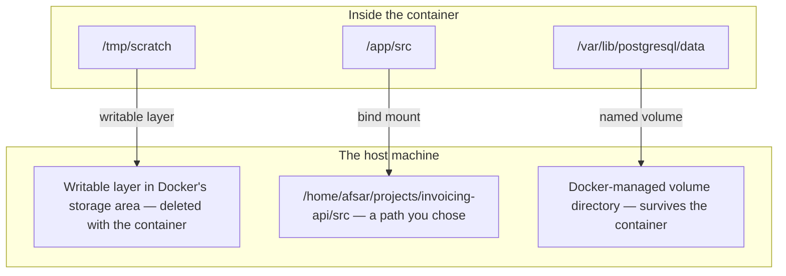

# Docker Volumes

Containers are meant to be disposable — stopped, removed, replaced with a
fresh one from the same image, without ceremony. But some data (a
database's actual rows, user-uploaded files) absolutely cannot be
disposable. Volumes are how Docker reconciles those two facts: they let
data live outside a container's writable layer, so it survives even when
the container itself doesn't.

This file is the **concept note**: what each storage option is, where the bytes
physically live, and how to choose. The day-to-day usage — mounting your source
for hot reload, the `node_modules` masking problem, fixing permission errors on
a mount — is in
[linux-and-deployment/02-docker-in-practice/](../../linux-and-deployment/02-docker-in-practice/).

> **📌 In one line:** a volume is a path inside the container that is redirected
> to storage the container does not own, so removing the container does not
> remove the data.

## Table of Contents

1. [Why the Writable Layer Isn't Enough](#why-the-writable-layer-isnt-enough)
2. [Keep It or Rebuild It](#keep-it-or-rebuild-it)
3. [Where the Bytes Actually Live](#where-the-bytes-actually-live)
4. [Named Volumes](#named-volumes)
5. [Bind Mounts](#bind-mounts)
6. [Named Volumes vs Bind Mounts](#named-volumes-vs-bind-mounts)
7. [tmpfs Mounts](#tmpfs-mounts)
8. [Sharing a Volume Between Containers](#sharing-a-volume-between-containers)
9. [Volume Drivers and the Single-Host Limit](#volume-drivers-and-the-single-host-limit)
10. [Volumes in Docker Compose](#volumes-in-docker-compose)
11. [Quick Reference](#quick-reference)
12. [Common Mistakes](#common-mistakes)
13. [Questions to Test Yourself](#questions-to-test-yourself)
14. [Related](#related)

---

## Why the Writable Layer Isn't Enough

As covered in [image-vs-container.md](image-vs-container.md), any file a
running container writes goes into that specific container's own
writable layer — which is destroyed the moment the container is removed:

```bash
docker run -d --name db postgres:16
# ... database writes rows to its data directory inside the container ...
docker rm -f db
# every row is gone — the writable layer, and everything in it, no longer exists
```

For a database, that's catastrophic. Volumes fix this by redirecting a
specific path inside the container to storage that lives *outside* the
container's lifecycle entirely. This is a *design decision*, not a limitation
someone forgot to fix: four things you rely on every day depend on it.

| What you get | Because the filesystem is ephemeral |
|---|---|
| Identical replicas | No container can drift into a different state than its siblings |
| Clean rollback | Starting the previous image gives you exactly the previous bytes, with no leftovers |
| Reproducible environments | A fresh container is always the image's state, never "the image plus whatever happened last month" |
| Cheap scaling | Adding a replica costs a writable layer, not a copy of the filesystem |

The cost of those four properties is that **the container cannot be where your
state lives**. Volumes are not a workaround. They are the other half of the
design: the container stays disposable, and the state moves somewhere that is not.

> **⚠️ Warning:** nothing warns you about this. Writing files inside a container
> works perfectly, right up until the first deploy, restart, crash or scale-out.
> That gap between "works in testing" and "fails in production" is why this
> mistake is so common.

## Keep It or Rebuild It

Before choosing a storage type, classify the data. Almost every decision falls
out of one question: **if this disappeared right now, could you regenerate it
from something else you still have?**

| Class | Examples | Where it belongs | If you lose it |
|---|---|---|---|
| **State you must keep** | Database files, uploaded invoices and attachments, audit trails | A managed database, object storage, or a backed-up named volume | A real incident. Possibly unrecoverable |
| **Derived data** | Generated thumbnails, a build output directory, a search index, a Redis cache | A volume if regenerating is slow, the writable layer if it is fast | Slower for a while, then fine |
| **Pure scratch** | Temp files during a request, decompression buffers | The writable layer, or `tmpfs` | Nothing |
| **Code and configuration** | Your source, migrations, the Dockerfile | The image, or environment variables at run time | Nothing — it is in git |

> **💡 Tip:** apply this to Redis and the answer stops being obvious. A Redis
> used purely as a cache is derived data and needs no volume at all. A Redis
> holding a job queue is state you must keep. Same software, opposite answer —
> [05-memory-and-operations-part-2.md](../../caching-and-background-jobs/02-redis-in-practice/05-memory-and-operations-part-2.md).

## Where the Bytes Actually Live

Three storage options, one difference that matters: which filesystem the bytes
end up on, and who controls its lifetime.



| What is mounted at the container path | Where the bytes really are | Lifetime |
|---|---|---|
| Nothing — the default | Docker's internal overlay directory | Deleted by `docker rm` |
| A bind mount | An exact host path you named | As long as you keep that directory |
| A named volume | A directory Docker creates and owns | Outlives every container using it |
| A `tmpfs` mount | Host RAM only, never written to disk | Until the container stops |

All four look identical to the process inside the container: it opens a path and
reads or writes. The difference is entirely in what the kernel mounted there,
and what happens to that storage later.

> **📌 Remember:** a mount **covers** whatever was at that path in the image, the
> way putting a rug over a floor hides the floor. The image's files are still
> there, unreadable, and they come back when you remove the mount. This single
> behaviour causes the `node_modules` problem described in
> [03-compose-for-local-development-part-2.md](../../linux-and-deployment/02-docker-in-practice/03-compose-for-local-development-part-2.md).

## Named Volumes

Docker manages the actual storage location; you refer to it by name.
This is the standard choice for anything Docker itself should own and
manage (database data directories, in most cases):

```bash
docker volume create pgdata
docker run -d --name db -v pgdata:/var/lib/postgresql/data postgres:16
```

```
docker rm -f db                     # remove the container...
docker run -d --name db2 -v pgdata:/var/lib/postgresql/data postgres:16
# ...and db2 sees the SAME data pgdata held, even though db is gone entirely
```

```bash
docker volume ls                     # list all named volumes
docker volume inspect pgdata          # see where it actually lives on the host
docker volume rm pgdata               # delete it (and the data with it)
```

Two behaviours of named volumes are worth knowing because they are not obvious:

- **A named volume is created on first use.** `-v pgdata:/var/lib/...` does not
  fail if `pgdata` does not exist; Docker creates an empty one. A typo therefore
  produces a silently empty database rather than an error, which is the usual
  explanation for "my data disappeared but the container started fine".
- **An empty named volume is seeded from the image.** Mount a brand-new volume
  over a path that already has files in the image and Docker copies them in.
  On later starts the volume has content, so nothing is copied and the image's
  version is simply hidden. Bind mounts never do this.

> **⚠️ Warning:** volumes are not deleted when the container that used them is
> removed. That is the point, and it is also why `docker volume ls` on a
> developer laptop often shows dozens of orphans holding gigabytes.
> Running `docker volume prune` removes the unused ones — read the list it
> prints before confirming.

## Bind Mounts

Instead of Docker-managed storage, a bind mount maps a specific path on
the *host* filesystem directly into the container:

```bash
docker run -d -v /home/user/myapp/src:/app/src myapp:1.0
```

Changes made on either side are immediately visible on the other — this
is the standard pattern for local development, where you want code
changes on your host machine to be picked up by a running container
without rebuilding the image every time:

```bash
# Local dev: mount your source code so live-reload tools inside the
# container pick up edits made in your normal editor on the host
docker run -d -v $(pwd):/app -p 8000:8000 myapp-dev:latest
```

A bind mount has no abstraction in it. It is the host's directory appearing at a
different path. That bluntness is both the appeal and the risk:

| Consequence | Why |
|---|---|
| Instant two-way visibility | There is one directory, seen from two places |
| Host file ownership applies | The container's user ID must be allowed to read and write those files, or you get `EACCES` |
| Slower on macOS and Windows | The bytes cross the Docker Desktop VM boundary on every read and write |
| Tied to one machine's layout | The path `/home/user/myapp/src` means nothing on the server |

The permission failure is the one everybody hits, because the container usually
runs as a different user ID than your host account. The fix is in
[04-debugging-containers-part-2.md](../../linux-and-deployment/02-docker-in-practice/04-debugging-containers-part-2.md).

> **💡 Tip:** add `:ro` to mount read-only when the container has no business
> writing — `-v $(pwd)/config:/app/config:ro`. It turns a possible accident into
> an immediate, obvious error.

## Named Volumes vs Bind Mounts

| Aspect                    | Named Volume                             | Bind Mount                                 |
| :---------------------------- | :-------------------------------------------- | :------------------------------------------------ |
| Storage location                | Managed by Docker, opaque path                    | Explicit host path you choose                          |
| Best for                        | Application data (databases, persistent state)     | Local development (live-editing source code)             |
| Portability                     | Works the same regardless of host OS/filesystem      | Tied to a specific host path — less portable               |
| Docker manages backup/lifecycle  | Yes — `docker volume` commands manage it directly    | No — it's just a regular directory on the host               |
| Seeded from the image on first use | Yes, when the volume is empty                       | No — the host directory always wins, even if empty             |
| Performance on macOS and Windows   | Native speed inside the Docker VM                     | Noticeably slower, because every read crosses the VM boundary    |
| Permissions                         | Docker sets them up to match the image's user           | The host's ownership applies, and often does not match            |

**Default to named volumes for anything running in production**
(especially data you can't regenerate) and bind mounts for local
development convenience — mixing them up (a bind mount for a production
database's data directory tied to one specific server's filesystem path)
creates a hidden dependency on that exact machine.

> **📌 Remember:** the difference is not really "managed versus unmanaged". It is
> **who owns the directory**. With a named volume, Docker owns it and nothing
> else on the host should touch it. With a bind mount, you own it, and Docker is
> just a second window onto it.

## tmpfs Mounts

A third option: store data only in the host's memory, never written to
disk at all — for genuinely temporary, sensitive-enough-to-not-persist
data (e.g., a short-lived secret, scratch space that shouldn't outlive
the container even as a lingering file):

```bash
docker run -d --tmpfs /app/cache myapp:1.0
```

Gone immediately when the container stops — faster than disk, but capped
by available RAM and never durable across a restart.

The reason to reach for `tmpfs` rather than letting writes land in the writable
layer is narrower than people assume, and comes down to two cases:

1. **The bytes must not reach a disk.** A decrypted credential in the writable
   layer is a real file on the host until the container is removed, and may
   survive in free blocks after that. `tmpfs` never writes it down.
2. **The write volume is high and the data is pure scratch.** Thousands of small
   temporary files per minute go through copy-on-write, which is slower than
   plain memory.

> **⚠️ Warning:** a `tmpfs` mount consumes the container's memory. If the
> container also has `--memory` set, filling the `tmpfs` counts toward that
> limit and the kernel kills the process — exit code 137, with nothing in your
> application logs.

## Sharing a Volume Between Containers

Multiple containers can mount the same named volume simultaneously —
useful when one container writes data another needs to read (e.g., a
container that generates static files, and an NGINX container that
serves them):

```bash
docker volume create static_files

docker run -d --name builder -v static_files:/output builder-image:1.0
docker run -d --name web -v static_files:/usr/share/nginx/html nginx:1.25
# builder writes to /output; web serves the same files from
# /usr/share/nginx/html — same underlying volume, two mount points
```

Docker doesn't coordinate concurrent writes for you — if both containers
write to the same files, you need your own coordination (or, more
commonly, one container writes and the other only reads).

That last sentence deserves more weight than it usually gets. A shared volume
gives you a shared filesystem and nothing else: no locking, no transactions, no
ordering guarantee, no notification that a file is complete. A reader can open a
file the writer is halfway through writing. The usual safe patterns:

| Pattern | How it avoids the problem |
|---|---|
| One writer, many readers | There is no concurrent write to coordinate |
| Write to a temporary name, then rename | A rename within one filesystem is atomic, so readers see the old file or the complete new one, never a partial one |
| Pass a message, not a file | The writer finishes, then enqueues a job naming the file. The reader only looks when told to |

> **💡 Tip:** if you find yourself wanting file locks across containers, the
> shared volume is probably the wrong tool. A database row or a Redis lock is
> the thing designed for that — see
> [04-distributed-locks-part-1.md](../../caching-and-background-jobs/02-redis-in-practice/04-distributed-locks-part-1.md).

## Volume Drivers and the Single-Host Limit

A `-v` mount uses a **volume driver**. The default is `local`, and `local` means
exactly what it says: a directory on *this* machine's disk. Plugin drivers exist
that can back a volume with network storage such as NFS or a cloud block device.
That default leads to the single most important limitation in this file:

> **⚠️ Warning:** a named volume with the default driver **does not follow a
> container to another machine**. Move the container to a second host and it
> starts with an empty volume. Nothing fails loudly. The database is simply new
> and empty.

```
Host A                              Host B
┌──────────────────────┐           ┌──────────────────────┐
│ container: api       │           │ container: api       │
│ volume: pgdata  ✔    │           │ volume: pgdata  ✘    │
│  → /var/lib/docker/  │           │  → a NEW empty dir   │
└──────────────────────┘           └──────────────────────┘
      same volume name, two different machines, two different directories
```

So a named volume solves "the container was replaced" but not "the host was
replaced" — which is the problem you have as soon as there is more than one
server, an autoscaler, or a platform that can move your workload.

| Scope of failure | Does a local named volume survive it? |
|---|---|
| `docker rm` and start a new container, or a host reboot | **Yes** |
| `docker compose down` without `-v` | **Yes** |
| `docker compose down -v`, or `docker volume rm` | No |
| The container is scheduled onto a different host | **No** |
| The host's disk fails | **No**, unless you have backups elsewhere |

### What to use instead, once one host is not enough

This is the conceptual bridge out of Docker storage entirely:

- **Uploaded files, documents, images** → object storage such as S3. Every
  container on every host reaches the same bytes over the network, and the
  storage is somebody else's durability problem. The design — keys, signed URLs,
  what the database stores — is in
  [02-object-storage-and-serving-files.md](../../backend-fundamentals/12-files-and-integrations/02-object-storage-and-serving-files.md).
- **Relational data** → a managed database, or at minimum a database on a host
  you treat as a pet rather than cattle, with backups you have restored once.
- **A network volume driver** → the right answer in some Kubernetes setups, but
  it makes storage a distributed systems problem rather than removing it.
  [Kubernetes](../kubernetes/pod.md) formalises this with persistent volume
  claims.

> **📌 Remember:** the progression is writable layer, then named volume, then
> network storage you do not run yourself. Each step buys you survival of a
> larger failure. Most backends should be at step three for files and at a
> managed database for rows, with named volumes reserved for local development.

## Volumes in Docker Compose

The Compose example from [overview.md](overview.md) used exactly this
pattern for the database:

```yaml
services:
  db:
    image: postgres:16
    volumes:
      - pgdata:/var/lib/postgresql/data   # named volume

  api:
    build: .
    volumes:
      - ./src:/app/src                     # bind mount, for live dev reload

volumes:
  pgdata:   # declares the named volume so Compose manages its lifecycle
```

`docker compose down` leaves named volumes intact by default (the data
survives); `docker compose down -v` explicitly also removes volumes —
worth knowing before running it against a database you care about.

Two Compose-specific details that surprise people:

- **Volume names are prefixed with the project name.** `pgdata` in a directory
  called `invoicing-api` becomes `invoicing-api_pgdata`. Rename the directory
  and Compose creates a new empty volume, so your local database looks wiped.
  It is not — the old volume is still in `docker volume ls` under the old
  prefix.
- **A relative bind mount path is relative to the Compose file**, not to your
  current directory. `./src` means the `src` next to `docker-compose.yml`.

### The BROKEN and FIXED version

```yaml
# ❌ BROKEN - no volume on the database, and uploads written inside the API
# container. Every "docker compose down" wipes the database, and every deploy
# deletes every file users uploaded.
services:
  db:
    image: postgres:16
  api:
    build: .
    environment:
      - UPLOAD_DIR=/app/uploads
```

```yaml
# ✅ FIXED - database data in a named volume that outlives the container,
# and uploads sent to object storage instead of any container filesystem
services:
  db:
    image: postgres:16
    volumes:
      - pgdata:/var/lib/postgresql/data
  api:
    build: .
    environment:
      - STORAGE_DRIVER=s3
      - S3_BUCKET=invoicing-attachments

volumes:
  pgdata:
```

The two fixes are different in kind, and that is the lesson. The database gets a
volume because Postgres must own real files on a real filesystem. The uploads do
**not** — they leave the host entirely, because a volume would only move the
problem from "survives a deploy" to "survives a deploy on this one machine".

The full local stack is built service by service in
[03-compose-for-local-development-part-1.md](../../linux-and-deployment/02-docker-in-practice/03-compose-for-local-development-part-1.md).

---

## Quick Reference

| Need                                                    | Use                                    |
| :------------------------------------------------------------- | :-------------------------------------------- |
| Persist a database's data across container restarts or removal   | Named volume                                     |
| Live-reload source code during local development                 | Bind mount                                        |
| Mount configuration the container must not change                 | Bind mount with `:ro`                            |
| Temporary, in-memory-only scratch data                            | `tmpfs` mount                                       |
| Share generated files between two containers                      | Named volume mounted by both                          |
| Store user uploads once there is more than one host                | **Not a volume** — object storage                       |
| Find old data after a project rename                                 | `docker volume ls`, look for the old project prefix         |
| Accidentally deleting production data via `docker compose down -v` | Don't — check for `-v` before running it against prod    |

**Bottom line:** anything that needs to outlive a single container —
which is most application data — belongs in a named volume, not the
container's writable layer. Reserve bind mounts for local development
convenience, where tying storage to a specific host path is exactly what
you want. And remember that a named volume outlives the container but not
the host, which is why durable user data belongs in a managed database or
object storage rather than in Docker at all.

## Common Mistakes

| Mistake | Why it is wrong | Do this instead |
|---|---|---|
| Running Postgres with no volume | The writable layer dies with the container, taking every row | `-v pgdata:/var/lib/postgresql/data` |
| Writing user uploads to a path inside the container | Lost on every deploy, and invisible to the other replicas | Object storage, with the key stored in the database |
| A named volume for uploads in a multi-host setup | It does not follow the container to another host, so half your replicas see nothing | Object storage |
| Typo in a volume name | Docker silently creates a new empty volume instead of failing | Declare volumes in Compose, and check `docker volume ls` |
| `docker compose down -v` out of habit | The `-v` deletes named volumes, which is your local database | Use plain `down`. Add `-v` only when you mean to wipe |
| Renaming the project directory and assuming data is gone | Compose prefixes volume names with the project name, so it is looking for a different volume | Look for the old prefix in `docker volume ls` |
| Assuming a volume is a backup | A volume is one copy on one disk, with no locking or atomicity either | Back it up elsewhere and test the restore |

## Questions to Test Yourself

1. You remove a container that had a named volume mounted. Is the data gone?
   Now the host's disk fails. Is the data gone? Explain the difference.
2. Your API runs on three hosts behind a load balancer, with uploads written to
   a named volume mounted at `/app/uploads` on each. Describe the bug a user
   experiences, and why a bigger volume does not fix it.
3. You mount a brand-new empty named volume over `/var/lib/postgresql/data`.
   Postgres starts fine. You do the same with an empty bind mount and it fails.
   What is the difference in behaviour, and why?
4. A teammate renames the project folder and reports that Compose "deleted the
   local database". What actually happened, and how do you get the data back?
5. Give one example of data that should go in a volume, one that should go to
   object storage, and one that is fine in the container's writable layer.
   Justify each in one sentence.
6. Why does mounting a host directory over `/app` break a container that
   installed its `node_modules` at `/app/node_modules` during the build?
7. Two containers mount the same volume and both write one report file. Name
   two ways this corrupts data, and the pattern that avoids both.

## Related

- [image-vs-container.md](image-vs-container.md) — the writable layer this file
  exists to work around, and why it dies with the container.
- [overview.md](overview.md) — union filesystems and copy-on-write.
- [../../linux-and-deployment/02-docker-in-practice/](../../linux-and-deployment/02-docker-in-practice/)
  — the practical track for using these in a real project.
- [02-running-containers-locally-part-2.md](../../linux-and-deployment/02-docker-in-practice/02-running-containers-locally-part-2.md)
  — the two volume patterns you need day to day, on a real stack.
- [03-compose-for-local-development-part-2.md](../../linux-and-deployment/02-docker-in-practice/03-compose-for-local-development-part-2.md)
  — hot reload and the `node_modules` masking problem in full.
- [04-debugging-containers-part-2.md](../../linux-and-deployment/02-docker-in-practice/04-debugging-containers-part-2.md)
  — permission denied on a mounted volume, and how to fix it properly.
- [02-object-storage-and-serving-files.md](../../backend-fundamentals/12-files-and-integrations/02-object-storage-and-serving-files.md)
  — where uploaded files belong once one host is not enough.
- [../kubernetes/pod.md](../kubernetes/pod.md) — persistent volume claims, which
  are this idea once a scheduler can move your container between hosts.
