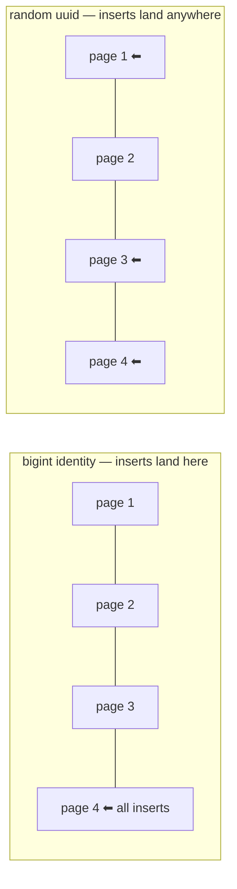
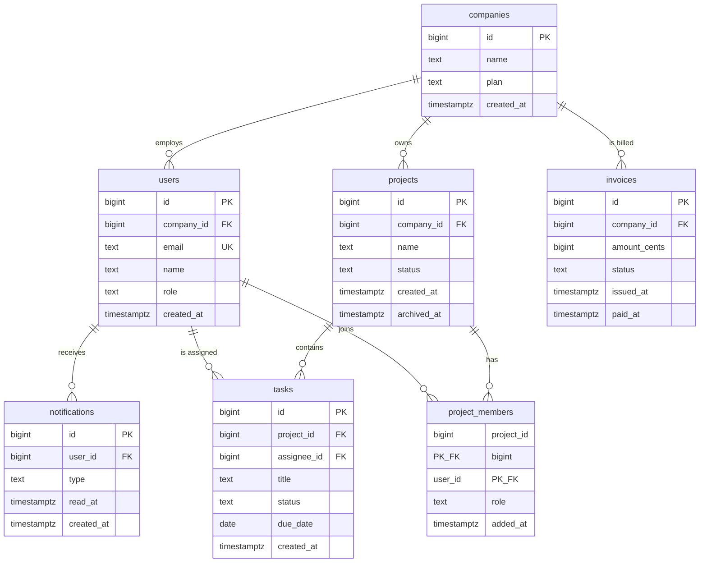

# Keys and Relationships — Part 1

A library gives every book a number on its spine. Not because the title is
boring, but because two books can share a title, a title can be corrected, and
a title is long to write on a lending card. The number is short, permanent, and
means exactly one book. That number is a **primary key**, and almost every
design mistake in this file comes from picking the wrong one.

> **📌 In one line:** Every table needs one short, permanent, meaningless
> identifier, and every relationship between tables is a foreign key pointing
> at one of those identifiers.

Part 2 takes the same keys and asks what tables do with them: how rows point at
each other, and what happens when the row they point at disappears.

## Table of Contents

1. [What a Primary Key Is](#what-a-primary-key-is)
2. [What Breaks Without a Primary Key](#what-breaks-without-a-primary-key)
3. [Natural Keys vs Surrogate Keys](#natural-keys-vs-surrogate-keys)
4. [Choosing the Surrogate Key Type: bigint vs uuid vs ULID](#choosing-the-surrogate-key-type-bigint-vs-uuid-vs-ulid)
5. [Composite Primary Keys](#composite-primary-keys)
6. [Foreign Keys: What They Actually Enforce](#foreign-keys-what-they-actually-enforce)
7. [The Shared Schema as an ER Diagram](#the-shared-schema-as-an-er-diagram)
8. [Common Mistakes](#common-mistakes)
9. [Questions to Test Yourself](#questions-to-test-yourself)
10. [Related](#related)

---

## What a Primary Key Is

A **primary key** is the column (or set of columns) that uniquely identifies
one row in a table. "Uniquely identifies" means: give me that value, and there
is exactly one row it can possibly be — today, and in ten years.

```sql
CREATE TABLE companies (
    id          bigint GENERATED ALWAYS AS IDENTITY PRIMARY KEY,
    name        text        NOT NULL,
    plan        text        NOT NULL,
    created_at  timestamptz NOT NULL DEFAULT now()
);
```

Declaring `PRIMARY KEY` does three things at once in PostgreSQL:

1. It adds `NOT NULL` to the column.
2. It adds a `UNIQUE` constraint.
3. It creates a **unique B-tree index** to enforce that constraint.

That third point matters for performance later: the primary key is not just a
rule, it is an index you already paid for. Lookups by `id` are fast because of
it.

A primary key should be:

- **Unique** — no two rows share it.
- **Not null** — every row has one.
- **Stable** — it never changes for the life of the row.
- **Short** — it gets copied into every index and every foreign key.
- **Meaningless** — it carries no business information that could change.

The last two are the ones people argue about, and the rest of this file is
mostly about them.

---

## What Breaks Without a Primary Key

PostgreSQL will happily let you create a table with no primary key. It is a
legal table. It is also a table that slowly ruins your week.

```sql
-- A table with no primary key. Nothing stops this.
CREATE TABLE task_imports (
    title   text,
    status  text
);

INSERT INTO task_imports VALUES ('Fix login', 'open');
INSERT INTO task_imports VALUES ('Fix login', 'open');  -- duplicate, allowed
```

Now you have two rows that are byte-for-byte identical, and here is what you
cannot do:

- **Update one of them.** `UPDATE task_imports SET status = 'done' WHERE title
  = 'Fix login'` updates both. There is no way to name just one.
- **Delete one of them.** Same problem.
- **Refer to one of them.** No other table can point at "that row", because
  there is no value that means "that row".
- **Replicate it safely.** Logical replication needs a replica identity to
  apply an update on the subscriber; without a key it either errors or you must
  fall back to `REPLICA IDENTITY FULL`, which ships the whole old row on every
  update.
- **Use it in an ORM.** Almost every ORM assumes a single-column identifier and
  will refuse to map the table.

> **⚠️ Warning:** "This table will never have duplicates" is not a design. It
> is a hope. Add the primary key.

---

## Natural Keys vs Surrogate Keys

A **natural key** is a column that already exists in the business data and
happens to be unique: an email address, an ISBN, a country code, an invoice
number.

A **surrogate key** is a column you invent purely to be an identifier: an
auto-incrementing `id`, a UUID. It means nothing outside the database.

| Aspect | Natural key (`email`) | Surrogate key (`id`) |
|---|---|---|
| Meaning | Carries business meaning | Meaningless on purpose |
| Stability | Changes when the business fact changes | Never changes |
| Size | Often long text (30–80 bytes) | 8 or 16 bytes |
| Uniqueness guaranteed by | The outside world (hopefully) | You |
| Foreign keys | Copy the long value into every child table | Copy 8 bytes |
| Readable in a URL | Yes — sometimes too readable | No (which is often good) |
| Survives a merge of two systems | Rarely — collisions are common | Yes |
| Extra index needed | No | Yes, a `UNIQUE` on the natural key |

### Why email as a primary key hurts

Say `users` uses `email` as its primary key, and `tasks.assignee_email`
references it.

```sql
-- ❌ BROKEN — the identity of a user is a value the user can change
CREATE TABLE users (
    email       text PRIMARY KEY,
    company_id  bigint NOT NULL REFERENCES companies (id),
    name        text NOT NULL
);

CREATE TABLE tasks (
    id             bigint GENERATED ALWAYS AS IDENTITY PRIMARY KEY,
    project_id     bigint NOT NULL,
    assignee_email text REFERENCES users (email),
    title          text NOT NULL
);
```

Now a user gets married and changes `anna@old.com` to `anna@new.com`. To do
that you must:

1. Update `users.email` — which cascades into, or is blocked by, every child.
2. Rewrite every referencing row in `tasks`, `notifications`, audit logs,
   anything else.
3. Rewrite every index entry on those foreign key columns.
4. Hope no external system cached the old value as an identifier.

And the update is not just slow — it is a rewrite of the *identity* of data
that is referenced elsewhere. Any row you miss is now orphaned or pointing at
the wrong person.

```sql
-- ✅ FIXED — surrogate key for identity, unique constraint for the business rule
CREATE TABLE users (
    id          bigint GENERATED ALWAYS AS IDENTITY PRIMARY KEY,
    company_id  bigint      NOT NULL REFERENCES companies (id),
    email       text        NOT NULL,
    name        text        NOT NULL,
    role        text        NOT NULL,
    created_at  timestamptz NOT NULL DEFAULT now(),

    CONSTRAINT users_email_unique UNIQUE (email)
);
```

Changing the email is now a one-row update. Nothing else in the database
notices, because nothing else ever stored the email.

> **📌 Remember:** The practical recommendation is always the same — a
> surrogate primary key, **plus** a separate `UNIQUE` constraint on the natural
> key. You get stable identity and the business rule at the same time. Dropping
> the unique constraint is the mistake, not using a surrogate key.

---

## Choosing the Surrogate Key Type: bigint vs uuid vs ULID

You make this decision on every table you create, so it is worth understanding
properly rather than copying whatever the last project used.

The three realistic options:

- **`bigint` identity** — a sequential 64-bit number generated by the database.
- **`uuid` v4** — 128 bits of randomness.
- **UUIDv7 / ULID** — 128 bits where the leading bits are a timestamp, so
  values sort roughly by creation time.

| Aspect | `bigint` identity | `uuid` v4 (random) | UUIDv7 / ULID |
|---|---|---|---|
| Storage per value | 8 bytes | 16 bytes | 16 bytes |
| Index size | Smallest | ~2× larger, plus poor packing | ~2× larger, packs well |
| Insert locality | Excellent — always the right edge | Terrible — random pages | Excellent — right edge |
| Page splits on insert | Rare | Frequent | Rare |
| Guessable / enumerable | Yes — `/users/41` implies `/users/42` | No | Partly — creation order leaks |
| Sortable by creation time | Yes | No | Yes |
| Client can generate before insert | No | Yes | Yes |
| Merge two databases safely | No — id collisions | Yes | Yes |
| Readable in logs and by humans | Very | No | No |

### The random-UUID write-amplification problem, in plain words

A B-tree index keeps its entries **in sorted order** across fixed-size 8 kB
pages. Where a new entry lands depends entirely on its value.

With a sequential `bigint`, every new row's key is larger than every existing
key, so it always goes into the **same last page**. That page is already in
memory because you just wrote to it. One page is dirtied per insert.

With a random UUID, the new key lands in a **random page** somewhere in the
middle of the index. That page probably is not in memory, so it must be read
from disk first. If it is full, PostgreSQL must **split** it: allocate a new
page, move half the entries across, and update the parent. So one insert can
mean several page reads and several page writes.



This is **write amplification**: the work done on disk is many times the work
you asked for. It gets worse as the index grows beyond memory, and it also
makes the index physically bigger, because half-full pages after a split stay
half full.

UUIDv7 and ULID fix exactly this. Their high bits are a millisecond timestamp,
so values generated now sort after values generated a second ago, and inserts
go back to landing at the right edge of the index — the same good behaviour as
`bigint`, while keeping the "client can generate it" and "no collisions across
systems" properties.

> **💡 Tip:** Recent PostgreSQL versions ship a built-in UUIDv7 generator. On
> older versions you generate UUIDv7 or ULID in the application, or use an
> extension. Check your version before assuming a built-in function exists.

### The recommendation

**Default to `bigint GENERATED ALWAYS AS IDENTITY`** for internal tables. It is
the smallest, the fastest to insert, the fastest to join on, and the easiest to
read in a log line at 2 AM.

Reach for **UUIDv7 or ULID** when at least one of these is genuinely true:

- The id appears in a URL that an outsider can see, and enumerating your rows
  would leak how many customers you have or let someone walk the range.
- The client or another service must create the id **before** the row is
  inserted — offline-first apps, or a request that writes to two services.
- You will merge or shard data from independently-running databases.

Avoid **random UUIDv4** as a primary key on a table that will get large. It
gives you the size cost and the write cost, and the only thing it buys over
UUIDv7 is hiding creation order — which is rarely worth it.

A common and sensible middle path: `bigint` primary key for joins, plus a
separate `public_id uuid UNIQUE` used only in URLs.

```sql
ALTER TABLE users
    ADD COLUMN public_id uuid NOT NULL DEFAULT gen_random_uuid();

ALTER TABLE users
    ADD CONSTRAINT users_public_id_unique UNIQUE (public_id);
```

---

## Composite Primary Keys

A **composite primary key** is a primary key made of more than one column. The
combination must be unique; each column alone need not be.

The place they are clearly right is a pure join table:

```sql
CREATE TABLE project_members (
    project_id  bigint      NOT NULL REFERENCES projects (id) ON DELETE CASCADE,
    user_id     bigint      NOT NULL REFERENCES users (id)    ON DELETE CASCADE,
    role        text        NOT NULL DEFAULT 'member',
    added_at    timestamptz NOT NULL DEFAULT now(),

    PRIMARY KEY (project_id, user_id)
);
```

This says "a user is in a project at most once" as a structural fact, with no
extra unique index needed. That is exactly right.

The pain starts when a composite key is on a table that other tables reference:

- Every child table must carry **all** the key columns, so the key spreads.
- Every join condition needs every column, so queries get long and easy to get
  wrong.
- ORMs handle composite keys badly or not at all.
- Adding a column to the key later means changing every referencing table.

> **⚠️ Warning:** If anything will ever point at this table, give it a
> surrogate primary key and put the composite uniqueness in a `UNIQUE`
> constraint instead. You lose nothing and keep your options open.

---

## Foreign Keys: What They Actually Enforce

A **foreign key** says: the value in this column must exist as a key in that
other table, or be `NULL`.

```sql
CREATE TABLE tasks (
    id           bigint GENERATED ALWAYS AS IDENTITY PRIMARY KEY,
    project_id   bigint      NOT NULL REFERENCES projects (id),
    assignee_id  bigint      REFERENCES users (id),
    title        text        NOT NULL,
    status       text        NOT NULL DEFAULT 'open',
    due_date     date,
    created_at   timestamptz NOT NULL DEFAULT now()
);
```

What it enforces, exactly:

- You cannot insert a `task` with a `project_id` that is not in `projects`.
- You cannot delete a `project` that still has tasks, unless you told it what
  to do instead (see [ON DELETE](#on-delete-behaviour-is-a-design-decision)).
- You cannot update a `projects.id` out from under its children.

What it does **not** do:

- It does not create an index on the child column. You must do that yourself —
  and forgetting is a real performance bug, covered
  [below](#advanced-the-unindexed-foreign-key-bug).
- It does not check anything about the *contents* of the referenced row. A task
  can reference a project in a different company unless you design against it.
- It does not work across databases. Data in another service is not protected.

`assignee_id` is nullable on purpose: an unassigned task is a real state.
`project_id` is `NOT NULL` because a task with no project is meaningless. That
choice — nullable or not — is a modelling decision, not a detail.

---

## The Shared Schema as an ER Diagram



`project_members` is an addition to the shared schema — a join table we need in
order to talk about many-to-many properly.

The `||--o{` notation reads "exactly one on the left, zero or more on the
right". So one company has zero or more users; every user has exactly one
company.

---

## Common Mistakes

1. **No primary key on a "temporary" table.** It is never temporary.
2. **Email or username as a primary key.** Stable-looking values that users can
   change.
3. **Random UUIDv4 primary keys on a table that grows to millions of rows.**
   Index bloat and slow inserts for no benefit over UUIDv7.
4. **A composite primary key on a table other tables reference.** The key
   spreads into every child.
5. **Dropping the `UNIQUE` on the natural key after adding a surrogate key.**
   You now allow two users with the same email.

---

## Questions to Test Yourself

1. A table has no primary key and contains two identical rows. Name three
   operations you cannot perform, and say why each one fails.
2. Why does using `email` as a primary key make an email change expensive, when
   the same change is one row update with a surrogate key?
3. Explain write amplification from random UUID primary keys, using the words
   "page", "sorted order", and "split".
4. Your ids appear in public URLs and you want to hide how many customers you
   have. What key type do you choose, and what do you give up?
5. When is a composite primary key clearly the right choice, and what single
   fact would make you replace it with a surrogate key?
6. A foreign key is declared on `tasks.project_id`. Name the three writes it
   refuses and the one it does not check at all.

---

> **➡️ Continued in [Part 2](./01-keys-and-relationships-part-2.md)**

## Related

- [README](README.md) — the rest of this folder.
- [Part 2](01-keys-and-relationships-part-2.md) — the three relationship shapes,
  join tables, `ON DELETE`, trees, and the unindexed foreign key bug.
- [Constraints and data integrity](02-constraints-and-data-integrity-part-1.md)
  — the `UNIQUE` and `CHECK` rules that go alongside these keys.
- [Normalization](03-normalization-part-1.md) — deciding which table a column
  belongs to in the first place.
- [Schema design patterns](06-schema-design-patterns-part-1.md) — naming, audit
  columns, and multi-tenancy keys.
- [Tables, rows, and data types](../fundamentals/02-tables-rows-and-data-types-part-1.md)
  — the basics this file assumes.
- [PostgreSQL data types](05-postgres-data-types-part-1.md) — the `uuid` and
  numeric types these key choices are built from.
- [ORM vs query builder](../../backend-fundamentals/10-database-integration/01-orm-vs-query-builder.md)
  — how application code maps these relationships.
