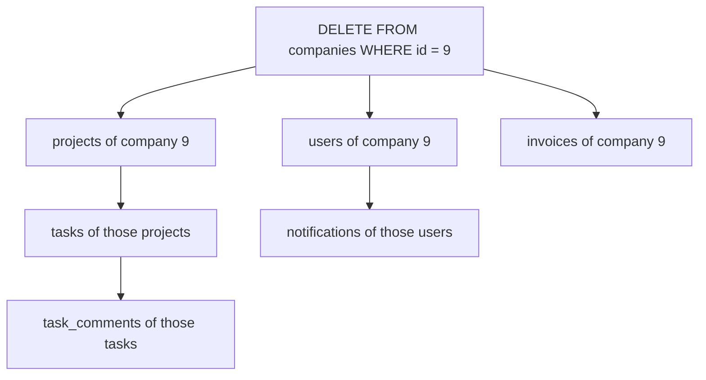

# Keys and Relationships — Part 2

Part 1 settled what identifies a single row. This part is about how rows point
at each other: the three relationship shapes, the join table that carries a
many-to-many, the `ON DELETE` action you owe every foreign key, and trees. It
ends with the two things that most often go wrong in production — an unindexed
foreign key and a constraint that has to be deferred.

> **⬅️ This continues [Part 1](./01-keys-and-relationships-part-1.md).**

> **📌 In one line:** Every relationship is a foreign key pointing at a primary
> key — the design work is choosing its shape, indexing it, and deciding what
> happens to the child when the parent is deleted.

## Table of Contents

1. [The Three Relationship Shapes](#the-three-relationship-shapes)
2. [Join Tables Done Well](#join-tables-done-well)
3. [ON DELETE Behaviour Is a Design Decision](#on-delete-behaviour-is-a-design-decision)
4. [Self-Referencing Keys and Trees](#self-referencing-keys-and-trees)
5. [Advanced: The Unindexed Foreign Key Bug](#advanced-the-unindexed-foreign-key-bug)
6. [Advanced: Deferrable Constraints](#advanced-deferrable-constraints)
7. [Common Mistakes](#common-mistakes)
8. [Questions to Test Yourself](#questions-to-test-yourself)
9. [Related](#related)

---

## The Three Relationship Shapes

### One-to-many

The most common shape by far. **The foreign key lives on the "many" side.** A
project has many tasks, so `project_id` is a column on `tasks`, never a list of
task ids on `projects`.

```sql
CREATE TABLE projects (
    id          bigint GENERATED ALWAYS AS IDENTITY PRIMARY KEY,
    company_id  bigint      NOT NULL REFERENCES companies (id) ON DELETE RESTRICT,
    name        text        NOT NULL,
    status      text        NOT NULL DEFAULT 'active',
    created_at  timestamptz NOT NULL DEFAULT now(),
    archived_at timestamptz
);

CREATE TABLE tasks (
    id          bigint GENERATED ALWAYS AS IDENTITY PRIMARY KEY,
    project_id  bigint      NOT NULL REFERENCES projects (id) ON DELETE CASCADE,
    assignee_id bigint      REFERENCES users (id) ON DELETE SET NULL,
    title       text        NOT NULL,
    status      text        NOT NULL DEFAULT 'open',
    due_date    date,
    created_at  timestamptz NOT NULL DEFAULT now()
);

-- The foreign key does NOT create this. You must.
CREATE INDEX tasks_project_id_idx  ON tasks (project_id);
CREATE INDEX tasks_assignee_id_idx ON tasks (assignee_id);
```

### Many-to-many

Neither side can hold the key, so a third table holds both.

```sql
CREATE TABLE project_members (
    project_id  bigint      NOT NULL REFERENCES projects (id) ON DELETE CASCADE,
    user_id     bigint      NOT NULL REFERENCES users (id)    ON DELETE CASCADE,
    role        text        NOT NULL DEFAULT 'member',
    added_at    timestamptz NOT NULL DEFAULT now(),

    PRIMARY KEY (project_id, user_id),
    CONSTRAINT project_members_role_check
        CHECK (role IN ('owner', 'editor', 'member', 'viewer'))
);
```

### One-to-one

Be honest about this one: **a one-to-one relationship is usually just a column
you split for no reason.** If every user has exactly one profile and you always
load them together, the profile fields belong on `users`.

There are three cases where the split is genuinely right:

1. **Optional heavy data.** A `users.avatar_blob` or a long biography that is
   rarely read makes every `SELECT *` on `users` more expensive. Splitting it
   out keeps the main table narrow, so more rows fit per page.
2. **Different access permissions.** Payroll or identity-document data that a
   different role should be able to query, with its own grants or row-level
   security policy.
3. **Different write frequency.** A counter that updates constantly next to
   data that never changes produces a lot of dead row versions on the wide
   table — see
   [../transactions-and-concurrency/04-locks-part-1.md](../transactions-and-concurrency/04-locks-part-1.md).

```sql
-- One-to-one done for a real reason: rarely-read, sensitive data
CREATE TABLE user_identity_documents (
    user_id       bigint PRIMARY KEY REFERENCES users (id) ON DELETE CASCADE,
    document_type text        NOT NULL,
    document_ref  text        NOT NULL,
    verified_at   timestamptz
);
```

The trick is the primary key: making `user_id` **both** the primary key and the
foreign key is what enforces "at most one row per user".

---

## Join Tables Done Well

### Composite key or surrogate key?

| | Composite PK `(project_id, user_id)` | Surrogate `id` + `UNIQUE (project_id, user_id)` |
|---|---|---|
| Uniqueness | Structural, free | Needs an extra unique index |
| Indexes created | One (the PK) | Two (the PK and the unique) |
| Can another table reference a row? | Awkward — two columns | Easy — one `id` |
| ORM support | Often poor | Always fine |
| Recommended when | Pure link, nothing points at it | The link has its own identity or children |

Start with the composite primary key. Switch to a surrogate only when something
needs to point at the membership row itself.

### Extra columns on the relationship

A join table is a real table and can carry facts *about the relationship*:

- `added_at` — when the membership started.
- `added_by` — who granted it.
- `role` — what this user can do **in this project**, which is different from
  `users.role` (their role in the company).

If you find yourself wanting these, that is a sign the relationship is a real
thing in your domain, and the join table deserves attention rather than being
treated as plumbing.

### Index both directions — the one people forget

The composite primary key `(project_id, user_id)` creates a B-tree index on
those columns **in that order**. A B-tree can only be used efficiently when the
query constrains a **leading prefix** of the index columns.

So this is fast:

```sql
-- "Who is in project 42?" — uses the PK index, project_id is leading
SELECT user_id FROM project_members WHERE project_id = 42;
```

And this is not:

```sql
-- "Which projects is user 7 in?" — user_id is NOT the leading column
SELECT project_id FROM project_members WHERE user_id = 7;
```

```text
Seq Scan on project_members  (cost=0.00..3812.00 rows=9 width=8)
                             (actual time=0.31..24.8 rows=9 loops=1)
  Filter: (user_id = 7)
  Rows Removed by Filter: 189991
```

190,000 rows scanned to return 9. The fix is one line:

```sql
CREATE INDEX project_members_user_id_idx ON project_members (user_id, project_id);
```

```text
Index Only Scan using project_members_user_id_idx on project_members
  (cost=0.42..12.06 rows=9 width=8) (actual time=0.02..0.03 rows=9 loops=1)
  Index Cond: (user_id = 7)
```

This is missed constantly, because the table "already has an index" — people
see the primary key and stop looking. Every join table is queried from both
sides, so it needs an index from both sides. See
[../query-optimization/composite-index-ordering.md](../query-optimization/composite-index-ordering.md)
for why column order decides everything here.

---

## ON DELETE Behaviour Is a Design Decision

When a parent row is deleted, the database must do something about the children
pointing at it. You choose what.

| Action | What happens | Correct when | SaaS example |
|---|---|---|---|
| `RESTRICT` | The delete fails immediately if any child exists | Losing the children would be a data-loss bug | You must not delete a `company` that still has `invoices` |
| `NO ACTION` | Same check, but deferred to end of statement/transaction | Same as `RESTRICT`, needed with `DEFERRABLE` | Circular references fixed up inside one transaction |
| `CASCADE` | Children are deleted too, recursively | Children are meaningless without the parent and carry no independent value | Deleting a `project` deletes its `tasks` |
| `SET NULL` | The child's FK column becomes `NULL` | The child survives fine without the parent | Deleting a `user` leaves their `tasks` unassigned |
| `SET DEFAULT` | The child's FK becomes its column default | Rare — there is a meaningful fallback row | Reassigning to a "system" user |

`RESTRICT` is the PostgreSQL default when you write nothing, and it is a good
default: it makes you think.

### The CASCADE warning

`CASCADE` is recursive, and the recursion is invisible at the point where you
run the delete.



One statement, six tables, and nothing in the statement text hints at it. If
`companies.id = 9` is your biggest customer, a single `DELETE` removes their
entire history, including the invoices your finance team needs to keep.

### BROKEN vs FIXED

```sql
-- ❌ BROKEN — CASCADE placed where the data has independent value
CREATE TABLE invoices (
    id           bigint GENERATED ALWAYS AS IDENTITY PRIMARY KEY,
    company_id   bigint      NOT NULL
                 REFERENCES companies (id) ON DELETE CASCADE,  -- <-- here
    amount_cents bigint      NOT NULL,
    status       text        NOT NULL,
    issued_at    timestamptz NOT NULL DEFAULT now(),
    paid_at      timestamptz
);

-- Support runs a "remove test company" script. Real invoices vanish silently.
DELETE FROM companies WHERE id = 9;
-- DELETE 1     <- one row reported. Thirty invoices are gone.
```

The reported row count is `1`. Nothing tells you that thirty financial records
were destroyed.

```sql
-- ✅ FIXED — RESTRICT forces the deletion to be a conscious act
CREATE TABLE invoices (
    id           bigint GENERATED ALWAYS AS IDENTITY PRIMARY KEY,
    company_id   bigint      NOT NULL
                 REFERENCES companies (id) ON DELETE RESTRICT,
    amount_cents bigint      NOT NULL,
    status       text        NOT NULL,
    issued_at    timestamptz NOT NULL DEFAULT now(),
    paid_at      timestamptz
);

DELETE FROM companies WHERE id = 9;
```

```text
ERROR:  update or delete on table "companies" violates foreign key constraint
        "invoices_company_id_fkey" on table "invoices"
DETAIL:  Key (id)=(9) is still referenced from table "invoices".
```

That error is the feature. Whoever wanted the company gone now has to decide
what should happen to thirty invoices — which is a decision a human should
make, not a cascade rule written eighteen months ago.

> **💡 Tip:** A useful rule of thumb: `CASCADE` down *composition* ("this row is
> part of that row" — tasks of a project, items of an order), `RESTRICT` across
> *association* ("this row refers to that row" — invoices of a company).

---

## Self-Referencing Keys and Trees

A foreign key can point at the same table. That is how you model a hierarchy —
a task with subtasks, a comment with replies, a folder inside a folder.

```sql
ALTER TABLE tasks
    ADD COLUMN parent_task_id bigint REFERENCES tasks (id) ON DELETE CASCADE;

CREATE INDEX tasks_parent_task_id_idx ON tasks (parent_task_id);
```

A `NULL` parent means a top-level task. This is the **adjacency list** model,
and it is not the only option.

| Model | How it stores the tree | Read a whole subtree | Move a subtree | Enforce integrity |
|---|---|---|---|---|
| Adjacency list | `parent_id` on each row | Recursive CTE | Change one row | Foreign key does it |
| Path enumeration | `path` text like `/1/7/22/` | One `LIKE '/1/7/%'` — very fast | Rewrite every descendant's path | Manual — nothing checks the path |
| Closure table | Extra table with a row per ancestor-descendant pair | Simple join — fastest | Delete and reinsert many rows | Foreign keys on the closure table |

**Recommendation:** start with the adjacency list. It is the only one the
database keeps correct for you, and a recursive CTE handles reads well up to
surprisingly large trees. Move to a closure table only when subtree reads are
measurably the bottleneck and the tree is read far more than it is written.

For the recursive query side of this — `WITH RECURSIVE`, depth limits, cycle
detection — see
[../fundamentals/06-ctes-and-window-functions-part-1.md](../fundamentals/06-ctes-and-window-functions-part-1.md).

> **⚠️ Warning:** A self-referencing foreign key does not stop a cycle. Nothing
> prevents task A's parent being B while B's parent is A, and a recursive query
> over that will run until you stop it. If cycles are possible in your data, add
> a `CYCLE` clause to the recursive CTE or a trigger that rejects them.

---

## Advanced: The Unindexed Foreign Key Bug

This is the most commonly missed performance bug in schema design, and it looks
like nothing.

A foreign key means that before PostgreSQL can delete or update a parent row,
it must check that no child still references it. To check that, it runs, in
effect:

```sql
SELECT 1 FROM tasks WHERE project_id = $1 FOR KEY SHARE;
```

If `tasks.project_id` has no index, **that check is a sequential scan of the
entire child table** — and it runs once per parent row deleted.

```text
-- tasks has 4,000,000 rows and no index on project_id

DELETE FROM projects WHERE id = 118;
```

```text
Delete on projects  (cost=0.29..8.30 rows=0 width=0)
                    (actual time=3184.902..3184.903 rows=0 loops=1)
  ->  Index Scan using projects_pkey on projects
        (cost=0.29..8.30 rows=1 width=6) (actual time=0.031..0.033 rows=1 loops=1)
Trigger for constraint tasks_project_id_fkey: time=3184.110 calls=1
Execution Time: 3185.204 ms
```

Note where the time is: **in the constraint trigger**, not in the delete. The
delete itself took 0.03 ms. Deleting 200 projects would take about ten minutes,
while holding locks the whole time.

```sql
CREATE INDEX tasks_project_id_idx ON tasks (project_id);
```

```text
Trigger for constraint tasks_project_id_fkey: time=0.212 calls=1
Execution Time: 0.489 ms
```

Six thousand times faster, from one index.

> **📌 Remember:** PostgreSQL indexes the **parent** side of a foreign key
> automatically (it is the primary key). It never indexes the **child** side.
> Every foreign key column you create needs an index unless you can prove the
> table is tiny and will stay tiny.

You can find the missing ones:

```sql
SELECT c.conrelid::regclass AS child_table,
       a.attname            AS column_name
FROM   pg_constraint c
JOIN   unnest(c.conkey) WITH ORDINALITY AS k (attnum, ord) ON true
JOIN   pg_attribute a ON a.attrelid = c.conrelid AND a.attnum = k.attnum
WHERE  c.contype = 'f'
AND    NOT EXISTS (
           SELECT 1 FROM pg_index i
           WHERE  i.indrelid = c.conrelid
           AND    i.indkey[0] = k.attnum
       )
ORDER  BY 1;
```

---

## Advanced: Deferrable Constraints

Sometimes two tables reference each other, and there is no order in which you
can insert the rows without breaking a constraint.

```sql
-- A company has a primary contact who is a user; a user belongs to a company.
ALTER TABLE companies
    ADD COLUMN primary_contact_id bigint REFERENCES users (id)
        DEFERRABLE INITIALLY IMMEDIATE;
```

`DEFERRABLE` means the check *can* be postponed. `INITIALLY IMMEDIATE` means it
is checked per statement by default, and you opt in per transaction:

```sql
BEGIN;
    SET CONSTRAINTS ALL DEFERRED;

    INSERT INTO companies (id, name, plan, primary_contact_id)
    VALUES (500, 'Acme', 'pro', 9001);        -- user 9001 does not exist yet

    INSERT INTO users (id, company_id, email, name, role)
    VALUES (9001, 500, 'boss@acme.com', 'Dana', 'admin');
COMMIT;                                       -- both checks run here, both pass
```

Use it sparingly. A deferred constraint means the database is temporarily in a
state that violates your rules, and any error at `COMMIT` is harder to trace
back to the statement that caused it. Prefer making one side nullable and doing
a second `UPDATE` — it is easier to read.

---

## Common Mistakes

1. **No index on a foreign key column.** Slow deletes on the parent, slow joins,
   slow "find all children" queries.
2. **Only indexing a join table from one direction.** Half your queries scan the
   whole table.
3. **`ON DELETE CASCADE` copied onto every foreign key.** One delete removes far
   more than anyone expects.
4. **Modelling a one-to-one split with no reason.** A join you pay for on every
   read with nothing gained.
5. **A join table with a surrogate primary key and no unique constraint on the
   pair.** The same membership can be inserted twice.

---

## Questions to Test Yourself

1. `project_members` has `PRIMARY KEY (project_id, user_id)`. Which of the two
   natural queries is slow, and what index fixes it?
2. Give one foreign key in the shared schema where `CASCADE` is correct and one
   where it would be a serious bug. Justify both.
3. A `DELETE` of one row from `projects` takes three seconds. The plan shows the
   time in a constraint trigger. What is wrong and what is the one-line fix?
4. You must model a task hierarchy. Which of the three tree models do you start
   with, and what would push you to a closure table?
5. When is a one-to-one table split justified? Give two distinct reasons that
   are not "it feels cleaner".
6. Two rows must reference each other. Why does a plain foreign key make the
   pair impossible to insert, and what does `DEFERRABLE INITIALLY DEFERRED`
   change about when the check runs?

---

## Related

- [README](README.md) — the rest of this folder.
- [Part 1](01-keys-and-relationships-part-1.md) — primary keys, natural vs
  surrogate keys, key type selection, and what a foreign key enforces.
- [Constraints and data integrity](02-constraints-and-data-integrity-part-1.md)
  — the `UNIQUE` and `CHECK` rules that go alongside these keys.
- [Normalization](03-normalization-part-1.md) — deciding which table a column
  belongs to in the first place.
- [Schema design patterns](06-schema-design-patterns-part-1.md) — naming, audit
  columns, and multi-tenancy keys.
- [CTEs and window functions](../fundamentals/06-ctes-and-window-functions-part-1.md)
  — recursive queries over the tree models above.
- [Composite index ordering](../query-optimization/composite-index-ordering.md)
  — why a join table needs an index from both directions.
- [Join optimization](../query-patterns/join-optimization.md) — what the planner
  does with these relationships.
- [Locks](../transactions-and-concurrency/04-locks-part-2.md) — what a foreign key
  check locks on the parent row.
- [ORM vs query builder](../../backend-fundamentals/10-database-integration/01-orm-vs-query-builder.md)
  — how application code maps these relationships.
