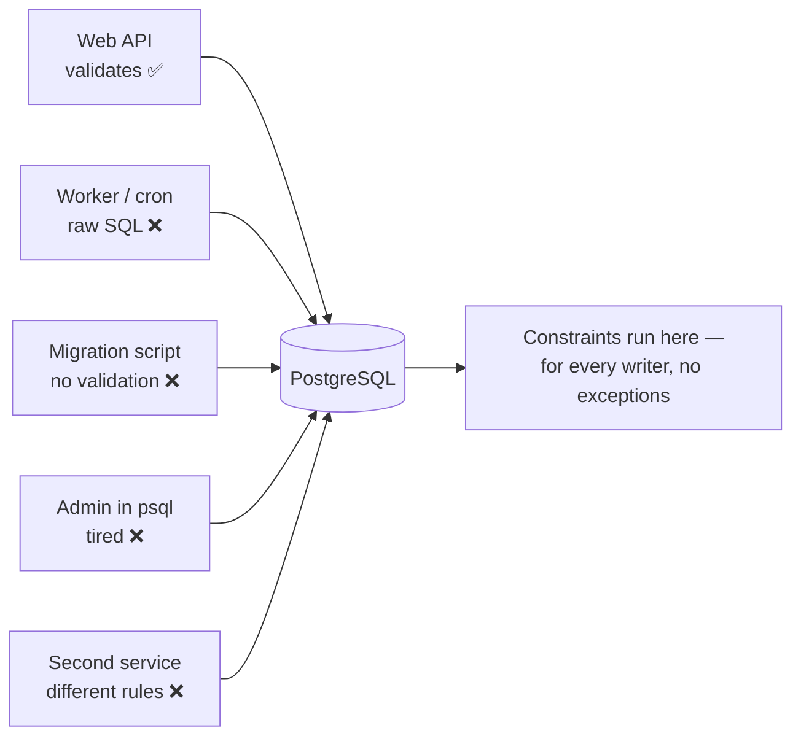

# Constraints and Data Integrity — Part 1

A building has a fire door that cannot be propped open. Not a sign asking
people not to prop it open — a mechanism that makes it impossible. Signs work
until someone is in a hurry. Constraints are the mechanism; application
validation is the sign. You want both, but only one of them is a guarantee.

> **📌 In one line:** Application validation stops most bad data from one
> door; a database constraint stops all bad data from every door, forever.

Part 2 picks up the constraints that go beyond a single column, and the
application code that has to live with all of them.

## Table of Contents

1. [Why the Database Is the Only Real Guarantee](#why-the-database-is-the-only-real-guarantee)
2. [The Constraint Types, With Their Errors](#the-constraint-types-with-their-errors)
3. [CHECK Constraints in Practice](#check-constraints-in-practice)
4. [UNIQUE in Depth](#unique-in-depth)
5. [Common Mistakes](#common-mistakes)
6. [Questions to Test Yourself](#questions-to-test-yourself)
7. [Related](#related)

---

## Why the Database Is the Only Real Guarantee

Here is the argument, and it is worth taking seriously before reading any
syntax.

Your API validates every request. Nothing invalid can get in. Except:

- **A second service** writes to the same table. It was written by another
  team, in another language, with its own idea of the rules.
- **A background job** backfills a column. It uses raw SQL because the ORM was
  slow, and it skips your model hooks entirely.
- **A migration** copies data from an old table to a new one. Migrations do not
  run application validation — they are SQL.
- **A developer in `psql`** fixes a customer's data at 11 PM. They are careful.
  They are also tired.
- **A retried request.** The client timed out and retried; the first request had
  already committed. Your "check then insert" logic ran twice, concurrently,
  and both checks passed before either insert.
- **Your own code, six months from now.** Someone adds a second code path that
  writes the same table and does not know the rule exists.



The rule is simple: **validation that lives in one application protects one
application.** A constraint lives in the data, so it protects the data.

This is not an argument against application validation. Application validation
gives good error messages, runs before you touch the database, and can express
things SQL cannot. It is the friendly front door. See
[../../backend-fundamentals/04-validation-and-input/01-why-validation-matters.md](../../backend-fundamentals/04-validation-and-input/01-why-validation-matters.md)
for that side. But a rule that matters must exist in both places, and if you
only have the budget for one, put it in the database.

> **📌 Remember:** Bad data is not a bug you fix once. It is a bug that keeps
> producing new bugs, in code that was written correctly, forever after.

---

## The Constraint Types, With Their Errors

Here is the full set, applied to the shared schema, each with the error you
actually see.

### NOT NULL

```sql
ALTER TABLE users ALTER COLUMN email SET NOT NULL;

INSERT INTO users (company_id, email, name, role) VALUES (1, NULL, 'Sam', 'member');
```

```text
ERROR:  null value in column "email" of relation "users"
        violates not-null constraint
DETAIL:  Failing row contains (91, 1, null, Sam, member, 2026-05-02 10:11:00+00).
```

### UNIQUE

```sql
ALTER TABLE users ADD CONSTRAINT users_email_unique UNIQUE (email);

INSERT INTO users (company_id, email, name, role)
VALUES (1, 'sam@acme.com', 'Sam', 'member');   -- already exists
```

```text
ERROR:  duplicate key value violates unique constraint "users_email_unique"
DETAIL:  Key (email)=(sam@acme.com) already exists.
```

### PRIMARY KEY

`NOT NULL` + `UNIQUE` + a unique index, all at once. Covered in
[01-keys-and-relationships-part-1.md](01-keys-and-relationships-part-1.md).

### FOREIGN KEY

```sql
INSERT INTO tasks (project_id, title) VALUES (999999, 'Orphan');
```

```text
ERROR:  insert or update on table "tasks" violates foreign key constraint
        "tasks_project_id_fkey"
DETAIL:  Key (project_id)=(999999) is not present in table "projects".
```

### CHECK

```sql
ALTER TABLE invoices
    ADD CONSTRAINT invoices_amount_positive CHECK (amount_cents >= 0);

INSERT INTO invoices (company_id, amount_cents, status) VALUES (1, -500, 'draft');
```

```text
ERROR:  new row for relation "invoices" violates check constraint
        "invoices_amount_positive"
DETAIL:  Failing row contains (4102, 1, -500, draft, 2026-05-02 10:14:00+00, null).
```

### EXCLUDE

The one most people have never used. It generalises `UNIQUE`: instead of "no
two rows may be equal on these columns", it says "no two rows may *overlap*, or
*intersect*, or satisfy any operator you name". Covered
[below](#exclude-preventing-overlaps).

| Constraint | Says | Scope |
|---|---|---|
| `NOT NULL` | This column always has a value | One column, one row |
| `CHECK` | This row satisfies an expression | One row only |
| `UNIQUE` | No two rows are equal here | Across the table |
| `PRIMARY KEY` | This identifies the row | Across the table |
| `FOREIGN KEY` | This value exists over there | Across two tables |
| `EXCLUDE` | No two rows relate by this operator | Across the table |

Notice what is missing: there is no built-in constraint that spans **rows in
another table conditionally**. That gap is why triggers exist.

---

## CHECK Constraints in Practice

A `CHECK` is any boolean expression over the columns of a single row. If it
evaluates to false, the write is rejected. (If it evaluates to `NULL`, the row
is **accepted** — a real subtlety worth remembering.)

### Non-negative amounts

```sql
ALTER TABLE invoices
    ADD CONSTRAINT invoices_amount_non_negative
    CHECK (amount_cents >= 0);
```

### Valid status values

```sql
ALTER TABLE tasks
    ADD CONSTRAINT tasks_status_valid
    CHECK (status IN ('open', 'in_progress', 'blocked', 'done', 'cancelled'));
```

### Date ordering

```sql
ALTER TABLE projects
    ADD COLUMN starts_on date,
    ADD COLUMN ends_on   date;

ALTER TABLE projects
    ADD CONSTRAINT projects_dates_ordered
    CHECK (ends_on IS NULL OR starts_on IS NULL OR ends_on > starts_on);
```

Note the explicit `IS NULL` branches. Without them the expression is `NULL`
when either date is missing, which the constraint accepts anyway — but writing
it out makes the intent visible to the next reader.

### Conditional requirements

A `CHECK` can express "if A then B", which is often exactly the business rule:

```sql
ALTER TABLE invoices
    ADD CONSTRAINT invoices_paid_has_date
    CHECK (status <> 'paid' OR paid_at IS NOT NULL);
```

"An invoice with status `paid` must have a `paid_at`." This single line
eliminates a whole class of reporting bug.

### The limitation

> **⚠️ Warning:** A `CHECK` constraint can only look at **the row being
> written**. It cannot query another table, cannot look at other rows in the
> same table, and cannot call a function that does (PostgreSQL does not stop
> you writing such a function, but the result is not enforced correctly — it is
> not re-checked when the *other* table changes).

So you cannot write "a task's due date must be before its project's end date"
as a `CHECK`. That needs either a trigger, or denormalising the project's end
date onto the task, or accepting it as an application-level rule.

---

## UNIQUE in Depth

`UNIQUE` looks simple and has three behaviours that surprise people.

### NULLs are not equal to each other

In SQL, `NULL = NULL` is not true — it is `NULL`, meaning "unknown". A unique
constraint compares values, so two `NULL`s are never "the same", and a unique
column accepts **any number of NULL rows**.

```sql
CREATE TABLE users (
    id          bigint GENERATED ALWAYS AS IDENTITY PRIMARY KEY,
    company_id  bigint NOT NULL REFERENCES companies (id),
    email       text   NOT NULL,
    name        text   NOT NULL,
    role        text   NOT NULL,
    external_id text,
    CONSTRAINT users_external_id_unique UNIQUE (external_id)
);

INSERT INTO users (company_id, email, name, role, external_id)
VALUES (1, 'a@x.com', 'A', 'member', NULL),
       (1, 'b@x.com', 'B', 'member', NULL),
       (1, 'c@x.com', 'C', 'member', NULL);
-- INSERT 0 3    <- all three accepted
```

Sometimes that is exactly right: "each user who has an external SSO id must
have a unique one, but most users have none." Sometimes it is a hole you did
not know about. If you need at most one NULL, recent PostgreSQL versions
support `UNIQUE NULLS NOT DISTINCT (external_id)` — check your version.

MySQL behaves the same way here: multiple NULLs are allowed in a unique index.

### Partial unique indexes: unique among active rows only

This is the standard answer to two very common problems.

**Problem 1 — soft deletes break uniqueness.** If deleted rows stay in the
table, a plain `UNIQUE (email)` means an email can never be reused, even after
the account is deleted.

```sql
-- Unique only among rows that are not soft-deleted
CREATE UNIQUE INDEX users_email_active_unique
ON users (email)
WHERE deleted_at IS NULL;
```

**Problem 2 — "exactly one primary contact per company".** You cannot express
that with `UNIQUE (company_id)` because most users are not the primary contact.

```sql
ALTER TABLE users ADD COLUMN is_primary_contact boolean NOT NULL DEFAULT false;

CREATE UNIQUE INDEX users_one_primary_contact_per_company
ON users (company_id)
WHERE is_primary_contact;
```

Now the second attempt to flag a primary contact fails:

```text
ERROR:  duplicate key value violates unique constraint
        "users_one_primary_contact_per_company"
DETAIL:  Key (company_id)=(1) already exists.
```

There is no way to get this wrong from application code, from a migration, or
from `psql`. That is the whole point.

> **💡 Tip:** This is a unique *index*, not a table constraint — PostgreSQL has
> no `ALTER TABLE ... ADD CONSTRAINT ... WHERE` syntax. It enforces just as
> strictly; it simply will not appear in `\d` under "constraints". See
> [../query-optimization/partial-indexes.md](../query-optimization/partial-indexes.md).

MySQL has no partial indexes, so there the equivalent trick is a generated
column that is `NULL` for rows you want excluded, plus a unique index on it.

### Functional unique indexes for case-insensitive uniqueness

`'Sam@Acme.com'` and `'sam@acme.com'` are different strings, so a plain
`UNIQUE (email)` allows both.

```sql
CREATE UNIQUE INDEX users_email_lower_unique ON users (LOWER(email));
```

Now the database compares the lowercased form, and the duplicate is rejected
whatever case it arrives in.

**Why normalising in the application is not enough:** normalisation is a rule
implemented in code, so it has every weakness from the
[first section](#why-the-database-is-the-only-real-guarantee). The support
script that inserts a user, the CSV import, the second service — each must
remember to lowercase. One that forgets creates a duplicate account that your
login query will never find, and the user will insist they already registered.

Do both: normalise in the application so the stored value is clean, and index
on `LOWER(email)` so it cannot go wrong. See
[../indexing/02-expression-and-functional-indexes.md](../indexing/02-expression-and-functional-indexes.md)
for how expression indexes work and when the planner can use them.

An alternative is the `citext` extension, which makes the column itself
case-insensitive. It is convenient, but it hides the behaviour in the type
rather than showing it in an index, and it interacts awkwardly with collations.
The functional index is usually the clearer choice.

### Composite unique constraints and column order

```sql
ALTER TABLE projects
    ADD CONSTRAINT projects_name_unique_per_company UNIQUE (company_id, name);
```

This says "a project name must be unique **within a company**" — two companies
may both have a project called "Website". That is almost always the rule you
want in a multi-tenant system, and `UNIQUE (name)` alone would be wrong.

For **correctness**, column order in a unique constraint does not matter:
`(company_id, name)` and `(name, company_id)` forbid exactly the same rows.

For **performance** it matters a lot, because the constraint is backed by a
B-tree index that your queries can also use. `(company_id, name)` can serve
"all projects in company 7"; `(name, company_id)` cannot. Put the column you
filter on alone first. See
[../query-optimization/composite-index-ordering.md](../query-optimization/composite-index-ordering.md).

---

## Common Mistakes

1. **"We validate in the API, we do not need constraints."** True until the
   second writer exists, which is always.
2. **Forgetting that multiple NULLs pass a unique constraint.**
3. **A plain `UNIQUE (email)` on a table with soft deletes.** The email can
   never be reused.
4. **Relying on application lowercasing instead of a `LOWER(email)` index.**
5. **A `CHECK` that reaches for another row.** It only sees the row being
   written, so the rule silently does not hold.

---

## Questions to Test Yourself

1. Give four distinct writers that bypass your application's validation. Which
   one is most likely to hit you first?
2. What does a `CHECK` constraint fundamentally not know about, and give an
   example of a rule you therefore cannot express with one?
3. Why does `UNIQUE (external_id)` allow a thousand rows with `NULL`? When is
   that the behaviour you want?
4. Write the DDL for "each company has at most one primary contact" using a
   partial unique index. Why can a plain `UNIQUE` not express it?
5. Your application lowercases every email before insert. Why is a
   `LOWER(email)` unique index still necessary?
6. A composite `UNIQUE (company_id, email)` exists. Which of the two single
   column lookups can use its index, and why does the order matter?

---

> **➡️ Continued in [Part 2](./02-constraints-and-data-integrity-part-2.md)**

## Related

- [README](README.md) — the rest of this folder.
- [Part 2](02-constraints-and-data-integrity-part-2.md) — `EXCLUDE`, enum
  values, catching violations in application code, and adding a constraint to a
  table that already holds bad data.
- [Keys and relationships](01-keys-and-relationships-part-1.md) — primary and
  foreign keys, which are constraints too.
- [Schema design patterns](06-schema-design-patterns-part-1.md) — soft deletes,
  status columns, and tenant keys that use these constraints.
- [PostgreSQL data types](05-postgres-data-types-part-1.md) — the types these
  constraints are written against.
- [Partial indexes](../query-optimization/partial-indexes.md) — the mechanics
  behind the conditional unique index.
- [Expression and functional indexes](../indexing/02-expression-and-functional-indexes.md)
  — how `LOWER(email)` indexing works.
- [Composite index ordering](../query-optimization/composite-index-ordering.md)
  — why the order of a composite unique constraint matters for reads.
- [Why validation matters](../../backend-fundamentals/04-validation-and-input/01-why-validation-matters.md)
  — the application side of the same argument.
