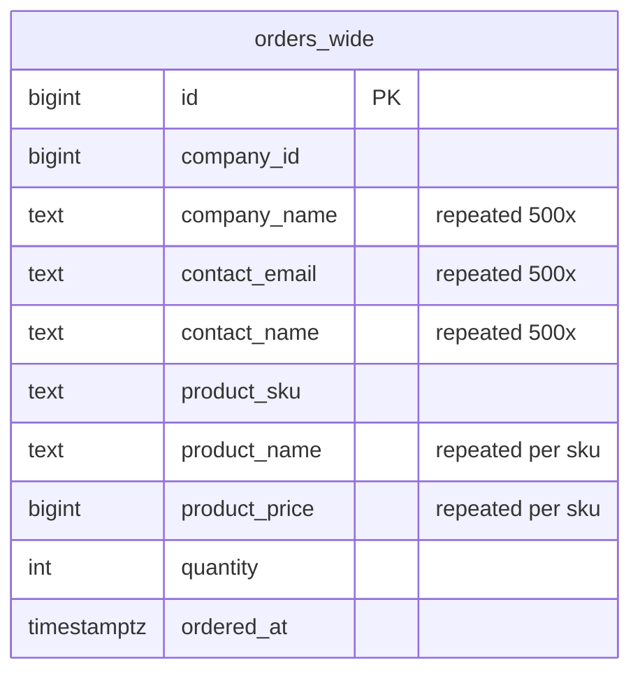
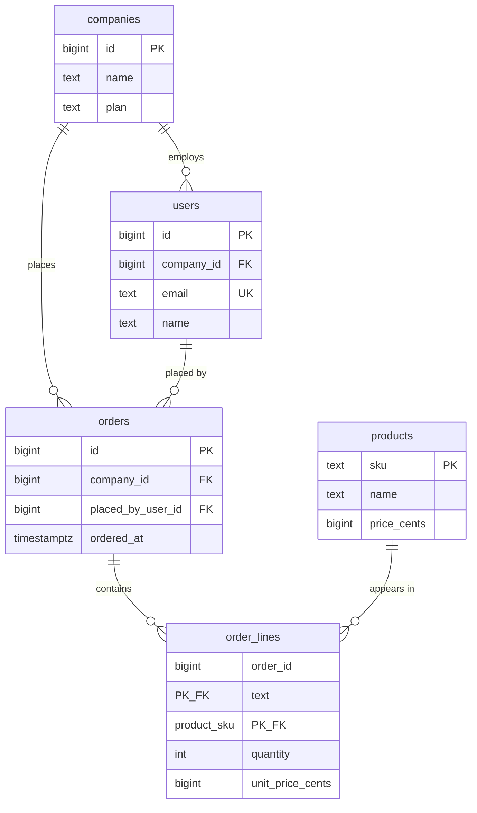

# Normalization — Part 1

Imagine a shop that writes a customer's full address on every receipt. When the
customer moves, the shop has to find and correct every receipt they ever
issued. They will miss some. A year later nobody knows which address is
current. The fix is obvious once you see it: write the address **once**, in one
place, and have the receipts point at it.

That is normalization. Everything below is that one idea, applied carefully.

> **📌 In one line:** Store each fact exactly once, so there is never a second
> copy that can disagree with the first.

Part 2 takes the normalized schema this part arrives at and asks the harder
questions: what it costs, when to stop, and what to do with data that does not
fit neatly into columns at all.

## Table of Contents

1. [The Problem, Before Any Theory](#the-problem-before-any-theory)
2. [The Three Anomalies](#the-three-anomalies)
3. [Now the Definition](#now-the-definition)
4. [First Normal Form](#first-normal-form)
5. [Second Normal Form](#second-normal-form)
6. [Third Normal Form](#third-normal-form)
7. [Before and After](#before-and-after)
8. [Common Mistakes](#common-mistakes)
9. [Questions to Test Yourself](#questions-to-test-yourself)
10. [Related](#related)

---

## The Problem, Before Any Theory

Here is a real-looking table. Someone built it because it made one report easy.

```sql
CREATE TABLE orders_wide (
    id              bigint GENERATED ALWAYS AS IDENTITY PRIMARY KEY,
    company_id      bigint      NOT NULL,
    company_name    text        NOT NULL,
    contact_email   text        NOT NULL,
    contact_name    text        NOT NULL,
    contact_phone   text,
    product_sku     text        NOT NULL,
    product_name    text        NOT NULL,
    product_price   bigint      NOT NULL,
    quantity        int         NOT NULL,
    ordered_at      timestamptz NOT NULL DEFAULT now()
);
```

And here is what it contains after a year:

```text
 id  | company_id | company_name | contact_email   | product_sku | product_name  | product_price | qty
-----+------------+--------------+-----------------+-------------+---------------+---------------+-----
 101 |          7 | Acme Ltd     | dana@acme.com   | SKU-9       | Pro Seat      |          4900 |   3
 102 |          7 | Acme Ltd     | dana@acme.com   | SKU-9       | Pro Seat      |          4900 |   1
 103 |          7 | Acme Ltd     | dana@acme.com   | SKU-4       | Storage 100GB |           900 |   2
 104 |          7 | Acme Ltd     | dana@acme.com   | SKU-9       | Pro Seat      |          4900 |   5
 ... 496 more rows for company 7 ...
 599 |         12 | Bolt Co      | li@bolt.io      | SKU-9       | Pro Seat      |          4900 |   2
```

Look at what is repeated. `Acme Ltd` and `dana@acme.com` appear 500 times.
`Pro Seat` and `4900` appear on every row that mentions `SKU-9`, across every
company.

Two facts — "company 7 is called Acme Ltd, contact dana@acme.com" and "SKU-9 is
a Pro Seat costing 4900" — are stored hundreds of times each. Every extra copy
is a chance for the copies to disagree.

---

## The Three Anomalies

The damage has three standard names. They are not academic; each one is a
support ticket.

### Update anomaly

Dana changes her email to `dana@acme.co.uk`.

```sql
UPDATE orders_wide
SET    contact_email = 'dana@acme.co.uk'
WHERE  company_id = 7;
-- UPDATE 500
```

Five hundred rows rewritten to record one change of fact. And this is the good
case — here is the bad one, which is what actually happens:

```sql
-- Someone writes it this way, because it "reads better"
UPDATE orders_wide
SET    contact_email = 'dana@acme.co.uk'
WHERE  contact_email = 'dana@acme.com';
-- UPDATE 499
```

499, not 500. One row had `Dana@Acme.com` with a capital D, typed by an import
script eight months ago. That row is now the only record in the database
claiming Dana's email is something else, and no query will ever tell you it is
wrong.

```text
SELECT DISTINCT contact_email FROM orders_wide WHERE company_id = 7;

 contact_email
--------------------
 dana@acme.co.uk
 Dana@Acme.com        <-- which one is true?
```

The database cannot answer that question, because both are "just data".

### Insertion anomaly

A new company signs up but has not ordered anything yet. Where do you put them?

```sql
INSERT INTO orders_wide (company_id, company_name, contact_email, contact_name,
                         product_sku, product_name, product_price, quantity)
VALUES (55, 'Nimbus GmbH', 'kai@nimbus.de', 'Kai', NULL, NULL, NULL, NULL);
```

```text
ERROR:  null value in column "product_sku" of relation "orders_wide"
        violates not-null constraint
```

You cannot record a customer without inventing a fake order. Teams solve this
with a "placeholder" row with `product_sku = 'NONE'` and quantity 0, and from
that day every single query must remember to exclude it. The table's structure
has forced a lie into the data.

The same applies to products: you cannot list a new product in the catalogue
until somebody buys it.

### Deletion anomaly

Acme cancels their only remaining order, so you delete it.

```sql
DELETE FROM orders_wide WHERE id = 104;
```

The order is gone — and so is every trace that Acme Ltd exists, who Dana is,
and what her email address was. Deleting one fact destroyed an unrelated one,
because they were stored in the same row.

| Anomaly | Trigger | What goes wrong |
|---|---|---|
| Update | Changing a repeated fact | Must update N rows; one is missed; copies disagree |
| Insertion | Recording a fact with no related fact | Cannot insert, or must invent a fake row |
| Deletion | Removing the last related row | An unrelated fact is destroyed with it |

All three come from the same cause: **one row is storing facts about more than
one thing.**

---

## Now the Definition

**Normalization** is the process of splitting data across tables so that each
fact is stored exactly once, in the table that is *about* the thing that fact
describes.

It is not about having many tables. It is not about saving disk space (though
it does). It is about making it **structurally impossible** for two copies of
the same fact to disagree, because there is only ever one copy.

The classic one-line summary, which is worth memorising:

> **📌 Remember:** Every non-key column must depend on **the key, the whole
> key, and nothing but the key.**

Those three clauses are 1NF, 2NF and 3NF in order, and the next three sections
explain each one concretely.

---

## First Normal Form

**1NF: each column holds one single value, and there are no repeating groups of
columns.**

Our `orders_wide` table is technically already in 1NF, so here is a version
that is not — and it is a shape you will genuinely meet:

```sql
-- ❌ BROKEN — not in 1NF, twice over
CREATE TABLE projects_bad (
    id         bigint PRIMARY KEY,
    company_id bigint NOT NULL,
    name       text   NOT NULL,
    tag1       text,           -- repeating group
    tag2       text,
    tag3       text,
    member_ids text            -- multiple values in one column: '4,17,23'
);
```

Two violations:

- `tag1, tag2, tag3` is a **repeating group**. What happens with a fourth tag?
  How do you find every project tagged `urgent` without checking three columns?
  How do you rename a tag everywhere?
- `member_ids` holds **many values in one cell**. You cannot put a foreign key
  on it, you cannot index a lookup of one member usefully, and finding
  "projects containing member 4" needs `LIKE '%4%'`, which also matches 14, 40
  and 234.

```sql
-- ✅ FIXED — in 1NF: one value per cell, repetition becomes rows
CREATE TABLE project_tags (
    project_id bigint NOT NULL REFERENCES projects (id) ON DELETE CASCADE,
    tag        text   NOT NULL,
    PRIMARY KEY (project_id, tag)
);

CREATE TABLE project_members (
    project_id bigint      NOT NULL REFERENCES projects (id) ON DELETE CASCADE,
    user_id    bigint      NOT NULL REFERENCES users (id)    ON DELETE CASCADE,
    role       text        NOT NULL DEFAULT 'member',
    added_at   timestamptz NOT NULL DEFAULT now(),
    PRIMARY KEY (project_id, user_id)
);
CREATE INDEX project_members_user_idx ON project_members (user_id, project_id);
```

**What this fixed:** unlimited tags and members, a real foreign key on
`user_id` so a deleted user cannot be silently left behind, an index that makes
both lookup directions fast, and a place to record `role` and `added_at` about
the membership.

Applied to our running example, `orders_wide` already satisfies 1NF. Good — one
clause down.

---

## Second Normal Form

**2NF: 1NF, plus every non-key column depends on the *whole* key, not just part
of it.**

This clause only ever applies when the key is **composite**. If your primary
key is a single surrogate `id`, you cannot violate 2NF — which is a quiet
argument for surrogate keys.

Suppose the order lines are keyed by `(order_id, product_sku)`:

```sql
-- ❌ BROKEN — violates 2NF
CREATE TABLE order_lines_bad (
    order_id      bigint NOT NULL,
    product_sku   text   NOT NULL,
    quantity      int    NOT NULL,
    product_name  text   NOT NULL,   -- depends only on product_sku
    product_price bigint NOT NULL,   -- depends only on product_sku
    ordered_at    timestamptz NOT NULL,  -- depends only on order_id
    PRIMARY KEY (order_id, product_sku)
);
```

Walk each column against the key `(order_id, product_sku)`:

- `quantity` — needs **both**. How many of *this product* on *this order*. ✅
- `product_name` — needs only `product_sku`. Knowing the order tells you
  nothing extra. ❌
- `product_price` — same. ❌
- `ordered_at` — needs only `order_id`. ❌

Each ❌ is a fact duplicated on every row sharing that part of the key. Fix it
by moving each column to the table whose key it actually depends on:

```sql
-- ✅ FIXED — 2NF
CREATE TABLE products (
    sku         text   PRIMARY KEY,
    name        text   NOT NULL,
    price_cents bigint NOT NULL
);

CREATE TABLE orders (
    id           bigint GENERATED ALWAYS AS IDENTITY PRIMARY KEY,
    company_id   bigint      NOT NULL REFERENCES companies (id) ON DELETE RESTRICT,
    ordered_at   timestamptz NOT NULL DEFAULT now()
);

CREATE TABLE order_lines (
    order_id    bigint NOT NULL REFERENCES orders (id)   ON DELETE CASCADE,
    product_sku text   NOT NULL REFERENCES products (sku) ON DELETE RESTRICT,
    quantity    int    NOT NULL CHECK (quantity > 0),
    PRIMARY KEY (order_id, product_sku)
);
CREATE INDEX order_lines_product_idx ON order_lines (product_sku);
```

**Which anomalies disappeared:**

- **Insertion** — you can now add a product to `products` before anyone orders
  it, and an order exists before its lines do.
- **Update** — a price change is one row in `products`, not a rewrite of every
  historical line.
- **Deletion** — deleting the last order line no longer erases the product.

> **⚠️ Warning:** Price is the famous exception. Once an order is placed you
> usually want the price **as it was at the time**, so `order_lines` should
> carry its own `unit_price_cents` copied at insert. That is not a normalization
> failure — the historical price is a genuinely different fact from the current
> price. Being able to tell those two apart is the skill.

---

## Third Normal Form

**3NF: 2NF, plus every non-key column depends on the key and *nothing but* the
key — no column depends on another non-key column.**

Back to the original wide table. Its key is `id`. Check every column:

```text
id -> company_id     ✅ a fact about this order
id -> company_name   ❌ actually depends on company_id, not on id
id -> contact_email  ❌ depends on company_id
id -> contact_name   ❌ depends on company_id
id -> quantity       ✅ a fact about this order
```

`company_name` is determined by `company_id`, which is determined by `id`. That
indirect chain — key → non-key → non-key — is called a **transitive
dependency**, and it is exactly what 3NF forbids.

```sql
-- ✅ FIXED — 3NF. Company facts live with the company.
CREATE TABLE companies (
    id         bigint GENERATED ALWAYS AS IDENTITY PRIMARY KEY,
    name       text        NOT NULL,
    plan       text        NOT NULL DEFAULT 'free',
    created_at timestamptz NOT NULL DEFAULT now()
);

CREATE TABLE users (
    id         bigint GENERATED ALWAYS AS IDENTITY PRIMARY KEY,
    company_id bigint      NOT NULL REFERENCES companies (id) ON DELETE RESTRICT,
    email      text        NOT NULL,
    name       text        NOT NULL,
    role       text        NOT NULL DEFAULT 'member',
    created_at timestamptz NOT NULL DEFAULT now(),
    CONSTRAINT users_email_unique UNIQUE (email)
);
CREATE INDEX users_company_idx ON users (company_id);

CREATE TABLE orders (
    id                 bigint GENERATED ALWAYS AS IDENTITY PRIMARY KEY,
    company_id         bigint      NOT NULL REFERENCES companies (id) ON DELETE RESTRICT,
    placed_by_user_id  bigint      REFERENCES users (id) ON DELETE SET NULL,
    ordered_at         timestamptz NOT NULL DEFAULT now()
);
CREATE INDEX orders_company_idx ON orders (company_id, ordered_at DESC);
```

**Which anomaly disappeared:** the update anomaly, completely. Dana's email now
lives in exactly one row of `users`:

```sql
UPDATE users SET email = 'dana@acme.co.uk' WHERE id = 31;
-- UPDATE 1
```

One row. There is no second copy that can be missed, no capital-D variant, no
`SELECT DISTINCT` returning two answers. The question "what is Dana's email"
has exactly one place to look, so it has exactly one answer.

That is the entire point of normalization, and everything else is bookkeeping.

---

## Before and After





One fact, one place. Five tables instead of one, and not a single duplicated
value between them.

---

## Common Mistakes

1. **Learning the normal forms as rules instead of as fixes for the three
   anomalies.** The anomalies are the point; the forms are just names.
2. **Keeping numbered columns because "three tags is enough".** It never is.
3. **Comma-separated ids in a text column.** No foreign key, no usable index.
4. **Adding a surrogate key and assuming 2NF is now satisfied** without
   checking whether a natural composite key still determines part of the row.

---

## Questions to Test Yourself

1. Name the three anomalies and give a concrete example of each from the wide
   `orders` table.
2. Why does the update anomaly usually produce *silent* wrong data rather than
   an error?
3. Explain "the key, the whole key, and nothing but the key" by saying which
   normal form each clause is and what it forbids.
4. Why can a table with a single surrogate primary key never violate 2NF?
5. Take the wide `orders` table and split it yourself. For each new table, say
   which of the three anomalies the split removes.

---

> **➡️ Continued in [Part 2](./03-normalization-part-2.md)**

## Related

- [README](README.md) — the rest of this folder.
- [Part 2](03-normalization-part-2.md) — BCNF and beyond, the cost of
  normalization, when to stop, spotting problems in an inherited schema, and
  optional or variant data.
- [Keys and relationships](01-keys-and-relationships-part-1.md) — the keys the
  split tables are joined on.
- [Constraints and data integrity](02-constraints-and-data-integrity-part-1.md)
  — the `CHECK` constraints that make conditional columns explicit.
- [Denormalization and read models](04-denormalization-and-read-models-part-1.md)
  — the deliberate reversal of this file.
- [Schema design patterns](06-schema-design-patterns-part-1.md) — the recurring
  decisions that sit on top of a normalized schema.
- [Join optimization](../query-patterns/join-optimization.md) — making the extra
  joins cheap.
- [ORM vs query builder](../../backend-fundamentals/10-database-integration/01-orm-vs-query-builder.md)
  — how application code traverses a normalized schema.
