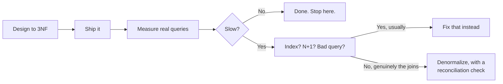

# Normalization — Part 2

Part 1 took a wide `orders` table apart and arrived at a schema where every
fact is stored once. This part is about everything after that: the normal forms
past 3NF, what normalization actually costs, and when stopping is the right
call. It ends with the two practical skills — recognising an unnormalized
schema you inherited, and modelling data that is genuinely optional or variant.

> **⬅️ This continues [Part 1](./03-normalization-part-1.md).**

> **📌 In one line:** Past 3NF the returns shrink quickly — the remaining skill
> is spotting a normalization problem in someone else's schema and knowing when
> a further split would cost more than it saves.

## Table of Contents

1. [BCNF, 4NF and 5NF, Briefly and Honestly](#bcnf-4nf-and-5nf-briefly-and-honestly)
2. [The Cost of Normalization](#the-cost-of-normalization)
3. [When to Deliberately Stop](#when-to-deliberately-stop)
4. [Spotting a Normalization Problem in an Existing Schema](#spotting-a-normalization-problem-in-an-existing-schema)
5. [Modelling Optional and Variant Data](#modelling-optional-and-variant-data)
6. [Advanced: Normalization and Concurrency](#advanced-normalization-and-concurrency)
7. [Common Mistakes](#common-mistakes)
8. [Questions to Test Yourself](#questions-to-test-yourself)
9. [Related](#related)

---

## BCNF, 4NF and 5NF, Briefly and Honestly

These exist. They are real. In ten years of building SaaS schemas you will
probably never consciously apply them, and you should not be intimidated by
the names.

**BCNF (Boyce-Codd Normal Form)** is a slightly stricter 3NF. It matters only
when a table has **more than one candidate key and they overlap** — for example
a table keyed by `(user_id, project_id)` where `(project_id, role)` is also
unique. If your tables have a single surrogate primary key plus some unique
constraints, you are almost certainly in BCNF already without trying.

**4NF** removes independent multi-valued facts stored together — a table
holding both a user's skills and their languages in the same rows, producing a
row for every skill × language combination. The fix is what you would do
anyway: two separate tables.

**5NF** deals with cases where a table can be split three ways and only
recombines correctly with all three. It is genuinely rare and, when it appears,
looks like a modelling error you would want to fix regardless.

> **💡 Tip:** If you reach 3NF by asking "does this column describe the thing
> this table is about?" for every column, you have handled BCNF and 4NF in
> practice. The higher forms are names for edge cases, not a checklist to work
> through.

---

## The Cost of Normalization

Normalization is not free, and pretending it is makes you bad at arguing for
it.

**More joins.** The question "show me last month's orders with company name and
product name" was one table scan. Now:

```sql
SELECT  o.id,
        c.name  AS company_name,
        p.name  AS product_name,
        ol.quantity
FROM    orders      o
JOIN    companies   c  ON c.id  = o.company_id
JOIN    order_lines ol ON ol.order_id = o.id
JOIN    products    p  ON p.sku = ol.product_sku
WHERE   o.ordered_at >= date_trunc('month', now()) - interval '1 month'
ORDER BY o.ordered_at DESC;
```

Four tables. Longer to write, more to get wrong, and the planner has more
choices to make — see
[../query-patterns/join-optimization.md](../query-patterns/join-optimization.md).

**More complex queries.** Every report writer must now understand the schema's
shape rather than reading one flat table. That is a real onboarding cost.

**Potentially slower reads.** Each join is work. With good indexes on the
foreign keys this is usually microseconds, but at high join counts, or when the
planner misjudges cardinality, it can be meaningful.

**More opportunity for N+1.** An ORM walking `order.company.name` in a loop
turns one query into a thousand. This is not normalization's fault, but
normalization is what creates the opportunity. See
[../query-optimization/n-plus-one-queries.md](../query-optimization/n-plus-one-queries.md).

What you get in exchange:

| Normalized | Denormalized |
|---|---|
| Writes touch one row | Writes touch many rows |
| No copies, so no drift | Copies drift, silently |
| Smaller tables, more rows per page | Wide rows, fewer per page, more I/O per scan |
| Constraints can enforce the rules | Nothing can enforce agreement between copies |
| Reads need joins | Reads are a single scan |

Note the row-per-page point: a normalized `orders` row is small, so a scan of
`orders` reads far fewer pages than a scan of `orders_wide` did. Normalization
frequently makes reads **faster**, not slower.

---

## When to Deliberately Stop

**3NF is the right default for transactional data.** That is the practical
answer, and it is not a compromise — it is where the anomalies stop and the
complexity is still low.

The order of operations matters:



**Normalize first, denormalize later with evidence.** Going the other way is
almost impossible: un-duplicating data that is already duplicated and already
drifted means deciding which copy was right, one row at a time.

You can always add a cached copy of a column later. You can very rarely undo
two years of inconsistency.

> **⚠️ Warning:** "We denormalized for performance" said before any measurement
> means "we guessed". Most schemas that were denormalized from day one turn out
> to have been slow for a completely different reason — a missing index that
> would have taken one line to add.

[04-denormalization-and-read-models-part-1.md](04-denormalization-and-read-models-part-1.md)
covers the deliberate reversal in full.

---

## Spotting a Normalization Problem in an Existing Schema

You usually inherit a schema rather than design one. These are the signs, in
rough order of how often you will meet them.

### Numbered columns

```sql
tag1 text, tag2 text, tag3 text
phone_1 text, phone_2 text
address_line_1 ... address_line_5
```

A repeating group. The number is the give-away — it means "a list", and lists
belong in rows.

### Comma-separated values in a text column

```sql
SELECT id, name, member_ids FROM projects WHERE id = 12;
```
```text
 id |    name    |  member_ids
----+------------+---------------
 12 | Redesign   | 4,17,23,105
```

No foreign key, no index that helps, and `LIKE '%17%'` matches `117`. Find them
by looking for any `text` column your code calls `.split(",")` on.

### A column that is only meaningful when another column has a certain value

```sql
-- invoices
status         text,     -- 'draft' | 'issued' | 'paid' | 'refunded'
paid_at        timestamptz,
refund_reason  text,
refunded_by_id bigint
```

`refund_reason` and `refunded_by_id` mean nothing unless `status = 'refunded'`,
which is roughly 2% of rows. Two possible fixes: a `CHECK` making the
dependency explicit (cheap, keeps one table), or a separate `invoice_refunds`
table keyed by `invoice_id` (cleaner, and the place to add refund details
later).

```sql
-- The cheap fix: make the dependency a rule instead of a convention
ALTER TABLE invoices ADD CONSTRAINT invoices_refund_fields_consistent
CHECK (
    (status = 'refunded' AND refund_reason IS NOT NULL)
 OR (status <> 'refunded' AND refund_reason IS NULL AND refunded_by_id IS NULL)
);
```

### Columns that are usually NULL

```sql
SELECT count(*) FILTER (WHERE refund_reason IS NULL) AS nulls,
       count(*)                                      AS total
FROM   invoices;
```
```text
 nulls  | total
--------+--------
 195842 | 200000
```

98% NULL is a signal that the column describes a different kind of thing than
the table is about. Not always wrong — but always worth a question.

### The same value repeated thousands of times

```sql
SELECT company_name, count(*)
FROM   orders_wide
GROUP  BY company_name
ORDER  BY 2 DESC
LIMIT  5;
```

If a text value repeats hundreds of times, it is a fact about something that
deserves its own table.

---

## Modelling Optional and Variant Data

The hardest real case is not "repeated data" but "different kinds of thing in
one table".

### The problem: one table, many nullable columns

A `notifications` table where each `type` carries different payload fields:

```sql
-- ❌ BROKEN — one table trying to be five things
CREATE TABLE notifications (
    id                bigint PRIMARY KEY,
    user_id           bigint NOT NULL,
    type              text   NOT NULL,
    -- task_assigned
    task_id           bigint,
    assigned_by_id    bigint,
    -- invoice_due
    invoice_id        bigint,
    amount_cents      bigint,
    due_date          date,
    -- mention
    comment_id        bigint,
    mentioned_by_id   bigint,
    -- project_shared
    project_id        bigint,
    shared_by_id      bigint,
    read_at           timestamptz,
    created_at        timestamptz NOT NULL DEFAULT now()
);
```

Every row has 8 of 10 payload columns NULL. Nothing stops a `mention`
notification from having an `invoice_id`. Adding a tenth notification type
means another `ALTER TABLE` on a large, hot table. And `SELECT *` drags ten
mostly-empty columns through every query.

### The options

**Option A — separate tables per variant**, with a shared parent:

```sql
CREATE TABLE notifications (
    id         bigint GENERATED ALWAYS AS IDENTITY PRIMARY KEY,
    user_id    bigint      NOT NULL REFERENCES users (id) ON DELETE CASCADE,
    type       text        NOT NULL,
    read_at    timestamptz,
    created_at timestamptz NOT NULL DEFAULT now()
);

CREATE TABLE notification_task_assigned (
    notification_id bigint PRIMARY KEY REFERENCES notifications (id) ON DELETE CASCADE,
    task_id         bigint NOT NULL REFERENCES tasks (id) ON DELETE CASCADE,
    assigned_by_id  bigint NOT NULL REFERENCES users (id) ON DELETE CASCADE
);
```

Real foreign keys, real `NOT NULL`, no wasted columns. The cost is a join per
variant and a table per type.

**Option B — a `jsonb` payload column:**

```sql
CREATE TABLE notifications (
    id         bigint GENERATED ALWAYS AS IDENTITY PRIMARY KEY,
    user_id    bigint      NOT NULL REFERENCES users (id) ON DELETE CASCADE,
    type       text        NOT NULL,
    payload    jsonb       NOT NULL DEFAULT '{}'::jsonb,
    read_at    timestamptz,
    created_at timestamptz NOT NULL DEFAULT now()
);
CREATE INDEX notifications_payload_gin ON notifications USING gin (payload);
```

One table, any number of types, no migration to add one. The cost is that
`payload->>'task_id'` is not a foreign key — nothing stops it pointing at a
deleted task, or at a string, or at nothing.

| | Nullable columns | Separate tables | `jsonb` column |
|---|---|---|---|
| Foreign keys on payload | Yes | Yes | No |
| `NOT NULL` per variant | No | Yes | Only via `CHECK` |
| Adding a new variant | `ALTER TABLE` on a hot table | New table, no lock on the old | Nothing |
| Query one variant | Easy | Join | `->>` operator, GIN index |
| Query across all variants | Easy | `UNION ALL` | Easy |
| Wasted space | High | None | Low |
| Right when | 2–3 variants, stable | Variants are few, known, and matter | Variants are many, open-ended, or third-party |

**Recommendation:** if you can name every variant and the set changes once a
year, use separate tables — the integrity is worth the joins. If the payload is
genuinely open-ended (user-defined fields, third-party webhook bodies, analytic
event properties) use `jsonb`. Use nullable columns only when there are two or
three variants sharing most of their fields, and add a `CHECK` that makes the
dependency explicit.

The full treatment of `jsonb`, including when it is a way of avoiding schema
design, is in
[05-postgres-data-types-part-2.md](05-postgres-data-types-part-2.md#jsonb).

---

## Advanced: Normalization and Concurrency

There is a performance argument for normalization that has nothing to do with
storage: **splitting a hot column out of a wide row reduces lock contention.**

In PostgreSQL, an `UPDATE` does not modify a row in place. It writes a **new
version of the whole row** and marks the old one dead. So updating one integer
on a 40-column row rewrites all 40 columns, and every index whose columns
changed must be updated too.

Now suppose `projects` carries a `task_count` that increments on every task
creation:

```sql
UPDATE projects SET task_count = task_count + 1 WHERE id = 42;
```

Every task creation in project 42 takes a row lock on that one `projects` row.
Two concurrent task creations serialise on it. At scale this becomes a visible
queue, and the whole wide row is rewritten each time — producing dead tuples
that `VACUUM` has to clean up.

Splitting the counter into its own narrow table helps twice:

```sql
CREATE TABLE project_counters (
    project_id bigint PRIMARY KEY REFERENCES projects (id) ON DELETE CASCADE,
    task_count bigint NOT NULL DEFAULT 0
);
```

- The rewritten row is now tiny, so updates produce far less dead data.
- Readers of `projects` are never blocked behind a counter update, and a
  `projects` row that never changes stays cacheable.

For high-contention counters you can go further and shard the counter into N
rows per project, summing on read — trading read cost for write concurrency.

See [../transactions-and-concurrency/04-locks-part-1.md](../transactions-and-concurrency/04-locks-part-1.md)
for what these row locks actually do, and
[04-denormalization-and-read-models-part-1.md](04-denormalization-and-read-models-part-1.md#counter-columns)
for whether you want the counter at all.

---

## Common Mistakes

1. **Denormalizing from day one "for performance"** without a single
   measurement.
2. **Treating a historical copy as a normalization failure.** An order's price
   at purchase time is a different fact from the product's current price.
3. **Over-normalizing lookups** — splitting a two-value status into its own
   table with an id, a code and a label, then joining it everywhere.
4. **Using `jsonb` to avoid deciding what the columns are.** It postpones the
   design, it does not replace it.
5. **Never asking why a column is 98% NULL.**

---

## Questions to Test Yourself

1. `order_lines` stores `unit_price_cents` even though `products` has
   `price_cents`. Is that a normalization failure? Justify your answer.
2. Give three concrete costs of normalization, and one way in which it can make
   reads *faster*.
3. You inherit a schema with `tag1, tag2, tag3` and a `member_ids` text column.
   What is wrong with each, and what do you replace them with?
4. A `notifications` table has ten payload columns and every row uses two. Give
   two different fixes and say when each one is the right choice.
5. Why does splitting a frequently-updated counter into its own table reduce
   lock contention? Use the words "row version" in your answer.
6. Why is "normalize first, denormalize later" much easier than the reverse?

---

## Related

- [README](README.md) — the rest of this folder.
- [Part 1](03-normalization-part-1.md) — the three anomalies and the first three
  normal forms, worked through on one table.
- [Keys and relationships](01-keys-and-relationships-part-1.md) — the keys the
  split tables are joined on.
- [Constraints and data integrity](02-constraints-and-data-integrity-part-1.md)
  — the `CHECK` constraints that make conditional columns explicit.
- [Denormalization and read models](04-denormalization-and-read-models-part-1.md)
  — the deliberate reversal of this file.
- [PostgreSQL data types](05-postgres-data-types-part-2.md) — `jsonb` and arrays
  for genuinely variant data.
- [Schema design patterns](06-schema-design-patterns-part-1.md) — the recurring
  decisions that sit on top of a normalized schema.
- [Join optimization](../query-patterns/join-optimization.md) — making the extra
  joins cheap.
- [N+1 queries](../query-optimization/n-plus-one-queries.md) — the application
  failure mode normalization enables.
- [Locks](../transactions-and-concurrency/04-locks-part-2.md) — the contention argument
  above, in full.
- [ORM vs query builder](../../backend-fundamentals/10-database-integration/01-orm-vs-query-builder.md)
  — how application code traverses a normalized schema.
