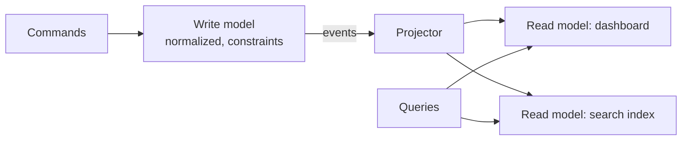

# Denormalization and Read Models — Part 2

Part 1 catalogued the forms a deliberate copy can take: a duplicated column, a
counter, a summary table, a derived value, an array. This part weighs them
against each other, then covers the half of the job that is easy to skip — how
a copy drifts away from its source, how you find out before a customer does,
and which cheaper fixes you should have tried first.

> **⬅️ This continues [Part 1](./04-denormalization-and-read-models-part-1.md).**

> **📌 In one line:** Every duplicated value eventually disagrees with its
> source — so take the trade-off knowingly, write the reconciliation query
> before you ship the column, and check the cheaper fixes first.

## Table of Contents

1. [The Core Trade-off Table](#the-core-trade-off-table)
2. [How Duplicated Data Drifts, and How to Catch It](#how-duplicated-data-drifts-and-how-to-catch-it)
3. [Materialized Views: The Managed Form](#materialized-views-the-managed-form)
4. [Caching as the Alternative](#caching-as-the-alternative)
5. [Read Models and CQRS](#read-models-and-cqrs)
6. [Check These First](#check-these-first)
7. [Common Mistakes](#common-mistakes)
8. [Questions to Test Yourself](#questions-to-test-yourself)
9. [Related](#related)

---

## The Core Trade-off Table

| Technique | Read speed gained | Write cost added | Consistency risk | Backfill burden when it drifts |
|---|---|---|---|---|
| Duplicated column (`tasks.company_id`) | Very high — removes a join and enables a composite index | One extra column write; an extra `UPDATE` when the source moves | **High and dangerous** — a wrong tenant key leaks data across tenants | One `UPDATE ... FROM` join; fast but must run in a transaction with the fix |
| Counter column (`projects.task_count`) | High for list views | One `UPDATE` per child write, plus row-lock contention | Medium — drifts on any missed path or cascade | Trivial — full recompute, idempotent |
| Summary table | Enormous for reports | A scheduled job, not an online cost | Low — bounded staleness by design | Re-run the job for the affected range |
| Derived value (`search_vector`) | High — enables an index that is otherwise impossible | Recompute on every write of the source columns | Medium — silently stale, and staleness is invisible in the UI | Full recompute, can be slow on a big table |
| Generated column | Same as derived | Computed by the engine on write | **None** — cannot drift | None |
| Array / `jsonb` list | Medium — removes a join | Whole-value rewrite, GIN maintenance | Medium — no referential integrity on elements | Hard — no source of truth to reconcile against |
| Materialized view | Enormous | Refresh cost, concentrated | Low — staleness is explicit and measurable | `REFRESH` |

Read the rightmost column carefully. The techniques that are easiest to fix
when they break — counters, summary tables, materialized views — are the safe
ones. The technique with no reconciliation possible (an array with no source of
truth) is the one to be most careful with.

---

## How Duplicated Data Drifts, and How to Catch It

Drift does not usually come from the code path you thought about. It comes
from:

- A **cascade delete** that removes children without running your trigger's
  sibling logic.
- A **bulk import** written in a hurry with raw `COPY`.
- A **failed transaction** in a system where one of the two writes was outside
  it.
- A **migration** that rewrote the source table.
- A **manual fix** in `psql` that touched one side.
- A **replica lag** window in which a read-your-write assumption was wrong.

You will not prevent all of these. You can detect all of them.

### Write the reconciliation query first

For every denormalized value, write the query that finds disagreement, and put
it on a schedule with an alert.

```sql
-- Counter drift: which projects have a wrong task_count?
SELECT p.id,
       p.name,
       p.task_count            AS stored,
       count(t.id)             AS actual,
       p.task_count - count(t.id) AS drift
FROM   projects p
LEFT   JOIN tasks t ON t.project_id = p.id
GROUP  BY p.id, p.name, p.task_count
HAVING p.task_count <> count(t.id)
ORDER  BY abs(p.task_count - count(t.id)) DESC;
```

```text
 id  |      name      | stored | actual | drift
-----+----------------+--------+--------+-------
  88 | Redesign       |    412 |    397 |    15
 201 | Q3 Migration   |     34 |     34 |     0
```

```sql
-- Tenant key drift: the security-relevant one. This should ALWAYS be empty.
SELECT t.id AS task_id,
       t.company_id AS task_company,
       p.company_id AS project_company
FROM   tasks t
JOIN   projects p ON p.id = t.project_id
WHERE  t.company_id <> p.company_id;
```

```sql
-- Summary table drift: does the rollup match the source for recent months?
SELECT r.company_id,
       r.month,
       r.total_cents AS stored,
       s.total_cents AS actual
FROM   company_monthly_revenue r
JOIN   LATERAL (
           SELECT sum(amount_cents) AS total_cents
           FROM   invoices i
           WHERE  i.company_id = r.company_id
           AND    i.status = 'paid'
           AND    date_trunc('month', i.issued_at)::date = r.month
       ) s ON true
WHERE  r.total_cents IS DISTINCT FROM s.total_cents;
```

> **📌 Remember:** A denormalization you cannot reconcile is a denormalization
> you cannot trust. Write the check at the same time as the column, not after
> the first incident.

Run these nightly, log the row count, and alert on non-zero. The tenant-key
check in particular should page someone, because a non-zero result means cross-
tenant data exposure.

---

## Materialized Views: The Managed Form

A materialized view is denormalization with the bookkeeping built in: you write
the query once, PostgreSQL stores its result as a real table, and refreshing it
is one command.

```sql
CREATE MATERIALIZED VIEW company_dashboard AS
SELECT c.id                                                    AS company_id,
       c.name,
       count(DISTINCT p.id)                                    AS project_count,
       count(t.id) FILTER (WHERE t.status = 'open')            AS open_tasks,
       count(t.id) FILTER (WHERE t.status = 'done')            AS done_tasks,
       max(t.created_at)                                       AS last_activity
FROM   companies c
LEFT   JOIN projects p ON p.company_id = c.id
LEFT   JOIN tasks    t ON t.project_id = p.id
GROUP  BY c.id, c.name;

-- A unique index is required for a non-blocking refresh
CREATE UNIQUE INDEX company_dashboard_pk ON company_dashboard (company_id);

REFRESH MATERIALIZED VIEW CONCURRENTLY company_dashboard;
```

The advantage over hand-rolled denormalization is that there is **one
definition**. The stored data cannot disagree with the query — it *is* the
query's result as of the last refresh. There is no reconciliation to write,
because there is no second writer.

The cost is that refresh is all-or-nothing and gets slower as the source grows,
and the data is stale between refreshes. Refresh mechanics, `CONCURRENTLY`, and
incremental strategies are in
[../operations/03-materialized-views.md](../operations/03-materialized-views.md).

---

## Caching as the Alternative

Before changing the schema, ask whether a cache solves it instead.

| | Denormalization | Cache (Redis, in-process) |
|---|---|---|
| Lives in | Your schema, forever | Outside the database, disposable |
| Invalidation | You reconcile | You expire (TTL) or delete on write |
| Wrong data | Persists until fixed | Disappears on its own |
| Survives a restart | Yes | Usually not, and that is fine |
| Cost of getting it wrong | Corrupted source of truth | A slow request |
| Reversibility | A migration | Delete a key |
| Good for | Something queried in `WHERE` / `ORDER BY` | A whole computed response |

The dividing line is usually this: **if the derived value must be filtered,
joined or sorted on, it has to be in the database.** You cannot `ORDER BY` a
Redis key. If the derived value is a whole rendered result that you only ever
look up by id, a cache is better — it is reversible, it self-heals by expiring,
and a wrong cache entry never corrupts your source of truth.

See
[../../system-design/foundational/caching-strategies.md](../../system-design/foundational/caching-strategies.md)
for invalidation patterns and
[../../system-design/foundational/redis.md](../../system-design/foundational/redis.md)
for the store itself.

---

## Read Models and CQRS

At the far end of this spectrum, you stop denormalizing columns and keep a
**separate model for reads**, shaped exactly like the query that serves it, fed
by events from the write model.



This buys independent scaling and read models tuned per query. It costs you
eventual consistency as a permanent, user-visible property — a user creates a
task and does not see it in the list yet — plus the projector infrastructure and
the ability to rebuild read models from scratch.

It is the right answer for a small number of systems and an expensive answer
for most. See
[../../system-design/scale-patterns/cqrs.md](../../system-design/scale-patterns/cqrs.md).

---

## Check These First

This is the most important section in the file.

**Most conclusions of "we need to denormalize" are wrong.** The query is slow
for a more boring reason, and denormalizing hides that reason behind a
permanent schema change.

Work through this before you add a single duplicated column:

1. **Is there a missing index?** Run `EXPLAIN (ANALYZE, BUFFERS)`. A `Seq Scan`
   with a large `Rows Removed by Filter` is a missing index, not a join
   problem. A join that is slow because the foreign key column is unindexed
   looks exactly like "joins are slow".
   → [../query-planner/reading-query-plans.md](../query-planner/reading-query-plans.md)

2. **Is it an N+1?** One query taking 200 ms is a query problem. Two hundred
   queries taking 1 ms each is an application problem, and no schema change
   will fix it.
   → [../query-optimization/n-plus-one-queries.md](../query-optimization/n-plus-one-queries.md)

3. **Is the index there but in the wrong column order?** A composite index only
   helps when the query constrains a leading prefix.
   → [../query-optimization/composite-index-ordering.md](../query-optimization/composite-index-ordering.md)

4. **Is it `SELECT *` dragging wide columns through a sort?**
   → [../query-patterns/select-star-anti-pattern.md](../query-patterns/select-star-anti-pattern.md)

5. **Is it offset pagination at page 400?** That is `OFFSET`, not joins.
   → [../query-optimization/pagination-performance.md](../query-optimization/pagination-performance.md)

6. **Are the statistics stale, so the planner picked a bad join?**
   → [../query-planner/cardinality-estimation-and-statistics.md](../query-planner/cardinality-estimation-and-statistics.md)

Only when all six are ruled out — and you have the plan output to prove it —
is the join itself the problem.

> **💡 Tip:** A good sanity check: if the same query is fast on your laptop
> against a copy of production data, the problem is not the schema. It is load,
> caching, connection pooling, or statistics.

The general triage sequence is in
[../query-optimization/slow-query-fixes.md](../query-optimization/slow-query-fixes.md).

---

## Common Mistakes

1. **No reconciliation query.** The drift is found by a customer, not by you.
2. **A denormalized tenant key with no reconciliation.** This is a data leak,
   not a stale number.
3. **Choosing denormalization when a cache was reversible and sufficient.**
4. **Calling an N+1 problem a join problem** and changing the schema to fix a
   bug in a loop.
5. **Treating a materialized view as free.** The refresh has to run, take a
   lock, and finish before the next one starts.

---

## Questions to Test Yourself

1. Why is a drifted `tasks.company_id` a more serious bug than a drifted
   `projects.task_count`?
2. Write the reconciliation query for `projects.task_count`. What should the
   alert threshold be?
3. What is the dividing line between "put it in the schema" and "put it in a
   cache"?
4. Name three mechanisms that cause drift which no amount of careful
   application code will prevent.
5. A colleague says a report is slow and proposes a denormalized column. What
   six things do you check first, and what evidence do you ask for?
6. Name two things a materialized view gives you that a hand-maintained summary
   table does not, and one thing it takes away.
7. At what point is a separate read model the right answer rather than one more
   denormalized column on the write table?

---

## Related

- [README](README.md) — the rest of this folder.
- [Part 1](04-denormalization-and-read-models-part-1.md) — the rule, and the
  forms a deliberate copy can take: duplicated columns, counters, summary
  tables, derived values, arrays and `jsonb`.
- [Normalization](03-normalization-part-1.md) — the default this file departs
  from.
- [Keys and relationships](01-keys-and-relationships-part-1.md) — the joins
  being avoided here.
- [Schema design patterns](06-schema-design-patterns-part-1.md) — composite
  tenant foreign keys that remove the drift risk entirely.
- [PostgreSQL data types](05-postgres-data-types-part-2.md) — arrays, `jsonb`
  and generated columns in depth.
- [Materialized views](../operations/03-materialized-views.md) — refresh
  mechanics.
- [N+1 queries](../query-optimization/n-plus-one-queries.md) — check this first.
- [Slow query fixes](../query-optimization/slow-query-fixes.md) — the triage
  order.
- [Reading query plans](../query-planner/reading-query-plans.md) — the evidence
  you need before denormalizing.
- [Locks](../transactions-and-concurrency/04-locks-part-2.md) — hot-row contention from
  counters.
- [Caching strategies](../../system-design/foundational/caching-strategies.md)
  — the reversible alternative.
- [Redis](../../system-design/foundational/redis.md) — where that cache lives.
- [CQRS](../../system-design/scale-patterns/cqrs.md) — the architectural end of
  this spectrum.
