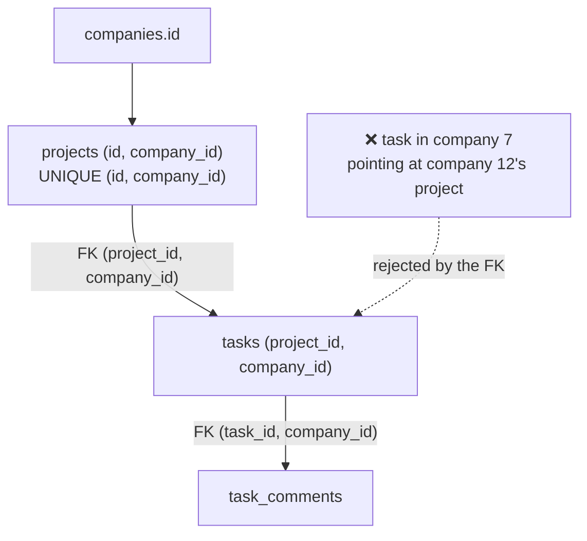

# Schema Design Patterns — Part 1

Every SaaS schema faces the same dozen decisions. What do you call the primary
key column? How do you record who changed a row? What happens when a user
"deletes" something they might want back? How do you stop one customer's data
reaching another?

None of these is hard. All of them are expensive to change later, because by
then a hundred tables have followed whichever answer you picked first. This
file is the catalogue: for each decision, the problem, the options, a
recommendation, and the trap.

> **📌 In one line:** Pick a convention for each of these once, write it down,
> and never deviate — consistency is worth more than any individual choice
> being optimal.

This part covers the four decisions that touch every table: what you call
things, how you record change, what "deleted" means, and how you keep one
customer's rows away from another's.

## Table of Contents

1. [Naming Conventions](#naming-conventions)
2. [Audit Columns](#audit-columns)
3. [Soft Deletes](#soft-deletes)
4. [Multi-Tenancy Columns](#multi-tenancy-columns)
5. [Common Mistakes](#common-mistakes)
6. [Questions to Test Yourself](#questions-to-test-yourself)
7. [Related](#related)

---

## Naming Conventions

**The problem:** none of these choices is objectively better, but mixing them
costs you every day. `SELECT * FROM user JOIN companies` — was it `user` or
`users`? Was the key `id` or `user_id`? You will look it up a thousand times.

**The trap:** letting each developer pick, or letting each ORM's default leak
into the schema. Six months in, half the tables are plural and half are not.

### The convention to adopt

| Thing | Convention | Example |
|---|---|---|
| Table name | Plural, `snake_case` | `users`, `project_members` |
| Join table | Both tables, alphabetical or natural reading order | `project_members` |
| Primary key column | `id`, always | `users.id` |
| Foreign key column | `<singular_table>_id` | `tasks.project_id` |
| Foreign key to the same table twice | Role prefix + `_id` | `created_by_id`, `assigned_to_id` |
| Boolean | `is_` / `has_` prefix | `is_archived`, `has_accepted_terms` |
| Timestamp | Past participle + `_at` | `created_at`, `paid_at`, `deleted_at` |
| Date (no time) | `_on` or `_date` | `due_date`, `starts_on` |
| Money | Include the unit | `amount_cents` |
| Index | `<table>_<columns>_idx` | `tasks_project_id_status_idx` |
| Unique index/constraint | `<table>_<columns>_unique` | `users_email_unique` |
| Check constraint | `<table>_<rule>_check` | `invoices_amount_positive_check` |
| Foreign key constraint | `<table>_<column>_fkey` | `tasks_project_id_fkey` |

### Why plural tables and a bare `id`

**Plural** because a table holds many rows: `SELECT * FROM users` reads as "from
the users". It also avoids a real problem — `user` is a reserved word in
PostgreSQL (`SELECT user` returns the current role), so a singular `user` table
must be quoted forever.

**`id` rather than `user_id`** because the qualified form already carries the
table: `users.id` is unambiguous, and `users.user_id` stutters. The pairing
`ON tasks.project_id = projects.id` then reads correctly in every join.

### Name your constraints explicitly

PostgreSQL will invent a name if you do not. `users_email_key1` tells you
nothing, and you cannot map it to a user-facing message.

```sql
-- ❌ auto-named: what rule is this, in a 409 handler?
ALTER TABLE users ADD UNIQUE (email);

-- ✅ named: the error tells you and your error handler what happened
ALTER TABLE users ADD CONSTRAINT users_email_unique UNIQUE (email);
```

This directly enables the SQLSTATE-to-field-error mapping in
[02-constraints-and-data-integrity-part-2.md](02-constraints-and-data-integrity-part-2.md#handling-constraint-violations-in-application-code).

> **💡 Tip:** Write the convention into the repository — a `CONVENTIONS.md` or
> a comment at the top of the first migration. A convention nobody can find is
> a convention that will drift.

---

## Audit Columns

**The problem:** "who changed this and when?" is asked about every row
eventually, usually during an incident, and usually about a row changed six
months ago.

**The options:** timestamps only; timestamps plus actor ids; a full history
table.

### The baseline

```sql
ALTER TABLE tasks
    ADD COLUMN created_at timestamptz NOT NULL DEFAULT now(),
    ADD COLUMN updated_at timestamptz NOT NULL DEFAULT now(),
    ADD COLUMN created_by bigint REFERENCES users (id) ON DELETE SET NULL,
    ADD COLUMN updated_by bigint REFERENCES users (id) ON DELETE SET NULL;
```

`created_at` with `DEFAULT now()` is free and correct — no writer can forget it,
because it happens when they say nothing.

`created_by` / `updated_by` are `ON DELETE SET NULL`, not `CASCADE`: deleting a
user must never delete the rows they created.

### `updated_at` must not be trusted to writers

**The trap:** `updated_at` is set by the application, so it is correct only for
rows written through the path that remembers. The bulk import forgets. The
admin `UPDATE` in `psql` forgets. Six months later `updated_at` is a column
nobody believes, which makes it useless for the one thing it exists for —
incremental sync and "what changed since".

```sql
-- ❌ BROKEN — every writer must remember, and one will not
UPDATE tasks SET status = 'done', updated_at = now() WHERE id = 42;
UPDATE tasks SET status = 'done' WHERE id = 43;   -- updated_at now lies
```

```sql
-- ✅ FIXED — the database maintains it, for every writer
CREATE FUNCTION set_updated_at() RETURNS trigger AS $$
BEGIN
    NEW.updated_at = now();
    RETURN NEW;
END;
$$ LANGUAGE plpgsql;

CREATE TRIGGER tasks_set_updated_at
    BEFORE UPDATE ON tasks
    FOR EACH ROW EXECUTE FUNCTION set_updated_at();
```

Apply the same trigger to every table. This is the one case where a trigger is
unambiguously right: it is mechanical bookkeeping, not business logic, so the
usual objection — that hidden logic confuses developers — does not apply. See
the trigger warning in
[02-constraints-and-data-integrity-part-2.md](02-constraints-and-data-integrity-part-2.md#advanced-triggers-for-what-constraints-cannot-say)
for where the line is.

`updated_by` cannot be handled this way, because the database does not know
your application's user. Pass it explicitly, or set a session variable per
request and read it in the trigger:

```sql
NEW.updated_by = nullif(current_setting('app.user_id', true), '')::bigint;
```

> **⚠️ Warning:** `now()` returns the **transaction** start time, so every row
> written in one transaction gets the same `updated_at`. That is usually what
> you want. If you need real wall-clock per statement, use `clock_timestamp()`.

---

## Soft Deletes

**The problem:** users delete things by accident, and "restore it" is a
reasonable request. Also, deleting a row that other rows reference either fails
or cascades.

**The options:** a `deleted_at` timestamp, a status column, or moving the row
to an archive table.

| | `deleted_at timestamptz` | `status = 'deleted'` | Archive table |
|---|---|---|---|
| Restore | Set it to `NULL` | Set status back | Move the row back |
| Knows *when* | Yes | No, unless a second column | Yes |
| Main table stays small | No | No | **Yes** |
| Queries need a filter | Yes, every one | Yes, every one | **No** |
| Foreign keys still valid | Yes | Yes | Break unless children move too |
| Unique constraints | Break | Break | Fine |
| Complexity | Low | Low | Medium — a move, in a transaction |

### The problems, honestly

Soft deletes are everywhere, and every one of these will happen to you.

**1. Every query needs the filter, and one will be forgotten.** This is the
big one. There is nothing structural about a soft delete — a "deleted" row is
an ordinary row, and the database will happily return it.

**2. Unique constraints break.** A deleted user's email can never be reused,
because the row is still there.

**3. Foreign keys point at deleted rows.** A task references a project whose
`deleted_at` is set. The foreign key is satisfied. Your UI shows a task in a
project that does not exist.

**4. The table grows forever.** Indexes get bigger, scans get slower, and you
are paying to index rows nobody will ever look at.

**5. Cascade semantics vanish.** Soft-deleting a project does not soft-delete
its tasks. You have to do that yourself, everywhere, and get it right.

### BROKEN vs FIXED: the forgotten filter

```sql
-- ❌ BROKEN — a report written six months after soft deletes were added
SELECT p.name,
       count(t.id) AS task_count
FROM   projects p
LEFT   JOIN tasks t ON t.project_id = p.id
WHERE  p.company_id = 7
GROUP  BY p.name;
```

```text
     name      | task_count
---------------+------------
 Redesign      |        412
 Old Website   |         88     <- deleted last year
 Redesign      |         12     <- a deleted project with the same name
```

Deleted projects in the list, deleted tasks in the counts, and a duplicate name
because an old project was "deleted" so the name could be reused. Nothing
errored. The numbers are simply wrong, and they have been wrong in the board
report for two quarters.

```sql
-- ✅ FIXED — the filter, on every table, including the joined one
SELECT p.name,
       count(t.id) FILTER (WHERE t.deleted_at IS NULL) AS task_count
FROM   projects p
LEFT   JOIN tasks t ON t.project_id = p.id
                   AND t.deleted_at IS NULL
WHERE  p.company_id = 7
AND    p.deleted_at IS NULL
GROUP  BY p.name;
```

Note the filter must be in the **join condition** for the `LEFT JOIN`, not in
the `WHERE` clause — putting `t.deleted_at IS NULL` in `WHERE` turns the outer
join into an inner one and drops projects with no live tasks.

That subtlety is exactly why relying on developers to remember is a losing
strategy.

### Mitigation 1 — partial unique indexes

```sql
CREATE UNIQUE INDEX users_email_active_unique
ON users (email)
WHERE deleted_at IS NULL;
```

Uniqueness applies only among live rows, so a deleted user's email can be
reused, and two deleted users can share one. See
[../query-optimization/partial-indexes.md](../query-optimization/partial-indexes.md).

Make your **read** indexes partial too — they get smaller and faster for free:

```sql
CREATE INDEX tasks_project_status_idx
ON tasks (project_id, status)
WHERE deleted_at IS NULL;
```

### Mitigation 2 — a view that filters automatically

```sql
ALTER TABLE tasks RENAME TO tasks_all;

CREATE VIEW tasks AS
SELECT * FROM tasks_all WHERE deleted_at IS NULL;
```

Now `SELECT * FROM tasks` cannot include deleted rows, because the deleted rows
are not in `tasks`. A simple view like this is auto-updatable in PostgreSQL —
`INSERT` and `UPDATE` through it work — and anyone who genuinely needs the
deleted rows asks for `tasks_all`, which is a deliberate act.

The cost is a layer of indirection that confuses newcomers and some ORM
tooling. It is still far better than hoping.

### The honest recommendation

**Hard delete plus an audit log is usually better than a soft delete.**

```sql
CREATE TABLE deleted_records (
    id           bigint GENERATED ALWAYS AS IDENTITY PRIMARY KEY,
    table_name   text        NOT NULL,
    record_id    bigint      NOT NULL,
    company_id   bigint,
    row_data     jsonb       NOT NULL,
    deleted_by   bigint      REFERENCES users (id) ON DELETE SET NULL,
    deleted_at   timestamptz NOT NULL DEFAULT now()
);
CREATE INDEX deleted_records_lookup_idx ON deleted_records (table_name, record_id);
```

You get: a main table that stays small and fast, queries that cannot forget a
filter, unique constraints that just work, foreign keys that mean what they
say, and a genuine record of who deleted what and when — which a `deleted_at`
column does not give you.

You lose: one-click restore becomes a script that reads the JSON and reinserts.
For the handful of times it is actually requested, that is a good trade.

**Choose a soft delete when** restore is a real, frequent product feature
("trash" with a 30-day window), or when regulation requires the row to remain
recoverable. Then commit to it: partial unique indexes, partial read indexes, a
view, and a purge job that hard-deletes rows older than the retention window.

---

## Multi-Tenancy Columns

**The problem:** one database holds many customers' data, and one customer
seeing another's is the worst bug your product can have.

**The options:** a `company_id` column on every tenant-owned table; a schema
per tenant; a database per tenant.

This section covers the column approach, which is what almost every SaaS starts
with and most stay on.

### `company_id` everywhere

```sql
CREATE TABLE tasks (
    id          bigint GENERATED ALWAYS AS IDENTITY PRIMARY KEY,
    company_id  bigint      NOT NULL REFERENCES companies (id) ON DELETE RESTRICT,
    project_id  bigint      NOT NULL,
    assignee_id bigint,
    title       text        NOT NULL,
    status      text        NOT NULL DEFAULT 'open',
    due_date    date,
    created_at  timestamptz NOT NULL DEFAULT now()
);
```

Yes, `company_id` is reachable through `project_id`. Putting it here anyway is
the duplication argued for in
[04-denormalization-and-read-models-part-1.md](04-denormalization-and-read-models-part-1.md#duplicating-a-column-to-avoid-a-join),
and in a multi-tenant system it earns its place twice over.

### It must be the leading column of your indexes

Every tenant-scoped query filters on `company_id`, so it belongs first in the
composite index:

```sql
-- ❌ tenant filter can't be used as an index condition
CREATE INDEX tasks_status_due_idx ON tasks (status, due_date);

-- ✅ tenant first, then the query's other filters and ordering
CREATE INDEX tasks_company_status_due_idx ON tasks (company_id, status, due_date);
```

With `company_id` leading, a scan for company 7 touches only that company's
index entries. Without it, the scan walks every tenant's rows and filters
after. On a table shared by a thousand customers that is a thousandfold
difference. See
[../query-optimization/composite-index-ordering.md](../query-optimization/composite-index-ordering.md).

### Put the tenant in the foreign key — the strong technique

This is the part most teams miss, and it is genuinely powerful.

A plain `tasks.project_id REFERENCES projects(id)` guarantees the project
exists. It says **nothing** about the project belonging to the same company. A
bug in one endpoint — a `project_id` taken from the request body without
checking ownership — writes a task into another tenant's project, and the
database allows it.

Make it structurally impossible:

```sql
-- Step 1: give projects a unique key that includes the tenant
ALTER TABLE projects
    ADD CONSTRAINT projects_id_company_unique UNIQUE (id, company_id);

-- Step 2: reference BOTH columns from the child
ALTER TABLE tasks
    ADD CONSTRAINT tasks_project_same_company_fkey
    FOREIGN KEY (project_id, company_id)
    REFERENCES projects (id, company_id) ON DELETE CASCADE;
```

Now a task can only reference a project **in its own company**, enforced by the
engine:

```sql
INSERT INTO tasks (company_id, project_id, title)
VALUES (7, 88, 'Leak');    -- project 88 belongs to company 12
```

```text
ERROR:  insert or update on table "tasks" violates foreign key constraint
        "tasks_project_same_company_fkey"
DETAIL:  Key (project_id, company_id)=(88, 7) is not present in table "projects".
```

Read that again: a whole class of cross-tenant bug is now impossible, from
every writer — the buggy endpoint, the migration, the admin in `psql`. It costs
one extra unique index and one extra column in a foreign key.

It also removes the drift risk from the denormalized `company_id`, because the
two can no longer disagree.



Carry the tenant key down the whole chain, and cross-tenant references cannot
exist anywhere.

Application-side tenant scoping, and defence in depth with row-level security,
are in
[../../backend-fundamentals/06-authorization/01-authn-vs-authz.md](../../backend-fundamentals/06-authorization/01-authn-vs-authz.md)
and
[02-constraints-and-data-integrity-part-2.md](02-constraints-and-data-integrity-part-2.md#advanced-row-level-security).

> **📌 Remember:** Tenant isolation enforced in application code is enforced
> once per code path. Tenant isolation enforced in a foreign key is enforced
> once, for all code paths, forever.

---

## Common Mistakes

1. **Mixing singular and plural table names.** A lifetime of small friction.
2. **Letting PostgreSQL auto-name constraints**, then being unable to map an
   error to a message.
3. **Trusting application code to set `updated_at`.** One writer forgets, and
   the column becomes untrustworthy.
4. **Adding soft deletes without partial unique indexes.** Emails can never be
   reused.
5. **Forgetting the soft-delete filter in a `LEFT JOIN`'s `ON` clause** — or
   putting it in `WHERE` and silently dropping rows.
6. **A tenant key on the table but not in the foreign key.** The cross-tenant
   bug is still possible.
7. **`company_id` missing from the front of composite indexes.**

---

## Questions to Test Yourself

1. Why is `user` a bad table name in PostgreSQL specifically?
2. Why name constraints explicitly instead of letting PostgreSQL choose?
3. Why is a trigger the right answer for `updated_at` when triggers are
   discouraged for business logic?
4. Name five distinct problems soft deletes cause. Which one produces silently
   wrong data with no error?
5. Why must the soft-delete filter go in a `LEFT JOIN`'s `ON` clause rather than
   the `WHERE` clause?
6. When is a hard delete plus an audit log better than a soft delete? What do
   you give up?
7. Write the DDL that makes it structurally impossible for a task to reference
   a project in another company. Why is this stronger than an application check?
8. Why must `company_id` be the **leading** column of a composite index rather
   than just present in it?

---

> **➡️ Continued in [Part 2](./06-schema-design-patterns-part-2.md)**

## Related

- [README](README.md) — the rest of this folder.
- [Part 2](06-schema-design-patterns-part-2.md) — status columns, money and
  currency, event tables, nullability, and the schema review checklist.
- [Keys and relationships](01-keys-and-relationships-part-1.md) — primary keys,
  foreign keys, and `ON DELETE`.
- [Constraints and data integrity](02-constraints-and-data-integrity-part-1.md)
  — partial unique indexes and `CHECK` constraints.
- [Denormalization and read models](04-denormalization-and-read-models-part-1.md)
  — the duplicated tenant key, and why the composite foreign key beats it.
- [Partial indexes](../query-optimization/partial-indexes.md) — the soft-delete
  mitigation.
- [Composite index ordering](../query-optimization/composite-index-ordering.md)
  — why the tenant key goes first.
- [Authentication vs authorization](../../backend-fundamentals/06-authorization/01-authn-vs-authz.md)
  — the application side of tenant isolation.
