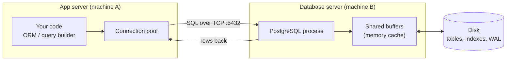
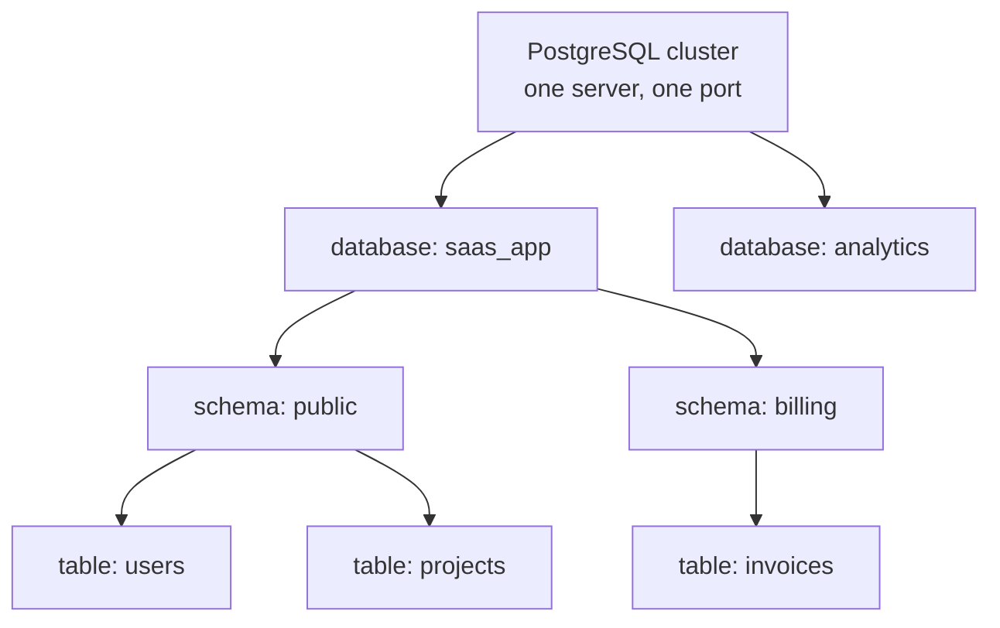
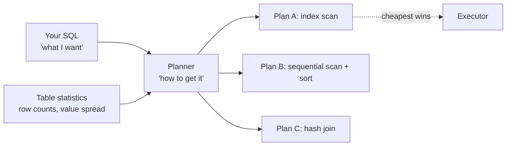
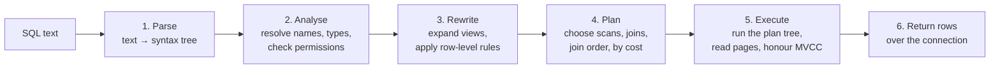

# What Is a Relational Database

You have probably already used a database without ever meeting it. You called
`User.find(id)` in an ORM (Object–Relational Mapper), a row came back, and the
feature worked. That is enough to ship code, and it is not enough to fix a slow
endpoint at 2 a.m.

This file introduces the thing your ORM has been hiding from you: a separate
program, usually on a separate machine, that stores your data, protects it from
other people writing at the same moment, and decides *by itself* how to answer
every question you ask it.

> **📌 In one line:** a relational database is a separate server program that
> stores data in tables, links those tables by values instead of pointers, and
> figures out the fastest way to answer the queries you describe.

## Table of Contents

1. [Why a File Is Not Enough](#why-a-file-is-not-enough)
2. [What "Relational" Actually Means](#what-relational-actually-means)
3. [Tables, Rows, Columns, Schema](#tables-rows-columns-schema)
4. [Where the Database Sits](#where-the-database-sits)
5. [Client and Server Basics](#client-and-server-basics)
6. [Database vs Schema vs Table](#database-vs-schema-vs-table)
7. [SQL Is Declarative](#sql-is-declarative)
8. [Relational vs Other Stores](#relational-vs-other-stores)
9. [ACID in One Sentence Each](#acid-in-one-sentence-each)
10. [Advanced: What Happens to Your Query](#advanced-what-happens-to-your-query)
11. [Common Mistakes](#common-mistakes)
12. [Questions to Test Yourself](#questions-to-test-yourself)
13. [Related](#related)

---

## Why a File Is Not Enough

Start with the simplest possible storage: a JSON file on disk.

```json
[
  { "id": 1, "email": "ana@acme.com", "name": "Ana" },
  { "id": 2, "email": "ben@acme.com", "name": "Ben" }
]
```

This works perfectly for one person, on one laptop, doing one thing at a time.
It falls apart the moment the system is real. Here is exactly where.

**Two writers at the same time.** Ana's browser and Ben's browser both load the
file, both add a user, both write the whole file back. One of the two new users
silently disappears. Nothing errored. The data is just gone.

**A crash in the middle of a write.** Your process writes half the file and the
server loses power. Now the file is not valid JSON at all. Every user is
unreadable, not just the one being written.

**Finding one row.** To find the user with email `ben@acme.com`, your code must
read and parse the entire file. With 2 users that is instant. With 2 million it
is a 400 MB parse on every login.

**Half-finished work.** "Create an invoice and mark the project as billed" is
two changes. If the process dies between them, you have an invoice for a
project that does not know it was billed. There is no way to say "both or
neither" in a file.

**Rules.** Nothing stops your code writing a user with no email, or a task
pointing at a project that was deleted last week.

A spreadsheet fixes none of these. It adds a nicer editor and a file-lock that
tells the second person "read only".

> **📌 Remember:** a database is not "a place to put data". It is a place to put
> data *while many people change it at once, on hardware that can fail, under
> rules you declare once.*

| Problem with a file | What a database gives you |
|---|---|
| Two writers overwrite each other | Locking and MVCC (multi-version concurrency control) |
| Crash mid-write corrupts everything | Write-ahead log, crash recovery |
| Must read everything to find one row | Indexes |
| Half-finished multi-step change | Transactions — all or nothing |
| Garbage data gets written | Constraints: `NOT NULL`, `UNIQUE`, foreign keys |
| No way to ask complex questions | SQL |

---

## What "Relational" Actually Means

"Relational" does **not** mean "it has relationships between tables", even
though that is how everyone uses the word. It comes from the mathematical idea
of a *relation*: a set of rows that all have the same shape.

The practical consequence is the part worth internalising:

> **📌 In a relational database, rows are connected by *values*, not by
> pointers.**

In your application code, an object holds a reference to another object in
memory:

```ts
const task = { id: 7, title: 'Ship billing', project: projectObject }
//                                            ^ a real pointer in RAM
```

That pointer is meaningless the moment the process restarts. A database has to
survive restarts, and it has to let two machines see the same data. So it
stores a *value* instead:

```text
tasks
 id | project_id | title
----+------------+---------------
  7 |         31 | Ship billing
```

`31` is not an address. It is just a number that happens to match the `id` of a
row in `projects`. The link exists because the values match, and it is
rebuilt fresh every time you ask for it with a `JOIN`.

**An analogy.** Think of a library. A book on the shelf does not physically
contain its author's biography. It contains the author's *name*. If you want
the biography, you take that name to the author catalogue and look it up. The
name is a value shared between two systems of records. Nothing breaks if the
book is moved to another shelf, because nothing pointed at the shelf.

This is why:

- The same row can be referenced from any number of other tables.
- You can ask questions nobody planned for, by matching values in new ways.
- A "broken pointer" is prevented by a **foreign key** constraint, which simply
  says "the value in `tasks.project_id` must exist in `projects.id`".

---

## Tables, Rows, Columns, Schema

Four words, used constantly, worth defining precisely.

| Term | What it is | Everyday analogy |
|---|---|---|
| **Table** | A named collection of rows that all have the same columns | One sheet in a spreadsheet |
| **Column** | One named field with one fixed type, e.g. `email text` | A spreadsheet column with a rule |
| **Row** | One record — one project, one invoice | A spreadsheet row |
| **Schema** | The *definition*: which tables exist, their columns, types, and rules | The blank form before anyone fills it in |

The schema is the shape. The rows are the content. Changing the schema
(`ALTER TABLE`) is a different kind of operation from changing the rows
(`UPDATE`), and it is the one that needs care in production.

Here are two tables from the SaaS schema used throughout this whole track:

```sql
CREATE TABLE companies (
    id         bigint GENERATED ALWAYS AS IDENTITY PRIMARY KEY,
    name       text        NOT NULL,
    plan       text        NOT NULL DEFAULT 'free',
    created_at timestamptz NOT NULL DEFAULT now()
);

CREATE TABLE users (
    id         bigint GENERATED ALWAYS AS IDENTITY PRIMARY KEY,
    company_id bigint      NOT NULL REFERENCES companies (id),
    email      text        NOT NULL UNIQUE,
    name       text        NOT NULL,
    role       text        NOT NULL DEFAULT 'member',
    created_at timestamptz NOT NULL DEFAULT now()
);
```

With some rows in them:

```text
companies
 id |    name     | plan |          created_at
----+-------------+------+-------------------------------
  1 | Acme Ltd    | pro  | 2026-01-04 09:12:00+00
  2 | Bolt Studio | free | 2026-02-11 14:30:00+00

users
 id | company_id |     email      | name |  role
----+------------+----------------+------+--------
  1 |          1 | ana@acme.com   | Ana  | admin
  2 |          1 | ben@acme.com   | Ben  | member
  3 |          2 | cleo@bolt.io   | Cleo | admin
```

Read the link out loud: *"Ana's `company_id` is 1, and the company whose `id` is
1 is Acme Ltd."* That sentence is exactly what a `JOIN` does, and nothing more.

Three pieces of vocabulary fall out of this:

- **Primary key** — the column whose value identifies a row uniquely inside its
  own table. `users.id`.
- **Foreign key** — a column holding a primary key value *from another table*.
  `users.company_id`. The `REFERENCES companies (id)` clause tells the database
  to refuse any value that does not exist over there.
- **Unique constraint** — no two rows may share this value. `users.email`.

---

## Where the Database Sits

The single most useful mental correction for a beginner: **the database is not
part of your application.** It is a different program. It usually runs on a
different machine, owned by a different team, and it keeps running when you
redeploy.



Four consequences of that picture, all of which matter later:

1. **Every query crosses a network.** Even on the same machine it crosses a
   socket. This is why 100 small queries are far worse than 1 query returning
   100 rows — the N+1 problem, covered in
   [n-plus-one-queries](../query-optimization/n-plus-one-queries.md).
2. **Connections are expensive and limited.** PostgreSQL uses one operating
   system process per connection. You cannot open one per request at scale,
   which is why connection pools exist.
3. **The database has its own memory.** `shared_buffers` caches pages of your
   tables. A "slow" query may just be a query whose data is not cached yet.
4. **Data outlives your app.** You can delete and rebuild your whole
   application; the rows stay. That is the point.

---

## Client and Server Basics

**A connection** is an open TCP session to the database, authenticated as some
database user, with its own state: the current transaction, temporary tables,
session settings. Two connections are isolated from one another. If you `BEGIN`
a transaction on one, the other cannot see the uncommitted changes.

**A client** is any program that opens such a connection. Your Node app is a
client. So is `psql`.

**`psql`** is the official command-line client that ships with PostgreSQL. It is
worth learning even if you live in an ORM, because it is where you will read
plans, check what a migration actually created, and run the one-off query that
answers a production question.

```bash
# host, port, user, database name
psql -h localhost -p 5432 -U app_user -d saas_app
```

```text
psql (17.2)
Type "help" for help.

saas_app=> SELECT count(*) FROM users;
 count
-------
  1842
(1 row)
```

Anything starting with a backslash is a `psql` command, not SQL — it is
interpreted by the client before anything is sent to the server. File 03 covers
the ones you will use daily.

---

## Database vs Schema vs Table

This naming trips up nearly everyone, especially people coming from MySQL,
where "database" and "schema" mean the same thing. In PostgreSQL they do not.



| Level | What it is | Can you query across it? |
|---|---|---|
| **Cluster** (or "instance") | One running PostgreSQL server, one data directory, one port | No — separate servers |
| **Database** | A fully isolated container of schemas. One connection talks to exactly one database | **No.** A single query cannot touch two databases |
| **Schema** | A namespace inside a database — a folder for tables | **Yes.** `SELECT * FROM billing.invoices` |
| **Table** | The actual rows | Yes |

The practical rules:

- If two things need to be queried together, put them in the **same database**,
  in different **schemas** if you want separation.
- `public` is the default schema. When you write `SELECT * FROM users`,
  PostgreSQL resolves `users` using the `search_path` setting, which normally
  means `public.users`.
- In MySQL, `CREATE SCHEMA` is literally an alias for `CREATE DATABASE`, and
  cross-"database" queries work because they are really cross-schema queries.
  Do not carry that habit into PostgreSQL.

> **⚠️ Warning:** "just make another database for the reporting tables" is a
> common and expensive mistake in PostgreSQL. You lose joins, foreign keys and
> transactions across the boundary. Use a schema.

---

## SQL Is Declarative

Almost every language you have written is **imperative**: you list the steps,
and the machine performs them in order.

```ts
// Imperative: you wrote the algorithm.
const result = []
for (const user of users) {
  if (user.role === 'admin') result.push(user.email)
}
result.sort()
```

SQL is **declarative**: you describe the result you want, and say nothing at all
about how to get it.

```sql
SELECT email
FROM users
WHERE role = 'admin'
ORDER BY email;
```

There is no loop here. You did not say "scan the table", "use the index on
role", or "sort with quicksort". You described a set of rows. Something else
decides the steps.

That something else is the **query planner**, and its existence is a direct
consequence of SQL being declarative. Since you did not specify the method, the
planner is free to choose one — and it chooses based on what it believes about
your data right now.



Two things follow, and they explain most database surprises you will ever meet:

1. **The same query can be fast today and slow next month.** Nothing in your
   code changed. The *data* changed, so the planner's estimates changed, so it
   picked a different plan. A query that used an index when the table had 500
   rows may switch to a full scan at 5 million rows — sometimes correctly,
   sometimes because its statistics are stale.
2. **You tune the inputs, not the steps.** You cannot write the algorithm. What
   you *can* do is give the planner better options (an index), better
   information (fresh statistics), or a simpler question (a rewritten query).

> **💡 Tip:** when a query is slow, the first question is never "how do I
> rewrite this?" It is "what plan did the database choose, and why?"

That whole story — how to read a plan, what the node names mean, why the
estimate differs from reality — continues in
[reading-query-plans](../query-planner/reading-query-plans.md). Do not read it
yet; finish this folder first.

---

## Relational vs Other Stores

An honest comparison, without the marketing.

| Store | Data shape | Best for | Weakness |
|---|---|---|---|
| **Relational** (PostgreSQL, MySQL) | Tables with a fixed schema, linked by keys | Anything with relationships, money, or rules you must enforce | Sharding across many machines is real work |
| **Document** (MongoDB) | Self-contained JSON documents | One aggregate read and written as a whole; schema changes constantly | Joins and multi-document consistency are awkward |
| **Key–value** (Redis, DynamoDB) | `key → blob`, no querying inside the value | Caches, sessions, rate limiters, counters — microsecond reads | You can only find things by the exact key |
| **Wide-column** (Cassandra) | Rows partitioned by key, huge write volume | Time-series and event firehoses across many nodes | Query shapes must be designed up front; no joins |
| **Search** (Elasticsearch) | Inverted index of analysed text | Full-text relevance ranking, faceted search | Not a source of truth; eventual consistency |

> **⚠️ The most common wrong turn:** "our data is nested, so we need a document
> database." PostgreSQL has had `jsonb` for years — a binary JSON type with
> indexing (GIN), operators, and functions. You can store a document *inside* a
> row and still have foreign keys, transactions and joins around it. The honest
> version of the question is: "do we need documents, or do we need to shard
> across fifty machines?" If it is the first, `jsonb` is almost always enough.

The same applies in reverse. Do not use PostgreSQL as a cache. Redis exists
because a network round trip to memory is an order of magnitude faster than a
round trip to a database that must also check transaction visibility — see
[redis](../../system-design/foundational/redis.md).

Modern reality: most systems use two or three of these together. PostgreSQL as
the source of truth, Redis for cache and sessions, and a search engine when
relevance ranking genuinely matters.

---

## ACID in One Sentence Each

ACID is the set of guarantees a transaction gives you. Named here, so the words
are not strangers later.

| Letter | Name | One sentence |
|---|---|---|
| **A** | Atomicity | All the statements in a transaction happen, or none of them do — there is no halfway. |
| **C** | Consistency | A transaction moves the database from one valid state to another; declared rules like foreign keys and `CHECK` constraints are never left broken. |
| **I** | Isolation | Concurrent transactions behave *as if* they ran one after another, to a degree you choose with the isolation level. |
| **D** | Durability | Once the database says "committed", the change survives a power cut. |

A one-line example of atomicity, which is the one you will use every day:

```sql
BEGIN;
  UPDATE invoices SET status = 'paid', paid_at = now() WHERE id = 900;
  UPDATE projects SET status = 'active' WHERE id = 31;
COMMIT;   -- both, or if anything fails: ROLLBACK — neither
```

Every one of these letters has sharp edges. Isolation in particular is not
free, is not absolute, and has several levels with different anomalies allowed.
The real treatment is in
[transactions-and-acid](../transactions-and-concurrency/01-transactions-and-acid-part-1.md).

---

## Advanced: What Happens to Your Query

You send a string of text. Rows come back. Here is the pipeline in between —
high level on purpose, because every later folder in this track zooms into one
of these boxes.



| Stage | What it does | What goes wrong here |
|---|---|---|
| **Parse** | Turns text into a tree. Pure syntax — it does not know if `users` exists | Syntax errors |
| **Analyse** | Resolves table and column names, checks types and privileges | `column "emial" does not exist`, permission denied |
| **Rewrite** | Substitutes views, applies rules and row-level security | A view hiding an expensive subquery |
| **Plan** | Estimates the cost of many possible plans and picks the cheapest | Bad estimates → bad plan → slow query |
| **Execute** | Actually reads pages, joins rows, filters by visibility | Disk I/O, lock waits, sorting on disk |
| **Return** | Streams rows back to the client | Sending 2 million rows you did not need |

Two details worth carrying forward:

- **Planning is not free.** For a simple query it takes well under a
  millisecond, but for a query joining a dozen tables it can become measurable.
  Prepared statements let the plan be reused across executions.
- **Execution honours MVCC.** The executor does not just read rows; it checks
  whether each row version is visible to *your* transaction. That is why
  `count(*)` cannot simply read a stored number — see file 05.

---

## Common Mistakes

| Mistake | Why it is wrong | Do this instead |
|---|---|---|
| Thinking the database is "part of the app" | It is a separate process with its own memory, limits and lifecycle | Picture the network hop before every query |
| Believing a foreign key is a pointer | It is a value that must match another value | Think "lookup by value", which is what `JOIN` does |
| Using a second database for related tables | No joins, no foreign keys, no transactions across it | Use a second **schema** |
| Assuming SQL runs in the order you wrote it | It is declarative; the planner decides the steps | Read the plan, not the text |
| "Our data is nested, we need MongoDB" | `jsonb` covers most of that need inside PostgreSQL | Decide on sharding needs, not data shape |
| Expecting a query to stay fast forever | Plans change as data grows and statistics shift | Re-check plans as tables grow |
| Treating a spreadsheet or file as a stopgap "database" | No concurrency, no atomicity, no constraints | Start with PostgreSQL from day one |

---

## Questions to Test Yourself

1. Name three specific failures that happen when two people write to the same
   JSON file at once, and say which database feature prevents each.
2. What does "relational" actually refer to, and why is "rows are linked by
   values, not pointers" the important consequence?
3. Draw, from memory, where the database sits relative to your app. Label the
   connection and say what protocol and port it uses.
4. In PostgreSQL, explain the difference between a database, a schema and a
   table. Which boundary can a single query *not* cross?
5. SQL is declarative. Explain what that means to someone who only knows
   JavaScript, and say why it forces the existence of a query planner.
6. Your query was fast last month and is slow now, with no code change. Give
   two plausible explanations.
7. Someone says "we need a document database because our settings object is
   nested." What is your reply?
8. State each ACID letter in one sentence, without looking.
9. List the six stages a query passes through, in order, and say what can go
   wrong at each.

---

## Related

- [Tables, Rows and Data Types](02-tables-rows-and-data-types-part-1.md) — the next
  file: how to actually create these tables and choose column types.
- [SQL Basics: CRUD](03-sql-basics-crud-part-1.md) — reading and writing rows.
- [reading-query-plans](../query-planner/reading-query-plans.md) — where the
  "declarative" story continues.
- [transactions-and-acid](../transactions-and-concurrency/01-transactions-and-acid-part-1.md)
  — the real treatment of ACID.
- [redis](../../system-design/foundational/redis.md) — the key–value store you
  will most likely pair with PostgreSQL.
- [orm-vs-query-builder](../../backend-fundamentals/10-database-integration/01-orm-vs-query-builder.md)
  — the application side of the connection.
- [databases/README.md](../README.md) — the whole track and its reading order.
