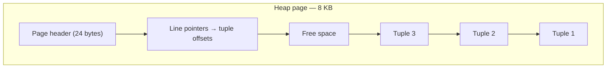

# Tables, Rows and Data Types — Part 2

Part 1 covered declaring a table and picking the right type for each column.
This part covers what happens to the values once they are in there: how NULL
behaves and why it breaks intuition, how defaults and identity columns generate
values for you, what it costs to change a table later, and how a row is
physically stored on disk.

> **⬅️ This continues [Part 1](./02-tables-rows-and-data-types-part-1.md).**

> **📌 In one line:** NULL is "unknown", not "empty" — and every surprising
> result in this file, from comparisons to aggregates to `UNIQUE`, follows from
> that one fact.

## Table of Contents

1. [NULL, Properly](#null-properly)
2. [Defaults, NOT NULL and Identity Columns](#defaults-not-null-and-identity-columns)
3. [Changing a Table Later](#changing-a-table-later)
4. [Advanced: How a Row Is Stored](#advanced-how-a-row-is-stored)
5. [Common Mistakes](#common-mistakes)
6. [Questions to Test Yourself](#questions-to-test-yourself)
7. [Related](#related)

---

## NULL, Properly

`NULL` is not zero, not an empty string, and not `false`. It means **"unknown"**
— there is no value here, and the database refuses to guess what it would have
been. Every strange `NULL` behaviour follows from that one idea.

### NULL = NULL is not true

```sql
SELECT NULL = NULL AS eq, NULL <> NULL AS neq, NULL IS NULL AS is_null;
```

```text
 eq  | neq | is_null
-----+-----+---------
 [null] | [null] | t
```

Both comparisons return `NULL` (unknown), not `true` and not `false`. "Is this
unknown thing equal to that unknown thing?" has no answer. SQL therefore has
three logical values: true, false, and unknown.

This is why `WHERE paid_at = NULL` returns **zero rows, always** — `WHERE` keeps
only rows where the condition is *true*, and unknown is not true.

```sql
-- ❌ Silently returns nothing
SELECT count(*) FROM invoices WHERE paid_at = NULL;
```

```text
 count
-------
     0
```

```sql
-- ✅ Correct
SELECT count(*) FROM invoices WHERE paid_at IS NULL;
```

```text
 count
-------
    47
```

### Three-valued logic

| `a` | `b` | `a AND b` | `a OR b` |
|---|---|---|---|
| true | NULL | NULL | **true** |
| false | NULL | **false** | NULL |
| NULL | NULL | NULL | NULL |

`false AND NULL` is `false`, because the result is false whatever the unknown
turns out to be. `true OR NULL` is `true` for the same reason. The database is
reasoning, not propagating blindly.

### NOT IN with a NULL returns nothing

This one has cost real teams real hours.

```sql
-- assignee_id is nullable; some tasks are unassigned
SELECT count(*) FROM users
WHERE id NOT IN (SELECT assignee_id FROM tasks);
```

```text
 count
-------
     0
```

Zero, even though plenty of users have no tasks. `id NOT IN (1, 2, NULL)`
expands to `id <> 1 AND id <> 2 AND id <> NULL`. That last term is unknown, so
the whole `AND` can never be true. The fix is `NOT EXISTS`, which is not
affected:

```sql
SELECT count(*) FROM users u
WHERE NOT EXISTS (SELECT 1 FROM tasks t WHERE t.assignee_id = u.id);
```

```text
 count
-------
    31
```

File 04 covers this again as a full BROKEN vs FIXED, because it shows up most
often inside joins.

### NULL in aggregates

Aggregate functions **skip NULLs**, except `count(*)`.

```sql
-- 4 invoices; 2 have amount_cents recorded, 2 are NULL
SELECT count(*)            AS rows,
       count(amount_cents) AS with_value,
       sum(amount_cents)   AS total,
       avg(amount_cents)   AS average
FROM invoices;
```

```text
 rows | with_value | total | average
------+------------+-------+---------
    4 |          2 | 30000 |   15000
```

The average is 15000, not 7500. `avg` divided by 2, not 4 — it averaged the
*known* values. That is usually right, and it is disastrous when the NULLs
actually meant zero. Say what you mean:

```sql
SELECT avg(coalesce(amount_cents, 0)) AS average_treating_null_as_zero
FROM invoices;
```

```text
 average_treating_null_as_zero
-------------------------------
                          7500
```

Also: `sum()` over zero rows returns `NULL`, not `0`. Wrap it in
`coalesce(sum(x), 0)` whenever the result goes straight into an API response.

### NULL and UNIQUE

A `UNIQUE` constraint permits **many** NULLs, because two unknowns are not known
to be equal.

```sql
CREATE TABLE projects (
    id          bigint GENERATED ALWAYS AS IDENTITY PRIMARY KEY,
    company_id  bigint NOT NULL REFERENCES companies (id),
    name        text NOT NULL,
    slug        text UNIQUE,          -- nullable
    status      text NOT NULL DEFAULT 'active',
    created_at  timestamptz NOT NULL DEFAULT now(),
    archived_at timestamptz
);

INSERT INTO projects (company_id, name, slug) VALUES (1, 'A', NULL);
INSERT INTO projects (company_id, name, slug) VALUES (1, 'B', NULL);  -- accepted
```

Both rows are accepted. In recent PostgreSQL versions you can demand the
stricter behaviour with `UNIQUE NULLS NOT DISTINCT` — check your version before
relying on it. A `PRIMARY KEY` never has this problem, because it implies
`NOT NULL`.

> **💡 Tip:** default every column to `NOT NULL` and justify each nullable one
> out loud. "`paid_at` is NULL until the invoice is paid" is a good reason.
> "`name` might be missing" usually means the application forgot to validate.

---

## Defaults, NOT NULL and Identity Columns

**`DEFAULT`** supplies a value when the `INSERT` does not mention the column. It
does nothing for existing rows unless you explicitly backfill them.

```sql
ALTER TABLE users ALTER COLUMN role SET DEFAULT 'member';
```

**`NOT NULL`** rejects the row outright. Combine them so new code cannot forget
a field:

```sql
status text NOT NULL DEFAULT 'draft'
```

**Identity columns** generate primary keys. Three generations of syntax exist,
and you will meet all three:

| Syntax | Notes |
|---|---|
| `serial` / `bigserial` | Legacy shorthand. Creates an `integer`/`bigint` plus a sequence. Still common, still works, but the sequence ownership is fiddly |
| `GENERATED BY DEFAULT AS IDENTITY` | Standard SQL. You *may* supply your own value |
| `GENERATED ALWAYS AS IDENTITY` | Standard SQL. You may **not** supply a value without `OVERRIDING SYSTEM VALUE` |

Prefer `bigint GENERATED ALWAYS AS IDENTITY` for new tables. `bigint` rather
than `integer`, because 2.1 billion sounds enormous until a notifications table
reaches it, and the migration to fix it at that point is measured in hours of
downtime.

**Generated columns** compute a value from other columns and store it:

```sql
ALTER TABLE invoices
    ADD COLUMN amount_dollars numeric(14,2)
    GENERATED ALWAYS AS (amount_cents / 100.0) STORED;
```

Useful for a normalised search value (`lower(email)`) or a derived total that
you also want to index.

---

## Changing a Table Later

The basics:

```sql
ALTER TABLE tasks ADD COLUMN estimate_minutes integer;         -- adding a column
ALTER TABLE tasks DROP COLUMN estimate_minutes;                -- dropping one
ALTER TABLE tasks ALTER COLUMN title TYPE varchar(300);        -- changing a type
ALTER TABLE tasks ALTER COLUMN status SET NOT NULL;            -- tightening
ALTER TABLE tasks RENAME COLUMN title TO name;                 -- renaming
```

These are one-line statements with wildly different costs.

| Change | Cost on a large table |
|---|---|
| `ADD COLUMN` nullable, no default | Cheap — metadata only |
| `ADD COLUMN` with a constant default | Cheap in recent PostgreSQL versions — the default is recorded, not written to every row |
| `ADD COLUMN` with a volatile default (e.g. `now()`) | **Rewrites the whole table** |
| `ALTER COLUMN ... TYPE` | Usually rewrites the whole table and holds an exclusive lock |
| `SET NOT NULL` | Full scan to verify, holding a lock (a validated `CHECK` can avoid the worst of it) |
| `DROP COLUMN` | Cheap — the column is marked dead; space returns after `VACUUM FULL` |
| `RENAME COLUMN` | Cheap in the database, **breaking** for any deployed code still using the old name |

> **⚠️ Warning:** `ALTER TABLE` takes an `ACCESS EXCLUSIVE` lock. Every read and
> write on that table queues behind it. On a 50-million-row table a type change
> can hold that lock for minutes — which is a total outage for any endpoint
> touching the table. Always set a short `lock_timeout` before running DDL in
> production, so the migration fails fast instead of freezing the site.

The *mechanics* of running these safely — migration tools, up/down files,
expand-and-contract deploys, zero-downtime column renames — belong to the
application side and are covered in
[orm-vs-query-builder](../../backend-fundamentals/10-database-integration/01-orm-vs-query-builder.md)
and the rest of
[10-database-integration](../../backend-fundamentals/10-database-integration/).
This folder stays on the engine's side of the line.

---

## Advanced: How a Row Is Stored

You do not need this to write SQL, but it explains several things that otherwise
look like magic.

PostgreSQL stores a table as a sequence of fixed-size **pages** (8 KB by
default). Each page holds a header, a line pointer array, and the row versions
themselves, called **tuples**, packed from the end of the page backwards.



Three consequences worth knowing:

**1. A row has fixed overhead.** Every tuple carries a ~23-byte header holding
the transaction IDs that make MVCC work — which transaction inserted it, which
deleted it. A table of one `boolean` column does not use 1 byte per row; it uses
roughly 28. This is why "just add a table with a few columns" is fine, and "one
row per API request forever" is not.

**2. TOAST handles large values.** A tuple cannot span pages. When a row exceeds
about 2 KB, PostgreSQL compresses the big fields and, if still too large, moves
them out of line into a side table called TOAST (The Oversized-Attribute
Storage Technique), leaving a small pointer behind.

The practical effect: a `text` column holding a 50 KB document costs almost
nothing to *skip*. `SELECT id, title FROM articles` never touches the TOAST
table. But `SELECT *` fetches and decompresses every one — one of the concrete
reasons behind
[select-star-anti-pattern](../query-patterns/select-star-anti-pattern.md).

**3. Column order affects row size, through alignment padding.** Fixed-width
types must start at aligned byte offsets: 8-byte types on 8-byte boundaries,
4-byte types on 4-byte boundaries. Declaring them out of order leaves gaps.

```sql
-- Wasteful ordering: bool, bigint, bool, bigint
CREATE TABLE a (f1 boolean, n1 bigint, f2 boolean, n2 bigint);

-- Tight ordering: widest first, small flags last
CREATE TABLE b (n1 bigint, n2 bigint, f1 boolean, f2 boolean);
```

Table `a` pads after each boolean to reach the next 8-byte boundary and ends up
noticeably wider per row than `b`. On a small table this is irrelevant; across a
billion rows it is gigabytes of disk and cache. The rule of thumb is: **8-byte
types first, then 4-byte, then 2-byte, then 1-byte and variable-length**.

**And finally, why `text` is not slower than `varchar`.** Both are stored as the
same internal `varlena` structure: a length header followed by the bytes.
`varchar(n)` is that structure plus a constraint check on write. There is no
padding, no reserved space, and no different code path on read. The choice is
purely about the rule you want enforced.

---

## Common Mistakes

| Mistake | Why it is wrong | Do this instead |
|---|---|---|
| `WHERE col = NULL` | Comparison with NULL is unknown, never true | `IS NULL` / `IS NOT NULL` |
| `NOT IN (subquery)` on a nullable column | One NULL makes the result empty | `NOT EXISTS` |
| Expecting `avg()` to count NULL rows | Aggregates skip NULLs | `avg(coalesce(col, 0))` if that is the intent |
| Returning `sum()` directly in an API | Returns `NULL` on zero rows | `coalesce(sum(x), 0)` |
| Assuming `UNIQUE` blocks multiple NULLs | Two unknowns are not equal | `NOT NULL` too, or `NULLS NOT DISTINCT` on recent versions |
| `integer` primary keys on a growth table | 2.1 billion arrives faster than you think | `bigint GENERATED ALWAYS AS IDENTITY` |
| Running `ALTER TABLE` in production casually | `ACCESS EXCLUSIVE` lock blocks all traffic | Set `lock_timeout`, use a safe migration pattern |
| Storing files in `bytea` | Bloats the table, backups and replication | Object storage, keep the URL in the row |

---

## Questions to Test Yourself

1. Why does `WHERE paid_at = NULL` return zero rows rather than an error?
2. `SELECT * FROM users WHERE id NOT IN (SELECT assignee_id FROM tasks)` returns
   nothing at all. Explain why, and fix it.
3. A table has 4 rows; 2 have `amount_cents` set to 10000 and 20000, 2 are NULL.
   What do `count(*)`, `count(amount_cents)`, `sum` and `avg` return?
4. Why does a `UNIQUE` column accept two NULL values?
5. Which `ALTER TABLE` operations are cheap on a 50-million-row table and which
   rewrite it? What lock do they take?
6. Explain TOAST in two sentences, and use it to justify avoiding `SELECT *`.
7. Why can column declaration order change how much disk a table uses?

---

## Related

- [Part 1](./02-tables-rows-and-data-types-part-1.md) — `CREATE TABLE`, the type
  reference, money, time zones and string types.
- [What Is a Relational Database](01-what-is-a-relational-database.md) — the
  tables and schema vocabulary this file builds on.
- [SQL Basics: CRUD](03-sql-basics-crud-part-1.md) — putting rows into these tables and
  getting them back.
- [Aggregations and Grouping](05-aggregations-and-grouping-part-1.md) — more on NULL
  behaviour inside aggregates.
- [select-star-anti-pattern](../query-patterns/select-star-anti-pattern.md) —
  the TOAST cost of `SELECT *`.
- [orm-vs-query-builder](../../backend-fundamentals/10-database-integration/01-orm-vs-query-builder.md)
  — migrations and schema change mechanics on the application side.
