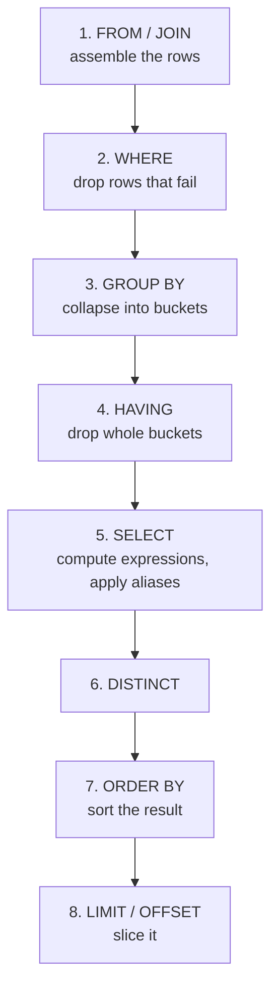

# SQL Basics: CRUD — Part 1

CRUD is Create, Read, Update, Delete — `INSERT`, `SELECT`, `UPDATE`, `DELETE`.
Four statements. You can learn the syntax in an afternoon and still write a
`DELETE` that empties a production table, or a `WHERE` that silently returns the
wrong rows because of one missing pair of brackets.

This file teaches the four statements properly, plus the two ideas that make
them click: the **logical order of evaluation**, and the habit of proving a
`WHERE` clause with a `SELECT` before you let it destroy anything.

> **📌 In one line:** SQL is evaluated in a different order from the one you
> write it in, and understanding that order explains most beginner confusion.

## Table of Contents

1. [SELECT, Built Up Slowly](#select-built-up-slowly)
2. [The Logical Order of Evaluation](#the-logical-order-of-evaluation)
3. [Filtering in Depth](#filtering-in-depth)
4. [BROKEN vs FIXED: Missing Parentheses](#broken-vs-fixed-missing-parentheses)
5. [INSERT and RETURNING](#insert-and-returning)
6. [Common Mistakes](#common-mistakes)
7. [Questions to Test Yourself](#questions-to-test-yourself)
8. [Related](#related)

---

## SELECT, Built Up Slowly

Start with everything:

```sql
SELECT * FROM tasks;
```

`*` means every column. It is fine while exploring in `psql` and a bad habit in
application code — you fetch columns you do not use, you break when a column is
added, and you defeat index-only scans
([select-star-anti-pattern](../query-patterns/select-star-anti-pattern.md)).
So: name your columns.

```sql
SELECT id, title, status, due_date
FROM tasks;
```

```text
 id |         title          |   status    |  due_date
----+------------------------+-------------+------------
  1 | Ship billing page      | in_progress | 2026-10-02
  2 | Fix invoice rounding   | todo        | 2026-09-28
  3 | Write onboarding email | done        | 2026-09-10
  4 | Update pricing copy    | todo        | [null]
```

**Filter the rows** with `WHERE`:

```sql
SELECT id, title, status, due_date
FROM tasks
WHERE status = 'todo';
```

```text
 id |         title         | status |  due_date
----+-----------------------+--------+------------
  2 | Fix invoice rounding  | todo   | 2026-09-28
  4 | Update pricing copy   | todo   | [null]
```

**Sort them** with `ORDER BY`. Sorting is not free — the database either reads
them in order from an index or sorts them in memory (or on disk).

```sql
SELECT id, title, due_date
FROM tasks
WHERE status = 'todo'
ORDER BY due_date ASC NULLS LAST;
```

`NULLS LAST` matters: PostgreSQL sorts NULLs *last* for `ASC` and *first* for
`DESC` by default, which surprises people who expect "empty means unimportant".

**Take a page** with `LIMIT` and `OFFSET`:

```sql
SELECT id, title
FROM tasks
WHERE status = 'todo'
ORDER BY due_date ASC NULLS LAST, id ASC
LIMIT 20 OFFSET 40;
```

Two warnings in one statement:

- `ORDER BY` **must be deterministic** for paging to be stable. Adding `id` as
  the tie-breaker guarantees a total order; without it, two rows with the same
  `due_date` can swap between pages and a row can appear twice or never.
- `OFFSET 40` makes the database produce and discard 40 rows first. At
  `OFFSET 100000` that is catastrophic. Keyset pagination is the fix —
  [pagination-performance](../query-optimization/pagination-performance.md).

**Rename output columns** with `AS`, and compute new ones:

```sql
SELECT id,
       title,
       due_date - CURRENT_DATE AS days_left,
       upper(status)           AS status_label
FROM tasks
WHERE status <> 'done';
```

**Remove duplicates** with `DISTINCT`, which applies to the whole selected row:

```sql
SELECT DISTINCT status FROM tasks;
SELECT DISTINCT status, project_id FROM tasks;   -- distinct pairs
```

PostgreSQL also has `DISTINCT ON`, which keeps the first row per group given an
`ORDER BY` — extremely useful, and PostgreSQL-only:

```sql
-- The most recently created task per project
SELECT DISTINCT ON (project_id) project_id, id, title, created_at
FROM tasks
ORDER BY project_id, created_at DESC;
```

---

## The Logical Order of Evaluation

You write a query in one order. The database evaluates it in another. This
single fact answers a surprising number of "why doesn't this work" questions.



Written order versus evaluated order:

| You write | It runs |
|---|---|
| 1. `SELECT` | 5 |
| 2. `FROM` | 1 |
| 3. `WHERE` | 2 |
| 4. `GROUP BY` | 3 |
| 5. `HAVING` | 4 |
| 6. `ORDER BY` | 7 |
| 7. `LIMIT` | 8 |

### Why an alias works in ORDER BY but not in WHERE

```sql
-- ❌ ERROR
SELECT id, due_date - CURRENT_DATE AS days_left
FROM tasks
WHERE days_left < 7;
```

```text
ERROR:  column "days_left" does not exist
LINE 3: WHERE days_left < 7;
```

`WHERE` runs at step 2. `SELECT` — where `days_left` is created — runs at step
5. At the moment `WHERE` is evaluated, that name does not exist yet.

```sql
-- ✅ Works: ORDER BY runs at step 7, after SELECT
SELECT id, due_date - CURRENT_DATE AS days_left
FROM tasks
ORDER BY days_left;
```

To filter on the expression, either repeat it or wrap the query:

```sql
-- Repeat the expression
SELECT id, due_date - CURRENT_DATE AS days_left
FROM tasks
WHERE due_date - CURRENT_DATE < 7;

-- Or name it once in a subquery / CTE (see file 06)
SELECT * FROM (
    SELECT id, due_date - CURRENT_DATE AS days_left FROM tasks
) t
WHERE days_left < 7;
```

> **💡 Tip:** `WHERE due_date < CURRENT_DATE + 7` is better than
> `WHERE due_date - CURRENT_DATE < 7`, because the first leaves the bare column
> on one side and can use an index on `due_date`. Wrapping a column in an
> expression usually disables its index.

The same ordering explains why `WHERE` cannot contain an aggregate (`HAVING`
exists for that) — covered in file 05.

---

## Filtering in Depth

### Comparison operators

| Operator | Meaning |
|---|---|
| `=` `<>` (or `!=`) | Equal / not equal |
| `<` `<=` `>` `>=` | Ordering comparisons |
| `BETWEEN a AND b` | `>= a AND <= b` — **both ends inclusive** |
| `IN (…)` | Matches any value in the list |
| `LIKE` / `ILIKE` | Pattern match; `ILIKE` is case-insensitive (PostgreSQL) |
| `IS NULL` / `IS NOT NULL` | The only correct way to test for NULL |
| `IS DISTINCT FROM` | Like `<>` but treats NULL as a comparable value |

`BETWEEN` being inclusive at both ends is a classic date bug:

```sql
-- ❌ Misses invoices issued on 31 March after 00:00:00
WHERE issued_at BETWEEN '2026-03-01' AND '2026-03-31'

-- ✅ Half-open range: everything in March, no edge case
WHERE issued_at >= '2026-03-01'
  AND issued_at <  '2026-04-01'
```

`'2026-03-31'` becomes `2026-03-31 00:00:00`, so the whole last day is excluded.
Use half-open ranges for every timestamp filter.

### IN, LIKE, ILIKE

```sql
SELECT id, title FROM tasks
WHERE status IN ('todo', 'in_progress');

SELECT id, name FROM users
WHERE email LIKE '%@acme.com';        -- case-sensitive
SELECT id, name FROM users
WHERE email ILIKE '%@ACME.com';       -- case-insensitive, PostgreSQL only
```

`%` matches any run of characters, `_` matches exactly one.

> **⚠️ Warning:** a **leading wildcard** (`LIKE '%acme%'`) cannot use a normal
> B-tree index, so it scans the whole table. A trailing-only wildcard
> (`LIKE 'acme%'`) can — with a `text_pattern_ops` index if your database is not
> in the C collation. For real search, use a trigram (`pg_trgm`) index or full
> text search:
> [index-types-deep-dive](../query-optimization/index-types-deep-dive.md).

### IS DISTINCT FROM

The NULL-safe comparison, and genuinely useful:

```sql
-- "status changed" — works even when one side is NULL
WHERE new_status IS DISTINCT FROM old_status
```

`'a' <> NULL` is unknown; `'a' IS DISTINCT FROM NULL` is `true`.

---

## BROKEN vs FIXED: Missing Parentheses

`AND` binds tighter than `OR`, exactly like `×` binds tighter than `+`. Forget
that and the query does not error — it quietly returns the wrong rows.

The intention: **open tasks (todo or in_progress) for project 31**.

```sql
-- ❌ BROKEN
SELECT id, project_id, status, title
FROM tasks
WHERE project_id = 31
  AND status = 'todo'
   OR status = 'in_progress';
```

```text
 id | project_id |   status    |         title
----+------------+-------------+------------------------
  2 |         31 | todo        | Fix invoice rounding
  7 |         55 | in_progress | Migrate DNS
  9 |         88 | in_progress | Rewrite billing worker
```

Tasks 7 and 9 belong to other projects entirely. The database read it as:

```sql
WHERE (project_id = 31 AND status = 'todo')
   OR (status = 'in_progress')          -- no project filter at all
```

Nothing failed. The endpoint returned other companies' tasks — which, in a
multi-tenant SaaS, is a data-leak incident, not a cosmetic bug.

```sql
-- ✅ FIXED — the OR group is bracketed
SELECT id, project_id, status, title
FROM tasks
WHERE project_id = 31
  AND (status = 'todo' OR status = 'in_progress');
```

```text
 id | project_id |   status    |        title
----+------------+-------------+----------------------
  2 |         31 | todo        | Fix invoice rounding
  5 |         31 | in_progress | Ship billing page
```

Cleaner still, and it reads as one idea:

```sql
WHERE project_id = 31
  AND status IN ('todo', 'in_progress');
```

> **📌 Remember:** whenever `AND` and `OR` appear in the same `WHERE`, add the
> parentheses even if you are sure of the precedence. They cost nothing and
> they make the intent reviewable.

---

## INSERT and RETURNING

A single row, always naming the columns:

```sql
INSERT INTO companies (name, plan)
VALUES ('Acme Ltd', 'pro');
```

Never write `INSERT INTO companies VALUES ('Acme Ltd', 'pro')` — it depends on
column order, and it breaks the day someone adds a column.

Many rows in one statement. This is dramatically faster than one statement per
row, because it is one round trip, one plan, one transaction:

```sql
INSERT INTO tasks (project_id, assignee_id, title, status, due_date)
VALUES
    (31, 1, 'Ship billing page',    'in_progress', '2026-10-02'),
    (31, 2, 'Fix invoice rounding', 'todo',        '2026-09-28'),
    (31, NULL, 'Update pricing copy', 'todo',      NULL);
```

For thousands of rows, `COPY` is faster still —
[bulk-write-performance](../query-patterns/bulk-write-performance.md).

### RETURNING

A PostgreSQL feature worth learning on day one. It gives back values generated
by the database — identity keys, defaults, generated columns — without a second
query:

```sql
INSERT INTO projects (company_id, name)
VALUES (1, 'Website redesign')
RETURNING id, created_at;
```

```text
 id |          created_at
----+-------------------------------
 31 | 2026-09-17 11:04:22.481+00
```

One round trip instead of two, and no race with another session. `RETURNING`
works on `UPDATE` and `DELETE` as well, which is how you build a safe job queue:

```sql
-- Claim one pending notification and mark it, atomically
UPDATE notifications
SET    read_at = now()
WHERE  id = (
    SELECT id FROM notifications
    WHERE  user_id = 1 AND read_at IS NULL
    ORDER  BY created_at
    FOR UPDATE SKIP LOCKED
    LIMIT  1
)
RETURNING id, type;
```

MySQL has no `RETURNING` on `INSERT`; it uses `LAST_INSERT_ID()` instead.

---

> **➡️ Continued in [Part 2](./03-sql-basics-crud-part-2.md)**

---

## Common Mistakes

| Mistake | Why it is wrong | Do this instead |
|---|---|---|
| `SELECT *` in application code | Fetches unused columns, breaks on schema change, blocks index-only scans | Name the columns |
| Using a `SELECT` alias in `WHERE` | `WHERE` runs before `SELECT` | Repeat the expression, or use a subquery/CTE |
| Mixing `AND` and `OR` without brackets | `AND` binds tighter; wrong rows, no error | Parenthesise, or use `IN` |
| `BETWEEN` on timestamps | Inclusive end misses most of the last day | Half-open: `>= start AND < end` |
| `ORDER BY` without a unique tie-breaker | Rows repeat or vanish across pages | Add the primary key to `ORDER BY` |
| Large `OFFSET` for paging | Produces and discards every skipped row | Keyset pagination |
| `INSERT` without a column list | Depends on column order | Always name the columns |
| One `INSERT` per row in a loop | One round trip each | Multi-row `INSERT` or `COPY` |

---

## Questions to Test Yourself

1. Write the logical order of evaluation from memory, all eight steps.
2. Why does a `SELECT` alias work in `ORDER BY` but raise an error in `WHERE`?
   Give two ways to filter on the computed value.
3. `WHERE company_id = 1 AND status = 'todo' OR status = 'done'` — what does the
   database actually evaluate, and what is the security risk in a multi-tenant
   app?
4. Why is `BETWEEN '2026-03-01' AND '2026-03-31'` wrong for a `timestamptz`
   column, and what should you write?
5. What does `RETURNING` save you, and what is the MySQL equivalent?

---

## Related

- [Part 2](./03-sql-basics-crud-part-2.md) — `UPDATE`, `DELETE`, upserts,
  existence checks, `psql` and set operations.
- [Tables, Rows and Data Types](02-tables-rows-and-data-types-part-1.md) — NULL
  semantics that drive half of the filtering rules here.
- [Joins Explained](04-joins-explained-part-1.md) — the next file: pulling rows from
  more than one table.
- [pagination-performance](../query-optimization/pagination-performance.md) —
  why `OFFSET` fails at scale.
- [bulk-write-performance](../query-patterns/bulk-write-performance.md) — `COPY`
  and batching for large inserts.
- [select-star-anti-pattern](../query-patterns/select-star-anti-pattern.md) —
  the full case against `SELECT *`.
