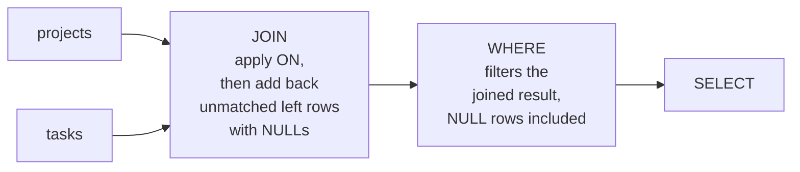

# Joins Explained — Part 1

A relational database splits data across tables on purpose. A join is how you
put it back together for one question.

Joins are where beginners stop being beginners — and also where the most
expensive silent bugs live. Not crashes: *wrong numbers*. A `LEFT JOIN` that
quietly became an `INNER JOIN`. An invoice total that doubled because a join
duplicated rows. Both look like working code.

> **📌 In one line:** a join matches rows from two tables by comparing values,
> and the two things to stay alert to are which rows survive and how many times
> each one appears.

## Table of Contents

1. [The Problem Joins Solve](#the-problem-joins-solve)
2. [Every Join Type on the Same Data](#every-join-type-on-the-same-data)
3. [ON vs WHERE](#on-vs-where)
4. [BROKEN vs FIXED: The Disappearing LEFT JOIN](#broken-vs-fixed-the-disappearing-left-join)
5. [Joining Four Tables](#joining-four-tables)
6. [Self Joins](#self-joins)
7. [Common Mistakes](#common-mistakes)
8. [Questions to Test Yourself](#questions-to-test-yourself)
9. [Related](#related)

---

## The Problem Joins Solve

The task list needs to show who each task is assigned to. But `tasks` does not
store a name — it stores a number:

```sql
SELECT id, title, assignee_id FROM tasks WHERE project_id = 31;
```

```text
 id |        title         | assignee_id
----+----------------------+-------------
  1 | Ship billing page    |           1
  2 | Fix invoice rounding |           2
  4 | Update pricing copy  |      [null]
```

`assignee_id = 1` is useless to a human. The name lives in `users`. The
beginner's instinct is a loop:

```ts
// ❌ One query for the tasks, then one per task. The N+1 problem.
const tasks = await db.select('*').from('tasks').where('project_id', 31)
for (const t of tasks) {
  t.assignee = await db.select('name').from('users').where('id', t.assignee_id).first()
}
```

That is 1 + N round trips — see
[n-plus-one-queries](../query-optimization/n-plus-one-queries.md). The database
can do it in one:

```sql
SELECT t.id, t.title, u.name AS assignee
FROM tasks t
JOIN users u ON u.id = t.assignee_id
WHERE t.project_id = 31;
```

```text
 id |        title         | assignee
----+----------------------+----------
  1 | Ship billing page    | Ana
  2 | Fix invoice rounding | Ben
```

Note what happened: task 4, with no assignee, **vanished**. That is not a bug in
the database; it is the definition of the join type you chose. Which brings us
to the join types.

---

## Every Join Type on the Same Data

Two small tables. Deliberately imperfect: one project has no tasks, one task has
no project.

```text
projects (left)                 tasks (right)
 id |     name        |        id | project_id |       title
----+-----------------+       ----+------------+------------------
 31 | Website redesign|         1 |         31 | Ship billing page
 32 | Mobile app      |         2 |         31 | Fix rounding
 33 | Internal tools  |         3 |         32 | Push notifications
                                  4 |     [null] | Orphan task
```

Project 33 has no tasks. Task 4 has no project.

### INNER JOIN — only matches

```sql
SELECT p.id AS p_id, p.name, t.id AS t_id, t.title
FROM projects p
INNER JOIN tasks t ON t.project_id = p.id;
```

```text
 p_id |      name        | t_id |       title
------+------------------+------+--------------------
   31 | Website redesign |    1 | Ship billing page
   31 | Website redesign |    2 | Fix rounding
   32 | Mobile app       |    3 | Push notifications
(3 rows)
```

Project 33 and task 4 are both gone. `JOIN` with no word in front means
`INNER JOIN`.

### LEFT JOIN — keep every left row

```sql
SELECT p.id AS p_id, p.name, t.id AS t_id, t.title
FROM projects p
LEFT JOIN tasks t ON t.project_id = p.id;
```

```text
 p_id |      name        |  t_id  |       title
------+------------------+--------+--------------------
   31 | Website redesign |      1 | Ship billing page
   31 | Website redesign |      2 | Fix rounding
   32 | Mobile app       |      3 | Push notifications
   33 | Internal tools   | [null] | [null]
(4 rows)
```

Project 33 survives with NULLs in the right-hand columns. **This is the join you
want whenever the right side is optional** — "projects and their tasks, if any".

### RIGHT JOIN — keep every right row

```sql
SELECT p.id AS p_id, p.name, t.id AS t_id, t.title
FROM projects p
RIGHT JOIN tasks t ON t.project_id = p.id;
```

```text
  p_id  |      name        | t_id |       title
--------+------------------+------+--------------------
     31 | Website redesign |    1 | Ship billing page
     31 | Website redesign |    2 | Fix rounding
     32 | Mobile app       |    3 | Push notifications
 [null] | [null]           |    4 | Orphan task
(4 rows)
```

Identical to a `LEFT JOIN` with the tables swapped. Most teams never write
`RIGHT JOIN` — reordering the tables is easier to read.

### FULL OUTER JOIN — keep everything

```sql
SELECT p.id AS p_id, p.name, t.id AS t_id, t.title
FROM projects p
FULL OUTER JOIN tasks t ON t.project_id = p.id;
```

```text
  p_id  |      name        |  t_id  |       title
--------+------------------+--------+--------------------
     31 | Website redesign |      1 | Ship billing page
     31 | Website redesign |      2 | Fix rounding
     32 | Mobile app       |      3 | Push notifications
     33 | Internal tools   | [null] | [null]
 [null] | [null]           |      4 | Orphan task
(5 rows)
```

Rare in application code, excellent for reconciliation: "show me everything that
does not line up on either side."

### CROSS JOIN — every combination

```sql
SELECT p.name, t.title FROM projects p CROSS JOIN tasks t;
```

3 projects × 4 tasks = **12 rows**, with no condition at all. Legitimate uses
are narrow — generating a date grid, filling a report matrix. The dangerous
version is the accidental one:

```sql
-- ❌ Comma join with a forgotten condition = CROSS JOIN
SELECT * FROM projects p, tasks t;
```

On 10,000 projects and 500,000 tasks that is five billion rows. Prefer explicit
`JOIN ... ON` syntax; a missing `ON` is then a syntax error instead of an
outage.

### Summary

| Join | Keeps unmatched **left** rows | Keeps unmatched **right** rows | Rows above |
|---|---|---|---|
| `INNER JOIN` | No | No | 3 |
| `LEFT JOIN` | **Yes** | No | 4 |
| `RIGHT JOIN` | No | **Yes** | 4 |
| `FULL OUTER JOIN` | **Yes** | **Yes** | 5 |
| `CROSS JOIN` | n/a — every pair | n/a | 12 |

> **⚠️ About Venn diagrams:** you will see joins drawn as overlapping circles.
> They are a fair picture of *which* rows survive and a misleading picture of
> *how many*. A Venn diagram cannot show that project 31 appears **twice** in
> the inner join because it has two tasks. Sets do not duplicate; joins do.
> Use the result tables above as your mental model instead.

---

## ON vs WHERE

For an `INNER JOIN`, a condition in `ON` and the same condition in `WHERE` give
the same rows. For a `LEFT JOIN` they do completely different things — and this
is the classic bug.

The order matters:



- `ON` decides **which rows pair up**. For an outer join, unmatched left rows
  are then re-added with NULLs on the right.
- `WHERE` runs **after** all of that, on the finished result — and it sees those
  NULL-filled rows like any other.

Since `NULL = 'done'` is unknown, any `WHERE` condition on a right-hand column
deletes exactly the rows the `LEFT JOIN` was there to keep.

---

## BROKEN vs FIXED: The Disappearing LEFT JOIN

**The question:** list every project with a count of its *done* tasks —
including projects with none.

```sql
-- ❌ BROKEN
SELECT p.name, count(t.id) AS done_tasks
FROM projects p
LEFT JOIN tasks t ON t.project_id = p.id
WHERE t.status = 'done'
GROUP BY p.name
ORDER BY p.name;
```

```text
      name        | done_tasks
------------------+------------
 Website redesign |          2
(1 row)
```

Only one project. "Mobile app" has tasks but none done, "Internal tools" has no
tasks at all — both gone. The `LEFT JOIN` produced their NULL rows, and then
`WHERE t.status = 'done'` evaluated `NULL = 'done'` → unknown → row dropped. The
`LEFT JOIN` was silently downgraded to an `INNER JOIN`.

```sql
-- ✅ FIXED — the condition belongs in ON, where it decides pairing
SELECT p.name, count(t.id) AS done_tasks
FROM projects p
LEFT JOIN tasks t
       ON t.project_id = p.id
      AND t.status = 'done'
GROUP BY p.name
ORDER BY p.name;
```

```text
      name        | done_tasks
------------------+------------
 Internal tools   |          0
 Mobile app       |          0
 Website redesign |          2
(3 rows)
```

An alternative fix when the condition must stay in `WHERE`:

```sql
WHERE t.status = 'done' OR t.id IS NULL
```

It works, but it reads like an apology. Put the condition in `ON`.

> **📌 Remember:** in a `LEFT JOIN`, a filter on the **right-hand** table goes in
> `ON`. A filter on the **left-hand** table goes in `WHERE`. Getting this
> backwards is the single most common join bug in production code.

---

## Joining Four Tables

Build it up one join at a time, checking the row count as you go.

**Step 1 — projects and their company:**

```sql
SELECT c.name AS company, p.name AS project
FROM companies c
JOIN projects p ON p.company_id = c.id;
```

**Step 2 — add tasks:**

```sql
SELECT c.name AS company, p.name AS project, t.title, t.status
FROM companies c
JOIN projects p ON p.company_id = c.id
JOIN tasks    t ON t.project_id = p.id;
```

**Step 3 — add the assignee, which is optional, so `LEFT JOIN`:**

```sql
SELECT c.name  AS company,
       p.name  AS project,
       t.title AS task,
       t.status,
       coalesce(u.name, 'Unassigned') AS assignee
FROM companies c
JOIN      projects p ON p.company_id = c.id
JOIN      tasks    t ON t.project_id  = p.id
LEFT JOIN users    u ON u.id          = t.assignee_id
WHERE c.id = 1
  AND p.archived_at IS NULL
  AND t.status <> 'done'
ORDER BY p.name, t.due_date NULLS LAST;
```

```text
 company  |     project      |        task          |   status    |  assignee
----------+------------------+----------------------+-------------+------------
 Acme Ltd | Website redesign | Fix invoice rounding | todo        | Ben
 Acme Ltd | Website redesign | Ship billing page    | in_progress | Ana
 Acme Ltd | Website redesign | Update pricing copy  | todo        | Unassigned
```

Points worth absorbing:

- **Alias every table** (`c`, `p`, `t`, `u`) and qualify every column. In a
  four-table join, a bare `name` is ambiguous or, worse, resolves to the wrong
  table.
- **The chain is by keys**, one link at a time: company → project → task → user.
- `p.archived_at IS NULL` filters the **left/driving** side, so `WHERE` is
  correct. If you wanted "unassigned tasks kept even when the user is deleted",
  that belongs in the `LEFT JOIN`'s `ON`.
- Join *order* in the text is a suggestion; the planner reorders freely — see
  [join-algorithms](../query-planner/join-algorithms.md).

---

## Self Joins

A self join is a table joined to itself, with two aliases. Nothing special
happens; the aliases just make it two logical tables.

Assume `tasks` has a `parent_task_id bigint REFERENCES tasks(id)` column (added
here, on top of the shared schema) for sub-tasks:

```sql
SELECT child.id,
       child.title                        AS subtask,
       coalesce(parent.title, '(top level)') AS parent_task
FROM tasks child
LEFT JOIN tasks parent ON parent.id = child.parent_task_id
WHERE child.project_id = 31
ORDER BY parent.title NULLS FIRST, child.id;
```

```text
 id |        subtask        |     parent_task
----+-----------------------+---------------------
  1 | Ship billing page     | (top level)
  5 | Design invoice PDF    | Ship billing page
  6 | Add Stripe webhook    | Ship billing page
```

`LEFT JOIN` is essential: an `INNER JOIN` would hide every top-level task.

The same shape works for a manager hierarchy (`users.manager_id`):

```sql
SELECT e.name AS employee, m.name AS manager
FROM users e
LEFT JOIN users m ON m.id = e.manager_id
WHERE e.company_id = 1;
```

A self join reaches **one level**. For the whole tree — every ancestor, every
descendant — you need a recursive CTE, in
[file 06](06-ctes-and-window-functions-part-1.md).

---

> **➡️ Continued in [Part 2](./04-joins-explained-part-2.md)**

---

## Common Mistakes

| Mistake | Why it is wrong | Do this instead |
|---|---|---|
| Filtering the right table in `WHERE` after a `LEFT JOIN` | NULL rows fail the test; it becomes an `INNER JOIN` | Put the condition in `ON` |
| Comma joins (`FROM a, b`) | A forgotten condition silently becomes a `CROSS JOIN` | Explicit `JOIN ... ON` |
| `INNER JOIN` for an optional relationship | Drops rows you meant to keep | `LEFT JOIN`, plus `coalesce` for display |
| Unqualified columns in a multi-table join | Ambiguous, or silently the wrong table | Alias every table, qualify every column |
| Reasoning about joins with Venn diagrams | They cannot show duplicated rows | Use worked result tables |

---

## Questions to Test Yourself

1. With 3 projects (one with no tasks) and 4 tasks (one with no project), how
   many rows does each of `INNER`, `LEFT`, `RIGHT`, `FULL OUTER` and `CROSS`
   return?
2. Why is a Venn diagram a misleading picture of a join?
3. Explain, using the evaluation order, why `WHERE t.status = 'done'` breaks a
   `LEFT JOIN` while `AND t.status = 'done'` inside `ON` does not.
4. In a `LEFT JOIN`, which table's filters go in `ON` and which in `WHERE`?
5. Write the four-table join from `companies` down to `users`, and say which
   join type each step needs if tasks may be unassigned.
6. What does a self join do that an ordinary join does not, and what is the one
   thing you must never forget when writing one?

---

## Related

- [Part 2](./04-joins-explained-part-2.md) — row multiplication, counting in a
  joined query, semi/anti-joins, `LATERAL` and the physical algorithms.
- [SQL Basics: CRUD](03-sql-basics-crud-part-1.md) — the single-table foundations.
- [CTEs and Window Functions](06-ctes-and-window-functions-part-1.md) — recursive
  hierarchies, when a self join is not deep enough.
- [n-plus-one-queries](../query-optimization/n-plus-one-queries.md) — the loop
  that a join replaces.
- [join-optimization](../query-patterns/join-optimization.md) — making a
  specific slow join fast.
