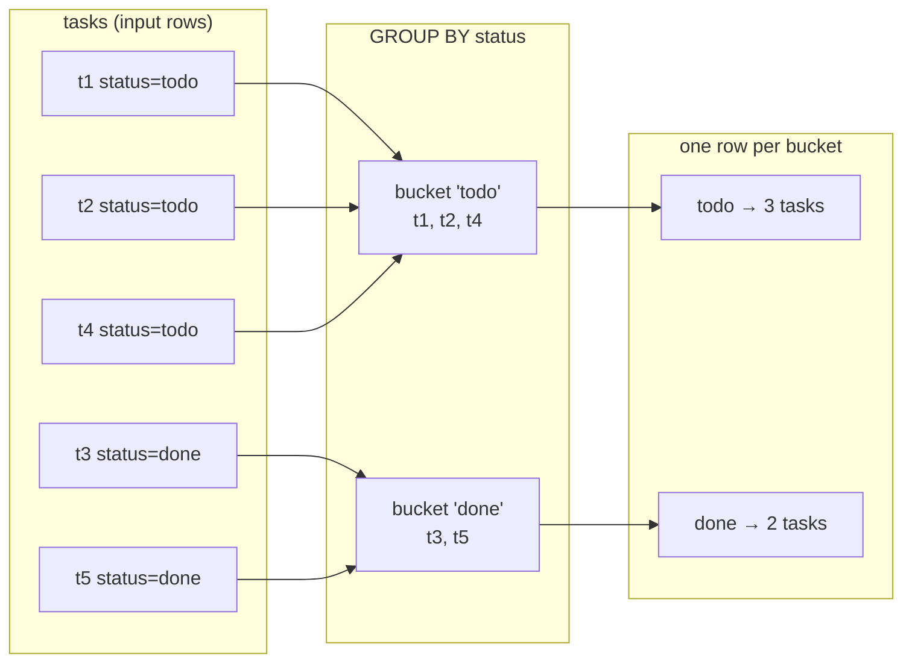

# Aggregations and Grouping — Part 1

Every dashboard, invoice summary and "how many users do we have" question is an
aggregation. You take many rows and turn them into few.

The syntax is short. The confusions are specific and predictable: why the
database rejects a column you did not group by, why `HAVING` exists when
`WHERE` already filters, why an average silently ignores missing values, and
why `count(*)` on a big table in PostgreSQL is slower than everyone expects.

> **📌 In one line:** an aggregate collapses a set of rows into one value, and
> `GROUP BY` decides which rows belong to which set.

## Table of Contents

1. [Aggregate Functions](#aggregate-functions)
2. [GROUP BY as Buckets](#group-by-as-buckets)
3. [The "must appear in GROUP BY" Rule](#the-must-appear-in-group-by-rule)
4. [HAVING vs WHERE](#having-vs-where)
5. [Grouping by Several Columns and by an Expression](#grouping-by-several-columns-and-by-an-expression)
6. [NULLs in Aggregates](#nulls-in-aggregates)
7. [Common Mistakes](#common-mistakes)
8. [Questions to Test Yourself](#questions-to-test-yourself)
9. [Related](#related)

---

## Aggregate Functions

An aggregate takes many rows and returns one value. With no `GROUP BY`, the
whole table is one group, so you always get exactly one row back.

```sql
SELECT count(*)          AS invoices,
       sum(amount_cents) AS total_cents,
       avg(amount_cents) AS avg_cents,
       min(issued_at)    AS first_issued,
       max(issued_at)    AS last_issued
FROM invoices
WHERE company_id = 1;
```

```text
 invoices | total_cents | avg_cents |      first_issued      |      last_issued
----------+-------------+-----------+------------------------+------------------------
        6 |      749400 |    124900 | 2026-04-01 00:00:00+00 | 2026-09-01 00:00:00+00
```

| Function | Returns | Notes |
|---|---|---|
| `count(*)` | Number of rows | The only aggregate that counts NULL rows |
| `count(col)` | Rows where `col IS NOT NULL` | |
| `count(DISTINCT col)` | Distinct non-NULL values | Needs a sort or hash; the expensive one |
| `sum(col)` | Total | **`NULL` when there are no rows**, not 0 |
| `avg(col)` | Mean of non-NULL values | Returns `numeric` for integer input |
| `min` / `max` | Smallest / largest | Works on text and dates too |
| `bool_and` / `bool_or` | "all" / "any" over booleans | |
| `string_agg(col, ', ')` | Values joined into one string | Add `ORDER BY` inside for stable output |
| `array_agg(col)` | Values collected into an array | |
| `jsonb_agg(...)` | Rows collected into a JSON array | Great for one-query nested API responses |

`string_agg` and `array_agg` are the ones people are most surprised to find:

```sql
SELECT p.name,
       string_agg(t.title, ', ' ORDER BY t.due_date) AS open_tasks
FROM projects p
JOIN tasks t ON t.project_id = p.id AND t.status <> 'done'
GROUP BY p.name;
```

```text
      name        |                 open_tasks
------------------+---------------------------------------------
 Website redesign | Fix invoice rounding, Ship billing page
```

---

## GROUP BY as Buckets

`GROUP BY` sorts rows into buckets by the value of the grouping columns, then
runs the aggregates once per bucket and emits **one row per bucket**.



```sql
SELECT status, count(*) AS tasks
FROM tasks
WHERE project_id = 31
GROUP BY status
ORDER BY tasks DESC;
```

```text
   status    | tasks
-------------+-------
 todo        |     3
 done        |     2
 in_progress |     1
```

Two things follow directly from the picture:

- The output has as many rows as there are **distinct values** of the grouping
  columns. Grouping by a primary key gives you back every row — pointless.
- The individual rows are gone after grouping. You cannot ask for `t.title`
  afterwards, because a bucket of 3 tasks has 3 different titles and no reason
  to prefer one.

---

## The "must appear in GROUP BY" Rule

This is everyone's first `GROUP BY` error.

```sql
-- ❌ BROKEN
SELECT p.name, t.status, count(*)
FROM projects p
JOIN tasks t ON t.project_id = p.id
GROUP BY p.name;
```

```text
ERROR:  column "t.status" must appear in the GROUP BY clause
        or be used in an aggregate function
LINE 1: SELECT p.name, t.status, count(*)
                       ^
```

**What it actually means:** you asked for one row per project name. Within
"Website redesign" there are three different `status` values. Which one should
the single output row show? There is no answer, so PostgreSQL refuses rather
than picking arbitrarily.

Every column in `SELECT` must be either:

1. listed in `GROUP BY` (so it is the same for every row in the bucket), or
2. wrapped in an aggregate (so many values become one).

Three valid fixes, depending on what you meant:

```sql
-- (a) One row per project AND status
SELECT p.name, t.status, count(*) AS tasks
FROM projects p JOIN tasks t ON t.project_id = p.id
GROUP BY p.name, t.status;

-- (b) One row per project; collapse status with an aggregate
SELECT p.name, count(*) AS tasks,
       count(*) FILTER (WHERE t.status = 'done') AS done
FROM projects p JOIN tasks t ON t.project_id = p.id
GROUP BY p.name;

-- (c) Group by the key, select other columns of the same table for free
SELECT p.id, p.name, count(t.id) AS tasks
FROM projects p LEFT JOIN tasks t ON t.project_id = p.id
GROUP BY p.id;          -- p.name allowed: p.id is the primary key
```

Fix (c) uses **functional dependency**: since `p.id` is the primary key,
PostgreSQL knows `p.name` cannot vary within the bucket, so it lets you select
it. Group by primary keys rather than by names — it is faster and it unlocks
this.

> **⚠️ MySQL differs.** With `ONLY_FULL_GROUP_BY` disabled, MySQL accepts the
> broken query and returns an *arbitrary* value for `t.status`. That is where the
> myth "GROUP BY just picks one" comes from. It is not a feature; it is silently
> wrong data. Modern MySQL enables `ONLY_FULL_GROUP_BY` by default.

---

## HAVING vs WHERE

Both filter. They run at different times, on different things.


- `WHERE` sees a **row**. It cannot use an aggregate — at that point no
  aggregate has been computed.
- `HAVING` sees a **bucket**. It can, and normally does, use an aggregate.

```sql
-- Projects with more than 5 open tasks
SELECT p.name, count(*) AS open_tasks
FROM projects p
JOIN tasks t ON t.project_id = p.id
WHERE  t.status <> 'done'          -- drop rows first
GROUP BY p.id, p.name
HAVING count(*) > 5                -- then drop small buckets
ORDER BY open_tasks DESC;
```

`WHERE count(*) > 5` raises `ERROR: aggregate functions are not allowed in
WHERE`. That is the evaluation order from file 03 speaking.

### When the choice changes the answer

These two queries look similar and mean different things:

```sql
-- A: "of the non-done tasks, projects with more than 5"
SELECT p.name, count(*) FROM projects p JOIN tasks t ON t.project_id = p.id
WHERE t.status <> 'done'
GROUP BY p.id, p.name
HAVING count(*) > 5;

-- B: "of projects with more than 5 tasks in total, how many are not done"
SELECT p.name, count(*) FILTER (WHERE t.status <> 'done')
FROM projects p JOIN tasks t ON t.project_id = p.id
GROUP BY p.id, p.name
HAVING count(*) > 5;
```

A project with 20 tasks of which 2 are open appears in B and not in A.

### And the performance

Putting a row-level condition in `HAVING` instead of `WHERE` is legal and slow:

```sql
-- ❌ Groups every status, then throws most buckets away
SELECT status, count(*) FROM tasks
GROUP BY status
HAVING status <> 'done';

-- ✅ Drops the rows before any grouping work
SELECT status, count(*) FROM tasks
WHERE status <> 'done'
GROUP BY status;
```

> **📌 Remember:** conditions on **columns** go in `WHERE`. Conditions on
> **aggregates** go in `HAVING`. If it could go in either, put it in `WHERE`.

---

## Grouping by Several Columns and by an Expression

Multiple columns create one bucket per **combination** present in the data:

```sql
SELECT p.name AS project, t.status, count(*) AS tasks
FROM projects p
JOIN tasks t ON t.project_id = p.id
WHERE p.company_id = 1
GROUP BY p.name, t.status
ORDER BY p.name, t.status;
```

```text
     project      |   status    | tasks
------------------+-------------+-------
 Mobile app       | todo        |     4
 Website redesign | done        |     2
 Website redesign | in_progress |     1
 Website redesign | todo        |     3
```

Combinations with no rows do not appear at all. "Mobile app / done = 0" is
missing rather than zero — a constant source of gaps in charts. Fix it by
joining against a list of all statuses, or by filling in the application.

You can group by an **expression**, which is how every "per month" report works:

```sql
SELECT date_trunc('month', issued_at) AS month,
       count(*)                       AS invoices,
       sum(amount_cents)              AS revenue_cents
FROM invoices
WHERE status = 'paid'
  AND issued_at >= date_trunc('year', now())
GROUP BY 1                          -- 1 = the first SELECT item
ORDER BY 1;
```

```text
         month          | invoices | revenue_cents
------------------------+----------+---------------
 2026-06-01 00:00:00+00 |       14 |       2098600
 2026-07-01 00:00:00+00 |       19 |       2847100
 2026-08-01 00:00:00+00 |       22 |       3291800
```

`GROUP BY 1` refers to the first item in the `SELECT` list. Convenient, and it
avoids retyping the expression — unlike `WHERE`, `GROUP BY` and `ORDER BY` may
use output positions and aliases.

> **💡 Tip:** grouping by an expression means the planner cannot use a plain
> index on `issued_at` to pre-sort the groups. If a monthly report is run
> constantly, an index on `date_trunc('month', issued_at)` (an expression index)
> or a rolled-up summary table is the answer.

---

## NULLs in Aggregates

The rule: **every aggregate except `count(*)` ignores NULL inputs.**

Four invoices; two have `amount_cents`, two are NULL (say, a draft with no
amount yet):

```sql
SELECT count(*)            AS rows,
       count(amount_cents) AS with_amount,
       sum(amount_cents)   AS total,
       avg(amount_cents)   AS average
FROM invoices WHERE company_id = 2;
```

```text
 rows | with_amount | total | average
------+-------------+-------+---------
    4 |           2 | 30000 |   15000
```

`avg` is 15000 — that is 30000 ÷ **2**, not ÷ 4. The average is over the rows
that *had* a value. That is usually the correct statistical behaviour and often
not what the business meant. Say it explicitly:

```sql
SELECT avg(coalesce(amount_cents, 0)) AS avg_treating_null_as_zero
FROM invoices WHERE company_id = 2;
```

```text
 avg_treating_null_as_zero
---------------------------
                      7500
```

Two more NULL facts that bite:

```sql
-- sum over zero rows is NULL, not 0
SELECT sum(amount_cents) FROM invoices WHERE company_id = 999;
```

```text
   sum
--------
 [null]
```

An API returning `{"total": null}` instead of `{"total": 0}` breaks clients.
Write `coalesce(sum(amount_cents), 0)` whenever the value is user-facing.

```sql
-- GROUP BY puts all NULLs in ONE bucket, even though NULL <> NULL
SELECT assignee_id, count(*) FROM tasks GROUP BY assignee_id;
```

```text
 assignee_id | count
-------------+-------
           1 |     3
           2 |     2
      [null] |     5      <- all unassigned tasks, one bucket
```

`GROUP BY` and `DISTINCT` treat NULLs as equal to each other, unlike `=`. That
is a deliberate exception, and a useful one.

---

> **➡️ Continued in [Part 2](./05-aggregations-and-grouping-part-2.md)**

---

## Common Mistakes

| Mistake | Why it is wrong | Do this instead |
|---|---|---|
| Selecting an ungrouped, unaggregated column | Undefined which value to show | Add it to `GROUP BY` or wrap it in an aggregate |
| Filtering rows in `HAVING` | Groups everything then throws it away | Row filters go in `WHERE` |
| Using an aggregate in `WHERE` | No aggregate exists yet at that step | `HAVING` |
| `count(*)` after a `LEFT JOIN` | The NULL-filled row counts as 1 | `count(right.id)` |
| Forgetting `DISTINCT` when a join fans out | Counts join rows, not entities | `count(DISTINCT u.id)` |
| Expecting `avg` to include NULL rows | Aggregates skip NULLs | `avg(coalesce(col, 0))` if that is the intent |
| Returning `sum()` straight to an API | `NULL` when no rows match | `coalesce(sum(x), 0)` |
| Grouping by a name instead of the key | Slower, and merges two entities with the same name | `GROUP BY p.id, p.name` |

---

## Questions to Test Yourself

1. What does an aggregate do to rows, and how does `GROUP BY` change the number
   of output rows?
2. Explain the error "column must appear in the GROUP BY clause" to a beginner
   in one sentence, and give three different fixes.
3. Why is `GROUP BY p.id` enough to also select `p.name`?
4. State the rule for choosing `WHERE` versus `HAVING`. Give a case where moving
   a condition between them changes the result, and one where it only changes
   the speed.
5. Four rows, two with `amount_cents` NULL, two with 10000 and 20000. Give
   `count(*)`, `count(amount_cents)`, `sum` and `avg`.
6. What does `sum()` return over zero rows, and why does that matter in an API?
7. Where do NULLs go in `GROUP BY`, given that `NULL = NULL` is not true?

---

## Related

- [Part 2](./05-aggregations-and-grouping-part-2.md) — `FILTER`, reporting
  queries, `ROLLUP`, the cost of `count(*)` and materialized views.
- [Joins Explained](04-joins-explained-part-1.md) — fan-out, which is what makes
  aggregates wrong.
- [SQL Basics: CRUD](03-sql-basics-crud-part-1.md) — the evaluation order behind
  `WHERE` vs `HAVING`.
- [CTEs and Window Functions](06-ctes-and-window-functions-part-2.md) — aggregating
  *without* collapsing rows.
- [reading-query-plans](../query-planner/reading-query-plans.md) —
  `HashAggregate`, `GroupAggregate` and what they cost.
