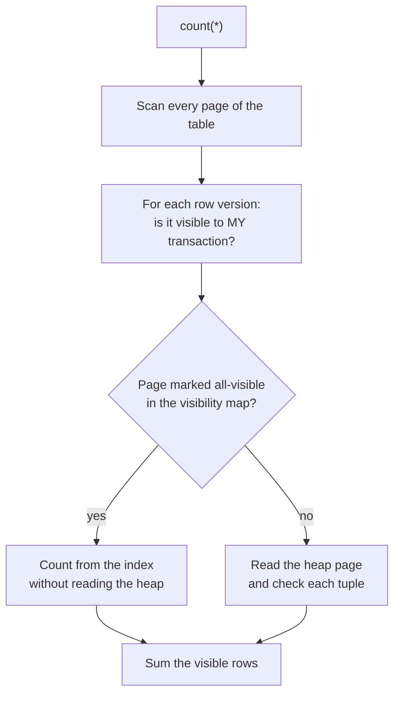

# Aggregations and Grouping — Part 2

Part 1 covered the aggregate functions themselves, `GROUP BY`, the grouping
rule, `HAVING` and how NULLs behave inside an aggregate. This part is about
using them for real: conditional aggregates with `FILTER`, full reporting
queries, subtotals with `ROLLUP`, and what to do when the aggregate itself is
the slow part.

> **⬅️ This continues [Part 1](./05-aggregations-and-grouping-part-1.md).**

> **📌 In one line:** once the grouping rules are second nature, the remaining
> work is shaping the report and paying for it — and `count(*)` on a large table
> is more expensive than anyone expects.

## Table of Contents

1. [FILTER: Conditional Aggregates](#filter-conditional-aggregates)
2. [Real Reporting Queries](#real-reporting-queries)
3. [GROUPING SETS, ROLLUP and CUBE](#grouping-sets-rollup-and-cube)
4. [Why count(*) Is Slow in PostgreSQL](#why-count-is-slow-in-postgresql)
5. [Advanced: DISTINCT vs GROUP BY, and Materialized Views](#advanced-distinct-vs-group-by-and-materialized-views)
6. [Common Mistakes](#common-mistakes)
7. [Questions to Test Yourself](#questions-to-test-yourself)
8. [Related](#related)

---

## FILTER: Conditional Aggregates

You often want several different counts in one pass. The traditional way uses
`CASE`:

```sql
SELECT p.name,
       count(*) AS total,
       sum(CASE WHEN t.status = 'done' THEN 1 ELSE 0 END)       AS done,
       count(CASE WHEN t.status = 'todo' THEN 1 END)            AS todo,
       sum(CASE WHEN t.status <> 'done' THEN 1 ELSE 0 END)      AS open
FROM projects p JOIN tasks t ON t.project_id = p.id
GROUP BY p.id, p.name;
```

The standard `FILTER` clause does the same thing and reads far better:

```sql
SELECT p.name,
       count(*)                                    AS total,
       count(*) FILTER (WHERE t.status = 'done')   AS done,
       count(*) FILTER (WHERE t.status = 'todo')   AS todo,
       count(*) FILTER (WHERE t.status <> 'done')  AS open
FROM projects p JOIN tasks t ON t.project_id = p.id
GROUP BY p.id, p.name;
```

```text
      name        | total | done | todo | open
------------------+-------+------+------+------
 Website redesign |     6 |    2 |    3 |    4
 Mobile app       |     4 |    0 |    4 |    4
```

You will meet both forms in real code, so recognise both. `FILTER` works with
any aggregate:

```sql
SELECT company_id,
       sum(amount_cents) FILTER (WHERE status = 'paid')   AS collected_cents,
       sum(amount_cents) FILTER (WHERE status = 'unpaid') AS outstanding_cents,
       count(*)          FILTER (WHERE status = 'unpaid'
                                   AND issued_at < now() - interval '30 days')
                                                          AS overdue
FROM invoices
GROUP BY company_id;
```

`FILTER` is PostgreSQL and standard SQL; MySQL has no `FILTER` clause, so stick
to `CASE` there. Note the subtle difference in the `CASE` forms above:
`count(CASE WHEN ... THEN 1 END)` works because `count(col)` skips NULL, whereas
`sum(CASE ... ELSE 0 END)` needs the explicit `ELSE 0`.

---

## Real Reporting Queries

Three queries you will write in some form on every project.

### Revenue per month, with growth

```sql
SELECT to_char(date_trunc('month', issued_at), 'YYYY-MM') AS month,
       count(*)                                           AS invoices,
       sum(amount_cents) / 100.0                          AS revenue,
       round(avg(amount_cents) / 100.0, 2)                AS avg_invoice
FROM invoices
WHERE status = 'paid'
  AND issued_at >= now() - interval '6 months'
GROUP BY 1
ORDER BY 1;
```

```text
  month  | invoices | revenue  | avg_invoice
---------+----------+----------+-------------
 2026-04 |       11 | 14285.00 |     1298.64
 2026-05 |       13 | 17420.00 |     1340.00
 2026-06 |       14 | 20986.00 |     1499.00
```

Filtering on `issued_at >= now() - interval '6 months'` keeps the bare column on
the left, so an index on `issued_at` can be used.

### Tasks per status per project

```sql
SELECT p.name AS project,
       count(*)                                        AS total,
       count(*) FILTER (WHERE t.status = 'todo')       AS todo,
       count(*) FILTER (WHERE t.status = 'in_progress') AS in_progress,
       count(*) FILTER (WHERE t.status = 'done')       AS done,
       count(*) FILTER (WHERE t.due_date < CURRENT_DATE
                          AND t.status <> 'done')      AS overdue
FROM projects p
LEFT JOIN tasks t ON t.project_id = p.id
WHERE p.company_id = 1
  AND p.archived_at IS NULL
GROUP BY p.id, p.name
ORDER BY overdue DESC, p.name;
```

The `LEFT JOIN` keeps projects with no tasks. Careful: `count(*)` would report 1
for those; use `count(t.id)` if you want a true zero — the trap from file 04.

### Active users per company

"Active" = did something in the last 30 days. Using `notifications` as the
activity signal:

```sql
SELECT c.name AS company,
       c.plan,
       count(DISTINCT u.id) AS total_users,
       count(DISTINCT n.user_id) FILTER (
           WHERE n.created_at >= now() - interval '30 days'
       ) AS active_users
FROM companies c
LEFT JOIN users u         ON u.company_id = c.id
LEFT JOIN notifications n ON n.user_id    = u.id
GROUP BY c.id, c.name, c.plan
ORDER BY active_users DESC;
```

```text
   company    | plan | total_users | active_users
--------------+------+-------------+--------------
 Acme Ltd     | pro  |          42 |           31
 Bolt Studio  | free |           7 |            2
```

`count(DISTINCT u.id)` is mandatory here: the join to `notifications` fans each
user out into one row per notification. Without `DISTINCT`, "total_users" would
count notifications. This is the fan-out problem from file 04 in its most common
real-world costume.

---

## GROUPING SETS, ROLLUP and CUBE

Sometimes you want subtotals alongside the detail. Instead of running several
queries and stitching them together, ask for several groupings at once.

```sql
SELECT p.name AS project, t.status, count(*) AS tasks
FROM projects p JOIN tasks t ON t.project_id = p.id
GROUP BY ROLLUP (p.name, t.status)
ORDER BY p.name NULLS LAST, t.status NULLS LAST;
```

```text
     project      |   status    | tasks
------------------+-------------+-------
 Mobile app       | todo        |     4
 Mobile app       | [null]      |     4      <- subtotal for Mobile app
 Website redesign | done        |     2
 Website redesign | todo        |     3
 Website redesign | [null]      |     5      <- subtotal
 [null]           | [null]      |     9      <- grand total
```

| Clause | Produces |
|---|---|
| `GROUPING SETS ((a,b), (a), ())` | Exactly the groupings you list |
| `ROLLUP (a, b)` | `(a,b)`, `(a)`, `()` — a hierarchy of subtotals |
| `CUBE (a, b)` | `(a,b)`, `(a)`, `(b)`, `()` — every combination |

The NULLs in subtotal rows are ambiguous against real NULLs in the data. The
`GROUPING()` function tells them apart:

```sql
SELECT CASE WHEN grouping(p.name) = 1 THEN 'ALL PROJECTS' ELSE p.name END
           AS project,
       count(*)
FROM projects p JOIN tasks t ON t.project_id = p.id
GROUP BY ROLLUP (p.name);
```

---

## Why count(*) Is Slow in PostgreSQL

```sql
SELECT count(*) FROM tasks;
```

```text
  count
---------
 4829114
Time: 2841.336 ms
```

Nearly three seconds to return one number. In MySQL's MyISAM engine this was
instant, because it kept a row counter. PostgreSQL cannot, and here is why.

PostgreSQL uses **MVCC** (multi-version concurrency control). An `UPDATE` does
not overwrite a row; it writes a new version and marks the old one dead. A
`DELETE` only marks. At any instant the table physically contains row versions
that are:

- visible to you,
- not yet committed by someone else,
- deleted but still visible to an older transaction,
- dead and waiting for `VACUUM`.



So "how many rows are there" has no single answer — it depends on *who is
asking*. Two concurrent transactions can legitimately get different counts. The
only way to answer is to walk the table and test visibility for each row. There
is no counter to read.

An index-only scan helps when the **visibility map** says a page is all-visible,
which is maintained by `VACUUM`. A recently vacuumed table counts much faster
than a bloated one. The full MVCC story is in
[mvcc](../transactions-and-concurrency/03-mvcc-part-2.md).

### The alternatives

```sql
-- 1. Approximate count from the planner's statistics. Instant.
SELECT reltuples::bigint AS approx_rows
FROM pg_class WHERE relname = 'tasks';
```

```text
 approx_rows
-------------
     4830000
```

Accurate to within a few percent if `ANALYZE` has run recently, and it costs
nothing. For "4.8M tasks" on a dashboard, this is the right answer.

```sql
-- 2. Estimate for an arbitrary filtered query, from EXPLAIN
EXPLAIN SELECT * FROM tasks WHERE status = 'todo';
```

```text
Seq Scan on tasks  (cost=0.00..92841.00 rows=1610221 width=64)
                                        ^^^^^^^^^^^^ the estimate
```

```sql
-- 3. A maintained counter, updated by a trigger. Exact, but adds write cost
--    and contention on the counter row.
CREATE TABLE task_counts (project_id bigint PRIMARY KEY, n bigint NOT NULL);
```

| Need | Use |
|---|---|
| A rough total for a dashboard | `reltuples` from `pg_class` |
| A rough count for a filtered query | `EXPLAIN` row estimate |
| "More than 1000?" for a pager | `SELECT count(*) FROM (SELECT 1 FROM t LIMIT 1001) x` |
| An exact, always-current count | Trigger-maintained counter table |
| An exact one-off count | `count(*)` and accept the wait |

> **💡 Tip:** most `count(*)` calls in web apps exist only to render "Page 1 of
> 482". Nobody visits page 300. Show "1,000+" or use keyset pagination instead —
> [pagination-performance](../query-optimization/pagination-performance.md).

---

## Advanced: DISTINCT vs GROUP BY, and Materialized Views

### Two ways to deduplicate

```sql
SELECT DISTINCT company_id FROM users;
SELECT company_id FROM users GROUP BY company_id;
```

Logically identical. In PostgreSQL they also usually produce the same plan —
both end in a `HashAggregate` (or a `Unique` on top of a sort, if the input is
already ordered):

```text
HashAggregate  (cost=1786.00..1788.00 rows=200 width=8)
               (actual time=24.9..25.0 rows=200 loops=1)
  Group Key: company_id
  ->  Seq Scan on users  (cost=0.00..1636.00 rows=60000 width=8)
```

Practical differences:

- `GROUP BY` extends naturally: the day you also want `count(*)`, you add it.
  `DISTINCT` forces a rewrite.
- `DISTINCT` applies to the **entire** select list. `SELECT DISTINCT a, b` is
  distinct *pairs*, which is a frequent misunderstanding — it is not "distinct
  `a`, with some `b`".
- `DISTINCT ON (col)` (PostgreSQL only) is different again: one row per `col`,
  chosen by `ORDER BY`. Useful, non-standard.
- Both can be avoided entirely if the duplicates came from a join that should
  have been an `EXISTS` — see file 04.

### When aggregation is too expensive to do live

If a dashboard query aggregates tens of millions of rows and the answer only
needs to be minutes-fresh, stop recomputing it per request.

```sql
CREATE MATERIALIZED VIEW monthly_revenue AS
SELECT company_id,
       date_trunc('month', issued_at) AS month,
       sum(amount_cents)              AS revenue_cents,
       count(*)                       AS invoice_count
FROM invoices
WHERE status = 'paid'
GROUP BY company_id, date_trunc('month', issued_at);

CREATE UNIQUE INDEX ON monthly_revenue (company_id, month);

REFRESH MATERIALIZED VIEW CONCURRENTLY monthly_revenue;
```

A materialized view stores the *result* on disk, so the dashboard reads a small
pre-aggregated table. `CONCURRENTLY` lets readers keep querying during the
refresh and requires that unique index. The trade-off — staleness, refresh cost,
scheduling, and when a rollup table beats a materialized view — is covered in
[materialized-views](../operations/03-materialized-views.md).

---

## Common Mistakes

| Mistake | Why it is wrong | Do this instead |
|---|---|---|
| Assuming missing combinations appear as 0 | Empty buckets do not exist | Join against a list, or fill in the app |
| Long `CASE WHEN` chains for conditional counts | Verbose and error-prone | `count(*) FILTER (WHERE ...)` |
| `count(*)` on a huge table for a UI | Must check visibility on every row | `reltuples`, `EXPLAIN` estimate, or a counter |
| Recomputing a heavy aggregate per request | Repeats the same scan constantly | Materialized view or rollup table |

---

## Questions to Test Yourself

1. Rewrite `sum(CASE WHEN status='done' THEN 1 ELSE 0 END)` using `FILTER`, and
   say which databases support it.
2. Explain in your own words why PostgreSQL cannot keep a row counter for
   `count(*)`. Give three faster alternatives and when each is acceptable.
3. When would you choose `DISTINCT` over `GROUP BY`, and what exactly does
   `SELECT DISTINCT a, b` return?
4. What does `ROLLUP (a, b)` produce that `GROUP BY a, b` does not?
5. A monthly report shows no row at all for a month with no invoices. Why, and
   what are two ways to make the zero appear?

---

## Related

- [Part 1](./05-aggregations-and-grouping-part-1.md) — aggregate functions,
  `GROUP BY`, `HAVING` and NULL behaviour.
- [CTEs and Window Functions](06-ctes-and-window-functions-part-2.md) — next file;
  aggregating *without* collapsing rows.
- [mvcc](../transactions-and-concurrency/03-mvcc-part-2.md) — the visibility rules that
  make `count(*)` expensive.
- [materialized-views](../operations/03-materialized-views.md) — precomputing
  heavy aggregates.
- [pagination-performance](../query-optimization/pagination-performance.md) —
  avoiding the count that pagination demands.
- [reading-query-plans](../query-planner/reading-query-plans.md) —
  `HashAggregate`, `GroupAggregate` and what they cost.
