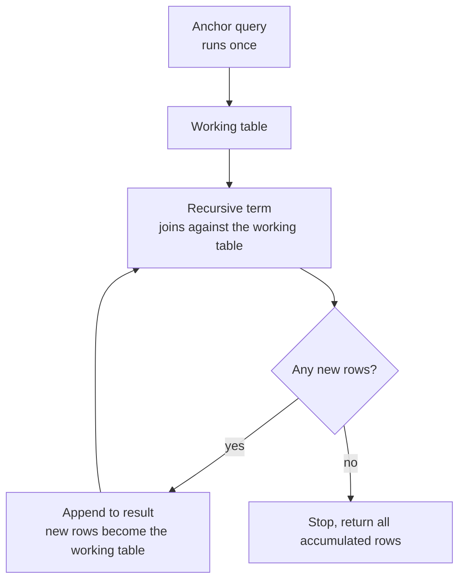

# CTEs and Window Functions — Part 1

Two features that separate people who write SQL from people who write *good*
SQL. Both solve problems you have almost certainly solved badly in application
code — by pulling rows into memory and looping.

A CTE (Common Table Expression) names an intermediate result so a long query
reads as a pipeline. A window function gives a row access to its neighbours
without collapsing anything.

> **📌 In one line:** a CTE names a step; a window function is an aggregate that
> lets every row survive.

## Table of Contents

1. [CTEs: Naming the Steps](#ctes-naming-the-steps)
2. [A Pipeline of CTEs](#a-pipeline-of-ctes)
3. [The Optimization Fence](#the-optimization-fence)
4. [Recursive CTEs](#recursive-ctes)
5. [Common Mistakes](#common-mistakes)
6. [Questions to Test Yourself](#questions-to-test-yourself)
7. [Related](#related)

---

## CTEs: Naming the Steps

A CTE is a named query defined with `WITH`, usable in the statement that
follows it. It exists for the duration of that one statement.

```sql
WITH open_tasks AS (
    SELECT * FROM tasks WHERE status <> 'done'
)
SELECT project_id, count(*) FROM open_tasks GROUP BY project_id;
```

The argument for CTEs is readability, and it is best made by comparison. Here is
a real shape of query: *companies whose paid revenue this year is above the
average paid revenue across all companies.*

```sql
-- ❌ Nested subqueries: read it inside-out, three levels deep
SELECT c.name, r.revenue_cents
FROM companies c
JOIN (
    SELECT company_id, sum(amount_cents) AS revenue_cents
    FROM invoices
    WHERE status = 'paid' AND issued_at >= date_trunc('year', now())
    GROUP BY company_id
) r ON r.company_id = c.id
WHERE r.revenue_cents > (
    SELECT avg(total) FROM (
        SELECT sum(amount_cents) AS total
        FROM invoices
        WHERE status = 'paid' AND issued_at >= date_trunc('year', now())
        GROUP BY company_id
    ) x
)
ORDER BY r.revenue_cents DESC;
```

The same logic appears twice, the reader starts in the middle, and changing the
date range means editing two places.

```sql
-- ✅ CTE chain: read it top to bottom, each step named
WITH paid_this_year AS (
    SELECT company_id, amount_cents
    FROM invoices
    WHERE status = 'paid'
      AND issued_at >= date_trunc('year', now())
),
revenue_per_company AS (
    SELECT company_id, sum(amount_cents) AS revenue_cents
    FROM paid_this_year
    GROUP BY company_id
),
company_average AS (
    SELECT avg(revenue_cents) AS avg_revenue_cents
    FROM revenue_per_company
)
SELECT c.name,
       r.revenue_cents,
       round(r.revenue_cents / a.avg_revenue_cents, 2) AS times_average
FROM revenue_per_company r
JOIN companies c ON c.id = r.company_id
CROSS JOIN company_average a
WHERE r.revenue_cents > a.avg_revenue_cents
ORDER BY r.revenue_cents DESC;
```

```text
   name    | revenue_cents | times_average
-----------+---------------+---------------
 Acme Ltd  |        749400 |          2.31
 Cobalt Co |        412000 |          1.27
```

Same result. The filter is defined once, each step has a name that says what it
is, and a reviewer can check the logic one block at a time.

Syntax notes: `WITH` comes first, CTEs are separated by commas (no `WITH`
repeated), and the final `SELECT`/`INSERT`/`UPDATE`/`DELETE` has no comma before
it. A CTE may reference any CTE defined **before** it.

---

## A Pipeline of CTEs

CTEs also make writes composable. `INSERT`/`UPDATE`/`DELETE ... RETURNING`
inside a CTE lets you chain several writes in one atomic statement:

```sql
WITH archived AS (
    UPDATE projects
    SET    archived_at = now(), status = 'archived'
    WHERE  company_id = 1
      AND  status = 'active'
      AND  id NOT IN (SELECT project_id FROM tasks WHERE status <> 'done')
    RETURNING id, name
),
closed_tasks AS (
    UPDATE tasks
    SET    status = 'done'
    WHERE  project_id IN (SELECT id FROM archived)
    RETURNING id
)
INSERT INTO notifications (user_id, type)
SELECT u.id, 'project_archived'
FROM users u
WHERE u.company_id = 1 AND u.role = 'admin'
  AND EXISTS (SELECT 1 FROM archived);
```

Two behaviours to know here, both PostgreSQL-specific:

1. **All the sub-statements see the same snapshot.** `closed_tasks` does not see
   the rows `archived` just updated — it sees the database as it was when the
   statement began. It works above only because it selects from the `archived`
   CTE's `RETURNING` output, not from `projects`.
2. **Execution order of data-modifying CTEs is not guaranteed.** Do not write
   two CTEs that update the same rows and expect a particular order.

---

## The Optimization Fence

An **optimization fence** means: the planner must compute this block on its own,
as written, and cannot merge it with the surrounding query. In particular, it
cannot push a filter from the outside *into* the block.

Why that matters, concretely:

```sql
WITH all_tasks AS (
    SELECT * FROM tasks          -- 4.8 million rows
)
SELECT * FROM all_tasks WHERE project_id = 31;    -- 12 rows wanted
```

- **Fenced:** materialise all 4.8 million rows into a temporary result, then
  filter it down to 12. The index on `project_id` is useless.
- **Inlined:** the planner rewrites it as `SELECT * FROM tasks WHERE project_id
  = 31` and uses the index. Milliseconds.

Historically, **PostgreSQL always fenced CTEs**. That made "I extracted this
into a CTE for readability" a genuine performance regression, and it is where
the folklore "CTEs are slow in Postgres" comes from.

In more recent PostgreSQL versions the default changed: a non-recursive CTE that
is referenced **exactly once** and has no side effects is inlined like a
subquery. You can override the decision either way:

```sql
-- Force the fence: compute once, reuse the result
WITH expensive AS MATERIALIZED (
    SELECT company_id, sum(amount_cents) AS total
    FROM invoices GROUP BY company_id
)
SELECT * FROM expensive e1 JOIN expensive e2 ON e2.company_id = e1.company_id;

-- Force inlining: let the outer WHERE push down
WITH recent AS NOT MATERIALIZED (
    SELECT * FROM tasks WHERE created_at > now() - interval '7 days'
)
SELECT * FROM recent WHERE project_id = 31;
```

| Situation | Want |
|---|---|
| Expensive computation referenced several times | `MATERIALIZED` — compute once |
| Simple CTE that the outer query filters hard | `NOT MATERIALIZED` — let the filter through |
| Recursive CTE | Always materialised; no choice |
| Data-modifying CTE | Always materialised; no choice |

> **⚠️ Check your version.** Whether a plain `WITH` is inlined depends on the
> PostgreSQL version you are actually running. Do not assume — run `EXPLAIN` and
> look for a `CTE Scan` node, which means it was materialised.

The full three-way comparison of subqueries, joins and CTEs — including which to
reach for and how each is planned — is in
[subqueries-vs-joins-vs-ctes](../query-patterns/subqueries-vs-joins-vs-ctes.md).
It is not repeated here.

---

## Recursive CTEs

A recursive CTE walks a hierarchy: sub-tasks of sub-tasks, an org chart, a
category tree. Without it you loop in application code, one query per level.

The structure is always the same three parts:

```sql
WITH RECURSIVE name AS (
    <anchor query>          -- the starting rows; runs once
    UNION ALL
    <recursive query>       -- references `name`; runs repeatedly
)
SELECT * FROM name;
```

Using `tasks.parent_task_id` (added on top of the shared schema, as in file 04),
find a task and everything beneath it:

```sql
WITH RECURSIVE subtree AS (
    -- Anchor: the root we start from
    SELECT id, parent_task_id, title, 1 AS depth,
           ARRAY[id] AS path
    FROM tasks
    WHERE id = 1

    UNION ALL

    -- Recursive term: children of whatever we found last round
    SELECT t.id, t.parent_task_id, t.title, s.depth + 1,
           s.path || t.id
    FROM tasks t
    JOIN subtree s ON t.parent_task_id = s.id
    WHERE NOT t.id = ANY(s.path)        -- cycle protection
)
SELECT repeat('    ', depth - 1) || title AS tree, id, depth
FROM subtree
ORDER BY path;
```

```text
           tree            | id | depth
---------------------------+----+-------
 Ship billing page         |  1 |     1
     Design invoice PDF    |  5 |     2
     Add Stripe webhook    |  6 |     2
         Verify signature  |  9 |     3
         Handle retries    | 10 |     3
```

### The iteration, step by step

It is not magic. PostgreSQL keeps a *working table* and repeats one step until
the working table comes back empty.

| Round | Working table (input) | Recursive term finds | Added to result |
|---|---|---|---|
| 0 (anchor) | — | — | `1` Ship billing page |
| 1 | `{1}` | children of 1 | `5` Design invoice PDF, `6` Add Stripe webhook |
| 2 | `{5, 6}` | children of 5 and 6 | `9` Verify signature, `10` Handle retries |
| 3 | `{9, 10}` | children of 9 and 10 | *(none)* |
| 4 | `{}` | — | stop |



Three details that matter:

- The recursive term sees **only the previous round's rows**, not everything
  accumulated so far. That is why it is a `JOIN` against `subtree` rather than a
  scan of the whole result.
- `UNION ALL` keeps every row and is the normal choice. Plain `UNION`
  deduplicates each round, which is slower but can itself stop some cycles.
- The keyword is `WITH RECURSIVE` even when only one CTE in the list is
  recursive.

### Cycle protection

> **⚠️ Warning:** if the data contains a cycle — task 5's parent is task 9 and
> task 9's parent is task 5 — a recursive CTE never terminates. It will consume
> memory and disk until the query is cancelled or the server runs out of
> temporary space. This is not hypothetical; bad data creates cycles.

Two defences, and you should use at least one:

```sql
-- 1. Track the path and refuse to revisit (shown above)
    ARRAY[id] AS path
    ...
    WHERE NOT t.id = ANY(s.path)

-- 2. Cap the depth
    WHERE s.depth < 20
```

Recent PostgreSQL versions also offer `CYCLE ... SET ... USING ...` syntax for
this — check your version before relying on it. A depth cap is universally
available and worth adding regardless.

### Walking upwards

Reverse the join to find every ancestor instead:

```sql
WITH RECURSIVE ancestors AS (
    SELECT id, parent_task_id, title, 1 AS level FROM tasks WHERE id = 9
    UNION ALL
    SELECT t.id, t.parent_task_id, t.title, a.level + 1
    FROM tasks t
    JOIN ancestors a ON a.parent_task_id = t.id
    WHERE a.level < 20
)
SELECT level, title FROM ancestors ORDER BY level DESC;
```

MySQL supports `WITH RECURSIVE` from 8.0 with the same structure.

---

## Common Mistakes

| Mistake | Why it is wrong | Do this instead |
|---|---|---|
| Assuming a CTE is always materialised | Recent versions inline single-use CTEs | Check `EXPLAIN` for `CTE Scan`; use `MATERIALIZED` if you need the fence |
| Wrapping a cheap query in a CTE on an old version | The fence blocks filter push-down | `NOT MATERIALIZED`, or a plain subquery |
| Recursive CTE with no depth or path guard | Cyclic data loops forever | Track a path array, or cap the depth |
| Expecting one data-modifying CTE to see another's writes | Every sub-statement reads the same snapshot | Select from the other CTE's `RETURNING` output |

---

## Questions to Test Yourself

1. What does a CTE give you that a nested subquery does not?
2. Explain "optimization fence" to someone who has never heard the term, and
   give a concrete query it makes slow.
3. When would you write `MATERIALIZED`, and when `NOT MATERIALIZED`?
4. Name the three parts of a recursive CTE and say what the recursive term joins
   against on each round.
5. Trace the working table round by round for a 3-level task tree.
6. What happens if the data contains a cycle, and what are two defences?
7. Two data-modifying CTEs in one statement: what does the second one see, and
   what can you not rely on about the order they run in?

---

> **➡️ Continued in [Part 2](./06-ctes-and-window-functions-part-2.md)**

---

## Related

- [Part 2](06-ctes-and-window-functions-part-2.md) — window functions,
  `PARTITION BY`, ranking, frame clauses and what a window costs.
- [Joins Explained](04-joins-explained-part-1.md) — self joins, which reach one
  level where a recursive CTE walks the whole tree.
- [SQL Basics: CRUD](03-sql-basics-crud-part-1.md) — the statements a CTE chain
  is built from.
- [subqueries-vs-joins-vs-ctes](../query-patterns/subqueries-vs-joins-vs-ctes.md)
  — the full comparison of the three shapes.
- [reading-query-plans](../query-planner/reading-query-plans.md) — reading the
  `CTE Scan` node that tells you a CTE was materialised.
- [databases/README.md](../README.md) — the rest of the track.
