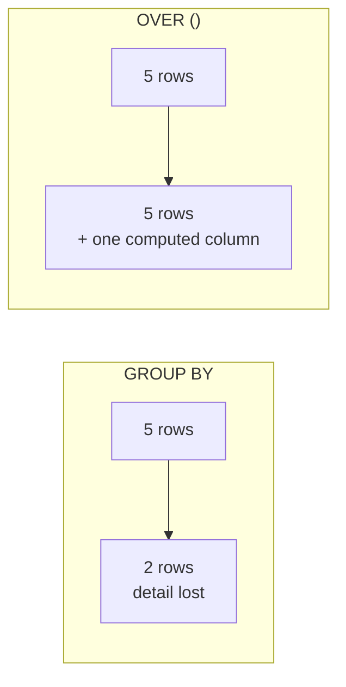
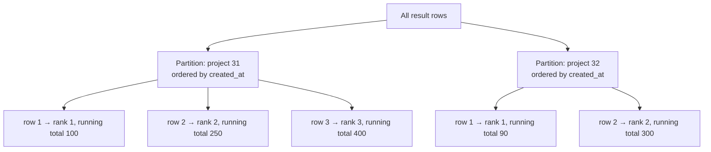

# CTEs and Window Functions — Part 2

Part 1 used CTEs to name the steps of a query and to walk a hierarchy. This part
is the other half: window functions, the aggregates that leave every input row
standing. It covers `PARTITION BY` and `ORDER BY`, the functions worth knowing,
the four problems they exist to solve, frame clauses and the default that
surprises everyone, and what a window costs in the plan.

> **⬅️ This continues [Part 1](./06-ctes-and-window-functions-part-1.md).**

> **📌 In one line:** a window function is an aggregate that lets every row
> survive — `OVER` is what makes it one, and the frame decides what it sees.

## Table of Contents

1. [Window Functions: The Core Idea](#window-functions-the-core-idea)
2. [PARTITION BY and ORDER BY](#partition-by-and-order-by)
3. [The Functions Worth Knowing](#the-functions-worth-knowing)
4. [Four Classic Problems](#four-classic-problems)
5. [Frame Clauses](#frame-clauses)
6. [Advanced: What Windows Cost](#advanced-what-windows-cost)
7. [Common Mistakes](#common-mistakes)
8. [Questions to Test Yourself](#questions-to-test-yourself)
9. [Related](#related)

---

## Window Functions: The Core Idea

An aggregate collapses rows. A **window function** computes a value across a set
of related rows — the *window* — while **every input row survives**.

Same data, two queries, side by side. `GROUP BY` first:

```sql
SELECT project_id, count(*) AS tasks
FROM tasks
WHERE project_id IN (31, 32)
GROUP BY project_id;
```

```text
 project_id | tasks
------------+-------
         31 |     3
         32 |     2
(2 rows)
```

Two rows out of five in. The individual tasks are gone.

```sql
SELECT id, project_id, title,
       count(*) OVER (PARTITION BY project_id) AS tasks_in_project
FROM tasks
WHERE project_id IN (31, 32);
```

```text
 id | project_id |        title         | tasks_in_project
----+------------+----------------------+------------------
  1 |         31 | Ship billing page    |                3
  2 |         31 | Fix invoice rounding |                3
  4 |         31 | Update pricing copy  |                3
  3 |         32 | Push notifications   |                2
  8 |         32 | Crash on iOS 18      |                2
(5 rows)
```

Five rows in, five rows out. Each row kept its own identity **and** gained a
fact about its group. That is the entire idea.



`OVER` is what makes a function a window function. `count(*)` is an aggregate;
`count(*) OVER (...)` is a window function. Window functions are evaluated
**after** `WHERE`, `GROUP BY` and `HAVING`, and **before** `ORDER BY` and
`LIMIT` — which is why you cannot filter on one in `WHERE`, and must wrap the
query in a CTE or subquery to do so.

---

## PARTITION BY and ORDER BY

Two independent settings inside `OVER (...)`:

- **`PARTITION BY`** — how to split rows into windows. Like `GROUP BY`, but the
  rows are not collapsed. Omit it and the whole result is one window.
- **`ORDER BY`** — the order *inside* each window. Required for anything
  positional (ranking, previous/next, running totals).



```sql
OVER ()                                              -- one window: every row
OVER (PARTITION BY project_id)                       -- one window per project
OVER (PARTITION BY project_id ORDER BY created_at)   -- ordered within project
OVER (ORDER BY issued_at)                            -- one ordered window
```

Reusing the same window several times? Name it once with `WINDOW`:

```sql
SELECT id, title,
       row_number() OVER w AS rn,
       lag(created_at) OVER w AS previous_task_at
FROM tasks
WINDOW w AS (PARTITION BY project_id ORDER BY created_at);
```

---

## The Functions Worth Knowing

| Function | Gives you | Needs `ORDER BY`? |
|---|---|---|
| `row_number()` | 1, 2, 3 … always unique | Yes |
| `rank()` | Ties share a rank, then it **skips** (1, 1, 3) | Yes |
| `dense_rank()` | Ties share a rank, no skipping (1, 1, 2) | Yes |
| `lag(col, n, default)` | Value from `n` rows back | Yes |
| `lead(col, n, default)` | Value from `n` rows ahead | Yes |
| `first_value` / `last_value` | Value at the window's edge | Yes (mind the frame) |
| `sum/avg/count/min/max ... OVER` | Aggregate over the window | Optional |
| `ntile(n)` | Split the window into `n` buckets | Yes |
| `percent_rank()`, `cume_dist()` | Relative position 0–1 | Yes |

The three ranking functions differ only in how they treat ties:

```sql
SELECT name, amount_cents,
       row_number() OVER (ORDER BY amount_cents DESC) AS rn,
       rank()       OVER (ORDER BY amount_cents DESC) AS rnk,
       dense_rank() OVER (ORDER BY amount_cents DESC) AS dense
FROM invoices_view;
```

```text
   name    | amount_cents | rn | rnk | dense
-----------+--------------+----+-----+-------
 Acme Ltd  |       249900 |  1 |   1 |     1
 Cobalt Co |       249900 |  2 |   1 |     1
 Bolt      |       120000 |  3 |   3 |     2
 Delta     |        99000 |  4 |   4 |     3
```

Use `row_number()` when you need a unique number (deduplication, paging),
`rank()` for leaderboards where ties should hold their place, `dense_rank()`
when you want "the top 3 *amounts*" rather than the top 3 rows.

`ntile(4)` splits each window into quartiles — the usual way to bucket customers
by spend:

```sql
SELECT company_id, revenue_cents,
       ntile(4) OVER (ORDER BY revenue_cents DESC) AS quartile
FROM revenue_per_company;
```

---

## Four Classic Problems

### 1. Top 3 tasks per project

The problem that sells window functions. Rank inside each partition, then filter
— and the filter must happen outside, because window functions cannot appear in
`WHERE`.

```sql
WITH ranked AS (
    SELECT t.id, t.project_id, t.title, t.created_at,
           row_number() OVER (PARTITION BY t.project_id
                              ORDER BY t.created_at DESC) AS rn
    FROM tasks t
    WHERE t.status <> 'done'
)
SELECT project_id, rn, title, created_at
FROM ranked
WHERE rn <= 3
ORDER BY project_id, rn;
```

```text
 project_id | rn |         title         |       created_at
------------+----+-----------------------+------------------------
         31 |  1 | Update pricing copy   | 2026-09-15 09:30:00+00
         31 |  2 | Fix invoice rounding  | 2026-09-12 16:05:00+00
         31 |  3 | Ship billing page     | 2026-09-11 10:00:00+00
         32 |  1 | Crash on iOS 18       | 2026-09-16 11:20:00+00
         32 |  2 | Push notifications    | 2026-09-14 08:00:00+00
```

Compare with the `LATERAL` version in
[file 04](04-joins-explained-part-2.md#lateral-top-n-per-group): `LATERAL` is usually
faster when partitions are large and N is small, because it stops after N index
entries per project. The window version ranks everything first. Measure both on
your data.

### 2. Each invoice with the previous one's amount

```sql
SELECT id, issued_at, amount_cents,
       lag(amount_cents) OVER w                     AS previous_cents,
       amount_cents - lag(amount_cents) OVER w      AS change_cents
FROM invoices
WHERE company_id = 1
WINDOW w AS (ORDER BY issued_at)
ORDER BY issued_at;
```

```text
 id |      issued_at       | amount_cents | previous_cents | change_cents
----+----------------------+--------------+----------------+--------------
 41 | 2026-06-01 00:00+00  |       120000 |         [null] |       [null]
 55 | 2026-07-01 00:00+00  |       135000 |         120000 |        15000
 68 | 2026-08-01 00:00+00  |       129900 |         135000 |        -5100
```

The first row has no predecessor, so `lag` returns NULL. Supply a default if you
prefer: `lag(amount_cents, 1, 0) OVER w`.

### 3. Running revenue total

```sql
SELECT date_trunc('month', issued_at)::date AS month,
       sum(amount_cents)                    AS month_cents,
       sum(sum(amount_cents)) OVER (ORDER BY date_trunc('month', issued_at))
                                            AS running_total_cents
FROM invoices
WHERE status = 'paid'
GROUP BY 1
ORDER BY 1;
```

```text
   month    | month_cents | running_total_cents
------------+-------------+---------------------
 2026-06-01 |      209860 |              209860
 2026-07-01 |      284710 |              494570
 2026-08-01 |      329180 |              823750
```

`sum(sum(...)) OVER (...)` looks strange and is correct: the inner `sum` is the
aggregate computed per `GROUP BY` bucket, the outer one is a window function
applied to those already-aggregated rows. Window functions run *after*
grouping, so they can take aggregates as input.

### 4. Deduplicate, keeping the newest row

Someone loaded the same users twice. Keep the most recent row per email.

```sql
WITH ranked AS (
    SELECT id, email,
           row_number() OVER (PARTITION BY lower(email)
                              ORDER BY created_at DESC, id DESC) AS rn
    FROM users
)
SELECT * FROM ranked WHERE rn > 1;      -- inspect first!
```

```sql
-- Then, once the SELECT shows exactly the rows you expect:
DELETE FROM users
WHERE id IN (
    SELECT id FROM (
        SELECT id, row_number() OVER (PARTITION BY lower(email)
                                      ORDER BY created_at DESC, id DESC) AS rn
        FROM users
    ) r
    WHERE r.rn > 1
);
```

Note the `SELECT`-first habit from file 03, and the `id DESC` tie-breaker so the
ordering is deterministic. `row_number()` is required here — `rank()` would give
two rows `rn = 1` on a tie and delete neither.

---

## Frame Clauses

Within a window, the **frame** is the slice of rows the function actually sees
for the current row. It is the part everyone skips and then gets surprised by.

```sql
OVER (PARTITION BY x ORDER BY y ROWS BETWEEN <start> AND <end>)
```

| Frame | Meaning |
|---|---|
| `ROWS BETWEEN UNBOUNDED PRECEDING AND CURRENT ROW` | Start of the partition to here — a running total |
| `ROWS BETWEEN 2 PRECEDING AND CURRENT ROW` | A 3-row moving window |
| `ROWS BETWEEN CURRENT ROW AND UNBOUNDED FOLLOWING` | Here to the end |
| `ROWS BETWEEN UNBOUNDED PRECEDING AND UNBOUNDED FOLLOWING` | The whole partition |
| `RANGE BETWEEN ...` | By **value** rather than row position; ties are one unit |

A 3-month moving average:

```sql
SELECT month,
       month_cents,
       round(avg(month_cents) OVER (ORDER BY month
                                    ROWS BETWEEN 2 PRECEDING AND CURRENT ROW))
           AS moving_avg_3m
FROM monthly_revenue
ORDER BY month;
```

### The default frame surprise

This one catches everybody.

- With **no `ORDER BY`** in `OVER()`, the default frame is the **whole
  partition**. `sum(x) OVER (PARTITION BY p)` is the partition total on every
  row — what you expect.
- With an **`ORDER BY`**, the default frame becomes
  `RANGE BETWEEN UNBOUNDED PRECEDING AND CURRENT ROW` — everything up to *and
  including all rows tied with* the current row.

So adding `ORDER BY` silently turns a total into a running total:

```sql
SELECT id, amount_cents,
       sum(amount_cents) OVER (PARTITION BY company_id)                  AS grand_total,
       sum(amount_cents) OVER (PARTITION BY company_id ORDER BY issued_at) AS running
FROM invoices WHERE company_id = 1 ORDER BY issued_at;
```

```text
 id | amount_cents | grand_total | running
----+--------------+-------------+---------
 41 |       120000 |      384900 |  120000
 55 |       135000 |      384900 |  255000
 68 |       129900 |      384900 |  384900
```

The same trap makes `last_value()` return the current row instead of the last
one:

```sql
-- ❌ Returns the current row's value, because the frame ends at CURRENT ROW
last_value(title) OVER (PARTITION BY project_id ORDER BY created_at)

-- ✅ Extend the frame to the end of the partition
last_value(title) OVER (PARTITION BY project_id ORDER BY created_at
                        ROWS BETWEEN UNBOUNDED PRECEDING AND UNBOUNDED FOLLOWING)
```

> **💡 Tip:** `first_value()` is safe with the default frame; `last_value()`
> almost never is. When in doubt, reverse the `ORDER BY` and use
> `first_value()`, or use `ROWS BETWEEN UNBOUNDED PRECEDING AND UNBOUNDED
> FOLLOWING` explicitly.

Also note `ROWS` versus `RANGE`: `ROWS 1 PRECEDING` means literally the previous
row; `RANGE 1 PRECEDING` means every row whose ordering value is within 1 of the
current one, so ties are grouped. Use `ROWS` unless you specifically want the
value-based behaviour.

---

## Advanced: What Windows Cost

A window function needs its partition in the right order, so the plan contains a
`WindowAgg` node fed by either a `Sort` or an already-ordered input.

```text
EXPLAIN (ANALYZE, BUFFERS)
SELECT id, project_id,
       row_number() OVER (PARTITION BY project_id ORDER BY created_at DESC)
FROM tasks;

WindowAgg  (cost=104821.44..123071.44 rows=482911 width=24)
           (actual time=1284.1..1901.6 rows=482911 loops=1)
  ->  Sort  (cost=104821.44..106028.72 rows=482911 width=16)
            (actual time=1284.0..1512.3 rows=482911 loops=1)
        Sort Key: project_id, created_at DESC
        Sort Method: external merge  Disk: 12904kB
        ->  Seq Scan on tasks  (cost=0.00..8461.11 rows=482911 width=16)
Execution Time: 1954.883 ms
```

Read it bottom-up: scan everything, sort it all, then compute the window. The
sort is the expensive part, and `Sort Method: external merge Disk: 12904kB`
means it did not fit in `work_mem` and spilled to disk.

An index whose order matches the window's `PARTITION BY` then `ORDER BY` removes
the sort entirely:

```sql
CREATE INDEX ON tasks (project_id, created_at DESC);
```

```text
WindowAgg  (cost=0.42..41215.30 rows=482911 width=24)
           (actual time=0.05..612.4 rows=482911 loops=1)
  ->  Index Scan using tasks_project_id_created_at_idx on tasks
           (cost=0.42..30201.19 rows=482911 width=16)
           (actual time=0.03..287.1 rows=482911 loops=1)
Execution Time: 651.220 ms
```

No `Sort` node. Three times faster, and no disk spill.

> **📌 The rule:** the index column order must be `PARTITION BY` columns first,
> then `ORDER BY` columns, with matching direction. `PARTITION BY project_id
> ORDER BY created_at DESC` wants an index on `(project_id, created_at DESC)`.

Three more performance notes:

- **Several window functions sharing one `OVER` definition cost one sort, not
  several.** Use the `WINDOW` clause so the planner sees they are identical.
- **Different partitions need different sorts.** A query with
  `PARTITION BY project_id` and `PARTITION BY assignee_id` will contain two
  `WindowAgg` nodes with a `Sort` between them.
- **Filtering on a window result requires a wrapper.** The inner query computes
  the window over *every* row before the outer `WHERE rn <= 3` throws most away
  — which is exactly why `LATERAL` can beat it.

Node names, cost numbers, `BUFFERS` and how to spot a bad estimate are covered
in [reading-query-plans](../query-planner/reading-query-plans.md). Index column
ordering is in
[composite-index-ordering](../query-optimization/composite-index-ordering.md).

---

## Common Mistakes

| Mistake | Why it is wrong | Do this instead |
|---|---|---|
| Filtering on a window function in `WHERE` | Window functions run after `WHERE` | Wrap in a CTE or subquery, filter outside |
| `rank()` where you needed `row_number()` | Ties produce duplicate ranks, so "keep rn = 1" keeps both | `row_number()` with a deterministic tie-breaker |
| `last_value()` with the default frame | The frame ends at the current row | Add `ROWS BETWEEN UNBOUNDED PRECEDING AND UNBOUNDED FOLLOWING` |
| Adding `ORDER BY` to `OVER()` and expecting a total | It becomes a running total | Omit `ORDER BY`, or set the frame explicitly |
| `GROUP BY` where you needed a window | Collapses the detail rows you wanted to keep | `OVER (PARTITION BY ...)` |
| Window over a huge table with no supporting index | A full sort, often spilling to disk | Index `(partition cols, order cols)` |
| Repeating the same `OVER (...)` many times | Harder to read, easy to make inconsistent | Name it with the `WINDOW` clause |
| Deleting duplicates without a `SELECT` first | No undo | Run the ranked `SELECT`, check, then `DELETE` in a transaction |

---

## Questions to Test Yourself

1. State the difference between `GROUP BY` and `OVER()` in one sentence, then
   show the row counts for the same data.
2. `row_number()`, `rank()`, `dense_rank()` on the values 100, 100, 90 — give all
   three outputs.
3. Why must "top 3 per project" be filtered outside a CTE rather than in `WHERE`?
4. What is the default frame with `ORDER BY` present, and how does that break
   `last_value()`?
5. Which index removes the `Sort` under a `WindowAgg` for
   `PARTITION BY project_id ORDER BY created_at DESC`?
6. What do `PARTITION BY` and `ORDER BY` each control inside `OVER (...)`, and
   what happens when you omit each one?
7. Explain why `sum(sum(amount_cents)) OVER (...)` is legal, using the order in
   which grouping and window functions are evaluated.

---

## Related

- [Part 1](06-ctes-and-window-functions-part-1.md) — `WITH` clauses, the
  optimization fence, `MATERIALIZED`, and recursive CTEs.
- [Joins Explained](04-joins-explained-part-2.md) — `LATERAL`, the other answer to
  "top N per group", and self joins for single-level hierarchies.
- [Aggregations and Grouping](05-aggregations-and-grouping-part-1.md) — the aggregates
  that window functions extend.
- [SQL Basics: CRUD](03-sql-basics-crud-part-1.md) — evaluation order, which explains
  why windows cannot be filtered in `WHERE`.
- [subqueries-vs-joins-vs-ctes](../query-patterns/subqueries-vs-joins-vs-ctes.md)
  — the full comparison of the three shapes.
- [reading-query-plans](../query-planner/reading-query-plans.md) — reading
  `WindowAgg`, `CTE Scan` and `Sort` nodes.
- [composite-index-ordering](../query-optimization/composite-index-ordering.md)
  — getting the index column order right for a window.
- [databases/README.md](../README.md) — the rest of the track.
