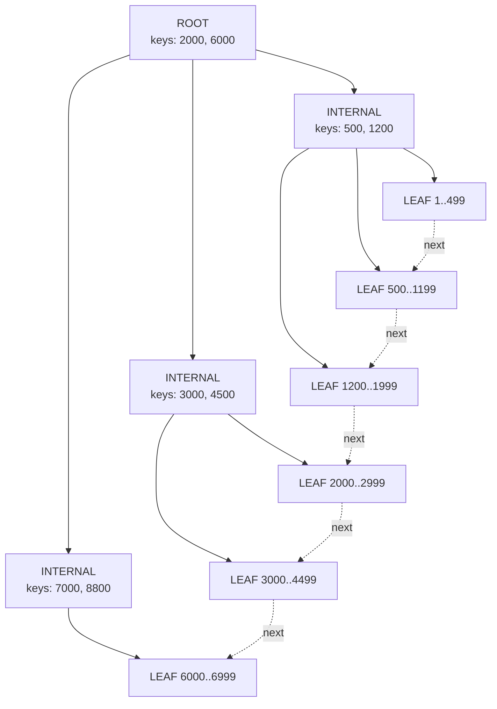
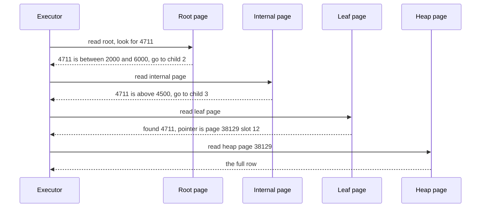

# How Indexes Work — Part 1

An index is the reason a query over five million rows can answer in one
millisecond. This part explains the data structure itself: what a B-tree looks
like, what one lookup actually does, and why the work barely grows as the table
grows.

Part 2 takes the same index and asks the planner's question: *should I use it?*

> **📌 In one line:** an index is a sorted, tree-shaped copy of one column (or
> expression) plus a pointer to each row, and searching it costs three or four
> page reads whether the table has ten thousand rows or a hundred million.

## Table of Contents

1. [The Index at the Back of a Book](#the-index-at-the-back-of-a-book)
2. [Without an Index: the Sequential Scan](#without-an-index-the-sequential-scan)
3. [What a B-tree Actually Looks Like](#what-a-b-tree-actually-looks-like)
4. [One Lookup, Step by Step](#one-lookup-step-by-step)
5. [Logarithmic, Not Linear](#logarithmic-not-linear)
6. [What Is Inside One Index Entry](#what-is-inside-one-index-entry)
7. [Linked Leaves: Ranges and Sorting](#linked-leaves-ranges-and-sorting)
8. [BROKEN vs FIXED: the Range That Was Not a Range](#broken-vs-fixed-the-range-that-was-not-a-range)
9. [Common Mistakes](#common-mistakes)
10. [Questions to Test Yourself](#questions-to-test-yourself)
11. [Related](#related)

---

## The Index at the Back of a Book

You have a 900-page textbook. You want every page that mentions "deadlock".

You have two options.

**Option A — read every page.** Start at page 1. Read it. Is "deadlock" there?
Move to page 2. This always works. It never misses anything. It takes hours.

**Option B — use the index at the back.** The index is a separate, much smaller
section. It is sorted alphabetically. You flip to `D`, run your finger down to
"deadlock", and read: *deadlock, 214, 216, 390*. Three page numbers. You turn
to those three pages and you are done. It takes seconds.

Notice four things about that book index, because all four are true of a
database index as well.

1. It is **a separate thing**. It is not the book. It takes extra paper.
2. It is **sorted**, which is the only reason you can find an entry without
   reading all of it.
3. It stores **a pointer** (a page number), not the content itself.
4. It **must be kept in step with the book**. If the publisher adds a chapter
   and every page number shifts, the index has to be rebuilt or it lies.

> **💡 Tip:** when an index decision confuses you later, come back to the book.
> "Would I bother building a paper index for a two-page leaflet?" answers most
> of the questions in [03-when-not-to-index-part-1.md](03-when-not-to-index-part-1.md).

---

## Without an Index: the Sequential Scan

A PostgreSQL table is stored as a **heap**: rows written into 8 kB blocks
called *pages*, in no particular order. A new row goes wherever there is room.
Nothing is sorted.

So when you ask a question about a column with no index, the database has one
honest answer: look at everything. That is a **sequential scan** — read page 1,
check every row on it, read page 2, and so on to the end.

```sql
-- tasks has 5,000,000 rows and no index on assignee_id
SELECT id, title, status
FROM tasks
WHERE assignee_id = 4711;
```

```text
Seq Scan on tasks  (cost=0.00..106250.00 rows=38 width=45)
                   (actual time=0.412..1184.903 rows=41 loops=1)
  Filter: (assignee_id = 4711)
  Rows Removed by Filter: 4999959
Planning Time: 0.094 ms
Execution Time: 1184.961 ms
```

Read the line `Rows Removed by Filter: 4999959`. The database looked at five
million rows to return 41. It threw away 99.999% of its work. That is what "no
index" costs.

```text
     the heap (unsorted pages)
┌──────┬──────┬──────┬──────┬─────┬──────┐
│ pg 1 │ pg 2 │ pg 3 │ pg 4 │ ... │62500 │
└──────┴──────┴──────┴──────┴─────┴──────┘
  ▲ read ─────────── every ────────── page ▲
```

At 62,500 pages of 8 kB, that scan moved about 488 MB through memory to find
41 rows. An index replaces "read everything" with "go straight there".

---

## What a B-tree Actually Looks Like

The default index in PostgreSQL (and MySQL) is a **B-tree**. The name means
"balanced tree": every leaf sits at the same depth, so no lookup is unlucky.

It has three kinds of node, and each node is one 8 kB page.

| Node kind | How many | What it holds | Job |
|---|---|---|---|
| Root | exactly 1 | a few hundred separator values | first decision |
| Internal | a few to a few thousand | separator values + child pointers | narrow the search |
| Leaf | most of the index | actual indexed values + row pointers | the answer lives here |

Only leaves point at real rows. Everything above them is signposts.



The dotted arrows matter as much as the solid ones. **Leaf pages are linked to
each other in sorted order**, in both directions. Once you have found the first
matching leaf, you can walk sideways without going back up the tree. That is
what makes `BETWEEN`, `>`, `<` and `ORDER BY` cheap.

The same tree as ASCII, which is sometimes easier to hold in your head:

```text
                        ┌──────────────────────┐
              ROOT      │   2000    │   6000   │
                        └───┬───────┬───────┬──┘
              ┌─────────────┘       │       └─────────────┐
              ▼                     ▼                     ▼
       ┌─────────────┐       ┌─────────────┐       ┌─────────────┐
 INTER │  500 │ 1200 │       │ 3000 │ 4500 │       │ 7000 │ 8800 │
       └──┬───┬────┬─┘       └──┬───┬────┬─┘       └──┬───┬────┬─┘
          ▼   ▼    ▼            ▼   ▼    ▼            ▼   ▼    ▼
       ┌────┐┌────┐┌────┐    ┌────┐┌────┐┌────┐    ┌────┐┌────┐┌────┐
 LEAF  │1..││500.││1200│ ←→ │2000││3000││4500│ ←→ │6000││7000││8800│
       └────┘└────┘└────┘    └────┘└────┘└────┘    └────┘└────┘└────┘
          └──── linked left-to-right in sorted order ────┘
```

> **📌 Remember:** the tree is only there to find the *first* leaf. After that,
> the index is just a sorted list you can walk.

---

## One Lookup, Step by Step

Take the query from earlier, now with an index:

```sql
CREATE INDEX idx_tasks_assignee ON tasks (assignee_id);

SELECT id, title, status
FROM tasks
WHERE assignee_id = 4711;
```

Here is what the database does. Five million rows, and it reads four pages.



Step by step in words:

1. **Read the root page.** It holds a handful of separator values. Binary
   search inside the page finds that 4711 falls between 2000 and 6000, so
   follow that child pointer. *(1 page read)*
2. **Read the internal page.** Same binary search, one level narrower: 4711 is
   above 4500. Follow that pointer. *(2 page reads)*
3. **Read the leaf page.** This page holds a few hundred sorted `assignee_id`
   values. Binary search finds 4711, and next to it the pointer to the row.
   *(3 page reads)*
4. **Read the heap page the pointer names** to get `title` and `status`, which
   the index does not store. *(4 page reads)*

Four 8 kB reads — 32 kB — instead of 488 MB. And the root and internal pages
are read by every single query, so in practice they are already in memory
(PostgreSQL's shared buffers). Realistically only the leaf and the heap page
touch the disk.

For the 41 matching rows, step 4 repeats per row, so the real cost is
*3 tree pages + up to 41 heap pages*. Still nothing next to 62,500.

---

## Logarithmic, Not Linear

This is the single most important intuition about indexes.

A sequential scan is **linear**: ten times more rows means ten times more work.
A B-tree lookup is **logarithmic**: ten times more rows adds, at most, one more
level to the tree.

Each internal page holds roughly 250–400 child pointers for an 8-byte key, so
every extra level multiplies the capacity by a few hundred.

| Rows in table | Approximate tree depth | Pages read per lookup | Rows a seq scan reads |
|---|---|---|---|
| 1,000 | 1 (root is a leaf) | 1 + heap | 1,000 |
| 100,000 | 2 | 2 + heap | 100,000 |
| 1,000,000 | 3 | 3 + heap | 1,000,000 |
| 5,000,000 | 3 | 3 + heap | 5,000,000 |
| 100,000,000 | 4 | 4 + heap | 100,000,000 |
| 1,000,000,000 | 5 | 5 + heap | 1,000,000,000 |

Read the last row carefully. The table grew a **million times**, and the index
lookup grew from 1 page read to 5. That is the deal an index offers you.

> **💡 Tip:** this is why "our table got big and everything slowed down" is
> almost never about indexed lookups. It is about the queries that were never
> using an index, which were fine at 10,000 rows and are not fine at 10 million.

---

## What Is Inside One Index Entry

A leaf entry is small and boring, which is the point:

```text
┌──────────────────────┬──────────────────────────┐
│  indexed value       │  pointer to the row      │
│  assignee_id = 4711  │  ctid = (38129, 12)      │
└──────────────────────┴──────────────────────────┘
        the key                 page 38129, slot 12
```

In PostgreSQL that pointer is the **ctid** (tuple identifier): the physical
page number and the slot inside that page. You can see it:

```sql
SELECT ctid, id, assignee_id
FROM tasks
WHERE assignee_id = 4711
LIMIT 3;
```

```text
    ctid    |   id   | assignee_id
------------+--------+-------------
 (38129,12) | 902334 |        4711
 (38130, 3) | 902871 |        4711
 (41002, 7) | 913455 |        4711
```

Two consequences follow from "the entry is value + physical pointer":

- **An index stores only its own columns.** Anything else in your `SELECT`
  requires a trip to the heap. That is the whole idea behind
  [covering indexes](../query-optimization/covering-indexes.md), covered in
  part 2.
- **When a row physically moves, index entries must be updated.** PostgreSQL's
  MVCC creates a new row version on every `UPDATE`, which is why an update can
  cost far more than one write. See
  [../transactions-and-concurrency/03-mvcc-part-1.md](../transactions-and-concurrency/03-mvcc-part-1.md)
  and the write-cost section in
  [03-when-not-to-index-part-1.md](03-when-not-to-index-part-1.md).

> **⚠️ Warning:** a `ctid` is not a stable row identity. It changes when the
> row is updated or the table is vacuumed and rewritten. Never store one in
> your application. Use the primary key.

---

## Linked Leaves: Ranges and Sorting

Because leaves are sorted and linked, a B-tree answers far more than
`column = value`.

```sql
-- descend once to '2026-03-01', then walk leaves sideways until '2026-04-01'
SELECT id, title, due_date
FROM tasks
WHERE due_date >= DATE '2026-03-01'
  AND due_date <  DATE '2026-04-01';
```


The operations a B-tree supports:

| Query shape | Works with a B-tree? | Why |
|---|---|---|
| `= value` | yes | descend to one leaf |
| `> < >= <= BETWEEN` | yes | descend once, then walk leaves |
| `IN (a, b, c)` | yes | one descent per value |
| `ORDER BY col` | yes | leaves are already in that order |
| `ORDER BY col DESC` | yes | the leaf chain is walked backwards |
| `MIN(col)` / `MAX(col)` | yes | the leftmost or rightmost leaf entry |
| `LIKE 'pre%'` | yes | a prefix is a range (see collation note in [02](02-expression-and-functional-indexes.md)) |
| `LIKE '%suf'` | **no** | no starting point to descend to |
| `<> value` | **no** | matches almost everything |
| `LOWER(col) = value` | **no** | the index stores the original value |

The last two rows are the bridge to the next file. Fixing them is what
[02-expression-and-functional-indexes.md](02-expression-and-functional-indexes.md)
is about.

> **📌 Remember:** "sorted and linked" explains everything a B-tree is good at.
> If a query cannot be expressed as *start here, walk this way*, a plain B-tree
> cannot help it.

---

## BROKEN vs FIXED: the Range That Was Not a Range

A very common way to accidentally turn a range scan back into a full scan.

```sql
-- ❌ BROKEN — the function hides the column, so the index on created_at is unusable
SELECT COUNT(*)
FROM invoices
WHERE DATE(issued_at) = DATE '2026-03-14';
```

```text
Seq Scan on invoices  (cost=0.00..54321.00 rows=10000 width=0)
                      (actual time=0.031..612.404 rows=1843 loops=1)
  Filter: (date(issued_at) = '2026-03-14'::date)
  Rows Removed by Filter: 1998157
Execution Time: 612.455 ms
```

The index stores `issued_at` values such as `2026-03-14 09:12:33+00`. The query
asks about `DATE(issued_at)`. Those are not the same values, so the sorted
order of the index tells the planner nothing.

```sql
-- ✅ FIXED — ask for a half-open range on the raw column, so the index can descend and walk
SELECT COUNT(*)
FROM invoices
WHERE issued_at >= TIMESTAMPTZ '2026-03-14 00:00+00'
  AND issued_at <  TIMESTAMPTZ '2026-03-15 00:00+00';
```

```text
Bitmap Heap Scan on invoices  (cost=42.18..3980.22 rows=1790 width=0)
                              (actual time=0.412..4.981 rows=1843 loops=1)
  Recheck Cond: ((issued_at >= ...) AND (issued_at < ...))
  ->  Bitmap Index Scan on idx_invoices_issued_at  (actual time=0.301..0.301 rows=1843 loops=1)
Execution Time: 5.032 ms
```

612 ms to 5 ms, same answer, no new index. Use `<` on the next day rather than
`BETWEEN`, so a timestamp at `23:59:59.7` is not missed.

If you genuinely cannot rewrite the query — for example the filter is generated
by an ORM — the other fix is to index the expression itself. That is file
[02](02-expression-and-functional-indexes.md).

---

## Common Mistakes

| Mistake | Why it is wrong | Do this instead |
|---|---|---|
| Thinking an index stores the whole row | It stores the key plus a pointer; other columns need a heap read | Add columns with `INCLUDE` if you want to avoid the heap — see [covering-indexes](../query-optimization/covering-indexes.md) |
| Thinking a big table means slow lookups | B-tree depth grows logarithmically; 1M to 1B adds two page reads | Check whether the slow query uses an index at all |
| Wrapping the indexed column in a function | The index holds the original values, not the transformed ones | Rewrite as a range, or create an expression index |
| Assuming rows are stored in primary-key order | A PostgreSQL heap is unordered; a new row goes wherever there is room | Sort explicitly with `ORDER BY`; never rely on insertion order |
| Storing `ctid` as a row identity | It changes on update and on vacuum | Store the primary key |
| Believing an index makes *everything* faster | It makes matching reads faster and every write slower | See [03-when-not-to-index-part-1.md](03-when-not-to-index-part-1.md) |

---

## Questions to Test Yourself

1. A table has 5,000,000 rows. Roughly how many pages does a B-tree lookup
   read, and why does that number barely change at 100,000,000 rows?
2. What exactly is stored in one leaf entry of a B-tree index?
3. Why are leaf pages linked to each other, and which query shapes depend on
   that link?
4. Explain in one sentence why `WHERE DATE(issued_at) = '2026-03-14'` cannot
   use an index on `issued_at`.
5. `Rows Removed by Filter: 4999959` appears in a plan. What does that tell you
   about the query, and what is the first thing you would check?
6. Why does an index on `assignee_id` still require reading heap pages when the
   query selects `title`?
7. Why is the root page of a busy index almost never read from disk?

---

## Related

- [Part 2](01-how-indexes-work-part-2.md) — the access methods a planner can
  choose, why a sequential scan is sometimes the right answer, index-only scans,
  and what an index costs.
- [02-expression-and-functional-indexes.md](02-expression-and-functional-indexes.md)
  — indexing the transformed value when the query cannot be rewritten.
- [../query-optimization/index-types-deep-dive.md](../query-optimization/index-types-deep-dive.md)
  — B-tree is the default, not the only choice: GIN, GiST, BRIN and hash.
- [../query-planner/reading-query-plans.md](../query-planner/reading-query-plans.md)
  — how to read the `EXPLAIN` output used throughout this file.
- [../fundamentals/01-what-is-a-relational-database.md](../fundamentals/01-what-is-a-relational-database.md)
  — pages, heaps and what a table physically is.
