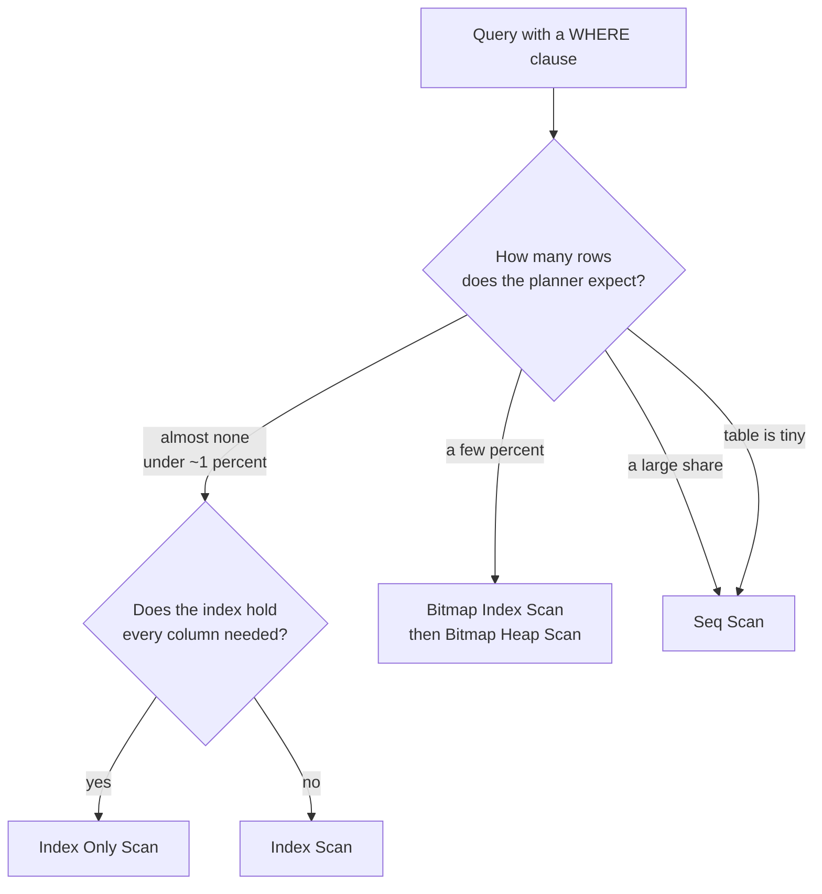
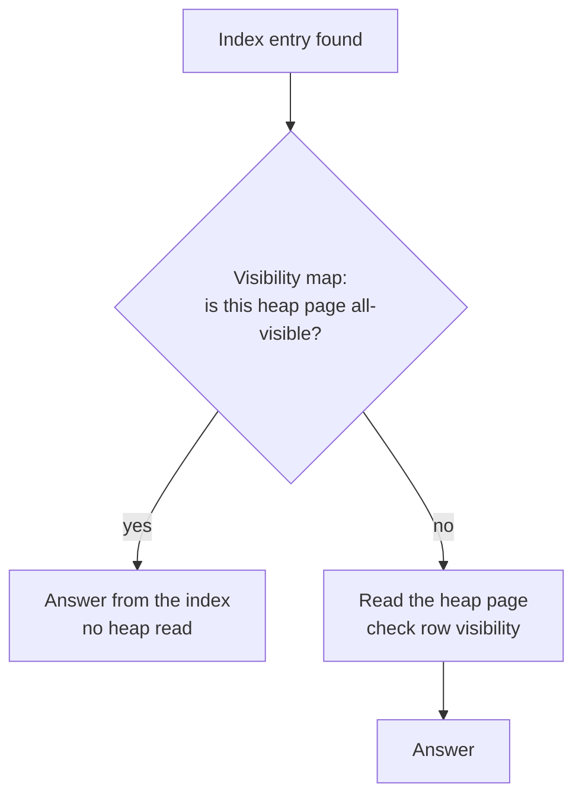
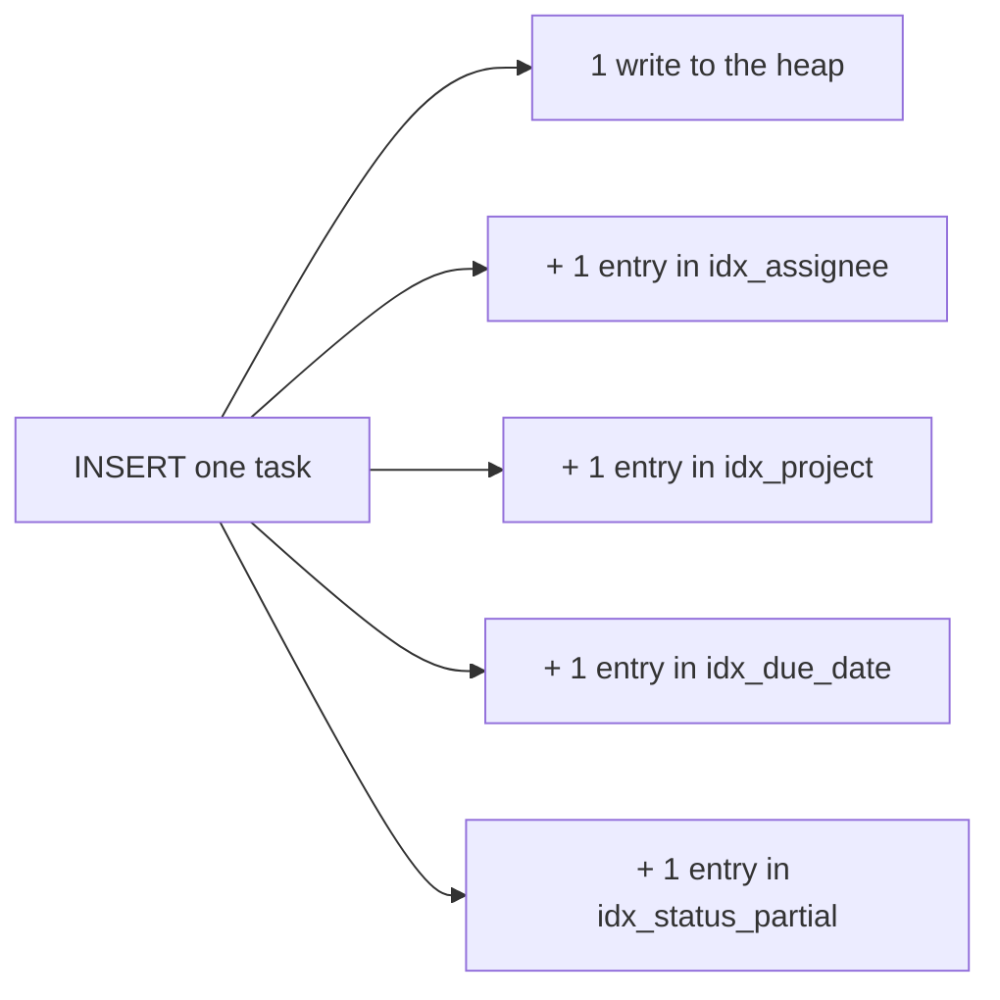

# How Indexes Work — Part 2

Part 1 built the index: a sorted, linked B-tree whose leaves point at rows.
This part is about the planner's decision. Having an index does not mean the
database will use it, and — the part almost everybody gets wrong — refusing to
use it is often the correct choice.

> **⬅️ This continues [Part 1](01-how-indexes-work-part-1.md).**

> **📌 In one line:** the planner picks between four ways of reading a table by
> estimating how many rows match, and an index only wins when the matching rows
> are a small fraction of the table.

## Table of Contents

1. [Four Ways to Read a Table](#four-ways-to-read-a-table)
2. [Why a Sequential Scan Is Sometimes Correct](#why-a-sequential-scan-is-sometimes-correct)
3. [The Bitmap Scan in the Middle](#the-bitmap-scan-in-the-middle)
4. [Seeing It Yourself: Before and After](#seeing-it-yourself-before-and-after)
5. [Index-Only Scans and the Visibility Map](#index-only-scans-and-the-visibility-map)
6. [BROKEN vs FIXED: the SELECT That Killed the Index-Only Scan](#broken-vs-fixed-the-select-that-killed-the-index-only-scan)
7. [What an Index Costs](#what-an-index-costs)
8. [Advanced: How the Planner Actually Decides](#advanced-how-the-planner-actually-decides)
9. [Common Mistakes](#common-mistakes)
10. [Questions to Test Yourself](#questions-to-test-yourself)
11. [Related](#related)

---

## Four Ways to Read a Table

When PostgreSQL needs rows from `tasks`, it chooses one of four **access
methods**. You will see all four in real plans.

| Access method | What it does | Wins when | Heap reads |
|---|---|---|---|
| **Seq Scan** | reads every page of the table in physical order | many rows match, or the table is small | all pages, sequential |
| **Index Scan** | walks the B-tree, fetches each matching row from the heap | few rows match, and you need columns the index lacks | one random read per row |
| **Index Only Scan** | walks the B-tree and answers from the index alone | few rows match **and** the index has every column used | usually none |
| **Bitmap Index Scan** | collects all matching pointers, sorts them by page, then reads each page once | a middling number of rows match, or several indexes combine | each page once, in page order |



The percentages are not hard rules — they come out of the cost model described
at the end of this file — but the shape of the decision is always this.

---

## Why a Sequential Scan Is Sometimes Correct

This is the most misunderstood point about indexes, so it gets its own section.

A sequential scan reads pages **in order**. Storage, the operating system and
PostgreSQL all like that: the disk reads ahead, and the pages arrive in a
stream. An index scan reads pages **in random order** — one page here, one page
far away — and each of those is a separate request.

PostgreSQL's cost model says a random page read is about **four times** more
expensive than a sequential one (`random_page_cost = 4.0` by default,
`seq_page_cost = 1.0`).

Now do the arithmetic on `tasks`: 5,000,000 rows in 62,500 pages, about 80 rows
per page.

| Rows matching | Heap pages an index scan touches | Cost of index scan | Cost of seq scan | Winner |
|---|---|---|---|---|
| 40 | ~40 (random) | ~160 + tree | 62,500 | index |
| 5,000 | ~4,900 (random) | ~19,600 | 62,500 | index |
| 250,000 (5%) | ~40,000 (random) | ~160,000 | 62,500 | **sequential** |
| 2,500,000 (50%) | ~62,000 (random) | ~248,000 | 62,500 | **sequential** |

Once the matching rows are spread across most pages, the index scan reads
almost the whole table anyway — but expensively, one random page at a time, and
it pays for the tree walk on top. Reading everything in order is simply faster.

```text
  index scan on 50% of rows           seq scan
  ┌──┐   ┌──┐ ┌──┐   ┌──┐            ┌──┬──┬──┬──┬──┬──┬──┐
  │pg│ ? │pg│ │pg│ ? │pg│   random   │pg│pg│pg│pg│pg│pg│pg│  streamed
  └──┘   └──┘ └──┘   └──┘   jumps    └──┴──┴──┴──┴──┴──┴──┘  in order
   + walk the B-tree for every row     + nothing else
```

Two more cases where a sequential scan is right:

- **Small tables.** `companies` has 8,000 rows in ~90 pages. The whole table
  fits in memory and is read in a few milliseconds. Descending a tree to save
  90 page reads is not worth the bookkeeping.
- **Queries that need most of the table anyway**, such as a monthly report or
  an export. There is nothing to skip.

> **⚠️ Warning:** do not "fix" a plan by setting `enable_seqscan = off` in
> production. That switch exists for experiments. If it makes a query faster,
> the real problem is usually wrong statistics or a wrong
> `random_page_cost` for SSD storage — see
> [../query-planner/cardinality-estimation-and-statistics.md](../query-planner/cardinality-estimation-and-statistics.md).

> **📌 Remember:** "the planner ignored my index" is usually the planner being
> right. Check how many rows actually match before you assume a bug.

---

## The Bitmap Scan in the Middle

Between "a handful of rows" and "half the table" sits the bitmap scan, and it
is the planner's clever compromise.

It runs in two phases:

1. **Bitmap Index Scan** — walk the index and collect *all* matching row
   pointers into a bitmap in memory. Do not read any table data yet.
2. **Bitmap Heap Scan** — sort that bitmap by page number, then read each page
   **once**, in physical order.

So 5,000 matching rows that happen to live on 900 pages cost 900 page reads
instead of 5,000 random ones, and those reads are mostly sequential.

```sql
SELECT id, title
FROM tasks
WHERE status = 'in_progress'
  AND project_id = 8821;
```

```text
Bitmap Heap Scan on tasks  (cost=98.44..8210.55 rows=2140 width=41)
                           (actual time=1.902..12.441 rows=2088 loops=1)
  Recheck Cond: (project_id = 8821)
  Filter: (status = 'in_progress')
  Heap Blocks: exact=871
  ->  Bitmap Index Scan on idx_tasks_project  (actual time=1.702..1.702 rows=3944 loops=1)
        Index Cond: (project_id = 8821)
```

Two things to read there:

- `Heap Blocks: exact=871` — 871 pages read, not 3,944 rows fetched randomly.
- A bitmap scan can **combine two indexes** with `BitmapAnd` or `BitmapOr`. If
  you see that, a single composite index usually beats the combination — see
  [../query-optimization/composite-index-ordering.md](../query-optimization/composite-index-ordering.md).

If the bitmap grows too large for `work_mem`, PostgreSQL switches from exact
pointers to marking whole pages (`Heap Blocks: lossy=...`) and rechecks the
condition on each row it reads. That is why `Recheck Cond` exists.

---

## Seeing It Yourself: Before and After

The reliable way to learn this is to run it. `EXPLAIN ANALYZE` executes the
query and reports what really happened.

**Before the index:**

```sql
EXPLAIN ANALYZE
SELECT id, title, due_date
FROM tasks
WHERE assignee_id = 4711
  AND status = 'todo';
```

```text
Seq Scan on tasks  (cost=0.00..118750.00 rows=8 width=49)
                   (actual time=2.104..1197.552 rows=11 loops=1)
  Filter: ((assignee_id = 4711) AND (status = 'todo'::text))
  Rows Removed by Filter: 4999989
Planning Time: 0.121 ms
Execution Time: 1197.601 ms
```

**Create the index:**

```sql
-- on a live table use CREATE INDEX CONCURRENTLY -- see 04-index-maintenance-and-bloat.md
CREATE INDEX idx_tasks_assignee_status ON tasks (assignee_id, status);
ANALYZE tasks;   -- refresh statistics so the planner trusts the new index
```

**After:**

```text
Index Scan using idx_tasks_assignee_status on tasks
      (cost=0.43..44.21 rows=9 width=49)
      (actual time=0.048..0.071 rows=11 loops=1)
  Index Cond: ((assignee_id = 4711) AND (status = 'todo'::text))
Planning Time: 0.204 ms
Execution Time: 0.098 ms
```

What changed, line by line:

| Read this | Before | After |
|---|---|---|
| Node type | `Seq Scan` | `Index Scan using ...` |
| How rows were filtered | `Filter:` (after reading) | `Index Cond:` (before reading) |
| Wasted work | `Rows Removed by Filter: 4999989` | absent |
| Execution time | 1197 ms | 0.098 ms |

`Filter` versus `Index Cond` is the detail to memorise. **`Index Cond` means the
index did the work. `Filter` means rows were read and then thrown away.** A
plan that says `Index Scan` but still has a large `Filter` is only half using
the index.

Always use `EXPLAIN (ANALYZE, BUFFERS)` in practice — `BUFFERS` shows how many
pages were read and how many came from cache, which is where the real story is.
Full detail in
[../query-planner/reading-query-plans.md](../query-planner/reading-query-plans.md).

---

## Index-Only Scans and the Visibility Map

If the index already holds every column the query touches, the heap read can be
skipped entirely. That is an **Index Only Scan**.

```sql
CREATE INDEX idx_tasks_project_due ON tasks (project_id, due_date);

SELECT project_id, due_date
FROM tasks
WHERE project_id = 8821;
```

But there is a catch, and it is the thing people find confusing. An index entry
does not record **whether the row is still visible to your transaction**. Under
MVCC a row may be deleted, or updated into a new version, and the old index
entry can still be sitting there — see
[../transactions-and-concurrency/03-mvcc-part-1.md](../transactions-and-concurrency/03-mvcc-part-1.md).

So how can the scan skip the heap? Through the **visibility map**: one tiny
file per table with two bits per page. One of them means *every row on this
page is visible to every transaction*. If a pointer lands on such a page, the
index entry can be trusted without reading it.



**`VACUUM` is what sets those bits.** So a table that has just taken a large
write burst has few all-visible pages, and the "index-only" scan quietly turns
into many heap fetches. The plan tells you:

```text
Index Only Scan using idx_tasks_project_due on tasks
      (actual time=0.031..3.884 rows=3944 loops=1)
  Index Cond: (project_id = 8821)
  Heap Fetches: 3901        <-- bad: nearly every row needed the heap anyway
```

```text
  Heap Fetches: 0           <-- good: after a vacuum, fully index-only
```

If `Heap Fetches` is high on a table you expect to be quiet, run `VACUUM
tasks;` and look again, and consider a more aggressive autovacuum setting for
that table. Details in
[../operations/02-vacuum-and-autovacuum-part-1.md](../operations/02-vacuum-and-autovacuum-part-1.md).

For how to *design* an index that enables this — including `INCLUDE` columns
that ride along without being part of the key — read
[../query-optimization/covering-indexes.md](../query-optimization/covering-indexes.md).

---

## BROKEN vs FIXED: the SELECT That Killed the Index-Only Scan

```sql
-- ❌ BROKEN — SELECT * drags in columns the index does not hold, so every row needs a heap read
SELECT *
FROM tasks
WHERE project_id = 8821
ORDER BY due_date
LIMIT 50;
```

```text
Index Scan using idx_tasks_project_due on tasks
      (actual time=0.062..18.402 rows=50 loops=1)
  Index Cond: (project_id = 8821)
  Buffers: shared hit=54 read=47
```

```sql
-- ✅ FIXED — ask only for columns the index covers, and the heap is never touched
SELECT project_id, due_date
FROM tasks
WHERE project_id = 8821
ORDER BY due_date
LIMIT 50;
```

```text
Index Only Scan using idx_tasks_project_due on tasks
      (actual time=0.028..0.104 rows=50 loops=1)
  Index Cond: (project_id = 8821)
  Heap Fetches: 0
  Buffers: shared hit=6
```

101 buffer accesses down to 6. Nothing about the index changed — only what the
query asked for. This is the concrete reason behind
[../query-patterns/select-star-anti-pattern.md](../query-patterns/select-star-anti-pattern.md).

If you genuinely need `title` too, add it as a payload column rather than a key
column: `CREATE INDEX ... ON tasks (project_id, due_date) INCLUDE (title);`

---

## What an Index Costs

An index is not free storage of extra speed. Frame every index decision like
this:

> **📌 Remember:** an index makes matching reads faster and **every write
> slower**, forever.



Four things you pay:

| Cost | What happens |
|---|---|
| Write amplification | every `INSERT` writes one entry per index; a `DELETE` and an `UPDATE` create work in each index whose column changed |
| WAL volume | index changes are written to the write-ahead log too, so replication and backups grow |
| Disk | a B-tree on a `bigint` column over 5,000,000 rows is roughly 107 MB; six such indexes outweigh a slim table |
| Memory | indexes compete with table data for shared buffers; a rarely used index that is still being maintained pushes hot data out of cache |
| Maintenance | vacuum must clean every index; restores and `REINDEX` must rebuild them |

A rough shape to carry in your head, measured on a table with five million
rows:

```text
INSERT with 0 indexes  ████                     ~ 21,000 rows/sec
INSERT with 3 indexes  ████████                 ~ 11,500 rows/sec
INSERT with 6 indexes  ████████████████          ~ 6,800 rows/sec
```

The numbers depend on hardware, but the direction never does. The full argument,
including HOT updates and how to find indexes nobody uses, is
[03-when-not-to-index-part-1.md](03-when-not-to-index-part-1.md).

---

## Advanced: How the Planner Actually Decides

The planner never "knows" how many rows match. It **estimates**, using
statistics collected by `ANALYZE` and stored in `pg_statistic`:

- the number of rows and pages in the table,
- the fraction of `NULL`s per column,
- the most common values and their frequencies,
- a histogram of the rest of the distribution,
- how physically sorted the table is relative to the index (**correlation**).

From those it computes **selectivity** — the fraction of rows a condition will
keep — turns that into a row count, and turns the row count into a cost for
each possible plan. The cheapest plan wins.

```sql
SELECT attname, n_distinct, correlation
FROM pg_stats
WHERE tablename = 'tasks'
  AND attname IN ('status', 'assignee_id', 'created_at');
```

```text
  attname   | n_distinct | correlation
------------+------------+-------------
 status     |          4 |       0.132
 assignee_id|      11840 |       0.004
 created_at |         -1 |       0.998
```

Read that table:

- `status` has 4 distinct values, so a single-value filter keeps roughly 25% of
  rows — far too many for an index scan to win.
- `assignee_id` has 11,840 distinct values, so one value keeps about 0.008% —
  perfect for an index.
- `created_at` has correlation 0.998: rows were inserted in time order, so the
  heap is nearly sorted by it. High correlation makes an index scan much
  cheaper, because "random" reads are not really random.

When the estimate is wrong, the plan is wrong. Stale statistics after a bulk
load are the classic cause, and the fix is to run `ANALYZE`. The full topic —
`default_statistics_target`, extended statistics for correlated columns, and
how to spot a bad estimate in a plan — is
[../query-planner/cardinality-estimation-and-statistics.md](../query-planner/cardinality-estimation-and-statistics.md).

### Other index types exist

Everything above described a B-tree, which suits values that can be sorted and
compared. Other data shapes need other structures: GIN for arrays, `jsonb` and
full-text search; GiST for geometry and ranges; BRIN for huge, naturally
ordered tables; hash for equality only. Each has its own cost profile and its
own limits, and they are compared in
[../query-optimization/index-types-deep-dive.md](../query-optimization/index-types-deep-dive.md).

---

## Common Mistakes

| Mistake | Why it is wrong | Do this instead |
|---|---|---|
| "The planner ignored my index — it is broken" | It costed the index scan and found it more expensive | Check the expected row count; a large fraction of the table means a seq scan is right |
| Setting `enable_seqscan = off` to force an index | Hides the real cause and breaks other queries on that connection | Fix statistics, or tune `random_page_cost` for SSDs |
| Testing performance on an empty or tiny dev table | A small table always gets a seq scan, so your index looks useless | Test with production-like row counts |
| Reading `Index Scan` and assuming the query is fine | A large `Filter` under an index scan still reads and discards rows | Move the filtering column into the `Index Cond` |
| Expecting an index-only scan and not checking `Heap Fetches` | Without vacuum the visibility map is empty, so the heap is read anyway | Check `Heap Fetches`, vacuum the table, tune autovacuum |
| Using `EXPLAIN` without `ANALYZE` to judge performance | `EXPLAIN` alone shows estimates, not reality | Use `EXPLAIN (ANALYZE, BUFFERS)` |
| Adding an index and measuring only the read | The write cost is invisible until the table is busy | Measure insert throughput before and after |

---

## Questions to Test Yourself

1. Name the four access methods and the situation where each one wins.
2. Explain to a colleague, without using the word "faster", why a sequential
   scan can beat an index scan on a query that matches 40% of rows.
3. What is the difference between `Index Cond` and `Filter` in a plan, and why
   does it matter?
4. What does a bitmap index scan do that a plain index scan does not, and what
   does `Heap Blocks: lossy=...` mean?
5. An `Index Only Scan` shows `Heap Fetches: 3901`. What is happening, and what
   would you do about it?
6. List four distinct costs you pay for every index you create.
7. `pg_stats` shows `n_distinct = 4` for a column. Would you index it for an
   equality filter? What would change your answer?
8. Why does a high `correlation` value make an index scan cheaper?

---

## Related

- [Part 1](01-how-indexes-work-part-1.md) — the B-tree structure, the lookup
  walkthrough, and what an index entry contains.
- [02-expression-and-functional-indexes.md](02-expression-and-functional-indexes.md)
  — when a query cannot use an index that clearly "should" match.
- [03-when-not-to-index-part-1.md](03-when-not-to-index-part-1.md) — the write
  cost measured properly, and the cases where an index does nothing.
- [../query-planner/reading-query-plans.md](../query-planner/reading-query-plans.md)
  — every plan node, and how to read costs and timings.
- [../query-planner/cardinality-estimation-and-statistics.md](../query-planner/cardinality-estimation-and-statistics.md)
  — where the row estimates come from and how they go wrong.
- [../query-optimization/covering-indexes.md](../query-optimization/covering-indexes.md)
  — designing for index-only scans with `INCLUDE`.
- [../operations/02-vacuum-and-autovacuum-part-2.md](../operations/02-vacuum-and-autovacuum-part-2.md)
  — the visibility map and who keeps it up to date.
