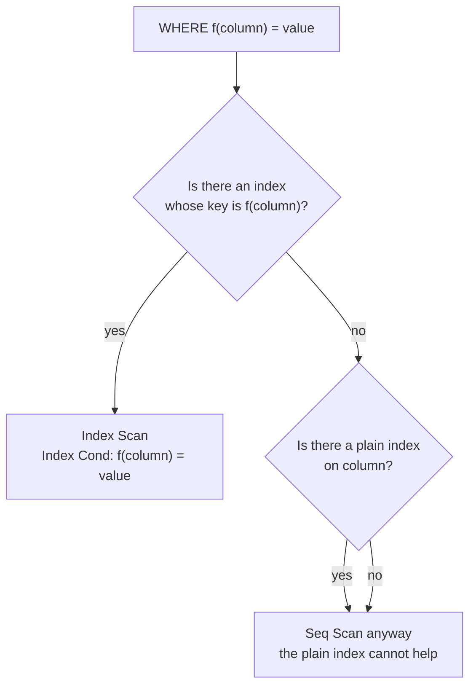
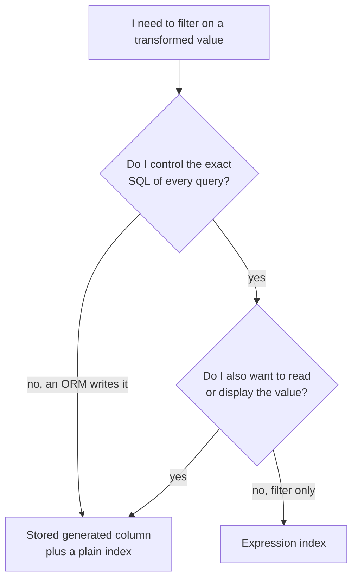

# Expression and Functional Indexes

You created an index on `users(email)`. Your login query filters on
`LOWER(email)`. The index is never used, and nobody can see why by looking at
the code. This file explains exactly why, and gives you the fix.

An **expression index** (also called a functional index) indexes the *result of
an expression* instead of a raw column.

> **📌 In one line:** an index stores the values you put into it, so a query can
> only use it when the query's expression is written the same way as the index's
> expression.

## Table of Contents

1. [The Index That Is Never Used](#the-index-that-is-never-used)
2. [The Rule](#the-rule)
3. [Creating an Expression Index](#creating-an-expression-index)
4. [The Function Must Be IMMUTABLE](#the-function-must-be-immutable)
5. [Case 1: Case-Insensitive Lookup and Uniqueness](#case-1-case-insensitive-lookup-and-uniqueness)
6. [Case 2: Date Truncation for Reporting](#case-2-date-truncation-for-reporting)
7. [Case 3: A JSONB Path](#case-3-a-jsonb-path)
8. [Case 4: Computed and Concatenated Values](#case-4-computed-and-concatenated-values)
9. [The Alternative: Generated Columns](#the-alternative-generated-columns)
10. [Other Ways an Index Is Silently Skipped](#other-ways-an-index-is-silently-skipped)
11. [Advanced: Partial Plus Expression, and the Maintenance Cost](#advanced-partial-plus-expression-and-the-maintenance-cost)
12. [Common Mistakes](#common-mistakes)
13. [Questions to Test Yourself](#questions-to-test-yourself)
14. [Related](#related)

---

## The Index That Is Never Used

Email addresses are case-insensitive in practice. `Anna@Acme.io` and
`anna@acme.io` are the same person. So the login query lowercases both sides:

```sql
CREATE INDEX idx_users_email ON users (email);

-- ❌ BROKEN — the index exists, and the plan below does not mention it
EXPLAIN ANALYZE
SELECT id, company_id, role FROM users WHERE LOWER(email) = 'anna@acme.io';
```

```text
Seq Scan on users  (cost=0.00..3412.00 rows=600 width=29)
                   (actual time=0.028..71.904 rows=1 loops=1)
  Filter: (lower(email) = 'anna@acme.io'::text)
  Rows Removed by Filter: 119999
Execution Time: 71.938 ms
```

120,000 rows read to find one. Why? Look at what is physically inside the
index:

```text
 idx_users_email leaf pages          the query asks for
┌───────────────────────────┐       ┌───────────────────────────┐
│ Anna@Acme.io   → (12, 4)  │       │ lower(email)              │
│ BEN@acme.io    → (14, 1)  │  ≠    │ = 'anna@acme.io'          │
│ carla@beta.dev → (91, 7)  │       └───────────────────────────┘
│ Dan@Acme.io    → (12, 9)  │
└───────────────────────────┘
   sorted by the ORIGINAL value
```

The index is sorted by `Anna@Acme.io`, not by `anna@acme.io`, and the
lowercased values are in a *different order*. The sorted structure that makes a
B-tree work therefore tells the planner nothing about `LOWER(email)`, so it must
read every row and compute `LOWER()` on each one.

```sql
-- ✅ FIXED — index the exact expression the query uses
CREATE INDEX idx_users_email_lower ON users (LOWER(email));
ANALYZE users;
```

```text
Index Scan using idx_users_email_lower on users
      (cost=0.42..8.44 rows=1 width=29)
      (actual time=0.034..0.036 rows=1 loops=1)
  Index Cond: (lower(email) = 'anna@acme.io'::text)
Execution Time: 0.061 ms
```

71.9 ms to 0.06 ms. The new index stores the *lowercased* strings, sorted, so
the descent works exactly as in
[01-how-indexes-work-part-1.md](01-how-indexes-work-part-1.md).

---

## The Rule

> **📌 Remember:** **the indexed expression must match the query's expression.**
> Any function or operation wrapped around an indexed column defeats a plain
> index on that column.



"Matching" is decided by comparing the parsed expression, not the text. So
extra whitespace or different capitalisation of `lower` is fine; a different
function, a different argument, or an extra cast is not.

| Index on | Query writes | Used? |
|---|---|---|
| `LOWER(email)` | `LOWER(email) = $1` | yes |
| `LOWER(email)` | `lower( email ) = $1` | yes — same parsed expression |
| `LOWER(email)` | `UPPER(email) = $1` | no |
| `LOWER(email)` | `email = $1` | no |
| `email` | `LOWER(email) = $1` | no |

The rule cuts both ways: an expression index does **not** serve queries on the
raw column. Many tables need both, and that is a real cost — see
[03-when-not-to-index-part-1.md](03-when-not-to-index-part-1.md).

---

## Creating an Expression Index

The syntax is an ordinary `CREATE INDEX` with an expression in parentheses:

```sql
-- a single function call needs one pair of parentheses
CREATE INDEX idx_users_email_lower ON users (LOWER(email));

-- anything more complex needs its own extra parentheses
CREATE INDEX idx_invoices_amount_eur ON invoices ((amount_cents / 100));
```

> **⚠️ Warning:** without the inner parentheses that second statement is a
> syntax error. When in doubt, add them.

Expression indexes work with every part of the index toolkit — they can be
composite, partial, unique, and can carry `INCLUDE` columns.

Always confirm with `EXPLAIN` that the planner picked it up. Creating the index
is not proof that the query uses it — the expression may still differ by a cast
you did not notice.

---

## The Function Must Be IMMUTABLE

PostgreSQL will refuse to index an expression whose result can change:

```sql
CREATE INDEX idx_tasks_overdue ON tasks ((due_date < NOW()));
```

```text
ERROR:  functions in index expression must be marked IMMUTABLE
```

The reason is simple when you think about what an index is: **a stored copy of
a computed value**. The value is computed once, when the row is written, and
then trusted forever.

`NOW()` changes every second. A task that was not overdue when it was inserted
becomes overdue at midnight — but nothing rewrites the index, so the stored
`false` is now a lie. The database would return wrong answers. So it refuses.

PostgreSQL labels every function with a **volatility** class:

| Class | Meaning | Indexable | Examples |
|---|---|---|---|
| `IMMUTABLE` | same input always gives the same output, forever | yes | `lower()`, `md5()`, `abs()`, `date_trunc(text, timestamp)` |
| `STABLE` | constant within one statement, may differ between statements | no | `now()`, `current_user`, anything reading a table, `timestamptz` to `date` casts |
| `VOLATILE` | may change on every call | no | `random()`, `nextval()`, `clock_timestamp()` |

The trap that catches everyone is timezones: `issued_at::date` is only
*stable*, because the calendar day depends on the session's `TimeZone` setting.
Pin the timezone to make it deterministic — `timezone('UTC', issued_at)::date`
— and write the query the same way. The next section does exactly that.

> **⚠️ Warning:** do not mark your own function `IMMUTABLE` just to make the
> error go away. If it is not truly immutable, the index will silently return
> wrong rows, and no error will ever tell you. That is a data-correctness bug,
> not a performance one.

---

## Case 1: Case-Insensitive Lookup and Uniqueness

The most common use, and it does two jobs at once.

```sql
-- fast lookup AND a guarantee that two users cannot share an email
-- differing only by case
CREATE UNIQUE INDEX idx_users_email_lower_uniq ON users (LOWER(email));
```

```sql
INSERT INTO users (company_id, email, name, role)
VALUES (12, 'Anna@Acme.io', 'Anna Roy', 'member');
-- ERROR:  duplicate key value violates unique constraint "idx_users_email_lower_uniq"
```

A plain `UNIQUE (email)` would have allowed that row, and you would have ended
up with two accounts for one person. A unique expression index is the correct
way to express "unique, ignoring case" — the wider topic of enforcing rules in
the database is
[../data-modeling/02-constraints-and-data-integrity-part-1.md](../data-modeling/02-constraints-and-data-integrity-part-1.md).

> **💡 Tip:** normalising on write is also valid. Use the expression index when
> you cannot change every writer, or must keep the original casing for display.

---

## Case 2: Date Truncation for Reporting

Every reporting screen groups by month. Without help, each one scans the table.

```sql
-- the query the dashboard runs
SELECT date_trunc('month', issued_at) AS month,
       SUM(amount_cents)
FROM invoices
WHERE company_id = 12
  AND date_trunc('month', issued_at) >= DATE '2026-01-01'
GROUP BY 1
ORDER BY 1;
```

```sql
CREATE INDEX idx_invoices_company_month
    ON invoices (company_id, (date_trunc('month', issued_at)));
```

Note `date_trunc(text, timestamp)` is immutable, but
`date_trunc(text, timestamptz)` is only stable, because the month boundary
depends on the session timezone. Pin it:

```sql
CREATE INDEX idx_invoices_company_month
    ON invoices (company_id, (date_trunc('month', timezone('UTC', issued_at))));
```

> **💡 Tip:** first check whether a plain range on `issued_at` answers the
> query (see the BROKEN/FIXED pair in
> [01-how-indexes-work-part-1.md](01-how-indexes-work-part-1.md)). One range
> index serves every time window. Reach for the truncation index when you also
> need to *group* by month over a large table.

---

## Case 3: A JSONB Path

Say `tasks` carries a `metadata jsonb` column (adding this column to the shared
schema for this example), and one key inside it is filtered constantly:

```sql
SELECT id, title
FROM tasks
WHERE metadata ->> 'source' = 'zapier';
```

You have two ways to index that, and they are not interchangeable.

```sql
-- A: a targeted expression index on one key
CREATE INDEX idx_tasks_meta_source ON tasks ((metadata ->> 'source'));

-- B: a general GIN index on the whole document
CREATE INDEX idx_tasks_meta_gin ON tasks USING GIN (metadata);
-- query form for B: WHERE metadata @> '{"source": "zapier"}'
```

| | A: expression index (B-tree) | B: GIN index |
|---|---|---|
| Indexes | one key you chose | every key and value |
| Size on 5M rows | ~90 MB | ~600 MB or more |
| Write cost | one entry per row | one entry per key, much heavier |
| Query operators | `=`, `<`, `>`, `BETWEEN`, `ORDER BY` | containment `@>`, existence `?` |
| Best for | a small, known set of hot keys | ad-hoc filtering across unknown keys |

Pick A when you know which keys matter, which is most of the time in an
application you control; pick B for a genuinely open document. GIN internals:
[../query-optimization/index-types-deep-dive.md](../query-optimization/index-types-deep-dive.md).

> **⚠️ Warning:** `->>` returns `text`. `WHERE (metadata ->> 'retries')::int > 3`
> does **not** match an index on `(metadata ->> 'retries')` — the cast changes
> the expression. Index `((metadata ->> 'retries')::int)` instead.

---

## Case 4: Computed and Concatenated Values

A user search box matches on the full name, which is not a column:

```sql
-- ❌ BROKEN — nothing to index against; full scan on every keystroke
SELECT id, email
FROM users
WHERE name || ' ' || COALESCE(last_name, '') ILIKE 'anna roy%';
```

```sql
-- ✅ FIXED — index the concatenation, lowercased, with a prefix-friendly
-- operator class
CREATE INDEX idx_users_fullname_lower
    ON users (LOWER(name || ' ' || COALESCE(last_name, '')) text_pattern_ops);

SELECT id, email
FROM users
WHERE LOWER(name || ' ' || COALESCE(last_name, '')) LIKE 'anna roy%';
```

Two details, both explained below: `text_pattern_ops` makes `LIKE 'prefix%'`
usable regardless of collation, and `LOWER(...) LIKE` replaces `ILIKE` so the
expression matches the index. (This example assumes a `last_name` column on
`users`; the shared schema has only `name`.) For real search — misspellings,
middle-of-string matches, ranking — use full-text search or `pg_trgm` instead:
[../query-optimization/index-types-deep-dive.md](../query-optimization/index-types-deep-dive.md).

---

## The Alternative: Generated Columns

Instead of indexing an expression, you can store the computed value in a real
column and index that normally:

```sql
ALTER TABLE users
    ADD COLUMN email_lower text
    GENERATED ALWAYS AS (LOWER(email)) STORED;

CREATE UNIQUE INDEX idx_users_email_lower_uniq ON users (email_lower);

-- and queries become plain and obvious
SELECT id FROM users WHERE email_lower = 'anna@acme.io';
```

PostgreSQL maintains the value, so it can never drift out of sync.

| | Expression index | Stored generated column + index |
|---|---|---|
| Table storage | nothing extra | the value is stored in every row |
| Index storage | same | same |
| Write cost | expression computed once per write | expression computed once per write, plus a wider row |
| Query must repeat the expression | **yes** — a mismatch silently loses the index | no — plain column comparison |
| Readable for other developers | the expression is hidden in a DDL file | visible in `\d users` |
| Works with `SELECT` of the value | must recompute | just select the column |
| Best for | filters, especially ones you cannot change in the query | values you also want to read, and teams who keep forgetting the expression |



> **💡 Tip:** if your ORM generates the `WHERE` clause and you cannot control
> its exact shape, a generated column is the safer choice — you query a normal
> column, and the ORM cannot get it wrong.

---

## Other Ways an Index Is Silently Skipped

The same underlying rule — *the query must ask in terms the index can compare* —
produces several other traps.

**Type mismatch.** A cast on the column side is a hidden function call:

```sql
-- external_ref is text; the parameter arrives as a number
SELECT * FROM invoices WHERE external_ref::bigint = 90012;   -- index unusable
SELECT * FROM invoices WHERE external_ref = '90012';         -- index used
```

A cast on the *value* side is fine, because the column stays untouched. A cast
on the *column* side is not. This is a frequent ORM bug: passing a JavaScript
number where the column is `text`, or a string where it is `bigint`.

**Leading wildcard.** `LIKE '%acme.io'` has no starting point, so the tree
cannot be descended. Either index the reversed string and query
`REVERSE(email) LIKE 'oi.emca%'`, or use a `pg_trgm` GIN index.

**Collation and `LIKE 'prefix%'`.** In a non-C collation, sort order is not
byte order, so a default B-tree cannot treat a prefix as a range. The fix is an
**operator class** that forces byte ordering:

```sql
-- ✅ makes LIKE 'anna%' usable on a database with a non-C collation
CREATE INDEX idx_users_email_prefix ON users (email text_pattern_ops);

SELECT id FROM users WHERE email LIKE 'anna%';
```

Use `varchar_pattern_ops` for `varchar`. Note the catch: an index with
`text_pattern_ops` serves `LIKE 'prefix%'` but **not** ordinary `=` comparisons
under the normal collation, so a table that needs both needs both indexes.

| Trap | Symptom | Fix |
|---|---|---|
| Function around the column | `Filter:` with the function in it | expression index, or rewrite the query |
| Cast on the column | `Filter: ((col)::bigint = ...)` | pass the right parameter type |
| `LIKE '%suffix'` | seq scan, always | `pg_trgm`, or index `REVERSE(col)` |
| `LIKE 'prefix%'` on a non-C collation or `ILIKE` | seq scan despite the index | `text_pattern_ops` index, and `LOWER(col) LIKE` |

---

## Advanced: Partial Plus Expression, and the Maintenance Cost

The two features combine, and together they make very small, very fast indexes:

```sql
-- only active users, only the lowercased email
CREATE UNIQUE INDEX idx_users_email_lower_active
    ON users (LOWER(email))
    WHERE deleted_at IS NULL;
```

This says "an email is unique among active users, but a deleted user may keep
its row". The index holds only live users, so it is smaller and touched less
often. Your query's `WHERE` clause must imply the index's one for the planner to
use it — the rules are in
[../query-optimization/partial-indexes.md](../query-optimization/partial-indexes.md).

**The maintenance cost.** The expression is evaluated on **every insert and
every update of the affected row** — not once, not on read. A cheap function
like `LOWER()` is invisible. Something expensive is not:

```sql
-- ⚠️ md5 over a large jsonb document, recomputed on every write
CREATE INDEX idx_tasks_meta_hash ON tasks ((md5(metadata::text)));
```

On a table taking thousands of writes a second, that is real CPU. Keep indexed
expressions cheap, or move them into a stored generated column where the cost is
at least visible in the table definition. Building and rebuilding is slower too:
`CREATE INDEX` on 5,000,000 rows means 5,000,000 function calls — see
[04-index-maintenance-and-bloat.md](04-index-maintenance-and-bloat.md).

> **📌 Remember:** an expression index does not make the expression free. It
> moves the cost from read time to write time — which is a good trade only when
> the table is read far more often than it is written.

---

## Common Mistakes

| Mistake | Why it is wrong | Do this instead |
|---|---|---|
| Creating the index but leaving the query on the raw column | The expressions do not match, so the index is dead weight | Confirm with `EXPLAIN` that `Index Cond` names the expression |
| Writing `UPPER()` in one query and `LOWER()` in another | Only one can use a given expression index | Standardise on one function everywhere |
| Marking a function `IMMUTABLE` to silence the error | Stale index entries return wrong rows, with no error | Make the expression genuinely deterministic, for example by pinning the timezone |
| `(metadata ->> 'retries')::int` against an index on `(metadata ->> 'retries')` | The cast changes the expression | Index the cast expression itself |
| Using `ILIKE` and expecting an index | `ILIKE` does not match a `LOWER()` index | `LOWER(col) LIKE lower_pattern`, plus a `text_pattern_ops` index for prefixes |
| Indexing an expensive expression on a write-heavy table | It runs on every insert and update | Keep it cheap, or store it in a generated column |
| Dropping the plain column index after adding the expression one | Queries on the raw column lose their index | Keep both if both query shapes exist |

---

## Questions to Test Yourself

1. In one sentence, why can an index on `email` not serve
   `WHERE LOWER(email) = $1`?
2. What does `IMMUTABLE` mean, and why does indexing require it? Give one
   example of a function that fails the test.
3. `CREATE INDEX ... ON invoices ((issued_at::date))` fails. What is the cause,
   and what is the fix?
4. When would you choose a targeted expression index on a `jsonb` key over a
   GIN index on the whole column, and when the reverse?
5. Compare an expression index with a stored generated column on four axes.
6. A query filters `external_ref::bigint = 90012` and does a seq scan. What is
   wrong and what is the cleanest fix?
7. Why does `LIKE 'anna%'` sometimes need a `text_pattern_ops` index, and when
   is an expression index the wrong trade even though reads get faster?

---

## Related

- [01-how-indexes-work-part-1.md](01-how-indexes-work-part-1.md) — why sorted
  order is the whole mechanism, which is why a transformed value breaks it.
- [01-how-indexes-work-part-2.md](01-how-indexes-work-part-2.md) — `Index Cond`
  versus `Filter`, the proof that your new index is being used.
- [04-index-maintenance-and-bloat.md](04-index-maintenance-and-bloat.md) —
  building one of these on a live table without blocking writes.
- [../query-optimization/partial-indexes.md](../query-optimization/partial-indexes.md)
  — the `WHERE` clause that combines with the expression.
- [../query-optimization/index-types-deep-dive.md](../query-optimization/index-types-deep-dive.md)
  — GIN, `pg_trgm` and full-text search, for the cases an expression index
  cannot cover.
- [../data-modeling/02-constraints-and-data-integrity-part-1.md](../data-modeling/02-constraints-and-data-integrity-part-1.md)
  — unique expression indexes as rules the database guarantees.
