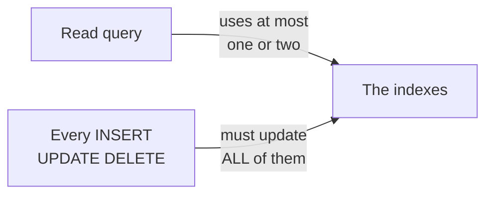
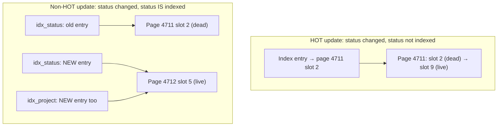

# When Not to Index — Part 1

Most teams do not have an index problem because they have too few indexes. They
have one because nobody ever removed the ones that were added "just in case".

This part is about the bill: what every index charges you on every write, the
optimisation an index quietly takes away, and the cases where an index does
nothing at all. Part 2 is about finding the ones you already have and should
not.

> **📌 In one line:** an index is a permanent tax on every insert, update and
> delete, paid forever, and you should be able to name the query that justifies
> it.

## Table of Contents

1. [The Belief Worth Breaking](#the-belief-worth-breaking)
2. [What a Write Really Costs](#what-a-write-really-costs)
3. [What an UPDATE Does to Every Index](#what-an-update-does-to-every-index)
4. [HOT Updates: the Optimisation an Index Removes](#hot-updates-the-optimisation-an-index-removes)
5. [Where an Index Buys Nothing](#where-an-index-buys-nothing)
6. [BROKEN vs FIXED: the Status Column Index](#broken-vs-fixed-the-status-column-index)
7. [Common Mistakes](#common-mistakes)
8. [Questions to Test Yourself](#questions-to-test-yourself)
9. [Related](#related)

---

## The Belief Worth Breaking

The belief goes like this: *indexes make queries faster, so more indexes means
a faster database.*

The first half is true for the queries an index actually serves. The second
half is false, for one reason: **the database has to keep every index correct.**
Nobody queries an index on every insert, but every insert writes to it.

Think about the book index from
[01-how-indexes-work-part-1.md](01-how-indexes-work-part-1.md). Adding one
index to a book costs the publisher some paper and some work. Adding twelve
indexes — by author, by year, by country, by chapter — means that changing a
single page now means correcting twelve lists. The book did not get easier to
maintain. It got twelve times harder.



That asymmetry is the whole file. Reads pick one index. Writes pay for all of
them.

---

## What a Write Really Costs

Here is the same 5,000,000-row `tasks` table, loaded from scratch with a
different number of indexes each time. Numbers depend on hardware; the shape
never changes.

| Indexes on the table | Insert throughput | Time to load 1M rows | Relative write cost |
|---|---|---|---|
| 0 (heap only) | ~21,000 rows/sec | 48 s | 1.0x |
| 1 (primary key) | ~16,500 rows/sec | 61 s | 1.3x |
| 3 | ~11,500 rows/sec | 87 s | 1.8x |
| 6 | ~6,800 rows/sec | 147 s | 3.1x |

What actually happens on one `INSERT` with six indexes:

```text
INSERT INTO tasks (...)
  │
  ├─ 1. find a heap page with room, write the row          ← the real work
  ├─ 2. idx_tasks_pkey          : descend tree, insert entry
  ├─ 3. idx_tasks_project       : descend tree, insert entry
  ├─ 4. idx_tasks_assignee      : descend tree, insert entry
  ├─ 5. idx_tasks_due_date      : descend tree, insert entry
  ├─ 6. idx_tasks_status        : descend tree, insert entry
  ├─ 7. idx_tasks_created_at    : descend tree, insert entry
  └─ 8. write all of the above to the WAL (write-ahead log)
```

Seven structures written instead of one, plus the write-ahead log entries for
all of them. The WAL growth is easy to forget and it is real: it flows to your
replicas and into every backup. See
[../../system-design/foundational/database-replication.md](../../system-design/foundational/database-replication.md).

Occasionally a tree insert also has to **split a page** — the leaf is full, so
it is divided in two and the parent is updated. That is several extra page
writes, and it can cascade upwards.

> **💡 Tip:** for a large bulk load, dropping the non-essential indexes,
> loading, and recreating them afterwards is often several times faster than
> loading with them in place. See
> [../query-patterns/bulk-write-performance.md](../query-patterns/bulk-write-performance.md).

---

## What an UPDATE Does to Every Index

In PostgreSQL an `UPDATE` does not edit a row in place. It writes a **new row
version** and marks the old one dead. That is MVCC (Multi-Version Concurrency
Control), explained in
[../transactions-and-concurrency/03-mvcc-part-1.md](../transactions-and-concurrency/03-mvcc-part-1.md).

A new row version lives at a new physical location, so every index that points
at rows now points at the wrong place — unless it is updated.

The rule to remember:

> **📌 Remember:** an `UPDATE` must add a new entry to every index **whose
> column changed**, and — unless the update is HOT, see the next section — to
> every index on the table at all.

`DELETE` is not free either. It does not remove index entries immediately; it
only marks the row dead. `VACUUM` removes the index entries later, which means
a delete-heavy table with many indexes gives vacuum a lot of work. That is
where bloat comes from —
[04-index-maintenance-and-bloat.md](04-index-maintenance-and-bloat.md).

---

## HOT Updates: the Optimisation an Index Removes

This section is the reason experienced engineers hesitate before indexing a
column that changes often.

**HOT** stands for *Heap-Only Tuple*. It is an optimisation with two
conditions:

1. **No indexed column changed** in this update, and
2. the new row version **fits on the same heap page** as the old one.

When both hold, PostgreSQL writes the new version on the same page and links it
from the old one. **No index is touched at all.** The existing index entries
still point at the old location, and the little chain on the page leads to the
current version.



Now the consequence. `tasks.status` changes many times in a task's life:
`todo → in_progress → in_review → done`. Compare the two worlds:

**Before — no index on `status`:**

```sql
UPDATE tasks SET status = 'in_progress' WHERE id = 902334;
```

```text
1 heap page write. 0 index writes. HOT.
```

**After — someone adds `CREATE INDEX idx_tasks_status ON tasks (status);`:**

```text
1 heap page write (possibly a new page)
+ 1 new entry in idx_tasks_status
+ 1 new entry in idx_tasks_project
+ 1 new entry in idx_tasks_assignee
+ 1 new entry in idx_tasks_due_date   ← none of these columns changed
+ 1 new entry in idx_tasks_created_at
```

Adding **one** index made the update write **five** index entries instead of
zero, because losing HOT means every index gets a new entry, not just the one
you added.

You can measure how much HOT you are getting:

```sql
SELECT relname,
       n_tup_upd,
       n_tup_hot_upd,
       ROUND(100.0 * n_tup_hot_upd / NULLIF(n_tup_upd, 0), 1) AS hot_pct
FROM pg_stat_user_tables
WHERE relname IN ('tasks', 'invoices', 'notifications');
```

```text
   relname     | n_tup_upd | n_tup_hot_upd | hot_pct
---------------+-----------+---------------+---------
 tasks         |  18402991 |       1204488 |     6.5     ← bad
 invoices      |   2044120 |       1902334 |    93.1     ← good
 notifications |  40118422 |      39220107 |    97.8     ← good
```

A low `hot_pct` on an update-heavy table is a strong signal: either an
indexed column is being updated constantly, or the pages have no free space —
which is what `fillfactor` is for, covered in
[04-index-maintenance-and-bloat.md](04-index-maintenance-and-bloat.md).

> **⚠️ Warning:** the columns most tempting to index — `status`, `last_seen_at`,
> `updated_at`, a counter — are often exactly the columns that change most
> often. Indexing them is the most expensive index decision you can make.

---

## Where an Index Buys Nothing

Five situations where an index is not the answer. In each one, the read does
not get faster and the write gets slower.

### 1. Small tables

`companies` has 8,000 rows in about 90 pages. The whole table is in memory. A
sequential scan reads it in a millisecond or two, and the planner will choose
that scan no matter what index you build.

The only reason to index a small table is a **constraint** — a primary key or a
unique key, where the index exists to enforce correctness rather than speed.

### 2. Low-cardinality columns

**Cardinality** means how many distinct values a column has. **Selectivity**
means what fraction of the table one value keeps. They are two views of the
same thing.

```sql
SELECT status, COUNT(*),
       ROUND(100.0 * COUNT(*) / SUM(COUNT(*)) OVER (), 1) AS pct
FROM tasks
GROUP BY status ORDER BY 2 DESC;
```

```text
   status    |  count  | pct
-------------+---------+------
 done        | 4100000 | 82.0
 todo        |  620000 | 12.4
 in_progress |  240000 |  4.8
 archived    |   40000 |  0.8
```

`WHERE status = 'done'` matches 82% of the table. As part 2 of
[01-how-indexes-work-part-2.md](01-how-indexes-work-part-2.md) showed, reading
82% of rows through an index costs far more than reading everything in order.
The index will be built, maintained, and never used.

A boolean column is the extreme case: two values, so each one is roughly half
the table.

**The exception, and it is an important one:** if one value is *rare*, a
**partial index** on that value is excellent. `archived` is 0.8% of rows:

```sql
CREATE INDEX idx_tasks_archived
    ON tasks (project_id)
    WHERE status = 'archived';
```

That index holds 40,000 entries instead of 5,000,000. The full rules are in
[../query-optimization/partial-indexes.md](../query-optimization/partial-indexes.md).

### 3. Columns never used in WHERE, JOIN or ORDER BY

An index only helps a query that searches, joins or sorts by that column. A
column you merely `SELECT` — `title`, `description`, an avatar URL — gains
nothing from its own index. (It can still be worth including as a *payload*
column in an index built for a different filter; see
[../query-optimization/covering-indexes.md](../query-optimization/covering-indexes.md).)

### 4. Write-heavy tables

`notifications` takes 40 million updates and tens of millions of inserts. Its
read pattern is narrow: "unread notifications for one user, newest first". One
carefully chosen partial index serves that. A second, third and fourth index —
by type, by `created_at`, by `read_at` — each slow down the write path that
dominates this table's life.

For append-only event and log tables, also consider **BRIN**, which is tiny and
suits naturally time-ordered data:
[../query-optimization/index-types-deep-dive.md](../query-optimization/index-types-deep-dive.md).

### 5. Queries that return most of the table anyway

A nightly export, a monthly report over a whole company, a migration that
rewrites every row. There is nothing to skip, so there is nothing for an index
to do.

| Situation | Why an index does not help | What to do instead |
|---|---|---|
| Table under ~1,000 rows | it is already in memory; seq scan wins | index only for constraints |
| Column with 2–5 values, evenly spread | most rows match | partial index on the rare value, or nothing |
| Column only ever selected, never filtered | an index is searched, not read | `INCLUDE` it in another index if needed |
| Very write-heavy table | every write pays, few reads benefit | one index for the one hot query; consider BRIN |
| Query returns most rows | no rows to skip | let it scan; batch it off-peak |

---

## BROKEN vs FIXED: the Status Column Index

A real pattern. The task board is slow, so someone indexes `status`.

```sql
-- ❌ BROKEN — indexes a low-cardinality, constantly updated column
CREATE INDEX idx_tasks_status ON tasks (status);

SELECT id, title FROM tasks
WHERE project_id = 8821 AND status = 'todo'
ORDER BY due_date LIMIT 50;
```

```text
Bitmap Heap Scan on tasks  (actual time=104.229..318.771 rows=50 loops=1)
  Recheck Cond: (status = 'todo'::text)
  Filter: (project_id = 8821)
  Rows Removed by Filter: 619412
  ->  Bitmap Index Scan on idx_tasks_status (actual time=61.004..61.004 rows=620000 rows)
```

The index found 620,000 rows, then 619,412 of them were thrown away by the
`project_id` filter. The index was used and still made nothing better — and
`tasks` lost HOT updates on every status change.

```sql
-- ✅ FIXED — index the selective column first, keep status out of the key
DROP INDEX idx_tasks_status;
CREATE INDEX idx_tasks_project_due ON tasks (project_id, due_date);
```

```text
Index Scan using idx_tasks_project_due on tasks
      (actual time=0.041..0.402 rows=50 loops=1)
  Index Cond: (project_id = 8821)
  Filter: (status = 'todo'::text)
```

`project_id` is selective — 3,944 rows for this project — and `due_date` in the
same index satisfies the `ORDER BY`, so the `LIMIT 50` stops early. Choosing
which column goes first is
[../query-optimization/composite-index-ordering.md](../query-optimization/composite-index-ordering.md).

---

## Common Mistakes

| Mistake | Why it is wrong | Do this instead |
|---|---|---|
| Indexing every foreign key and every column "to be safe" | Each one taxes every write forever | Index the ones a real query or a delete-cascade needs |
| Indexing `status`, `is_active` or a boolean | Most rows match, so the planner skips it | Partial index on the rare value, or nothing |
| Indexing a column that updates on every request | Loses HOT updates for the whole table | Leave it unindexed, or accept the cost knowingly |
| Adding an index on a dev database with 200 rows | A small table always gets a seq scan | Test with production-like row counts |
| Forgetting `DELETE` costs | Index entries are removed later by vacuum, not instantly | Watch vacuum load on delete-heavy tables |
| Loading millions of rows with all indexes in place | Every row pays every index | Drop, load, recreate |
| Judging an index by "the plan used it" | A used index that filters nothing still helped nothing | Check rows returned versus rows removed |

---

## Questions to Test Yourself

1. Why does adding an index slow down writes to columns that index does not
   even contain?
2. What are the two conditions for a HOT update, and what does the database
   save when they hold?
3. `hot_pct` on `tasks` is 6.5%. Name two possible causes and how you would
   tell them apart.
4. `status` has four values and the most common covers 82% of rows. Why will an
   index on it not be used, and what would you build instead?
5. Explain cardinality and selectivity in your own words, using `tasks.status`
   and `tasks.assignee_id`.
6. Why is an index on a small lookup table usually pointless — and what is the
   one good reason to have one anyway?
7. A plan shows `Bitmap Index Scan` returning 620,000 rows and
   `Rows Removed by Filter: 619412`. Was the index useful? What would you
   change?

---

## Related

- [Part 2](03-when-not-to-index-part-2.md) — finding redundant, duplicate and
  unused indexes in a live database, and retiring one safely.
- [01-how-indexes-work-part-2.md](01-how-indexes-work-part-2.md) — why a
  sequential scan beats an index scan when many rows match.
- [04-index-maintenance-and-bloat.md](04-index-maintenance-and-bloat.md) —
  `fillfactor`, bloat, and the vacuum work that indexes create.
- [../transactions-and-concurrency/03-mvcc-part-1.md](../transactions-and-concurrency/03-mvcc-part-1.md)
  — why an `UPDATE` writes a new row version in the first place.
- [../query-optimization/partial-indexes.md](../query-optimization/partial-indexes.md)
  — the right way to index a rare value in a low-cardinality column.
- [../query-patterns/bulk-write-performance.md](../query-patterns/bulk-write-performance.md)
  — loading data with the indexes dropped.
