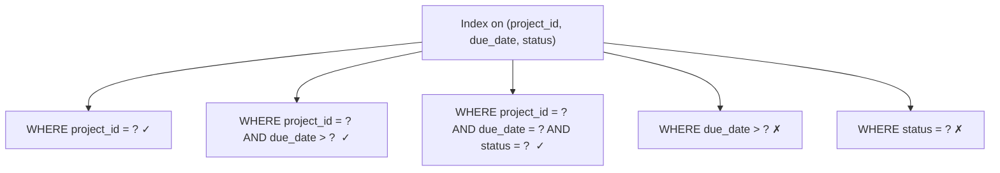
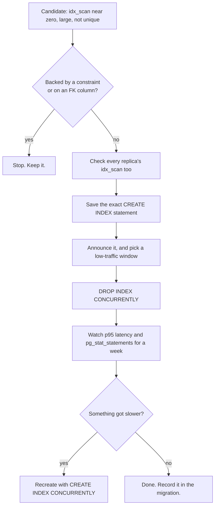

# When Not to Index — Part 2

Part 1 argued that every index is a permanent tax on writes. This part is the
practical half: how to find the indexes already sitting in your database that
nobody needs, and how to remove one without breaking production at two in the
morning.

> **⬅️ This continues [Part 1](03-when-not-to-index-part-1.md).**

Recap of part 1 in one paragraph: every `INSERT` writes an entry into every
index; an `UPDATE` that touches an indexed column loses the HOT optimisation
and writes into *all* of them; and an index on a small table, a low-cardinality
column, or a column nobody filters by, buys nothing in return. So an index that
serves no query is pure loss.

> **📌 In one line:** an index nobody queries still costs you on every write,
> every vacuum, every backup and every restore — find those indexes on purpose,
> because nothing will ever tell you about them.

## Table of Contents

1. [Redundant Indexes and the Leftmost-Prefix Rule](#redundant-indexes-and-the-leftmost-prefix-rule)
2. [Finding Duplicate and Redundant Indexes](#finding-duplicate-and-redundant-indexes)
3. [Finding Unused Indexes](#finding-unused-indexes)
4. [The Caveats That Matter](#the-caveats-that-matter)
5. [Retiring an Index Safely](#retiring-an-index-safely)
6. [BROKEN vs FIXED: the Drop That Froze the API](#broken-vs-fixed-the-drop-that-froze-the-api)
7. [The Cost of an Index You Forgot](#the-cost-of-an-index-you-forgot)
8. [Should I Add This Index? A Checklist](#should-i-add-this-index-a-checklist)
9. [Common Mistakes](#common-mistakes)
10. [Questions to Test Yourself](#questions-to-test-yourself)
11. [Related](#related)

---

## Redundant Indexes and the Leftmost-Prefix Rule

This is the most common waste in real systems, and it happens innocently: two
developers, two migrations, six months apart.

```sql
CREATE INDEX idx_tasks_project      ON tasks (project_id);
CREATE INDEX idx_tasks_project_due  ON tasks (project_id, due_date);
```

The first index is **redundant**. A composite index is sorted by its first
column, then the second within that. So its leading part is already a complete,
sorted index on `project_id` alone.

```text
 idx_tasks_project_due leaves, in order:
 (8821, 2026-03-01) (8821, 2026-03-04) (8821, 2026-04-02) (8822, 2026-01-11) ...
  └────────────────── all project_id = 8821 sit together ──────────────┘
         so "WHERE project_id = 8821" is answered by this index too
```

That is the **leftmost-prefix rule**: an index on `(a, b, c)` can serve queries
on `(a)`, on `(a, b)`, and on `(a, b, c)` — but not on `(b)` alone, and not on
`(b, c)`.



So `idx_tasks_project` can be dropped, and you lose nothing except a little
speed on that one query — the narrower index is slightly smaller, so slightly
cheaper to scan. That is almost never worth a second full index on 5,000,000
rows.

Choosing the column order that makes one index serve the most queries is
[../query-optimization/composite-index-ordering.md](../query-optimization/composite-index-ordering.md).

> **⚠️ Warning:** the rule is about the **key** columns only. An index on
> `(project_id) INCLUDE (title)` is *not* a prefix of `(project_id, due_date)`,
> and dropping it may cost you an index-only scan. Check what the plans use
> before assuming.

---

## Finding Duplicate and Redundant Indexes

Two different problems, two queries.

**Exact duplicates** — same table, same columns, same order, different name.
They happen when a migration creates an index that a `UNIQUE` constraint had
already created.

```sql
SELECT indrelid::regclass AS table_name,
       array_agg(indexrelid::regclass) AS duplicate_indexes,
       pg_size_pretty(SUM(pg_relation_size(indexrelid))) AS wasted
FROM pg_index
GROUP BY indrelid,
         indkey::text, indclass::text, indexprs::text, indpred::text, indisunique
HAVING COUNT(*) > 1;
```

```text
 table_name |                duplicate_indexes                 | wasted
------------+--------------------------------------------------+--------
 users      | {users_email_key,idx_users_email}                | 18 MB
 tasks      | {idx_tasks_assignee,idx_tasks_assignee_id_idx}   | 214 MB
```

**Redundant prefixes** — one index's key columns are the leading part of
another's:

```sql
SELECT a.indexrelid::regclass  AS redundant_index,
       b.indexrelid::regclass  AS covered_by,
       pg_size_pretty(pg_relation_size(a.indexrelid)) AS reclaimable
FROM pg_index a
JOIN pg_index b
  ON a.indrelid = b.indrelid
 AND a.indexrelid <> b.indexrelid
 AND b.indkey::text LIKE a.indkey::text || '%'   -- a's columns are b's prefix
WHERE a.indisunique = false        -- never propose dropping a unique index
  AND a.indisprimary = false
  AND a.indpred IS NULL            -- ignore partial indexes: they differ
  AND b.indpred IS NULL
ORDER BY pg_relation_size(a.indexrelid) DESC;
```

```text
 redundant_index      |      covered_by        | reclaimable
----------------------+------------------------+-------------
 idx_tasks_project    | idx_tasks_project_due  | 107 MB
 idx_invoices_company | idx_invoices_company_st|  41 MB
```

> **💡 Tip:** treat both queries as *candidate lists*, not instructions. They
> are string comparisons over catalog columns, and they do not understand
> operator classes, `INCLUDE` columns or partial predicates. Every candidate
> still goes through the retirement procedure below.

---

## Finding Unused Indexes

PostgreSQL counts how many times each index has been used. That counter is the
single most useful number in this file.

```sql
SELECT s.relname                                AS table_name,
       s.indexrelname                           AS index_name,
       s.idx_scan                               AS times_used,
       pg_size_pretty(pg_relation_size(s.indexrelid)) AS size,
       i.indisunique                            AS is_unique
FROM pg_stat_user_indexes s
JOIN pg_index i ON i.indexrelid = s.indexrelid
WHERE s.idx_scan < 50
  AND NOT i.indisprimary
ORDER BY pg_relation_size(s.indexrelid) DESC
LIMIT 20;
```

```text
 table_name    |       index_name        | times_used |  size  | is_unique
---------------+-------------------------+------------+--------+-----------
 tasks         | idx_tasks_created_at    |          0 | 107 MB | f
 notifications | idx_notifications_type  |          0 | 288 MB | f
 tasks         | idx_tasks_status        |          3 |  92 MB | f
 invoices      | idx_invoices_paid_at    |         12 |  38 MB | f
 users         | users_email_key         |          0 |  18 MB | t
```

Read `idx_notifications_type`: 288 MB, maintained on every one of 40 million
writes, and used zero times. That is the shape you are hunting.

Also check **when the counters were last reset**, or the numbers mean nothing:

```sql
SELECT stats_reset FROM pg_stat_database WHERE datname = current_database();
```

```text
          stats_reset
-------------------------------
 2026-02-03 04:11:52.104+00     ← six weeks of evidence: usable
```

---

## The Caveats That Matter

Do not drop anything from that list yet. Five reasons a zero can lie.

| Caveat | Why it matters | What to do |
|---|---|---|
| **Statistics reset** | `pg_stat_reset()`, a crash, or a `pg_upgrade` zeroes the counters | Check `stats_reset`; wait for a full business cycle, at least one month |
| **Replicas have their own counters** | A read replica may use an index the primary never touches — reporting and analytics usually run there | Run the query on **every** node, primary and replicas |
| **Constraint-backed indexes** | `idx_scan = 0` on a unique index is normal; it is checked on write, not scanned | Never drop an index where `indisunique` or `indisprimary` is true, without dropping the constraint deliberately |
| **Foreign key targets** | An index on the referencing column is used for cascading deletes and FK checks, sometimes without incrementing visible scan counts in an obvious way | Keep indexes on FK columns unless you have proved the parent is never deleted or updated |
| **Rare but critical queries** | The month-end close, the yearly export, the incident runbook query | Ask the team; check a month of `pg_stat_statements` |

> **⚠️ Warning:** the unique index row in the output above (`users_email_key`,
> 0 scans) is the classic trap. Dropping it does not slow anything down — it
> removes a **correctness guarantee**, and duplicate accounts start appearing
> weeks later. Constraints are not performance objects. See
> [../data-modeling/02-constraints-and-data-integrity-part-1.md](../data-modeling/02-constraints-and-data-integrity-part-1.md).

---

## Retiring an Index Safely

A procedure you can follow without fear.



**Step 1 — capture the definition before you lose it.** This is the rollback
plan:

```sql
SELECT indexdef FROM pg_indexes WHERE indexname = 'idx_notifications_type';
```

```text
CREATE INDEX idx_notifications_type ON public.notifications USING btree (type)
```

**Step 2 — drop without blocking.** `DROP INDEX` takes an `ACCESS EXCLUSIVE`
lock on the table, which blocks reads *and* writes for as long as it runs:

```sql
DROP INDEX CONCURRENTLY idx_notifications_type;
```

`CONCURRENTLY` waits for existing transactions instead of locking them out. It
cannot run inside a transaction block, which means it usually needs a migration
tool setting — see
[../../backend-fundamentals/10-database-integration/01-orm-vs-query-builder.md](../../backend-fundamentals/10-database-integration/01-orm-vs-query-builder.md).

**Step 3 — watch.** Keep the `CREATE INDEX` statement for a week. If p95 on an
endpoint climbs, recreate it with `CREATE INDEX CONCURRENTLY` and you are back
where you started in minutes.

> **💡 Tip:** MySQL 8 can make an index *invisible*
> (`ALTER TABLE tasks ALTER INDEX idx_tasks_status INVISIBLE`), so the planner
> ignores it while it is still maintained — a perfect dry run. PostgreSQL has no
> direct equivalent, so the save-the-DDL-and-recreate approach is the
> equivalent safety net.

---

## BROKEN vs FIXED: the Drop That Froze the API

A cleanup migration, run at 10:00 on a Tuesday.

```sql
-- ❌ BROKEN — takes ACCESS EXCLUSIVE on a 40M-row table, inside a transaction
BEGIN;
DROP INDEX idx_notifications_type;
COMMIT;
```

```text
-- meanwhile, from another session:
SELECT wait_event_type, wait_event, query
FROM pg_stat_activity WHERE state = 'active';

 wait_event_type |    wait_event     |                 query
-----------------+-------------------+---------------------------------------
 Lock            | relation          | SELECT * FROM notifications WHERE ...
 Lock            | relation          | INSERT INTO notifications ...
```

Every query on `notifications` queued behind the lock. The drop itself is fast,
but it must first wait for every in-flight transaction to finish — and one long
report query held it for four minutes, during which the API returned timeouts.

```sql
-- ✅ FIXED — no blocking lock, and not inside a transaction block
DROP INDEX CONCURRENTLY idx_notifications_type;
```

Two rules that follow:

- Never wrap `CONCURRENTLY` in `BEGIN ... COMMIT`; PostgreSQL rejects it.
- Set a `lock_timeout` on migrations so a blocked DDL statement fails fast
  instead of building a queue behind it. Locks and queues are
  [../transactions-and-concurrency/04-locks-part-1.md](../transactions-and-concurrency/04-locks-part-1.md).

---

## The Cost of an Index You Forgot

Beyond the write tax from part 1, an unused index keeps charging you in ways
that never appear on a slow-query dashboard.

| Where it costs you | What actually happens |
|---|---|
| **Disk** | 288 MB per replica, per backup, per environment. Ten forgotten indexes on a 50 GB database is not a rounding error. |
| **Cache memory** | Its pages compete for shared buffers with data you actually read. A cold index that is written to keeps evicting hot rows. |
| **Vacuum time** | Vacuum must scan every index to remove dead pointers. More indexes means longer vacuums and more chance of falling behind. |
| **Restore and failover time** | A restore rebuilds indexes. Indexes often dominate restore time, which is your recovery-time objective. |
| **Migrations** | Every `ALTER TABLE` that rewrites the table rebuilds every index on it. |
| **Human time** | Every future engineer reading the schema wonders what it was for. |

```sql
-- how much of this table is actually index?
SELECT pg_size_pretty(pg_table_size('notifications'))   AS heap,
       pg_size_pretty(pg_indexes_size('notifications')) AS indexes,
       ROUND(100.0 * pg_indexes_size('notifications')
                   / NULLIF(pg_table_size('notifications'), 0), 1) AS pct;
```

```text
  heap   | indexes |  pct
---------+---------+-------
 3204 MB | 2911 MB |  90.8
```

Indexes at 90% of the heap size on a write-heavy table is a finding, not a
statistic. Two or three of them are probably doing nothing.

---

## Should I Add This Index? A Checklist

Run through this before writing the migration. If you cannot answer the first
question, stop.

1. **Which exact query does this serve?** Paste it. If the answer is "reports
   in general", there is no index to design yet.
2. **What does `EXPLAIN (ANALYZE, BUFFERS)` say today?** You need a before
   number, or you cannot prove the after.
3. **How selective is the filter?** Under roughly 1–5% of rows, an index scan
   can win; above that, expect a sequential scan anyway.
4. **Can an existing index serve it?** Check the leftmost prefix of every index
   on the table first. Extending one index usually beats adding another.
5. **Does the query need an `ORDER BY` or a `LIMIT`?** Put the sort column in
   the index and the top-N query stops early.
6. **Is the column updated often?** If so, you are paying with HOT updates —
   see [part 1](03-when-not-to-index-part-1.md).
7. **Would a partial index be enough?** Filtering on a rare value makes the
   index a fraction of the size:
   [../query-optimization/partial-indexes.md](../query-optimization/partial-indexes.md).
8. **How will I create it in production?** `CREATE INDEX CONCURRENTLY`, in its
   own migration —
   [04-index-maintenance-and-bloat.md](04-index-maintenance-and-bloat.md).
9. **When will I check whether it is used?** Put a date in the calendar and
   look at `idx_scan`.

> **📌 Remember:** the strongest argument for a new index is a plan, a measured
> time, and a named query. "It might help" is how databases end up 90% index.

---

## Common Mistakes

| Mistake | Why it is wrong | Do this instead |
|---|---|---|
| Dropping every index with `idx_scan = 0` | Unique and primary-key indexes enforce correctness, not speed | Exclude `indisunique` and `indisprimary` |
| Checking `idx_scan` only on the primary | Reporting traffic on a replica uses different indexes | Check every node |
| Trusting counters after a restart or upgrade | Statistics reset to zero | Check `stats_reset` first |
| Plain `DROP INDEX` on a busy table | `ACCESS EXCLUSIVE` blocks reads and writes while it waits | `DROP INDEX CONCURRENTLY`, outside a transaction |
| Keeping `(a)` alongside `(a, b)` | The composite already serves `(a)` | Drop the narrower one, unless it has `INCLUDE` columns you rely on |
| Assuming `(a, b)` serves `WHERE b = ?` | Leftmost-prefix rule: `b` alone is not a prefix | Reorder, or add an index on `(b, ...)` |
| Dropping an index on a foreign key column | Cascading deletes and FK checks scan the child table | Keep FK indexes unless the parent is never deleted |
| Cleaning up ten indexes in one migration | If latency moves, you cannot tell which one caused it | One at a time, with a week between |

---

## Questions to Test Yourself

1. Why is `CREATE INDEX ON tasks (project_id)` redundant when
   `(project_id, due_date)` already exists — and what single exception makes it
   not redundant?
2. State the leftmost-prefix rule, and give one query it does *not* cover for
   an index on `(a, b, c)`.
3. You find a 288 MB index with `idx_scan = 0`. List four checks before you
   drop it.
4. Why is `idx_scan = 0` completely normal for a unique index?
5. What lock does plain `DROP INDEX` take, and what does `CONCURRENTLY` change?
6. Name four costs of an index that no query uses, other than slower writes.
7. Indexes total 90% of a table's heap size. What does that suggest, and what
   would you look at first?
8. A colleague proposes an index "for the reports". What three questions do you
   ask?

---

## Related

- [Part 1](03-when-not-to-index-part-1.md) — the write tax, HOT updates, and
  where an index buys nothing.
- [04-index-maintenance-and-bloat.md](04-index-maintenance-and-bloat.md) —
  `CREATE INDEX CONCURRENTLY`, bloat, and keeping what you decided to keep.
- [../query-optimization/composite-index-ordering.md](../query-optimization/composite-index-ordering.md)
  — the column order that lets one index replace three.
- [../query-optimization/covering-indexes.md](../query-optimization/covering-indexes.md)
  — why an `INCLUDE` index is not a plain prefix and may not be redundant.
- [../query-optimization/partial-indexes.md](../query-optimization/partial-indexes.md)
  — the smaller index that often replaces the one you were about to drop.
- [../transactions-and-concurrency/04-locks-part-1.md](../transactions-and-concurrency/04-locks-part-1.md)
  — what `ACCESS EXCLUSIVE` blocks and why a queue forms behind it.
- [../data-modeling/02-constraints-and-data-integrity-part-1.md](../data-modeling/02-constraints-and-data-integrity-part-1.md)
  — the indexes that exist for correctness and must never be dropped for speed.
